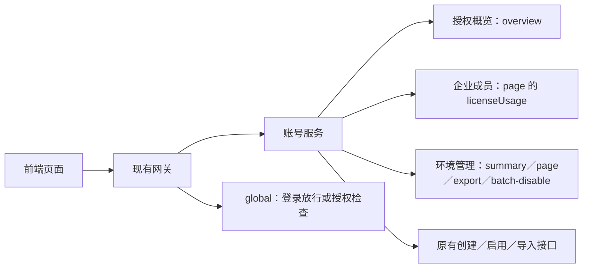
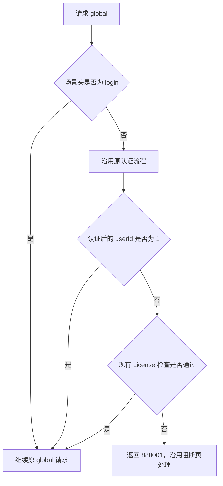

# 授权人数控制前端接口联调说明

> 状态：评审中
> 最后更新：2026-10-20
> 适用范围：DeepFOS 授权概览、企业成员、环境用户管理、用户创建／启用／导入及 global 请求
> 关联文档：[主题说明](../说明.md)、[功能与技术规范](功能与技术规范.md)

本文按当前后端实现整理，供前端对接。后端分支为 `codex/license-user-count`；部署地址、发布版本和浏览器联调结果待后续补充。文中的账号、企业和人数均为虚构示例。

## 1. 请求与人数约定

- 下文账号接口均加现有账号服务前缀，默认 `/system-account-api`，以项目配置为准。例如概览完整路径为 `/system-account-api/account/license/overview`。
- JSON 接口沿用现有登录态与请求封装；POST 使用 `application/json`，导入仍用原有表单（FormData）。前端不用增加 `user`、`userId` 或 `username` 请求头。
- 环境占用人数：已启用（`status=1`）、关联至少一个有效企业、且 `username` 不为 `admin` 的用户数。同一用户跨企业仅计一次。
- 企业占用人数：本企业已启用且非 `admin` 的成员数。各企业占用不能相加替代环境占用。
- 授权人数 `authorizedUsers`：正数为上限，`0` 显示“不限人数”；`null`／缺失显示 `-`，不能按不限处理。占用数为 `0` 时正常显示 `0`。
- 正数额度下，**占用大于额度**才超额，等于额度允许。列表搜索、筛选和分页不改变统计指标。

下图说明各页面使用哪些接口。



### 通用响应

普通 JSON 接口成功响应示例：

```json
{"status":true,"code":0,"message":null,"data":{"disabledCount":2}}
```

字段说明及后续示例均以 `data` 为对象。现有 `accountServer` 通常已经解包，页面直接使用其返回值，避免重复取 `.data`。导出成功返回文件流，见第 5 节。

## 2. 授权概览与企业成员列表

| 方法与路径 | 本次增加的字段 | 前端使用 |
| --- | --- | --- |
| `GET /account/license/overview` | `occupiedUsers: number` | 环境占用人数；原有 `authorizedUsers` 和其余字段保持不变 |
| `POST /api/user/page` | 分页对象顶层 `licenseUsage` | 企业成员页人数展示，原列表请求和分页字段保持不变 |

`licenseUsage` 示例，与 `list`、`total` 同级：

```json
{
  "list": [],
  "total": 0,
  "licenseUsage": {
    "authorizedUsers": 100,
    "occupiedUsers": 80,
    "scopeOccupiedUsers": 50
  }
}
```

`occupiedUsers` 是环境占用；`scopeOccupiedUsers` 是当前企业占用，不是当前筛选结果人数。仅 `/api/user/page` 本次补充此字段，不应假定所有成员或空间列表接口都有。

进入／切回概览时刷新概览；切换企业或成员变更成功后刷新成员列表及其人数。概览数据中的原有 `status` 是授权状态，不能与外层响应的布尔 `status` 混用。

## 3. 环境用户统计

以下四个环境用户管理接口仅超级管理员（`username=admin`）可调用，沿用现有登录态。

**`GET /account/license/environment-users/summary`**，无请求参数。`data` 示例：

```json
{
  "totalUsers": 120,
  "unassociatedUsers": 30,
  "occupiedUsers": 80,
  "authorizedUsers": 100,
  "enterpriseCount": 2,
  "enterprises": [
    {"id":"enterprise-demo-001","name":"示例企业一","memberCount":61,"occupiedUsers":50},
    {"id":"enterprise-demo-002","name":"示例企业二","memberCount":48,"occupiedUsers":40}
  ]
}
```

| 字段 | 类型 | 含义 |
| --- | --- | --- |
| `totalUsers` | number | 环境总用户数，包含管理员、禁用和无企业用户 |
| `unassociatedUsers` | number | 未关联有效企业的用户数，不限定启用状态 |
| `occupiedUsers` | number | 环境去重占用人数 |
| `authorizedUsers` | number / null | 授权人数，显示规则见第 1 节 |
| `enterpriseCount` | number | 企业数量 |
| `enterprises` | array | 全量企业统计；`id/name` 为企业标识／名称，`memberCount` 为成员数，`occupiedUsers` 为该企业占用人数 |

这些统计不受用户列表筛选条件影响。企业下拉和企业统计页签复用 `enterprises`，由前端搜索、排序和分页，没有单独新增企业统计分页接口。

## 4. 环境用户列表

**`POST /account/license/environment-users/page`**。所有请求字段可省略：

| 字段 | 类型 | 默认／约束 |
| --- | --- | --- |
| `pageNum` | integer | 默认 1，≥1 |
| `pageSize` | integer | 默认 20，1～100 |
| `keyword` | string | 最长 200 字符；匹配昵称、用户名或邮箱；去除首尾空白后为空不筛选，`%`／`_` 按普通字符匹配 |
| `status` | integer | 1 已启用、2 已禁用、3 已激活、4 未激活；省略表示全部 |
| `enterpriseId` | string | 指定企业 ID；不筛选时省略 |
| `occupiesQuota` | boolean | `true` 占用，`false` 不占用，省略不筛选；不要丢弃 false |
| `unassociated` | boolean | 仅 true 筛选无有效企业用户；false／省略不筛选；true 不能同时传非空 enterpriseId |
| `sortField` | string | 省略或 `createTime` |
| `sortOrder` | string | 省略或 `desc` |

请求示例：

```json
{"pageNum":1,"pageSize":20,"keyword":"示例","status":1,"occupiesQuota":true}
```

`data` 为原有分页结构，主要读取 `list`、`total`：

```json
{
  "pageNum": 1,
  "pageSize": 20,
  "pages": 1,
  "total": 1,
  "list": [{
    "id": "user-demo-001",
    "username": "demo-user",
    "nickname": "示例用户",
    "avatar": null,
    "color": null,
    "email": "demo@example.com",
    "phone": "13800000000",
    "status": 1,
    "createTime": "2026-10-20 10:00:00",
    "hasAdmin": false,
    "occupiesQuota": true,
    "enterprises": [{"id":"enterprise-demo-001","name":"示例企业一"}]
  }]
}
```

- 一名用户一行；按创建时间降序，再按 ID 降序，缺失创建时间排最后。`total` 是筛选后的用户数。
- `id` 为字符串；用户名、昵称、头像、颜色、邮箱、手机号和创建时间可空。手机号字段为 **`phone`**，时间格式为 `yyyy-MM-dd HH:mm:ss`（GMT+8）。
- `status` 未知时为 null；`hasAdmin` 表示是否管理员，用户名缺失时可为 null；`occupiesQuota` 是实际是否占用的布尔值。
- `enterprises` 读取 `id/name`，无关联为 `[]`；同一对象附带的空统计字段可忽略。
- 当前未返回 `nonOccupancyReasons`，页面不能依赖它展示不占用原因。

## 5. 导出与批量禁用

### 导出

**`POST /account/license/environment-users/export`**，请求沿用列表当前已生效的筛选条件，不传分页即可，导出全部匹配用户。

- 成功返回 Excel 二进制，不包 JSON：`Content-Type: application/vnd.openxmlformats-officedocument.spreadsheetml.sheet`。
- `Content-Disposition: attachment;filename=EXPORT_USER_yyyyMMddHHmmss.xlsx`。
- 列顺序：用户ID、用户名、昵称、手机号、邮箱、状态、关联企业、创建时间、名额占用。
- 状态为 1／2／3／4，未知为 `-`；企业名用中文逗号 `，` 分隔，无企业为空；名额占用显示“是”，不占用为空。
- 沿用现有 `getResponse: true`、`responseType: 'blob'` 下载方式，从响应头取文件名；返回 JSON 错误时展示 message，不能保存成 Excel。

### 批量禁用

**`POST /account/license/environment-users/batch-disable`**：

```json
{"userIds":["user-demo-001","user-demo-002"]}
```

`userIds` 必填，原数组长度 1～100，元素为非空用户 ID，后端去重。全部目标先校验：缺失账号、用户名缺失、管理员或未知状态混入，整次拒绝。已禁用用户跳过，重复提交允许成功且数量为 0。

成功 `data`：

```json
{"disabledCount":2}
```

禁用保留历史数据并沿用原有登录态清理。成功后清空选择，重新请求 `summary` 和 `page`。`disabledCount` 可能小于勾选数，不能用它直接推算释放名额数。

## 6. 创建、启用与导入

继续调用原接口，无需增加独立人数校验接口或修改原请求协议：

| 场景 | 原有接口 |
| --- | --- |
| 企业／空间创建用户 | `POST /api/user/create-user-detail`、`POST /api/user/space/create-user-detail` |
| 编辑用户／修改状态 | `POST /api/user/modify-user-detail`、`POST /api/user/update-status` |
| 受邀账号完善信息后启用 | `POST /oauth/reset` |
| 企业用户导入检查／提交 | `POST /api/user/import/check`、`POST /api/user/import` |
| 空间用户导入检查／提交 | `POST /api/user/import/space/check`、`POST /api/user/import/space` |

后端对本次涉及的新增占用操作在实际写入前检查。导入按整次解析结果判断，不能按 Excel 行数估算；`/check` 不预留名额，正式导入仍会重新检查，因此检查通过后正式提交仍可能因人数超额失败。

人数超额整次操作不执行，在当前操作页面展示后端 message，不跳转整页阻断页。并发操作可能短时超额，后续 global 按授权状态限制普通用户使用。

## 7. 登录 global 与授权阻断

浏览器默认 global 地址为 **`GET /deepfos-server/system-server/api/config/global`**，以现有前端服务前缀配置为准。

- **登录页初始化**：仅该请求携带 `X-License-Scene: login`，跳过 License 校验。不要把该头设为全局公共请求头。
- **登录后的 global、恢复探测**：不携带此场景头，正常检查 License。沿用现有凭据，后端认证过滤器负责传递身份，前端不要手工传 `user=1`。
- 网关管理员豁免按认证后的 `userId=1`；环境管理权限及人数统计仍按 `username=admin`。
- 本次 License 过滤器只检查 global。原型人数超额页重试沿用回跳逻辑，使用 global 的恢复探测不能带 `login`。

下图说明 global 的登录放行、管理员豁免及失败处理。



原认证失败沿用现有登录失效处理。网关缓存默认 60 秒，释放名额或更新授权后，恢复判断可能等待现有缓存刷新；没有新增强制刷新或探测接口。

## 8. 错误处理

| 场景 | 响应／处理 |
| --- | --- |
| 平台参数、权限、人数校验失败 | `status:false`，显示 `message`，留在当前操作页；本次新增校验默认业务码为 42，沿用通用业务失败处理 |
| global 被 License 阻断 | HTTP 200，业务码 `888001`，沿用现有全局阻断处理 |
| 登录失效 | 沿用现有 401 处理 |

平台失败示例：

```json
{"status":false,"code":42,"message":"当前账号无权查看或管理环境用户，仅超级管理员可执行此操作。"}
```

环境管理权限失败使用普通业务校验响应，前端无需为本次新增 HTTP 403 分支。原接口可能有其他业务码，不要把全部业务失败限定为 42。

人数超额提交失败的 message 示例：

> 操作失败：本次操作后环境占用人数将超过授权用户数。授权用户数 100 人，当前已占用 98 人，本次操作后预计占用 108 人，超出 8 人。本次操作未执行，请调整本次操作、释放名额或增加授权用户数后重试。

global 人数超额的 message：

> 当前环境授权人数已超额，暂时无法使用平台。请联系系统管理员处理。

常见环境管理校验文案包括“分页参数不合法”“用户状态不合法”“未关联企业与指定企业不能同时筛选”“搜索内容不能超过200个字符”“不支持的用户排序方式”“请选择1至100个有效用户”“所选用户无法禁用，请刷新后重试”。授权信息异常提示“授权信息无效，无法校验授权人数，请联系系统管理员处理。”；重复导入提示“同一用户存在重复导入记录，请合并后重试。”。统一展示后端 message，不依赖解析文案计算人数。

## 9. 联调清单

- [ ] 关闭原型预览参数 `environmentUsersPreview=1`，使用真实接口验证列表和导出。
- [ ] 登录页 global 携带场景头；登录后与恢复探测不携带；普通用户超额触发 888001，管理员可进入调整。
- [ ] 概览、企业成员、环境统计人数口径一致；同用户跨企业不重复计入环境人数；额度 0、未知、刚好满额展示正确。
- [ ] 列表覆盖 `occupiesQuota=false`、无企业、企业筛选互斥、空结果、状态与分页；企业统计不随筛选变化。
- [ ] 导出与当前筛选一致且包含全部页；错误响应展示 message；批量禁用覆盖管理员、已禁用及无效账号，成功后刷新统计与列表。
- [ ] 当前 98／100 时新增 2 人成功；新增 10 人或整批导入预计 108 人时失败，当前页展示明细且无部分导入；正式导入仍重新检查。
- [ ] 释放名额后刷新概览／成员／环境管理；按现有缓存刷新节奏验证普通用户恢复。

联调前待补充：实际访问地址、部署版本、测试账号和授权额度。当前文档记录源码合同，上述浏览器联调项目尚未验收。

## 10. 实现依据

供后续核对接口变更；前端接入以正文为准。

- 平台仓库 `deepfos-platform/seepln-account/seepln-account-rest/src/main/java/com/seepln/account/rest/license/`：`EnvironmentUserController`、`LicenseController`。
- 同仓 `seepln-account/seepln-account-core/src/main/java/com/seepln/account/core/license/`：`dto/EnvironmentUserQuery`、`vo/EnvironmentUserVO`、`vo/EnvironmentUserSummaryVO`、`vo/MemberLicenseUsageVO`、`service/impl/EnvironmentUserServiceImpl`。
- 网关仓库 `web-gateway/src/main/java/com/proinnova/gateway/server/filter/LicenseGatewayFilter.java`。
- 前端原型仓库 `front-end-development-group/src/modules/account/services/`：`common.ts`、`environmentUsers.ts`、`memberList.ts`、`license.ts`（只读参考）。
