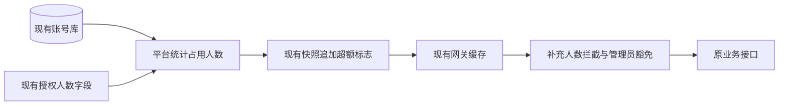
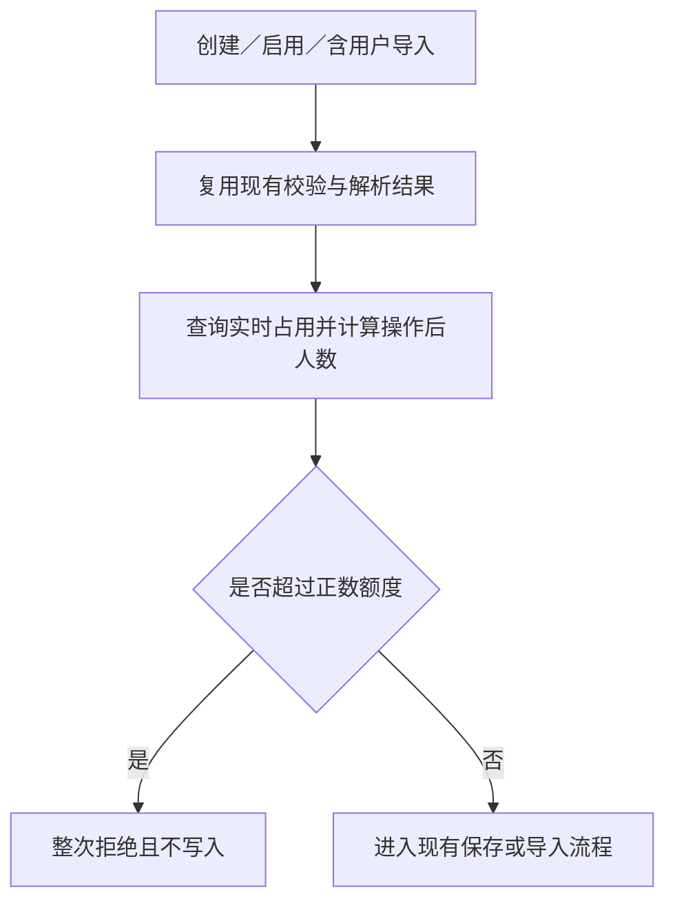

# 授权人数控制功能与技术规范

> 状态：评审中
> 最后更新：2026-10-19
> 适用范围：DeepFOS 平台与网关，复用现有 License 实现
> 关联文档：[说明](../说明.md)、[实施计划](../代码执行计划/2026-10-19-人数授权实施计划.md)、[SQL 验证记录](../验证记录/2026-10-19-人数统计查询验证.md)、[产品原文](../需求记录/2026-10-16-人数授权需求评审记录.md)

## 1. 人数规则

- 环境占用：已启用（status=1）、至少关联一个有效企业、非超级管理员的用户数，按用户 ID 去重。企业、空间和应用共用额度，顾问不单独识别。
- 企业占用：本企业全部成员中已启用、非超级管理员的人数，不随搜索、筛选和分页变化。各企业占用不能相加代替环境占用。
- 授权人数沿用 `authorized_users`：正整数控制人数，0 不限；缺失或非法仍按现有授权异常处理，不默认成 0。仅补齐该字段必要的整数检查，不改授权解析架构。
- 超过额度才拦截，等于额度允许。本需求的统计排除、后台权限、禁用保护和网关豁免均只按 `username=admin` 判断超级管理员，不使用用户 ID。

## 2. 复用现有 License

这张图说明只在既有链路上增加人数计算和判断。

- `LicenseController.overview()` 增加 `occupiedUsers`，其余字段及状态保持原样。
- `LicenseInternalController.snapshot()` 增加 `userLimitExceeded`：合法额度 >0 且实时占用超过额度时为 true，0 时为 false。网关只使用这个平台判定，不重复统计。
- `GatewayLicenseService` 的取快照、缓存及故障处理直接复用，不调整 TTL，不另加平台人数缓存，也不增加快照版本或人数状态体系。当前默认缓存为 60 秒，人数限制和解除沿用其刷新节奏。
- 网关在现有 License 判断中增加超额分支；已认证 `username=admin` 跳过整个 License 检查，普通用户在超额、硬停、未授权等场景沿用拦截。用户名取现有认证返回结果，不使用用户 ID，也不信任外部 username/user-id 请求头。
- 人数检查覆盖普通用户后续业务请求，不能仍只拦 global。复用已有认证取得的用户信息；账号前缀跳过原 Token 过滤器的路径也不能漏掉。

## 3. 提交前人数校验

这张图说明正式操作在写入之前完成校验。

校验入口：企业／空间创建已启用用户、修改状态为启用、受邀账号完善信息后启用、企业／空间含用户的导入（含列表导入）。其他操作不新增本次额度校验。

预计占用 = 当前占用 + 本次新增占用 - 本次释放占用。按同一用户的最终状态与最终企业关系计算，不能直接用 Excel 行数：已计数用户跨企业不重复增加；移除一个企业但仍关联其他企业不释放；混合新增、启用、禁用、移除要一起计算。

导入 `/check` 可提前提示，但正式导入仍须重新校验。包含用户时，先检查整次导入，超额不得执行前面的其他页签、用户／空间写入或发送成功消息；不含用户时沿用原流程。复用已有解析和保存逻辑，不重构整个导入框架。

不增加人数事务锁或并发预留。并发请求可能都通过预校验并造成超额，按用户已接受的方式由后续网关限制使用，再由管理员释放人数。产品原文的严格并发一致性暂不作为本次验收要求。原有业务事务保留，不为此新建锁表或人数表。

## 4. 登录 global 与重试的协作约定

删除仅靠后端身份／来源推测页面的方案，保持前端现有 global 和重试流程，由前端同学加明确请求头。

已与前端确认：登录初始化的 `GET /system-server/api/config/global` 携带 `X-License-Scene: login`，网关仅对该路径加该值跳过 License；阻断页恢复探测不带此值，正常检查。后端按此实现，不负责修改前端。

该请求头只允许读取登录所需的现有 global，不作为 admin 身份，也不使其他业务接口跳过 License。原型人数超额页实际直接回跳重试，硬停等分支才探测 global，两者均不在本任务修改。

## 5. 原型接口对接

前端只读，后端按已有原型返回数据，不新增页面或重试接口。

| 现有约定 | 后端补充 |
| --- | --- |
| `GET /account/license/overview` | 增加环境 `occupiedUsers` |
| `GET /account/license/internal/snapshot` | 增加 `userLimitExceeded`，其余快照直接复用 |
| 企业成员 `POST /api/user/page` | 追加原型已有 `licenseUsage`：authorizedUsers、occupiedUsers、scopeOccupiedUsers；企业人数独立于筛选分页 |
| `GET /account/license/environment-users/summary` | totalUsers、unassociatedUsers、occupiedUsers、authorizedUsers、enterpriseCount、enterprises；字段沿用原型 |
| `POST /account/license/environment-users/page` | 按原型条件查询用户，一人一行，创建时间降序、分页；仅批量补当前页企业信息 |
| `POST /account/license/environment-users/export` | 相同条件下全部用户的后端 Excel，字段与文件名按产品原文 |
| `POST /account/license/environment-users/batch-disable` | 仅禁用指定账号，保护超级管理员、未知身份及非法状态，不删除历史数据，复用现有状态与 token 清理能力 |

环境管理四个接口逐一校验超级管理员，并按当前 `account-route-rules.txt` 登记对应 method/path。企业统计复用 summary.enterprises，搜索排序和分页已有前端原型处理，不新增企业分页接口。

统计未知显示由现有原型处理，后端返回 null，不伪造为 0；人数查询失败也不得作为不限人数。环境用户总数包含禁用、无企业和超级管理员，未关联企业数按不存在有效企业关系统计。

用户列表、total、导出使用一致条件；避免按用户逐条查企业或一对多关联后直接分页。优先使用现有索引，Alpha 查询结果见 SQL 记录。

## 6. 错误提示与验收

网关复用 888001，人数超额文案保持原型已识别的原文：

> 当前环境授权人数已超额，暂时无法使用平台。请联系系统管理员处理。

提交前超额作为当前操作失败，不能用 888001 跳离页面；提示授权人数、当前人数、预计人数和超出人数，整批操作未执行。具体长文案沿用产品原文。

- [ ] 98/100 时新增 2 个占用成功，新增 10 个整批拒绝，提示预计 108、超额 8。
- [ ] 同账号跨企业只占一次；禁用、无企业、状态 3/4 和超级管理员按统一口径处理。
- [ ] 企业／空间创建、启用、账号完善、文件和列表导入均在写入前校验，用户页签排最后也不漏。
- [ ] 已认证 admin 可通过现有 License 拦截，普通用户已有会话的业务请求在快照更新后也受限；并发超额后能由管理员调整人数恢复。
- [ ] 登录 global 的约定头可放行，阻断探测仍校验，其他业务伪造该头不能获得豁免；与前端同学联调，本任务不改前端。
- [ ] 环境管理权限、分页、企业统计、完整导出、批量禁用均能对接现有原型。
