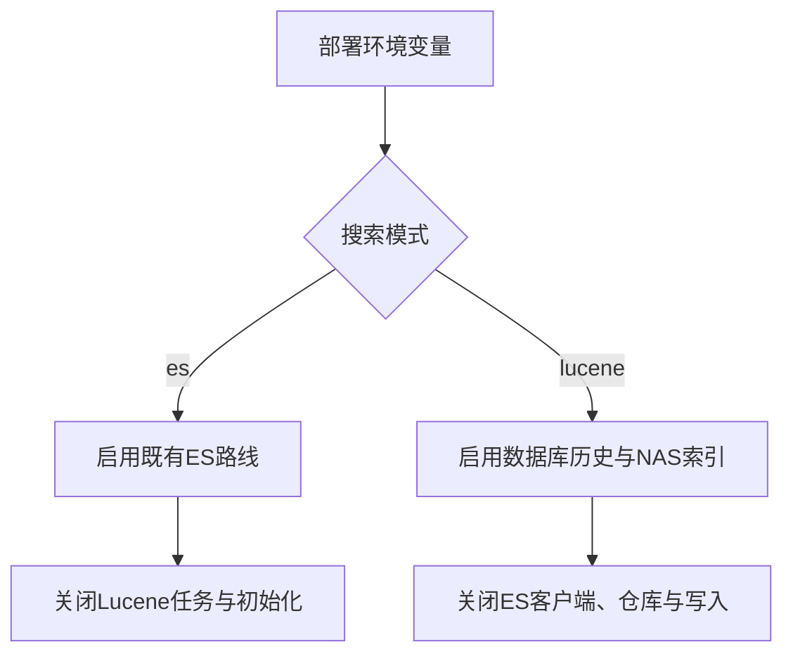
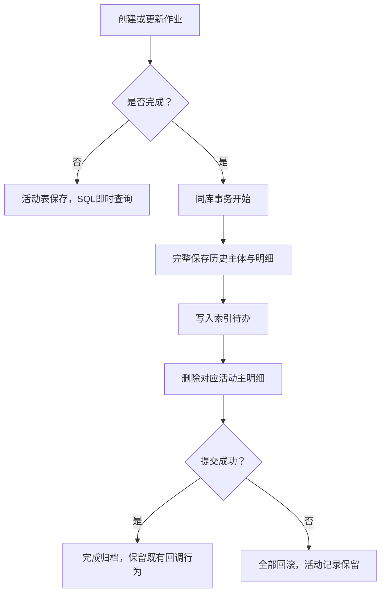
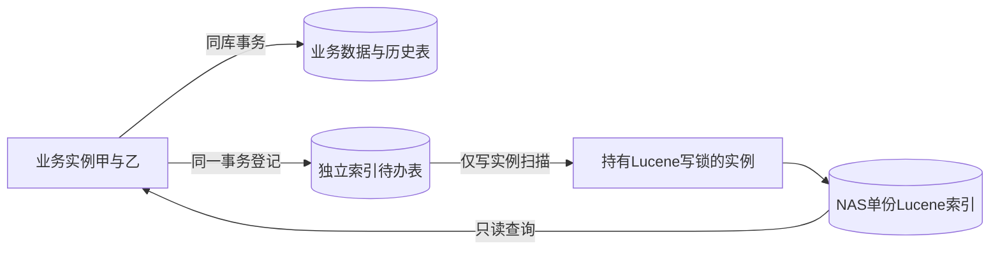
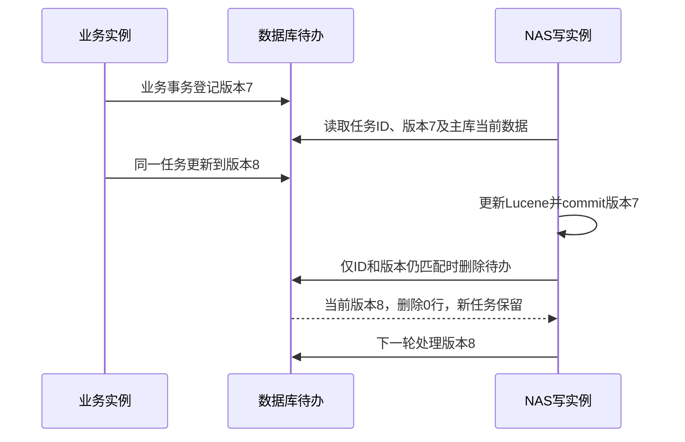

# 共享存储索引技术方案

> 状态：评审中
> 最后更新：2026-10-13
> 适用范围：deepfos-platform 的ES／Lucene互斥模式、作业管理和操作日志
> 关联文档：[主题说明](../说明.md)、[实施计划](../代码执行计划/2026-10-13-搜索中间件替换实施计划.md)、[迁移规范](历史数据迁移脚本规范.md)、[调整记录](../决策记录/2026-10-13-互斥模式与简化实现.md)

## 一、采用的方案

**一个部署只运行一个搜索后端。** 用 `EXPORT_SEARCH_MODE=es|lucene` 选择，默认 `es`，通过正常发布／重启生效。同一部署所有实例必须相同配置；不做动态热切换、双端同步、影子比对或自动故障切后端。

| 模式 | 作业存储与查询 | 操作日志 | 启动依赖 |
| --- | --- | --- | --- |
| `es` | 保留现有路线：未完成在活动表，完成在ES | 保留数据库记录和既有ES查询／写入 | ES；不初始化Lucene、不要求NAS、不扫描Lucene待办 |
| `lucene` | 未完成在活动表；完成存新历史表，查询Lucene | 使用已有数据库数据，查询Lucene | 数据库和NAS；不创建ES客户端／仓库bean，不读写ES |

ES代码、依赖和配置保留；通过模式控制实际启用。Lucene模式的历史数据以数据库为准，Lucene可以重建。业务与索引同步不用MQ。当前仅编写方案，不修改平台代码或真实数据。

下图说明模式是二选一，不是同时维护两套索引。

## 二、规模与性能判断

以下是用户2026-10-13提供的环境信息，未执行现场统计。

| 对象 | 已知规模 |
| --- | --- |
| 正式ES全部数据 | 约6GB |
| 正式space_log | 约3GB，已有数据库记录 |
| 正式job_current_*／job_content_* | 合计约3GB |
| alpha的space_log数据库记录 | system库内约5GB |

3～6GB本身不是Lucene的规模障碍；ES也是基于Lucene。能否保持现有响应速度，主要取决于NAS随机IO、缓存、记录数、关键词命中量、精确统计和并发，需在实际NAS测量，不能承诺固定毫秒数。ES磁盘统计可能含副本，数据库文件可能包含索引和空闲空间，二者不直接等于新索引体积。

验证保留最小集合：常用第一页、时间过滤、关键词广命中、精确count和导出；分别测冷／热缓存及业务写入并发时的耗时，和现有ES的同条件接口比较。记录p95、错误率、索引积压和NAS容量，具体通过阈值待确认。

新待办表替代原表增加同步字段，减少对5GB日志表的DDL影响。加列并非一定长时间锁表：部分MySQL8操作支持INSTANT，但仍有元数据锁，长事务可导致等待。新增活动表索引、必要业务字段调整仍要单独评估，不能认为新建表意味着完全没有锁／IO影响。

## 三、未完成作业与历史分开

**未完成作业固定查现有 `job_current/job_content`，不走异步Lucene。** Lucene模式新增 `job_history/job_content_history` 保存完成主明细，ES回迁历史只写新表，不写活动表。

下图说明完成归档的同库事务边界。

创建即完成直接保存历史表；正常结束、取消、超时采用同一归档流程。重复终态处理通过数据库条件更新／锁定保证幂等，不重复回调。按ID查重、详情和实时进度以数据库状态为准，不能只查延迟索引。

活动表只随并发未完成作业和暂停积压增长，历史3GB不会进入该表。常见查询按空间／应用、用户及时间评估组合索引，明细按job_id定位；实际索引由EXPLAIN和现有结构决定，不预设一个索引满足所有OR授权条件。历史表在新建时建立必要主键及查询索引。

## 四、Lucene模式的组件

下图展示数据库待办与单份共享索引；没有数据库选主表或双后端进度表。

Lucene模式只增加三个业务表：`job_history`、`job_content_history`和 `search_index_task`。已有 `sp_log_info`不增加索引同步列。表放在业务事务所在数据库，不能把异库插入当作事务内待办；当前alpha日志在system库，正式数据源拓扑仍需确认。

NAS使用一个按环境／部署隔离的索引目录，作业主体、明细和操作日志通过 `entity_type`区分，通过企业／空间／应用／用户字段做授权过滤。这个规模先不按实例或租户拆成多份索引，也不实现分布式查询汇总。

## 五、哪个实例写，以及怎样处理待办

### 5.1 使用Lucene写锁选出唯一写实例

所有Lucene实例尝试对同一目录创建IndexWriter：成功者是写实例，获取锁失败者只在索引已就绪时创建reader。未获写锁的实例不查询待办表、不扫描全量源表，隔几秒重试获取锁。持有者释放锁后其他实例可接手；旧实例仍持有锁时等待，不能删除锁文件强行接管。

不增加数据库租约、任期表或Redis选主。每个实例只保留一个写对象，扫描、写入、commit串行执行。NAS或写对象异常时停止扫描，rollback并释放资源，未确认任务保留；正常关闭与故障关闭区分，避免故障时close意外提交。

NAS跨机器锁可靠性必须先验证，包括崩溃释放、网络断连和旧进程暂停恢复；仅有目录共享不够。锁有效性检查是尽力而为，不能替代NAS测试。若协议／挂载的锁不能可靠工作，此方案不能上线；不以关闭锁来绕过限制。

### 5.2 独立待办表

`search_index_task`只保存尚未成功同步的实体通知，按实体合并；新增、更新、删除在业务事务中登记或更新任务。版本在新表维护，不改原大表。任务成功后物理删除，不保留DONE历史。

| 字段 | 作用 |
| --- | --- |
| `id` | 数据库生成且运行期间不重用的任务主键；删除时校验，防止同UID重新建任务后被旧任务误删 |
| `entity_uid` | 稳定源库身份＋类别＋完整主键的规范编码哈希，唯一约束 |
| `entity_type`、`entity_key` | 历史主体／明细／操作日志类别及定位键 |
| `version` | 该任务存在期间每次变更原子加1；成功删除后新任务有新ID，可从1开始 |
| `retry_at`、`last_error`、`updated_at` | 失败退避和排查，不另建错误框架 |

任务只存类别、完整定位键和版本，不复制日志正文，也不需要operation、payload或完成状态字段。消费者从同一源库**主库**读取该实体的最新完整行：存在则按UID更新索引，不存在则删除对应文档。删除业务行之前仍要在同库事务登记定位键，这些键足以保留待处理删除信息。不能读延迟副本后把“暂时查不到”当成删除。

在 `(retry_at,id)`建立调度索引，每次有限批量查到期任务；新建或更新任务时retry_at重设为数据库当前时间，并清理旧错误。不能只记“上次最大ID”，避免漏掉旧任务再更新或晚提交事务。失败保留任务并退避，不能永久挡住后面的任务。

下图展示为什么提交后必须按任务ID和版本条件删除。

写实例按UID更新／删除索引，**commit成功后**执行 `DELETE FROM search_index_task WHERE id=:id AND version=:capturedVersion`。仅写入缓冲区、flush或目录出现文件，都不等于可删待办。失败退避也校验ID及版本，不能由旧失败覆盖新任务。commit后、删待办前宕机可幂等重放；删待办后同UID再变化会创建新ID，旧删除条件不会命中它。每个UID顺序处理，不并发执行旧任务。

读取源数据后又发生业务变化时，其事务会递增或重新创建待办，旧任务不能删掉新通知，因此下一轮会再次读取最新状态。历史删除、批量日志修复均与任务登记同库事务提交。空间删库前必须处理完／可靠保全其定位任务。

### 5.3 启动只检查，必要时才全量初始化

**正常重启不全量扫描Lucene文档，也不扫描历史／日志源表。** 只读取索引提交元数据判断是否已完成初始化，打开reader／竞争写锁，持锁者继续消费尚未完成的待办。不在启动时做全库对账、全量重刷或强制预热全部索引文件。

这里的“有效索引”只表示**索引可打开且本应用初始化已完成**，不是数据库与索引逐条一致的证明。启动用DirectoryReader.indexExists初步判断是否有提交，再尝试DirectoryReader.open读取提交／segment元数据，最后检查提交中本应用写入的build_complete；该标记不是Lucene自动生成的。indexExists本身不能证明未损坏，open也不是全部数据文件的完整校验。索引文件由多个segment组成，不是一条数据库记录对应一个NAS文件，不需要拿数据库记录逐条匹配目录。

正常数据一致性依赖“业务与待办同事务、唯一写实例、commit后删待办”的流程。若运维恢复了较旧NAS备份，旧索引可能仍能打开且标记为true，启动检查无法判断它遗漏了已消费的数据；此类恢复必须显式全量重建。完整文件校验或数据库／索引逐条核验是单独维护操作，不加入每次启动。

| 启动时状态 | 动作 | 是否全量读库 |
| --- | --- | --- |
| 有效索引且build_complete=true | 直接使用索引，消费待办 | 否 |
| 正常空目录／没有有效索引／上次初始化未完成 | 持锁者执行一次全量初始化 | 是，仅写实例 |
| NAS不可达／已有索引损坏 | 报错，按故障或维护重建处理 | 不静默触发 |

普通启动仍有NAS文件访问、元数据加载及reader打开成本，冷缓存可能让首次查询较慢，这与全量建索引不同。首次扫描3～5GB数据可能耗时较长，需测吞吐；初始化在写实例后台执行，不让所有实例都在启动线程扫描。构建完成前历史／日志查询明确返回“索引构建中”，未完成作业继续查数据库。

在Lucene模式启动时先确认NAS可访问，再检查有效索引和最新提交中的 `build_complete=true`。**目录存在不等于索引已完成**；普通空文件夹、没有有效提交、初始化中断留下的 `build_complete=false`均需初始化。NAS不可达或已有索引损坏应明确报错，不能当作空目录创建本地替代目录或覆盖损坏文件。

只有持有IndexWriter锁的实例执行以下流程，其他实例等待就绪；未完成作业仍可查活动数据库表。

1. 新建／重置未完成的索引，提交 `build_complete=false`，开始分批按稳定主键扫描 `job_history`、`job_content_history`和 `sp_log_info`。逐行按UID更新，不能一次载入全表，也不必为全量已有数据制造待办。
2. 全量扫描期间暂停普通待办消费，业务和外部迁移如有变更仍须原子登记待办，避免旧全量行覆盖已消费的新状态。
3. 全量结束后回放当轮已提交待办，仍从主库读最新状态，业务行已删除则删除索引；commit成功后按ID／版本删除。初始化期间新增、修改和删除通过此步骤收敛，后续新到任务继续正常增量处理。
4. 只有全部源表扫描成功且当轮待办成功回放，才提交 `build_complete=true`并开放历史／日志查询。源表为空是成功扫描，源表读取失败不能当成空表。失败任务未解决时不标记初始化完成。

首次建索引途中宕机，重启见完成标记缺失／false就重新扫描源表，再回放剩余待办；成功任务虽已删，完整数据仍在源表，已删业务行不会在新索引重现。不是每次启动都全刷：有效索引且完成标记为true时只消费待办，后续增量commit保留此标记。已完成索引的接管不重置数据，人工全量重建使用停读停写的维护窗口。

### 5.4 目录已存在时迁移与重复补刷

运维若要求目录先就绪再回迁，允许先从已有日志／当前历史表完成初始化，历史表为空也可以；之后执行**项目外**ES迁移脚本。应用仍是Lucene模式，不访问ES，外部脚本仅作一次性数据搬迁。

- 每个实际新增／补齐的历史主体和明细，在同一批数据库事务内写历史表并登记对应待办。提交后写实例自动读取新历史数据补入现有索引；不删除目录、不全刷5GB日志。
- 脚本重跑遇到相同数据时默认幂等跳过；需要把该次迁移范围再刷一遍，增加 `--reindex`参数，为这批目标业务键重新登记／更新待办，消费者读取数据库当前内容。不使用旧ES导出正文覆盖较新的库数据。
- 索引按同一UID使用updateDocument，重复登记不增加重复文档。脚本在写库后、登记任务前故障时整个事务回滚，不留下只进库未进索引的数据。
- 运维确认“导入提交”后，还要等待该范围待办被消费、查询reader刷新，并核对迁移范围ID／数量；脚本返回成功不等于数据已经可搜索。迁移分批时历史查询可能逐批可见，完整上线以前不宣称迁移已全部就绪。
- 如果实际需要全库重刷，用维护窗口重新建立目录，仍走5.3的全量源表扫描＋待办回放；局部迁移不触发全库重建。

## 六、共享读、分页与旧文件

所有实例从同一NAS目录打开已commit的reader，定期刷新；写实例也使用该读取方式。作业历史按结束时间倒序、明细按开始时间倒序，日志按请求指定创建时间升降序；都增加唯一键排序，保证同时间记录次序明确。

页码接口先保持现状，深页限制按现有使用确认；导出用searchAfter并固定本次reader。需要精确总数时用精确count，不把Lucene命中下界当总数。三个入口的权限条件一致，数据库回查校验当前记录／空间有效性。中文／英文／繁体包含语义以现有样本验证，不能把通配符查询简单换成分词后宣称等价。

NAS多客户端读取旧segment时，默认删除旧提交文件可能有兼容问题。首期使用 `NoDeletionPolicy`保留提交文件，**不实现读租约表、持久快照登记、在线旧文件回收**。代价是旧segment会持续占空间，可能显著超过当前有效索引大小；必须监控容量、演练维护频率，空间不足停止索引并告警。

清理采用维护窗口：停止所有实例的读写、关闭reader，保留有效最新提交或从数据库建新目录后统一重启；不能在线手工删正在使用的文件。这个选择减少实现量，但增加维护与磁盘成本。如果目标环境不能接受维护窗口／空间增长，再单独评审自动回收，不能将简单版本描述为免维护。

## 七、配置与模式切换

必需配置只保留 `EXPORT_SEARCH_MODE`和Lucene模式的 `EXPORT_LUCENE_NAS_ROOT`。默认 `es`；不合法值启动失败。ES客户端、仓库扫描、索引名bean和ES初始化仅ES模式启用；Lucene组件和待办消费仅Lucene模式启用。异常日志Lucene模式也不得继续向ES写入，沿用数据库现有查询；额外完整堆栈差异由迁移规范单独保全，不扩展本次全文搜索。

切换是一项维护操作，不是实时容灾开关。所有实例一致停写并处理在途作业／超时／日志修复，使用Lucene模式准备目标；可以先初始化目录再运行外部历史迁移，也可以先回迁再初始化，最后均需索引对账通过才开放完整历史查询。Lucene期间ES不更新，回切须外部补齐最终数据集合与删除，不能直接改开关读旧ES。**待办成功即删，不能用它当回切日志**；回切按完整数据库业务键集合与ES旧集合对账，删除ES多余记录，并保留迁移身份映射。ES期间不维护Lucene，转回Lucene同样需准备目标数据。

## 八、迁移、验收与不做的部分

**space_log直接读取数据库sp_log_info建Lucene，不做ES／数据库对账，不导出或回迁ES日志。** 后续变化走待办增量；约3GB作业历史由项目外脚本回迁新历史表，不混入活动表。只有缺失／未完成索引由持锁者自动初始化，正常重启不扫描完整数据；损坏索引先保全并在维护窗口重建，不能只消费剩余待办恢复全量数据。

核心验收：ES模式原功能不受影响；Lucene模式无ES连接；未完成SQL列表即时可用且历史不进入活动表；多实例只有一个写者且非写者待办查询次数为0；成功任务commit后条件删除，正常空闲时表内无历史成功记录；并发版本、删除与commit前后故障不漏处理；空目录及半成品能初始化，已就绪目录启动不重复全刷；目录先建后迁移和--reindex均只补目标范围；分页、权限、统计、导出及NAS性能通过。

不做：双端同步、分模块多种模式、数据库搜索第三后端、动态切换、影子比较、消息队列、数据库／Redis选主、读租约表、已就绪索引自动在线重建、自动旧文件清理、分布式索引分片和通用多消费者平台。缺失目录初始化和迁移待办补刷属于本次核心能力。

待确认：正式／alpha数据库版本及实际索引、NAS协议和锁语义、容量是否含副本、数据行数／并发未完成数、允许维护时长、查询性能目标及旧文件保留的空间预算。必要业务字段补齐或活动表新增索引仍要单独评估DDL风险。

依据：[Lucene与ES](https://lucene.apache.org/)、[写锁、commit及提交元数据](https://lucene.apache.org/core/10_3_1/core/org/apache/lucene/index/IndexWriter.html)、[锁有效性限制](https://lucene.apache.org/core/10_3_1/core/org/apache/lucene/store/Lock.html)、[保留提交策略](https://lucene.apache.org/core/10_3_1/core/org/apache/lucene/index/NoDeletionPolicy.html)、[MySQL在线DDL锁](https://dev.mysql.com/doc/refman/8.0/en/innodb-online-ddl-performance.html)。性能尚未实测。
