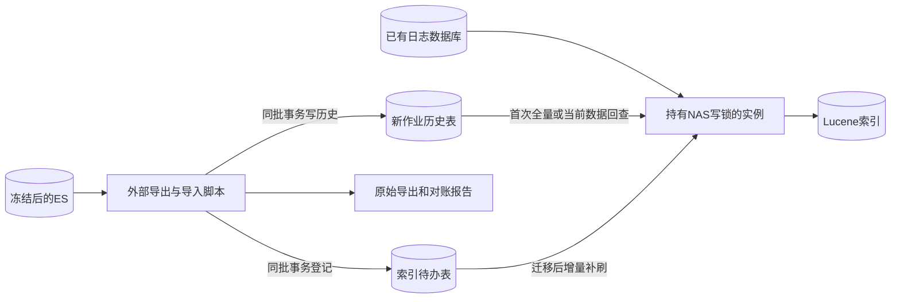
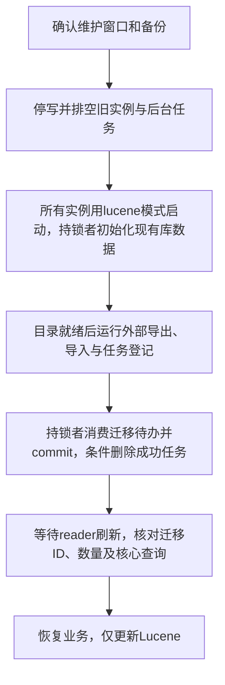

# 历史数据迁移脚本规范

> 状态：评审中
> 最后更新：2026-10-13
> 适用范围：ES与Lucene互斥模式之间的一次性历史数据准备
> 关联文档：[主题说明](../说明.md)、[技术方案](共享存储索引技术方案.md)、[实施计划](../代码执行计划/2026-10-13-搜索中间件替换实施计划.md)

## 一、范围与原则

迁移使用项目外独立脚本，不写进platform启动逻辑、不提供迁移Controller，也不建设永久ES同步服务。本轮只定义执行要求，脚本语言／运行目录待实现时确定。默认维护窗口停写；支持Lucene目录先就绪再回迁，脚本写库时原子登记待办，由当前写实例补刷，不需要全量重建已有目录。

用户提供正式ES约6GB，其中space_log约3GB、job_*历史约3GB；alpha的space_log数据库在system库内约5GB。**space_log不做ES／数据库对账，直接由应用读取sp_log_info建Lucene；外部迁移脚本不导出、不导入此类ES日志。** ES模式不执行Lucene待办或建索引。

本规范保留全景和切换流程两张图；一次性停写操作不再建立在线回放状态机或多后端进度模型。

下图说明脚本的历史写入与待办登记是同一事务，既有索引通过增量待办补刷。

## 二、各类数据的处理

| 来源 | 目标／处理 |
| --- | --- |
| job_current_* | 幂等导入job_history，保留主体全部业务字段 |
| job_content_* | 幂等导入job_content_history，按完整jobId、key关联主体 |
| space_log | 不参与ES迁移或对账，直接从sp_log_info初始化Lucene，后续按待办增量 |
| 异常日志ES | 核对数据库现有字段；ES额外完整堆栈原始导出保全，不静默丢弃，不扩展本次搜索功能 |

先解析作业具体索引、别名及源库映射，不能只凭租户后缀推导数据库。记录索引UUID和源ES文档ID。异常日志若需保全额外堆栈，单独导出，不把它作为space_log对账或补缺流程。

历史表新建时保存ES需要保留的完整字段；不把3GB历史导入现有活动表。附件保留引用，不由脚本重复下载。原始导出保留完整_source，字段缺失／长度不足／未知状态／时间格式异常不得默默裁剪或填当前时间。

## 三、脚本最小能力

脚本只需覆盖“导出、导入、校验”三步，可同一个程序分阶段运行：

1. 导出：使用PIT＋search_after或版本适配的scroll，分批保存NDJSON及校验和；记录具体索引、UUID、源身份和预期数量。检查超时／失败分片，部分失败不能算成功。
2. 导入：按业务唯一键幂等批量写作业历史表，并在**同批数据库事务**为实际新增／补齐记录登记search_index_task；不处理space_log回迁。每批提交成功后才保存检查点，不能先提交历史再单独插任务。相同数据重跑默认跳过，不重复登记；用 `--reindex`则为该迁移范围的目标业务键重新登记／更新待办，消费时读取数据库最新内容。源到目标身份映射保存在迁移产物中。
3. 校验：逐类别／租户／源库核对主键集合、数量、完整字段和主明细关联；原始ES数量不能直接等于含已有数据的库总数。最终报告解释新增、已存在、补齐、冲突／隔离记录。

PIT过期后旧_shard_doc游标不可用于新PIT，可重新导出该索引并幂等导入。不使用业务更新时间作唯一增量水位。凭证不写仓库、日志或命令历史；导出文件按日志敏感信息管理。

产物仅保留必要内容：原始导出、索引清单、源到目标映射、批次检查点、冲突记录和对账报告。`--reindex`复用该批目标键，不重新用旧ES正文覆盖已有新数据，也不删除Lucene目录。无需建立通用迁移调度平台、迁移API或自动回滚命令框架。

## 四、切换步骤

下图以“运维先要求Lucene目录就绪”为默认顺序；外部脚本只读冻结的ES源，应用仍只用Lucene。

停写范围包括作业创建／更新／取消／删除、Redis超时归档、操作日志生产和历史修复。运行中作业怎样暂停／恢复由业务规则确认，不能因维护延长就直接判超时。排空在途事务和异步写入，停止旧代码继续归档写ES并删活动表。

运维确认NAS可用和新表已建，再统一用 `EXPORT_SEARCH_MODE=lucene`启动。目录缺失／无初始化完成标记时，持锁者在后台分批扫描job_history、job_content_history和sp_log_info，再回放待办；目录已就绪时只读取索引元数据、打开reader并消费待办，不全量扫描文档或源表。历史表尚为空也可先完成初始化，不能因“目录存在”就判定此前中断的全量成功。

此后外部脚本读取冻结ES，写历史与待办，同一批提交后消费者自动补入已有索引。只新增约3GB作业历史时不重刷已有日志；数据库原本相同而需重复补刷的记录使用 `--reindex`。**导入成功与可搜索成功是两项检查**：待该范围待办已消费、reader已刷新，按目标ID核对结果后才完成发布。待办成功即删除，不能从DONE记录判断进度，迁移产物和索引对账负责保存完成证据。

也允许先导入再启动空目录初始化，仍由同一流程扫描全部源数据和回放待办。全量不制造长期payload副本，原表不增加同步字段。初始化中断重启可重复扫描，固定UID更新不会重复文档。

## 五、失败、回切与验收

导入失败保留已提交批次，修复后幂等续跑；未恢复业务前需要撤销时，按导入批次新增键及导入前备份恢复，不能清空原业务表。

Lucene模式产生新数据后，ES已落后。回切需停写、外部按完整数据库最终集合与旧ES集合核对：补齐新增／更新，删除ES多出的业务记录，再用ES模式统一启动。任务消费后已经删除，**不能依赖待办表保存历史删除日志**；源到目标身份映射及完整集合对账负责回切。活动与历史归属须按目标模式准备，无法完整补偿时不得直接读旧ES。

- [ ] 约3GB作业历史进新历史表，活动表体积不因回迁增长。
- [ ] space_log直接读取sp_log_info建索引，不执行ES对账、导出或补缺导入。
- [ ] 重复导入和提交后崩溃续跑不重插、不覆盖较新记录。
- [ ] 每批历史写入与待办登记同事务；目录已存在后迁移可自动补索引，正常消费后成功任务为0。
- [ ] `--reindex`只补该迁移范围，索引文档不重复；日志不因局部回迁而被全量重刷。
- [ ] 空目录后台初始化；半成品不标记就绪，重启可重扫恢复；已有就绪索引重启不扫描完整文档／源表。
- [ ] 字段、时区、主明细关联与数据库／索引集合对账通过；额外堆栈原始内容已保全。
- [ ] 所有实例模式一致，切换后只启用所选后端；回切前完成新数据／删除补偿。

资料：[ES分页与PIT](https://www.elastic.co/docs/reference/elasticsearch/rest-apis/paginate-search-results)。实际命令与鉴权以现场版本为准。
