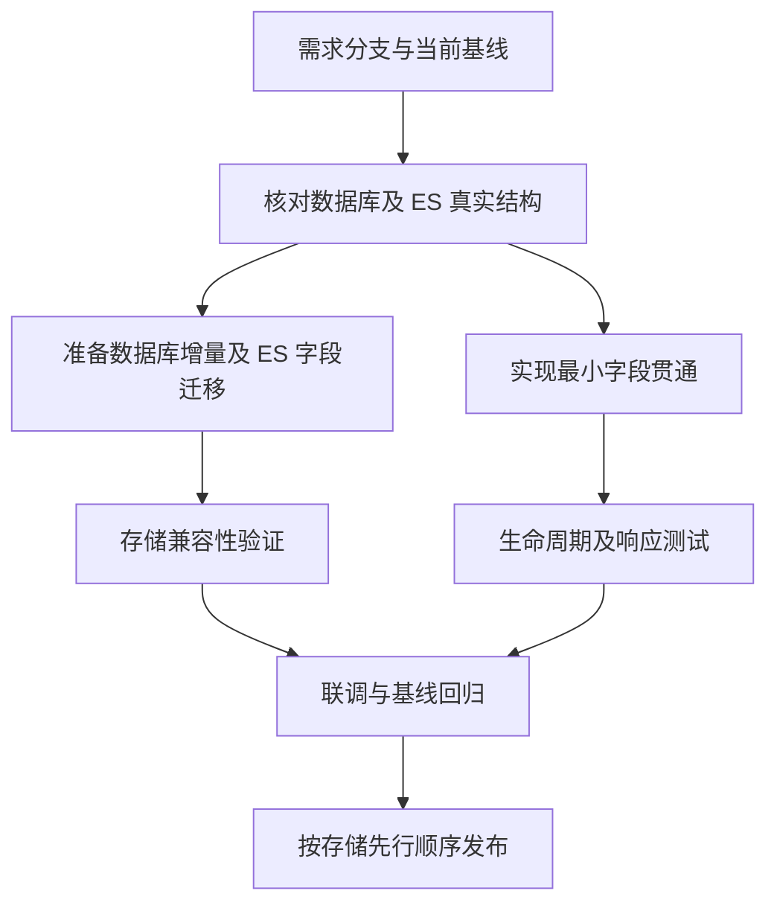
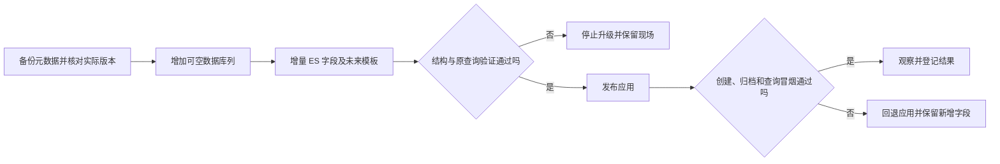

# 操作日志与作业来源地址字段实施计划

> 状态：已确认（本地实施完成，未部署）
> 最后更新：2026-10-21
> 适用范围：deepfos-platform 企业日志响应、主作业数据库与 ES 生命周期
> 关联文档：[主题说明](../说明.md)、[接口与数据规范](../规划/接口与数据规范.md)

## 一、交付目标与本轮状态

实施完成后，企业操作日志列表返回已有来源 IP；作业创建时记录来源 IP，未完成列表、完成列表及主作业导出返回同一创建 IP，归档不丢失也不覆盖它。历史未知来源保持空值。

本轮执行范围：按用户指示完成代码、迁移资料与本地验证，暂不部署，不修改远端数据库或 ES。前次分支准备情况：

- 后端仓库：`/Users/yang/deepfinance_project/deepfos-platform`。
- 需求分支：`codex/feature-log-job-ip`，已创建并切换。
- 原创建基点为 `9e155699`，2026-10-21 已按用户要求将该菜单提交从本需求分支移除，当前基点改为 `cd42dc10`。不混入额外合并，原菜单需求分支保留。
- 开始实施时后端没有已跟踪文件改动；本次在需求分支上实现，未获部署指令前不执行远端迁移。
- 文档仓库既有未提交内容保留，本次只新增本主题三份文档。

## 二、依据与现状

先通过 CodeGraph 查询 `JobController`、`JobServiceImpl`、`JobCurrentMapper`、`JobCurrentPageDto`、`RedisKeyExpirationListener`、`buildIndexName` 和合并调用入口，再补读未返回的具体代码段、Mapper 和初始化配置。未给现有仓库新建索引。

以下链接指向核查时的实际本地文件；行号为本轮基线，后续修改后以符号定位为准。

### 操作日志

| 入口 | 已确认行为与本次动作 |
| --- | --- |
| [LogManageCotroller.java:86](/Users/yang/deepfinance_project/deepfos-platform/system-server/src/main/java/com/proinnova/system/log/rest/LogManageCotroller.java:86) | `/log/enterprise/log-list` 返回 `QueryLogResponseDto`，接口路径与分页结构不变 |
| [QueryLogResponseDto.java:13](/Users/yang/deepfinance_project/deepfos-platform/system-server/src/main/java/com/proinnova/system/log/dto/QueryLogResponseDto.java:13) | 当前没有 IP；此处增加可空字符串及访问方法 |
| [SpLogInfo.java:65](/Users/yang/deepfinance_project/deepfos-platform/system-server/src/main/java/com/proinnova/system/log/po/SpLogInfo.java:65) | 已有 `ip`；无需为返回字段重复建日志列 |
| [LogServiceImpl.java:449](/Users/yang/deepfinance_project/deepfos-platform/system-server/src/main/java/com/proinnova/system/log/service/impl/LogServiceImpl.java:449) | `packageLogData` 复制 ES 实体到响应；同名 IP 可沿用复制 |
| [LogCotroller.java:84](/Users/yang/deepfinance_project/deepfos-platform/space-server/src/main/java/com/proinnova/space/log/rest/LogCotroller.java:84) | 操作日志从当前上下文参数取 IP |
| [SPACE-INIT/mysql.sql:209](/Users/yang/deepfinance_project/deepfos-platform/space-server/src/main/resources/SPACE-INIT/mysql.sql:209) | 2.7.0 已有日志 IP／MAC 列升级，日志本次不重复加列 |

### 作业链路

| 入口 | 已确认行为与漏改风险 |
| --- | --- |
| [JobController.java:102](/Users/yang/deepfinance_project/deepfos-platform/system-server/src/main/java/com/proinnova/system/job/rest/JobController.java:102) | 创建入口补用户、空间、应用，调用创建服务 |
| [SystemApiImpl.java:832](/Users/yang/deepfinance_project/deepfos-platform/system-server/src/main/java/com/proinnova/system/api/SystemApiImpl.java:832) | 合并部署内部创建也进入上述 Controller，不需要给所有调用 DTO 透传 IP |
| [JobServiceImpl.java:197](/Users/yang/deepfinance_project/deepfos-platform/system-server/src/main/java/com/proinnova/system/job/service/impl/JobServiceImpl.java:197) | 创建实体后根据结束时间选择数据库或直接 ES；在分支前采集一次 IP |
| [JobCurrent.java:14](/Users/yang/deepfinance_project/deepfos-platform/system-server/src/main/java/com/proinnova/system/job/entity/JobCurrent.java:14) | 同时用于数据库实体和 ES 文档；当前无 IP |
| [JobCurrentMapper.java:16](/Users/yang/deepfinance_project/deepfos-platform/system-server/src/main/java/com/proinnova/system/job/mapper/JobCurrentMapper.java:16) | 显式插入、列表查询与按 ID 查询，不是加实体就能自动贯通 |
| [mapper/common/JobCurrentMapper.xml:5](/Users/yang/deepfinance_project/deepfos-platform/system-server/src/main/resources/mapper/common/JobCurrentMapper.xml:5) | `ResultMap` 返回 `CurrentDto`；`updateJobCurrent` 是字段白名单，应保留创建 IP 不可改的性质 |
| [mapper/mysql/JobCurrentMapper.xml:5](/Users/yang/deepfinance_project/deepfos-platform/system-server/src/main/resources/mapper/mysql/JobCurrentMapper.xml:5) | `Column_List`、`insert` 和 `selectByJobId` 都要包含 IP；其中按 ID 查询漏改会导致归档丢值 |
| [SYSTEM-INIT/mysql.sql:823](/Users/yang/deepfinance_project/deepfos-platform/system-server/src/main/resources/SYSTEM-INIT/mysql.sql:823) | 现有 `job_current` 定义没有 IP |
| [JobController.java:375](/Users/yang/deepfinance_project/deepfos-platform/system-server/src/main/java/com/proinnova/system/job/rest/JobController.java:375) | 更新先加载旧实体；普通更新另建新实体，完成更新则合并原实体再迁移 |
| [JobServiceImpl.java:445](/Users/yang/deepfinance_project/deepfos-platform/system-server/src/main/java/com/proinnova/system/job/service/impl/JobServiceImpl.java:445) | `transferEs` 正常归档：写主、明细 ES 后删除数据库记录 |
| [JobServiceImpl.java:1015](/Users/yang/deepfinance_project/deepfos-platform/system-server/src/main/java/com/proinnova/system/job/service/impl/JobServiceImpl.java:1015) | `removeJobToES` 被取消与超时调用；写主 ES 后即删主库，再处理明细。保持既有顺序，不混入归档重构 |
| [RedisKeyExpirationListener.java:35](/Users/yang/deepfinance_project/deepfos-platform/system-server/src/main/java/com/proinnova/system/job/config/RedisKeyExpirationListener.java:35) | 后台超时线程调用 `removeJobToES`，不能在这里临时采集创建者 IP |
| [JobServiceImpl.java:572](/Users/yang/deepfinance_project/deepfos-platform/system-server/src/main/java/com/proinnova/system/job/service/impl/JobServiceImpl.java:572) | 数据库与 ES 分别汇入 `CurrentDto`，再复制到 `JobCurrentPageDto` |
| [CurrentDto.java:15](/Users/yang/deepfinance_project/deepfos-platform/system-server/src/main/java/com/proinnova/system/job/dto/CurrentDto.java:15)、[JobCurrentPageDto.java:14](/Users/yang/deepfinance_project/deepfos-platform/system-server/src/main/java/com/proinnova/system/job/dto/JobCurrentPageDto.java:14) | 两层都需增加同名 IP，否则任一转换环节会丢值 |
| [ESJobServiceImpl.java:384](/Users/yang/deepfinance_project/deepfos-platform/system-server/src/main/java/com/proinnova/system/job/service/impl/ESJobServiceImpl.java:384) | 主索引为 `os.job.current` 或加企业 code 后缀；不是按每个空间单独建名 |
| [ESCustomRepositoryImpl.java:32](/Users/yang/deepfinance_project/deepfos-platform/system-server/src/main/java/com/proinnova/system/job/repository/impl/ESCustomRepositoryImpl.java:32) | 显式索引坐标保存，不提供现存索引字段升级 |

`JobServiceImpl.transfer(JobCurrent)` 已核实由历史作业导出的 `stream().map(this::transfer)` 调用，前次盘点未识别该方法引用。该转换已保留 `ip`，本轮导出直接复用。`getJobCurrentByIds` 等共享 DTO 方法也列入影响审计，不借此修改其既有返回或计算行为。

### 上下文与框架

| 位置 | 事实 |
| --- | --- |
| [ContextHandlerInterceptor.java:47](/Users/yang/deepfinance_project/seepln-framework/src/main/java/org/seeplnframework/context/ContextHandlerInterceptor.java:47) | `params.put("ip", NetUtils.getIpAddress(request))` |
| [RequestContext.java:61](/Users/yang/deepfinance_project/seepln-framework/src/main/java/org/seeplnframework/context/RequestContext.java:61) | 获取当前 `CustomContext` 后返回其参数 Map；上下文不存在时返回空 |
| [NetUtils.java:14](/Users/yang/deepfinance_project/seepln-framework/src/main/java/org/seeplnframework/util/NetUtils.java:14) | 从代理头取 IP，最后回退远端地址 |
| [IpUtil.java:20](/Users/yang/deepfinance_project/deepfos-platform/seepln-account/seepln-account-core/src/main/java/com/seepln/account/core/oauth/util/IpUtil.java:20) | 账号模块有另一套取 IP 方法，语义不同；不跨模块引入 |
| [平台 pom.xml:50](/Users/yang/deepfinance_project/deepfos-platform/pom.xml:50) | 平台依赖 `common:2.0.19`，本地框架源码声明为 2.0.18；本轮已核实实际本地 2.0.19 字节码行为一致 |

框架仓库没有 `.codegraph/`，因此按用户约定直接读取上述源码，没有为它初始化 CodeGraph。

## 三、范围与依赖

必须修改的产品位置以 `system-server` 为主：一个日志响应 DTO、作业实体与两层查询 DTO、创建采集点、公共结果映射、七份方言 Mapper、适用的数据库增量脚本，以及 ES 发布迁移资料。

不要求修改所有 `JobCurrentDto`。来源 IP 由服务端当前上下文提供；创建请求、更新请求、`merge-common` 与 `app-server` 的调用 DTO 保持原协议。子作业不新增 IP。

前置核实：目标数据库版本与实际加载方言；现有列与初始化成功记录；ES 名称、模板、mapping、权限；实际框架依赖包；异步／代理传递；测试运行依赖。没有证据的项目保留为发布前条件，不当作已通过。

下图展示改动的依赖关系，避免 DTO 已发布而存储尚未准备。



## 四、实施步骤

### 1. 准备需求分支与发布基线

- 修改位置：后端 Git 分支。
- 具体改动：本轮已创建 `codex/feature-log-job-ip`，基点 `9e155699`；后续在此实施。不覆盖既有未跟踪文件，不提交无关文档或依赖目录。
- 依赖关系：无。远端集成目标在提交前核对；不擅自把需求切到陈旧默认分支。
- 验证方式：`git branch --show-current`、`git status --short`、`git diff --stat`，确认只包含本需求。

### 2. 完成部署结构和框架核对

- 修改位置：本步骤只读核查，无源码修改。
- 具体改动：记录 `datasource.type`、`datasource.mapper-type`、数据库 `job_current` 列、`os.job.current`、所有实际主索引及匹配模板；确认 `common:2.0.19` 的拦截器行为。选择一条实际业务创建作业链路验证上下文。
- 依赖关系：步骤 1。
- 验证方式：形成环境变更清单；OceanBase 建表已在第 837 行核实；MySQL 协议 openGauss 沿用独立的数据库类型与 Mapper 类型配置，发布前核对实际组合。未核实的环境不列为已支持升级。

### 3. 准备数据库增量和显式映射

- 修改位置：`system-server/src/main/resources/SYSTEM-INIT/{mysql,dm,kingbase8,postgresql,opengauss,oceanbase}.sql` 中适用的增量段；`mapper/common/JobCurrentMapper.xml`；七个方言目录的 `JobCurrentMapper.xml`。
- 具体改动：在已确认表存在的初始化链路末尾追加可空 `ip VARCHAR(100)`。不修改历史 CREATE 原文，不加索引。公共 `ResultMap` 增加 `ip`；方言列表列、插入列和值、按 ID 查询列全部增加 `ip`。沿用既有参数绑定与转义。
- 具体改动：`updateJobCurrent` 不增加 IP 更新项，`updateToMoving` 不改 IP，防止普通更新新实体中的空值覆盖创建快照。补齐实际部署的非 MySQL 方言；建表路径不明时先解决核实，不盲目追加会失败的 ALTER。
- 依赖关系：步骤 2。Java DTO 字段与映射在同一交付中编译验证。
- 验证方式：空库完整初始化、旧库升级、重复启动、手工已加列四类场景；查元数据确认列与可空性。运行真实 Mapper 插入、列表与 `selectByJobId`，断言 IP 往返一致；检查插入列和值个数一致。

### 4. 贯通作业创建与查询模型

- 修改位置：`job/entity/JobCurrent.java`、`job/dto/CurrentDto.java`、`job/dto/JobCurrentPageDto.java`、`JobServiceImpl.jobCreate`，必要时同步保留的手动转换方法。
- 具体改动：三个类增加 `String ip` 与访问方法；ES 实体增加 `@Field(type = FieldType.Keyword)`。在创建服务复制 DTO 后、数据库／直接 ES 分支前集中设置来源 IP。
- 具体改动：使用现有 `RequestContext.getParams()`，按规范处理空 Map、未知与长度；不引入 servlet request、框架修改、账号工具依赖或通用解析服务。一次创建只采集一次。
- 依赖关系：步骤 3 的存储契约。
- 验证方式：上下文含 IPv4、IPv6、缺失、空白、`unknown`、超长时分别创建；有结束时间直接 ES 和无结束时间插入数据库都验证。ES 实体复制到中间 DTO、再到最终响应时 IP 一致。

### 5. 核实全部归档路径与更新不可覆盖

- 修改位置：核查 `JobController.jobUpdate`、`JobServiceImpl.jobUpdate/transferEs/removeJobToES` 和 `RedisKeyExpirationListener`；原则上通过正确的实体和 Mapper 贯通，无需改归档流程。
- 具体改动：保证 `selectByJobId` 带回 IP，完成更新继续在原实体上合并；更新 DTO 不增加可覆盖字段。取消和后台超时从数据库原实体归档，不取后台线程 IP。
- 依赖关系：步骤 3、4。
- 验证方式：创建 A、更新 B、取消 C、无上下文超时四类来源组合；成功、失败、部分失败、取消、超时归档均保留 A。旧作业空值不会被 B/C 补写。断言 ES 保存和数据库删除调用顺序与本路径基线一致。

### 6. 增加企业日志响应字段

- 修改位置：`system-server/.../log/dto/QueryLogResponseDto.java`，核查 `LogServiceImpl.packageLogData`。
- 具体改动：增加 `String ip`、访问方法和字段说明，沿用实体到响应的属性复制。暂不修改 `space-server` 的独立日志响应 DTO，因为它不是本次 `/log/enterprise/log-list` 的返回模型。
- 依赖关系：现有日志实体已具备该字段，不依赖作业数据库改造。
- 验证方式：带 IP、无 IP 的日志生成响应和 JSON；权限、分页、语言处理保持，原字段不变化；不增加日志数据库 DDL 或重建日志 ES。

### 7. 准备既有与未来主作业索引映射

- 修改位置：目标 ES 主作业索引 mapping 与匹配模板；交付可审阅的增量迁移清单和重跑检查说明，作为本需求发布资料。
- 具体改动：依据实际配置解析基础索引与企业索引。既有索引缺少 IP 时增量 `put mapping` 添加 `keyword`；已存在同类型跳过；冲突时停止该环境升级并记录处理方案，不执行删除或原地改类型。
- 具体改动：修改现有有效模板中的 IP 定义；若不存在模板，建立仅匹配本部署主作业名称的模板，并核查最高优先级模板的最终组合，避免覆盖已有 mapping／settings。未来索引不可仅依赖动态推断。
- 具体改动：不使用 `createMapping(JobCurrent.class)` 替换整份 mapping。当前实体的日期字段注解等既有定义不是本次调整对象，不能借 IP 改造影响时间范围和排序。无可靠来源的历史文档不回填。
- 依赖关系：步骤 2 的实际环境结构与权限、步骤 4 的字段契约。
- 验证方式：既有基础索引、既有企业索引、新企业索引分别验证；迁移前后除 IP 外的 mapping/settings 差异为空；重复执行无副作用。使用原查询模式、时间筛选和排序验证未退化。

### 8. 完成针对性测试与回归

- 验证位置：专项测试放在仓库外的本地临时目录；仓库内不保留本需求新增测试文件或 H2 依赖，按用户后续要求执行。
- 具体改动：临时服务测试和 Mapper 集成验证覆盖真实丢字段风险；这些测试与辅助依赖只供本地使用，不进入提交。仓库现有方言回归继续保留，真实存储验证留待部署。
- 依赖关系：步骤 3～7。
- 验证方式：按下节测试矩阵；在依赖就绪后运行目标模块和相关回归。记录准确命令、环境、结果及未执行项，不把静态检查等同联调通过。

### 9. 按兼容顺序发布并保留回退路径

- 修改位置：部署环境、发布记录和本主题文档状态。
- 具体改动：先升级数据库列与 ES 既有／未来 mapping，验证通过后发布应用。切换前保留实际 schema、mapping 和模板快照；新增列允许旧版本不传，新增响应允许旧客户端忽略。
- 依赖关系：步骤 8 通过；待确认项已关闭或明确不纳入该环境发布。
- 验证方式：执行发布后冒烟；失败优先回退应用，数据库列和 ES 字段保留，不以删列、删文档或回灌旧 schema 回滚。旧应用运行期间新作业仍可能无 IP，属兼容窗口预期。

## 五、测试计划

| 层次 | 场景 | 必须验证的结果 |
| --- | --- | --- |
| 服务 | 未完成创建、创建即完成 | 在分支前完成采集，数据库／ES 保存实体有 IP |
| 服务 | IPv4、IPv6、无上下文、空 Map、未知、超长 | 有效值保留，可选来源缺失不阻断作业 |
| Mapper 集成 | 插入 → 列表 → 按 ID 取回 | 每一段都返回相同 IP，公共结果映射生效 |
| 更新 | 创建 A、普通更新 B | 数据库仍为 A；原日志、状态、明细数按原规则变化 |
| 正常归档 | 成功、失败、部分失败、完成时间触发 | ES 保留创建 IP，写删顺序和异常处理与基线一致 |
| 特殊归档 | 取消、Redis 超时、没有 servlet request | 不用当前线程或取消人 IP 覆盖来源 |
| 历史数据 | 数据库空 IP、ES 缺 IP | 查询和归档成功，未知来源不伪造 |
| 日志响应 | 企业日志已有／没有 IP | 同名复制正确，无额外历史数据迁移 |
| 查询回归 | `complete=false/true`、多语言、角色范围、分页、计数、时间过滤 | 除新增字段外结果一致，不能放宽用户／空间／应用约束 |
| 共享模型 | 历史单条查询、按 ID 查询、主作业导出 | 可空字段兼容；按补充需求导出末尾追加 IP，原 11 列保持 |
| 故障 | ES 主文档失败、明细失败、SQL 更新失败、重试 | 新 IP 逻辑不新增删除或覆盖，不改变已有失败边界 |
| 迁移 | 空库、旧库、重复启动、已经人工加列 | 列真实存在且类型正确；不能以初始化未抛错代替成功 |
| 索引 | 既有基础／企业索引、新企业索引、模板冲突 | 字段类型可预测，其他字段不变，冲突有明确阻断与记录 |

单元测试应集中验证新增字段及链路，不引入全量外部依赖才能运行的默认测试。Mapper 与 ES 行为需用真实测试存储补验，不能仅由 Mock 推断 SQL 或 mapping 正确。当前未检出专门的作业链路测试，不能假设已有覆盖。

## 六、发布、迁移与回滚

以下图展示实际发布闸口；任何结构验证失败都不继续发布新应用。



现有初始化器 [InitServiceImpl.execute:382](/Users/yang/deepfinance_project/deepfos-platform/system-server/src/main/java/com/proinnova/system/init/service/impl/InitServiceImpl.java:382) 依据 SQL 原文和成功记录跳过已执行语句，失败只记录后继续。因而：

1. 不修改已发布建表语句作为唯一升级手段；新旧库都通过清晰的增量步骤得到字段。
2. 应用发布前实际检查列，避免新代码先运行导致 unknown column。
3. DDL 与应用回滚分开；可空新列兼容旧版，回滚时保留。
4. mapping 可加字段但不能原地移除或改类型；应用回滚保留已存 IP。
5. 模板变更需保留原配置。回退模板前核对是否还有新版写实例，避免未来索引恢复为动态错误类型。

发布后观察新增 SQL 错误、mapping 冲突、创建／归档失败、`moving` 滞留和新创建样本的 IP 值。使用现有日志和数据核查即可，不为本需求新建监控平台。比较失败率与耗时的具体阈值由目标环境基线确认，本轮不编造指标。

## 七、风险与未决事项

| 风险或缺口 | 处理方式 |
| --- | --- |
| 只补响应 DTO，数据库或中间模型缺字段 | 以真实 Mapper 往返和 ES → 中间 DTO → 响应测试证明贯通 |
| 按 ID 查询漏选 IP | 正常结束、取消、超时逐条断言归档源实体 IP |
| 普通更新新建实体导致覆盖 | 不增加 IP 更新 SQL，不在更新 DTO 开放 IP |
| 自动动态映射为 text | 迁移既有索引并处理未来模板，不能只增加注解 |
| 既有索引 IP 已是其他类型 | 实施前报告冲突；显示本身不要求 keyword，不为统一类型默认重建；若必须搜索则另定迁移 |
| 所有方言使用同一 Java 模型但仅升级 MySQL | 核查七份 Mapper 和实际 schema 初始化路径，未覆盖环境禁止宣称可发布 |
| 代理／异步上下文不足 | 保留未知值；验证代表性业务，不把服务 IP 冒充用户来源 |
| 框架源码与依赖版本不同 | 已复核实际本地 2.0.19 包行为一致；不升级依赖 |
| ES 与数据库缺少跨存储事务 | 本次仅增加字段，不改变各路径写删顺序；保留当前已知限制 |
| 搜索中间件替换未来合并 | 本分支独立交付；后续历史表、迁移脚本和 Lucene 文档同步携带来源 IP |

目标环境、发布版本号、ES 模板管理位置及各部署方言由实施时实际配置确定，责任方尚未指定；本计划不把这些信息写成已确认事实。

## 八、完成标准

- [x] 创建需求分支，记录基点与现有工作状态。
- [x] 完成代码链路核查，并按节点同步计划和规范。
- [x] 核实本地实际框架 2.0.19、六份基础脚本和七份方言 Mapper。
- [x] 两个列表字段、作业创建与所有归档路径的本地测试通过。
- [x] 数据库增量和七份实际 Mapper 在隔离 H2 中完成迁移及插入、列表、计数、按 ID 读取、更新保护、删除验证。
- [x] Spring Data ES 文档转换、历史缺失 IP、日志响应包装及 JSON 序列化测试通过。
- [x] 覆盖创建来源与后续请求不同、取消、无请求上下文超时、主明细归档失败、语言及权限筛选条件。
- [x] 32 项专项与 5 项既有方言回归共 37 项通过；Maven compile 和 diff 检查通过。
- [x] 交付存储迁移、索引模板、发布和回滚说明，明确本地验证边界。
- [ ] 在真实部署环境核实列与索引、执行迁移、检验未来企业索引模板。
- [ ] 完成代理／业务异步端到端、原生数据库引擎、真实 ES 查询与归档及全量导出回归。
- [ ] 执行实际部署和发布后观察、回滚演练。

最后三项按用户“先完成代码和本地验证，暂不部署”的指示保留待发布，不属于本轮未交付代码。后端初始实现为 `0f258e18`，清理提交为 `24cf8f9d`；本轮按用户最新指示提交并推送。

## 九、逐节点执行记录

| 节点 | 状态 | 已执行与验证 | 待办边界 |
| --- | --- | --- | --- |
| 1 分支与基线 | 已完成 | 复核当前分支为 `codex/feature-log-job-ip`，开始时无已跟踪源码改动，基点不变 | 初始实现 `0f258e18`，清理提交 `24cf8f9d`，本轮执行推送 |
| 2 结构与框架核查 | 本地已完成 | Maven 实际仓库为 `deep_repository`；已反编译核实 common 2.0.19；六份脚本均建有作业表，七份 Mapper 的显式列已核实 | 远端配置、DDL 和模板核查按用户要求留待部署前 |
| 3 数据库增量与显式映射 | 本地实现与验证完成 | 六份脚本只追加可空 IP 列；七份 Mapper 插入、列表和按 ID 查询补齐；公共结果映射补齐；更新 SQL 保持不写 IP；XML 解析与 diff 空白检查通过 | 节点 8 的七份 Mapper H2 往返已通过；各原生数据库引擎未实跑 |
| 4 创建与查询模型 | 本地实现与验证完成 | JobCurrent、CurrentDto、JobCurrentPageDto 增加 IP；创建分支前从上下文采集、空值和长度保护；手动转换同步；Maven reactor compile 通过 | 节点 8 生命周期与响应测试已通过，未连接远端环境 |
| 5 更新与归档审计 | 本地审计与验证完成 | selectByJobId 已带回 IP；更新 DTO 与更新 SQL 不开放来源修改；两个归档方法和超时监听未改状态机及顺序 | 节点 8 正常结束、取消、超时与失败边界已通过；未改变既有流程 |
| 6 企业日志响应 | 本地实现与验证完成 | 仅 system 日志 QueryLogResponseDto 增加可空 IP 及访问方法，沿用 packageLogData 属性复制 | 节点 8 带 IPv4/IPv6 和空 IP 的真实响应包装与 JSON 测试已通过 |
| 7 ES 迁移准备 | 本地资料已完成 | 已交付 `deepfos-platform/ai-docs/log-job-ip.md`，包含既有逐索引增量 mapping、有效模板保全、新索引模拟与验证、重跑及冲突处理；不依赖注解自动升级 | 依用户要求未执行远端迁移；真实模板、mapping、索引验证留待部署 |
| 8 针对性测试 | 本地完成，37 项通过 | 21 项生命周期与列表测试、7 份真实 Mapper 在 H2 中往返、1 项 ES 转换、3 项日志响应；IPv4/IPv6、空值、更新不覆盖、直接归档、完成/取消/超时及主明细失败均覆盖 | 既有 PlatformConfigDialectTest 的 5 项也已通过；H2 不代表七种原生引擎，未连接真实 ES |
| 9 发布与回滚 | 按用户要求未部署 | 发布说明已包含存储先行、schema 核查、模板保全、冒烟与保留新增字段的回滚步骤 | 用户明确暂不部署；没有执行远端 DDL、mapping、模板修改或应用发布 |

## 十、本地验证结果与交付文件

当前仓库复核命令（专项测试已移出仓库）：

```sh
mvn -pl system-server -am test -DskipTests=false \
  -Dtest=PlatformConfigDialectTest -Dsurefire.failIfNoSpecifiedTests=false -q
```

以下为首轮临时专项测试的历史结果，不作为当前仓库可执行测试清单。

结果：编译成功；专项 32 项、既有回归 5 项，共 37 项，失败 0、错误 0、跳过 0。测试过程修正了测试侧的泛型重载匹配和真实入口默认值／分页夹具，没有为使测试通过而改动产品状态机或归档逻辑。

| 测试 | 数量 | 主要证据 |
| --- | --- | --- |
| `JobIpLifecycleTest` | 21 | 创建快照、可选 IP、直接 ES、真实完成控制器到归档服务、取消／超时、主明细失败、两类列表与权限语言条件 |
| `JobIpMapperTest` | 7 | 七份真实 XML 各在 H2 执行；从原表升级保留旧行，验证 IP 读写和普通更新不可覆盖 |
| `JobIpDocumentTest` | 1 | Spring Data 实际转换器写入、读取 IP 并兼容旧文档 |
| `LogIpResponseTest` | 3 | 实际 `packageLogData` 包装 IPv4、IPv6、空值并校验 JSON 和原有字段 |
| `PlatformConfigDialectTest` | 5 | 六份初始化脚本追加改动未破坏已有配置方言契约 |

生产逻辑只增加创建时 IP 采集和同名字段传递。首轮使用的 H2 依赖和四份专项测试随后按用户要求移出仓库；当前提交不增加测试依赖或专项测试文件。真实 ES 和原生数据库不在本轮实跑范围。

发布迁移说明：[log-job-ip.md](/Users/yang/deepfinance_project/deepfos-platform/ai-docs/log-job-ip.md)。首轮专项测试已移到仓库外，当前仓库不再保留这四份源码。后端分支仍为 `codex/feature-log-job-ip`。

## 十一、本地提交记录

2026-10-16 按用户要求提交本需求改动。后端提交 `0f258e18`（`feat: preserve source IP in operation logs and jobs`），包含 25 个本需求文件。docs 同步提交本主题三份文档；未混入其他任务的工作区改动，未推送、未部署。


## 十二、用户要求的简化与推送

- 范围：移除 `system-server/pom.xml` 中的 H2 依赖，移出 `JobIpLifecycleTest`、`JobIpMapperTest`、`JobIpDocumentTest`、`LogIpResponseTest` 四份专项测试。必要业务代码、字段、Mapper、增量 SQL 保留。
- 原因：用户明确测试辅助工具可本地临时使用，但不可进入代码提交，要求提交保持简洁。
- 验证：移除辅助文件后重新执行 Maven reactor 编译及既有 `PlatformConfigDialectTest`，5 项通过，失败 0、错误 0、跳过 0；项目 POM 相对需求前无差异。
- Git：原需求提交已在远端，因此追加清理提交并正常推送，不改写共享历史；其他任务已暂存与未提交内容均保持。
- 部署：本次只提交并推送源码和文档，不执行数据库或 ES 迁移。

- 清理提交：后端 `24cf8f9d`（`chore: remove IP feature test-only dependencies`），仅涉及 POM、四份辅助测试移除及发布说明更新。Git 验证其他任务已暂存内容保持一致。


## 十三、补充节点：主作业导出 IP

- 修改位置：`JobCurrentExportVO` 增加 `@ExcelProperty("来源ip") private String ip`，`JobServiceImpl.getJobCurrentExportData` 组装行时执行 `vo.setIp(data.getIp())`。
- 已核实：数据库路径和历史 ES 转换已保留 IP，不重复修改 Mapper、存储或请求参数。
- 兼容：末尾追加第 12 列 IP，原有 11 列顺序不变；旧记录为空。
- 状态：代码和本地验证完成；Maven reactor 编译通过，仓库外 6 种情况验证通过（活动／历史作业 × IPv4／IPv6／空值）。实际执行导出服务组装，再通过 Controller 生成、回读 XLSX，确认原 11 列保持、第 12 列 IP 正确。上游数据库／ES 使用本地 Mock，未部署。辅助验证文件不提交，不增加依赖。
- 提交：后端 `c6a9322c`（`feat: include source IP in job exports`），仅修改两个必要 Java 位置和发布说明，其他任务暂存内容保持。


## 十四、补充节点：移除菜单提交并增加操作日志导出 IP

1. 已完成分支清理：备份原 `c6a9322c` 到本地恢复分支，执行 `git rebase --onto 9e155699^ 9e155699 codex/feature-log-job-ip`。重放后的既有提交为 `efc3b482`、`6ecdffd6`、`10a24b54`。
2. 已验证 `9e155699` 不在当前分支祖先中；菜单独占文件与父提交完全相同，IP 独占文件与旧分支完全相同；六份共有初始化脚本只保留原基点加 IP DDL。
3. 日志导出只修改 `LogServiceImpl`：表头末尾增加 `IP`、设置该列宽度、`toExcelRow` 末尾写入 `QueryLogResponseDto.ip`。原 9 列保持，旧记录导出为空。
4. 验证完成：Maven clean 构建及 5 项既有方言回归通过；仓库外操作日志 Excel 校验 9 项通过，覆盖 IPv4／IPv6／空值、用户信息有无、混合多行、空数据与 10000 条上限。更正表头后重新编译并回读两个导出的 Excel，确认 `来源ip` 列及原有列顺序正确；查询数据为 Mock，未做真实存储联调。
5. 已提交并更新远端：操作日志导出提交 `d9741b91`、列名统一提交 `000b125a`。使用绑定原远端 `c6a9322c` 的 `--force-with-lease` 成功更新；随后 `ls-remote` 确认远端为 `000b125a3d7ca8dcea2f8391ffd30a6025f3ae63`，祖先检查确认不含 `9e155699`。未推送恢复备份、未修改原菜单分支、未部署。

- 用户更正：两个导出的表头统一为 `来源ip`；不改字段名、数据来源或原列顺序。更新表头后重新验证再推送。

- 最终范围：只补导出表头／列宽／行值并清理分支历史；IP 需求已有文件及共有 SQL 已比对，未混入菜单迁移内容。
