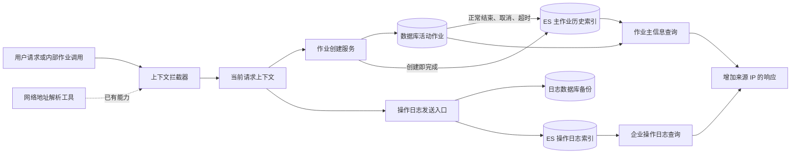
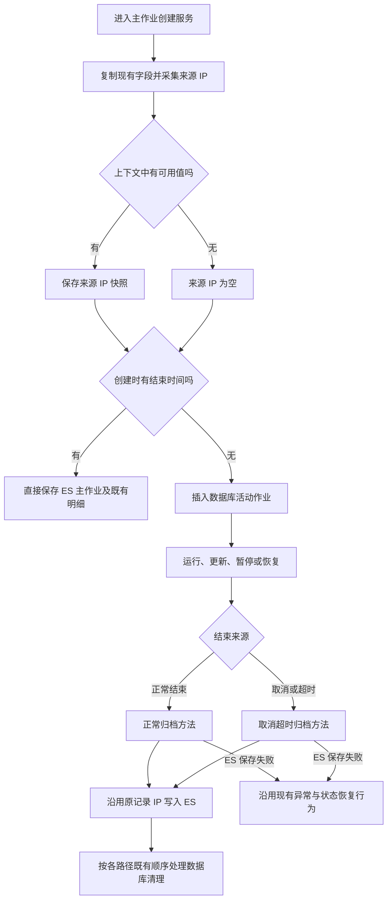
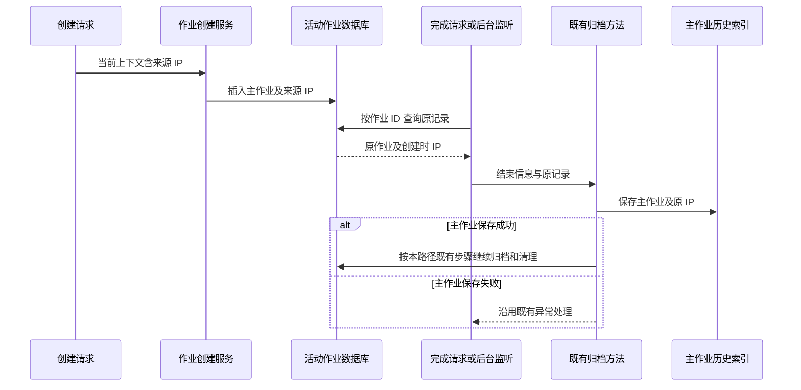
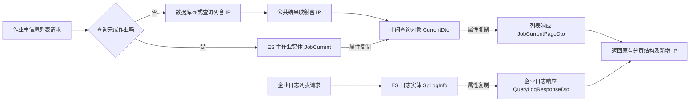

# 操作日志与作业来源地址接口与数据规范

> 状态：已确认（本地实施完成，未部署）
> 最后更新：2026-10-16
> 适用范围：deepfos-platform 企业操作日志、活动作业、ES 历史作业
> 关联文档：[主题说明](../说明.md)、[来源地址字段实施计划](../代码执行计划/2026-10-16-来源地址字段实施计划.md)

## 一、需求与边界

已确认需求：

1. 创建独立需求分支。
2. `/log/enterprise/log-list` 的响应实体增加 `ip`。
3. `/job-current-list` 的未完成和已完成作业均返回 `ip`；创建时持久化到数据库，归档时保留到 ES。
4. IP 可从请求上下文 `CustomContext.getParams()` 获取，核查并复用现有合适方法。
5. 前轮交付文档，本轮获准执行代码与本地验证；用户明确暂不部署，不修改远端数据库或 ES。

本规范不增加 IP 筛选、模糊搜索、排序、前端展示、Excel 导出列、子作业独立来源地址，不调整已有权限、状态机、超时机制、分页和主明细迁移顺序。

以下图展示当前服务边界与两类数据的来源。虚线表示仅核查的已有能力，不要求修改框架。



“数据库”在本需求首先指 MySQL；代码仓库存在多个 SQL 方言，实施时必须覆盖实际受支持且会加载新模型的方言。主作业与子作业索引不同，本次只扩展主作业索引。

## 二、已确认的代码事实

核查基线为后端提交 `9e155699`。详细文件位置见[执行计划的代码依据](../代码执行计划/2026-10-16-来源地址字段实施计划.md#二依据与现状)。

| 链路 | 已确认事实 |
| --- | --- |
| 操作日志写入 | `space` 模块 `LogCotroller.addLog` 从 `RequestContext.getParams().get("ip")` 取值；属性复制到 `SpLogInfo`，随后写数据库和 ES |
| 企业日志返回 | `system` 模块的 `SpLogInfo` 已有 `ip`；`QueryLogResponseDto` 没有 `ip`，`packageLogData` 通过属性复制生成响应 |
| 作业创建 | `JobServiceImpl.jobCreate` 构造 `JobCurrent`；没有结束时间时插入 `job_current`，有结束时间时直接写 ES |
| 作业正常结束 | `JobController.jobUpdate` 先通过 `selectByJobId` 取原记录，再合并更新，调用 `transferEs`；先写 ES，后删数据库主明细 |
| 取消及超时 | 取消和 `RedisKeyExpirationListener` 使用 `removeJobToES`，从数据库实体保留原有字段；该方法的主明细写删顺序与 `transferEs` 不完全相同 |
| 作业查询 | `complete=false` 读 Mapper 的 `CurrentDto`；`complete=true` 将 ES 的 `JobCurrent` 复制到 `CurrentDto`；最后都复制到 `JobCurrentPageDto` |
| MySQL 持久化 | 插入列、列表列、`selectByJobId` 都是显式 SQL，不能只加 Java 属性 |
| 主作业索引 | 名称基于 `os.job.current`，有空间时查企业 code 并追加小写企业后缀；没有企业后缀时用基础索引 |
| ES 仓库 | 自定义仓库按 `IndexCoordinates` 直接保存，当前 `checkIndex` 只检查是否存在，不负责同步字段 mapping |

框架来源证据需区分版本：本地 `seepln-framework` 源码 `pom.xml` 声明 `common:2.0.18`，平台依赖声明 `common:2.0.19`。本轮已通过 Maven 实际本地仓库的 `common-2.0.19.jar` 字节码复核：拦截器调用 `NetUtils.getIpAddress(request)` 写入参数，`RequestContext.getParams()` 委托读取当前上下文，行为一致；未升级或发布框架包。

## 三、字段协议

| 对象 | 字段 | 类型与可空性 | 语义 |
| --- | --- | --- | --- |
| 企业日志列表每条记录 | `ip` | 字符串，可空 | 原日志记录时保存的来源地址 |
| 作业列表每条记录 | `ip` | 字符串，可空 | 主作业创建时当前上下文中的来源地址 |
| 数据库 `job_current` | `ip` | `VARCHAR(100)`，允许 `NULL` | 活动作业的来源 IP 快照，无默认伪造值 |
| ES 主作业文档 | `ip` | 新增字段采用 `keyword` | 与数据库同义的字符串快照，不使用 ES 原生 `ip` 类型 |

示例仅展示新增字段，不改变现有分页外壳和其他字段：

```json
{
  "ip": "203.0.113.8"
}
```

IPv4、IPv6 均按字符串保留。作业新采集值先去首尾空白；上下文、参数 Map、键缺失、空字符串或 `unknown` 时按空值处理。超过 100 字符时按空值处理，不让可选审计字段造成数据库写入失败，不截断为可能指向其他来源的地址。

历史数据无 IP 时业务含义为未知。响应目标为可空 `ip`；按项目现有 JSON 空值策略序列化，不为本字段修改全局序列化配置。调用方不得把未知解释为本机或查询者 IP。

## 四、IP 获取方案

### 采用的入口

作业创建服务中，在 `BeanUtils.copyProperties(jobCurrentDto, jobCurrent)` 之后读取一次 `RequestContext.getParams()`，经空值处理后设置 `JobCurrent.ip`。不要在创建分支判断之后分别补值，也不要等结束、取消或超时发生时才取值。

这与操作日志的来源一致，也覆盖当前合并部署中的内部调用：`SystemApiImpl.createJob` 转换 DTO 后直接进入 `JobController.jobCreate`，不会再经过一次 HTTP 拦截器。使用当前线程已有上下文即可，不要求各业务调用方把 IP 塞进请求体。

### 备选方法比较

| 方法 | 判断 |
| --- | --- |
| `RequestContext.getParams()` | 推荐。现成的当前上下文访问方法，内部读取 `CustomContext.getParams()`；Map 仍需判空 |
| 已显式传入的 `customContext.getParams()` | 对跨线程调用合适；应使用任务发起时捕获的上下文，不到结束时读取线程本地变量 |
| `NetUtils.getIpAddress(request)` | 拦截器已经调用，业务层重复解析没有新增收益，且内部调用、后台线程未必有 servlet request |
| 账号模块 `IpUtil.getIp(request)` | 不引入。与框架工具的代理头优先级、多个地址处理和 IPv6 回环处理不同，会造成日志与作业口径不一致 |
| 本机网络地址工具 | 不采用，获取的是服务实例地址，不能替代请求来源 |

已核实的框架工具优先读取 `x-forwarded-for`，该头包含多个值时取第一项，再检查其他代理头，最后回退 `request.getRemoteAddr()`。来源地址是否为最终用户地址，依赖部署代理正确维护这些请求头；跨 HTTP 服务时尤其需要真实链路验证。本次复用现状，不调整代理头信任模型。

没有请求上下文的定时、后台或内部任务允许 `ip` 为空，不因此中止作业。若调用方异步创建作业且丢失上下文，不在本次自动扩展为全平台线程上下文改造；将其作为已知边界记录并在代表性业务创建链路联调确认。

## 五、生命周期与保留规则

以下图展示 IP 在不同创建和归档路径中的处理，IP 缺失仅影响字段值，不改变作业执行分支。



必须保留以下约束：

- 更新接口不采集来源 IP，不给更新 DTO 增加可覆盖来源 IP 的字段。
- `selectByJobId` 必须选出 IP，正常归档、取消和超时才能沿用数据库中的值。
- 普通更新路径会新建 `JobCurrent`，但其更新 SQL 只更新既有字段；不把新对象中的空 IP 写回覆盖已存值。
- `transferEs` 与 `removeJobToES` 的既有事务、锁和写删顺序均保持。ES 与数据库不构成分布式事务，本次不扩大为归档一致性重构。
- 不从当前作业更新者、取消者、超时监听线程或应用实例推断创建 IP；旧作业未知来源时继续为空。

以下时序图说明正常归档为什么依赖查询原记录时就携带 IP。



该图只强调主作业与 IP 的关系；不把两个归档方法的子作业顺序误写为完全相同，也不保证当前未实现的跨存储原子性。

## 六、查询与兼容

以下图列出必须贯通的转换点，避免仅修改最终响应类。



新增 IP 不参与现有查询条件，因此总数、过滤、排序、权限、语言、百分比计算均应与改动前一致。`JobCurrentPageDto` 还被单条历史作业查询等接口复用，这些接口自然新增可空字段，列入兼容回归，不改其既有业务逻辑。

## 七、数据库与索引迁移

### 数据库

- 向已有 `job_current` 增加可空 `ip`，不加索引，不要求更新历史行。
- 优先在现有初始化脚本末尾追加增量语句，保留已执行的建表 SQL 原文。初始化器按 SQL 内容记录执行结果，改写历史建表语句可能导致重新执行记录变化。
- 新库按原脚本创建表后执行增量加列；旧库执行增量；重复启动应跳过成功记录，手工先执行过 DDL 的环境须按元数据确认并记录，不能把重复列异常当成功证明。
- 当前初始化器捕获单条 SQL 异常后会继续执行。发布必须实际检查列存在、类型和可空性，不能只看进程成功启动。
- Mapper 与 DDL 需匹配：公共结果映射一份，方言 Mapper 有 MySQL、OceanBase、达梦、人大金仓、PostgreSQL、openGauss、MySQL 协议 openGauss 七份。
- `SYSTEM-INIT` 六种脚本均有 `job_current` 建表，包括 OceanBase（此前盘点未覆盖带反引号的表名，已纠正）。MySQL 协议 openGauss 的 Mapper 类型与初始化数据库类型可分别配置，沿用 `datasource.type` 选择基础脚本、`datasource.mapper-type` 选择 Mapper；不新增未经现有初始化器支持的同名脚本。实际部署组合仍在发布前核实。

### ES

- 新代码实体的 `ip` 显式标注 `@Field(type = FieldType.Keyword)`，但**注解本身不等于真实索引完成升级**。当前自定义保存路径不会为已存在的动态索引同步 mapping。
- 发布前枚举本环境实际的主作业基础索引及企业索引，以 `os.job.current` 和已有命名逻辑为准，不硬编码默认值，不修改子作业索引。
- 对不存在 `ip` 的既有主作业索引增量添加 `ip: keyword`；已是 `keyword` 时跳过。若已存在其他类型，先记录并评估，禁止删除索引、原地变更已有类型或以全量重建作为默认动作。
- 核查匹配这些索引的现有模板；在保持原有模板内容和匹配优先级语义的前提下增加 `ip`。若没有适用模板，增加只覆盖本部署主作业基础名与企业后缀的窄范围模板。模板是未来新索引的保证，单次更新既有索引不能替代它。
- 必须模拟模板并创建测试企业索引验证。当前动态字段、时间字段和现有搜索模式均保持，不直接依据整个 `JobCurrent` 重新生成全部 mapping。
- 操作日志已有 `ip` 且仅增加返回字段，本次不把它的未知现存类型强制改为 `keyword`。
- mapping 更新不会给历史文档自动补 IP。没有可靠来源的历史作业保持缺失；本次不从“同用户当前 IP”回填。

## 八、可验证验收

- [ ] 给定日志 ES 文档已有 IP，当查询企业日志，则返回同一 IP；无 IP 的日志继续正常返回。
- [ ] 给定创建上下文含 IPv4 或 IPv6，当创建未完成作业，则数据库和 `complete=false` 列表返回相同 IP。
- [ ] 给定创建 IP 为 A、更新或取消请求 IP 为 B，当作业归档，则历史文档与 `complete=true` 列表仍返回 A。
- [ ] 给定创建时已经有结束时间，当创建作业，则不新增数据库活动记录，ES 及列表保留创建 IP。
- [ ] 给定后台线程没有请求上下文，当超时归档已有作业，则保留数据库中的 IP，且没有空指针错误。
- [ ] 给定无上下文、空 Map、空值、空白、`unknown` 或超过长度的来源值，当创建作业，则不因 IP 字段中止创建。
- [ ] 给定历史作业没有 IP，当普通更新、结束或查询，则保持未知，不使用当前请求 IP 补写。
- [ ] 给定既有和未来主作业索引，当部署迁移并创建测试企业索引，则 `ip` 映射正确，其余字段定义保持。
- [ ] 给定相同业务样本与权限，当比较改动前后，则过滤、分页、计数、排序、状态、明细、回调和导出行为一致。
- [ ] ES 主作业保存失败、明细保存失败和重复归档场景的行为与基线一致，不因新增字段增加删除、重试或覆盖。

## 九、待确认事项

| 项目 | 影响与处理 |
| --- | --- |
| 目标环境 ES mapping、模板、索引名前缀及模板优先级 | 实施前只读核查，生成逐项增量变更清单后执行；本轮未连接目标 ES |
| 目标数据库版本、权限、表结构和初始化记录 | 决定 DDL 语法、锁等待和幂等验证方式；本轮未执行 DDL |
| 数据库与 Mapper 配置组合 | 六种基础脚本建表已核实；部署前核对 `datasource.type` 与 `datasource.mapper-type`，确保实际 schema 已升级 |
| 实际部署依赖包 | 本地实际 `common:2.0.19` 已核实行为一致；部署时核对实际发布依赖未被替换 |
| 代表性异步和跨 HTTP 创建链路 | 验证创建时原始上下文和代理头是否保留；缺失时允许未知，不承诺所有后台任务都具备最终用户 IP |
| 来源地址之外的范围 | IP 模糊搜索、前端列和导出列留待单独明确，不混入本次实施 |

## 十、实施同步记录

- 节点 1 已复核：需求分支与基线正确，无既有已跟踪源码改动。
- 实施范围已明确为代码、迁移材料和本地验证；远端迁移及部署保持未执行。

- 节点 2 本地核查完成：已复核实际框架 2.0.19 字节码和 OceanBase 建表；远端配置、表结构与模板按暂不部署要求保留为发布前事项。
- 节点 3 已实现数据库与 Mapper 字段契约：六种增量脚本统一 `VARCHAR(100) DEFAULT NULL`，七种方言补齐显式列；历史建表和普通更新语句保持。已通过 XML 解析，真实读写验证安排在节点 8。
- 节点 4：代码完成，编译通过。JobCurrent、CurrentDto、JobCurrentPageDto 增加 IP；创建分支前从上下文采集、空值和长度保护；手动转换同步；Maven reactor compile 通过；生命周期与响应测试在节点 8 执行。
- 节点 5：代码审计完成。selectByJobId 已带回 IP；更新 DTO 与更新 SQL 不开放来源修改；两个归档方法和超时监听未改状态机及顺序；节点 8 验证正常结束、取消、超时与失败边界。
- 节点 6：代码完成，编译通过。仅 system 日志 QueryLogResponseDto 增加可空 IP 及访问方法，沿用 packageLogData 属性复制；节点 8 验证真实响应生成与 JSON 序列化。
- 节点 7 已交付可执行的发布迁移说明 `deepfos-platform/ai-docs/log-job-ip.md`，覆盖存量字段和未来企业索引模板。遵循暂不部署要求，所有真实环境 mapping 与模板更改保持未执行。
- 节点 8 的 32 项专项测试已全部通过：21 项生命周期和双查询分支、7 份 Mapper 在 H2 的实际读写、1 项 Spring Data ES 文档转换、3 项企业日志响应。H2 仅证明当前 SQL 在本地兼容模式可执行，不代表所有原生数据库与远端 ES 已联调。

- 节点 8 完成：上述 32 项专项与既有方言回归 5 项，共 37 项全部通过，无失败或跳过。
- 节点 9 按用户要求不部署：远端 DDL、mapping、模板与真实业务联调均未执行；已交付发布前检查和回滚说明。

## 十一、本地实现与验证结论

本规范字段契约已落实到 `JobCurrent`、`CurrentDto`、`JobCurrentPageDto`、企业日志 `QueryLogResponseDto`、创建服务、公共结果映射、七份方言 Mapper 和六份增量脚本。创建请求和更新请求不增加可覆盖 IP 的字段，普通更新 SQL 不写 IP，两个归档方法及后台监听的既有流程保持。

32 项专项和 5 项既有方言回归证明了本地样本的来源保留、数据库映射、响应和文档转换；不代表现有 ES mapping 已更新，也不代表七种原生数据库、代理头、异步上下文与全部既有业务在目标环境已联调。第八节涉及真实环境的验收条件仍作为部署验收，不因本地测试通过直接勾选。

未来模板与存量 mapping 的准备方式见后端 `ai-docs/log-job-ip.md`，实际执行仍留待部署。历史字段事实表保留了核查基线 `9e155699` 的现状描述，当前实现结果以本节和执行记录为准。

- 2026-10-16 本地提交同步：后端提交 `0f258e18`；本规范与执行计划同步进入 docs 本地提交。接口与数据契约不变，未推送或部署。


## 十二、简化提交范围

2026-10-16 用户进一步明确：代码必须简洁，非必要测试依赖与辅助代码不进入提交。为此移除仓库内 H2 测试依赖和四份本需求新增测试文件，保留必要的 IP 字段、创建采集、映射、增量 SQL 和迁移说明。专项测试移到仓库外，仅作本地临时验证；不新增替代依赖或测试基础设施。

前文 32 项临时专项与 5 项回归是首轮实际验证记录，不表示当前仓库仍提供这些专项测试源码。字段与存储契约、历史空值和更新不可覆盖规则均不变。当前仓库只使用既有测试依赖重新编译并执行现有方言回归；仍不部署。

- 清理后验证完成：移除 H2 和专项测试后重新编译，5 项既有方言回归全部通过。后端清理提交为 `24cf8f9d`，本轮按用户要求正常推送，业务契约保持，部署仍不执行。
