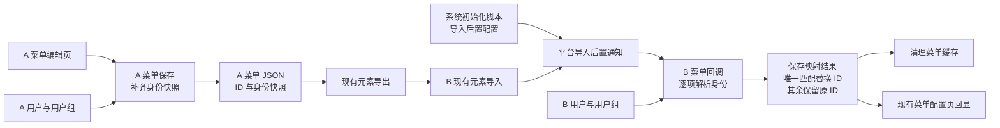
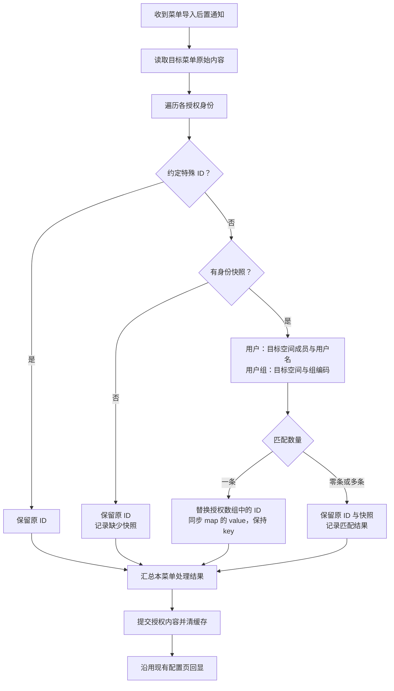

# 菜单权限跨环境迁移修复计划

> 状态：已确认
> 最后更新：2026-10-15
> 适用范围：`deepfos-platform` 的 `menu-server`、平台元素导入通知及系统初始化配置
> 关联文档：[功能说明](../说明.md)、[恢复重建与删除组件通知](../../元素备份恢复/代码执行计划/2026-08-07-恢复重建与删除组件通知.md)

## 1. 交付目标与确认规则

解决 A 环境菜单导出后导入 B 时，自定义用户、用户组权限仍引用 A 的 ID，无法对应 B 身份的问题。

本计划按用户在 2026-10-15 确认的以下规则执行：

- 菜单后端保存时附带 `userName` 和 `groupCode`，不增加菜单导出前置、后置接口。
- 身份快照以用户名、用户组编码为 key，以当前 ID 为 value，字段为 `userIdsByName / groupIdsByCode`。
- 用户于 2026-10-15 最后更正：菜单用户、用户组的匹配候选范围均为目标空间；不能把“企业内存在用户”视为“用户已加入目标空间”。
- 目标环境通过菜单导入后置接口，将可唯一匹配的身份转换成 B 的 ID。
- `sys_melement_operate_notice_config` 在初始化脚本中增加菜单导入后置配置，兼顾已有环境执行。
- 未匹配或匹配多条时，逐项保留导入数据中该项原 ID；不清空、不跳过该授权项、不任意选择一条结果。
- 原 ID 在 B 查不到时，现有菜单编辑页会显示无用户、用户组，这即为本次认可的页面提示。本次不新增错误持久化字段、错误面板或迁移状态阻断。
- 正常使用继续按 ID 鉴权，保持原有公开、继承、自定义权限语义。

本计划记录代码执行方式；2026-10-15 已完成本地代码及针对性测试。实施结果与发布后验证边界见第 12 节，不将代码完成等同于已部署和完成客户环境迁移。

## 2. 依据与已确认现状

### 2.1 代码定位

以下路径相对于后端仓库 `/Users/yang/deepfinance_project/deepfos-platform`；前端仓库为 `/Users/yang/deepfinance_front_project/front-end-development-group`。

| 已确认事实 | 代码位置与符号 | 对本次实现的约束 |
| --- | --- | --- |
| 自定义授权保存用户、用户组 ID | `menu-server/src/main/java/com/proinnova/v2/menu/pojo/bo/relation/UserGroup.java`，`userIds / groupIds` | 新身份快照作为附加字段，保留现有 ID 字段 |
| 新建、更新最终保存菜单 JSON | `menu-server/src/main/java/com/proinnova/v2/menu/service/impl/MenuServiceImpl.java`，`create / update / buildPlatformElementOnCreate / buildPlatformElementOnUpdate` | 在 JSON 构建之前补齐快照，新建与更新保持一致 |
| 菜单编辑查询校验 ID 是否存在 | 同上，`validatePermission / filterIdExisted` | 不改变原有校验与页面回显语义 |
| 运行时直接匹配用户、所属组 ID | 同上，`hasPermission` | 本次不切换为按编码鉴权 |
| 新旧菜单格式转换显式构造授权对象 | `menu-server/src/main/java/com/proinnova/v2/menu/util/V1DataConversionUtil.java`、`V2DataConversionUtil.java`，后者的 `buildPermission` | 转换时必须保留身份快照，不能仅改一个 DTO |
| 元素导出携带菜单自定义内容 | `app-server/src/main/java/com/proinnova/app/element/service/impl/ElementExportAsyncServiceImpl.java`，`elementInfoDetail` | 保存后的快照直接随现有导出包迁移 |
| 平台已有元素导入后置通知编排 | `app-server/src/main/java/com/proinnova/app/element/service/impl/ElementImportAsyncServiceImpl.java`，`noticeForElementImport` | 复用平台调用，不另建导入作业或导出通知 |
| 通知按模块、元素类型、操作、前后置类型匹配 | `app-server/src/main/java/com/proinnova/app/manage/SpModuleOperateNoticeConfigManage.java`，`noticeForElementImport / sendNoticeForElementImport` | 采用现有 `ELEMENT_IMPORT / REAR` 协议 |
| 当前平台操作通知查询读取元素级表 | `system-server/src/main/java/com/proinnova/system/module/service/impl/ModuleServiceImpl.java`，`getOperateNoticeConfigByOperate` | 必须补充 `sys_melement_operate_notice_config`，只补模块级表无效 |
| 菜单现有回调只有应用创建、组件注册 | `menu-server/src/main/java/com/proinnova/protocolregister/rest/RegisterCallBackController.java`；`menu-server/src/main/resources/module-config.properties` | 增加菜单导入后置入口和对应声明 |
| 按方言执行系统初始化 SQL | `system-server/src/main/java/com/proinnova/system/init/service/impl/InitServiceImpl.java`，`SYSTEM-INIT/<datasourceType>.sql` | 沿用既有初始化脚本机制 |
| 配置页按 ID 加载身份详情 | 前端 `src/modules/menu/pages/edit/Trays/components/MenuInfo/UserGroupSelector.tsx`，`setTransferData` | 查不到的 ID 沿用现有空回显，不新增 UI |

### 2.2 dev 实际配置快照

2026-10-15 只读查询 dev 的 `system` 库，得到以下菜单记录。此处记录配置事实，不包含连接凭据。

| 表 | 模块／元素 | 操作 | 类型 | 回调 |
| --- | --- | --- | --- | --- |
| `sys_module_operate_notice_config` | `MEN1_0` | `APP_CREATE` | `REAR / ASYNC` | `/menu/app-create-rear` |
| 同上 | `MEN1_0` | `MODULE_REGISTER` | `REAR / ASYNC` | `/menu/module-register-rear` |
| `sys_melement_operate_notice_config` | `MEN1_0 / MEN1_0_MEN`，类型 `MEN` | `APP_CREATE` | `REAR / ASYNC` | `/menu/app-create-rear` |
| 同上 | 同上 | `MODULE_REGISTER` | `REAR / ASYNC` | `/menu/module-register-rear` |

这两张表的菜单记录均没有 `ELEMENT_IMPORT / REAR`。本地代码中平台导入通知最终通过同步调用发起；不能仅凭配置中的 `ASYNC` 字样推断 HTTP 调用不等待完成。

### 2.3 现成平台查询能力核查

以下为 2026-10-15 对本地代码及性能调用链的核查结论，尚未代表新回调已完成 dev 联调。性能约束纳入本次范围：用户接口沿用现有协议并优化内部空间成员过滤；用户组新增按组编码批量精确查询的薄接口，复用已有 SQL 能力，不采用全空间列表后内存筛选的方案。

| 用途 | 现有 HTTP 接口／内部入口 | 能力与采用方式 |
| --- | --- | --- |
| 菜单选择用户 | `GET /api/space/user-info/page` | 当前空间用户分页列表，`keyword` 模糊查询用户名、昵称、邮箱；证明配置候选范围为空间，但不作为批量精确映射接口 |
| 回调按用户名查 ID | `GET /api/space/user-info/query/batch/by-name`；`SpaceApi#batchQueryUserByNames(String[], String)` | 已有批量精确查询协议，但内部目前用空 ID 集合查询全空间成员；本次优化为仅校验命中用户名的候选 ID，并用 Set 过滤 |
| 不采用的全量组查询 | `GET /api/space/group-info/all_enable_group`；`SpaceApi#getAllEnableGroup(null)` | 能取得 `id / groupCode / groupName / status`，但返回全部空间组，成本随空间组总数增长，本次不用于导入映射 |
| 不能用于组编码匹配的近似接口 | `GET /api/space/group-info/query/batch/by-name`；`SpaceApi#batchQueryGroupByNames` | 实际按 `group_name IN (...)` 查询，不能把 `groupCode` 当作参数传入 |

用户批量查询的已确认调用链：

```text
SpUserInfoController#batchQueryUserByNames
  -> SpUserInfoServiceImpl#batchQueryUserByNames
  -> 账户中心按企业和用户名精确查询
  -> SystemInfoClient#getUserIdsBySpacePost 当前传空 ID 集合，获取全空间成员
  -> 过滤非目标空间成员，返回用户列表
```

代码位置：`space-server/src/main/java/com/proinnova/space/core/rest/SpUserInfoController.java:194`、`space-server/src/main/java/com/proinnova/space/core/service/impl/SpUserInfoServiceImpl.java:992`。当前方法已计算 `idList`，但获取空间成员时传入 `new ArrayList<>()`，后续使用 `List.contains`，会产生全空间结果传输及候选数乘空间成员数的内存比较。本次改传非空的候选 `idList`，接收结果转为 Set 后判断成员资格。底层 `SystemApi#getUserIdsBySpacePost -> SpUserServiceImpl#batchQueryUser -> SpUserCommonMapper#queryUserIds` 已支持 `space + type=USER + id IN (...)`，不需要为用户新增查询 HTTP 接口。候选为空时必须直接返回，不能传空集合触发底层全量语义。

菜单已有 `SelfCallElementManagerServiceImpl#getUserInfoByName` 复用用户名查询，但仅封装单用户名且固定 `ENABLE`；本次应封装集合入参，不逐个用户名调用，也不直接照搬其固定状态过滤。

用户组列表的已确认调用链：

```text
SpaceApi#getAllEnableGroup(null)
  -> SpUserGroupController#getAllGroup
  -> SpGroupInfoServiceImpl#getAllUsedGroup（page=false，keyword=null）
  -> SysUserInfoCloud#getGroupInfo
  -> 账户中心 selectGroupListByUserGroupNameFuzzy
  -> UserGroupMapper#selectGroups（ug.space_id = 当前空间）
```

代码位置：`space-server/src/main/java/com/proinnova/space/api/SpaceApiImpl.java:401`、`space-server/src/main/java/com/proinnova/space/core/service/impl/SpGroupInfoServiceImpl.java:649`、`seepln-account/seepln-account-core/src/main/resources/mapper/common/UserGroupMapper.xml:228`。该 SQL 返回 `group_code`；`SpaceUserGroupInfoVo` 已包含 `groupCode`，可供菜单侧使用。虽然入口名称含 `Enable`，当前列表链路没有显式设置状态过滤，不能仅按名称认定只返回启用组。

目前没有发现直接对外提供“当前空间 + 多个组编码”精确查询的专用接口；账户中心已有 `UserGroupMapper#selectGroups` 的 `codes` SQL 分支，以及 `getUserGroupListBySpaceId(groupCodeList, spaceId)` 等底层能力。为避免全量查询，本次新增薄的批量组编码查询入口和内部 API 透传，直接查询目标空间及指定组编码，不先查全空间组 ID，不拉取组成员或构建用户组树。采用返回 `id / groupCode / status` 列表的现有 Mapper 能力，保留重复匹配结果供菜单判断；状态规则沿用现有菜单语义。

保存快照时还需注意：现有菜单 `SpaceClient#findUsers` 调用的 `SpaceApi#batchQueryUser(List, status)` 对应不按当前空间过滤的用户 ID 查询重载。另一入口 `SpaceApi#batchQueryUserPost` 会标记 `leaveSpace`，并在部分配置下追加空间组成员查询，也不能仅凭方法名称当作轻量且已过滤的入口。快照生成应按已选候选 ID 查询详情，再用 `SystemApi#getUserIdsBySpacePost(候选ID, space)` 校验空间成员，不展开全空间组或成员。用户组 ID 查询已有 `SpaceApi#batchQueryGroupByPost`，返回对象 `SpaceGroupInfoVo` 含组编码；菜单本地 `GroupVO` 当前没有 `groupCode` 字段，需要补充该字段或使用专用快照 DTO，避免 JSON 转换丢失编码。

### 2.4 性能决策与验证约束

设空间总用户数为 U、总组数为 G，本次菜单去重后引用的用户名数为 K、组编码数为 L。原全量方案会传回 U 个用户 ID 或 G 个组，即使 K、L 很小也会受空间规模影响；用户 `List.contains` 过滤还可能产生 O(K×U) 比较。逐菜单回调时这一成本会重复，不能把“每个回调只查一次全量”当成足够的优化。

本次改为：用户名批量精确查询后只校验其候选 ID，用户组按空间及组编码列表下推 SQL；回传、集合构造和匹配以本次命中候选规模为界，菜单递归遍历一次。数据库是否避免大范围扫描仍取决于索引及执行计划，不能只靠增加 `IN` 条件作性能保证。

- 同一菜单内先去重用户名、组编码和 ID，再按统一批大小 B 分批；首次建议 B=200，作为可调整的实现参数，需按 GET URL 长度、数据库参数数量及联调结果校准，不作为已测得的性能阈值。
- 查询调用次数按去重后的身份数及分批数增长，不按菜单节点数增长；没有普通用户或组时跳过对应查询，不并发发出无限请求。
- 空候选在每层直接返回；不通过空列表回退全量，不通过逐个身份查询或全量缓存掩盖问题。
- 核查用户名精确查询及企业关联索引、`user_group_space` 的空间／类型／ID 过滤索引，以及 `user_group` 的空间／组编码索引；有合适索引则复用，没有才按实际 EXPLAIN 和发布约束补充，避免重复建索引。
- 在固定 K、L 下增加 U、G，记录身份查询次数、返回行数、SQL 扫描情况、耗时与响应大小；再固定空间规模增加 K、L，验证分批行为。耗时目标根据测试环境与客户规模确定，本计划不编造毫秒级承诺。

## 3. 范围与边界

包含：菜单保存补齐身份快照、导入后置逐项映射、用户批量接口内部性能优化、组编码批量查询薄接口、菜单新旧格式兼容、通知初始化脚本、已有菜单快照补齐、缓存失效、日志和必要测试。

本次不改元素本身的使用／修改／完全控制权限导入，不改平台导入向导的覆盖／增量／忽略规则，不自动创建用户或用户组，不改菜单节点 ID，不增加导出接口，不改变正常鉴权策略，不新增页面错误展示。备份恢复可复用同一通知接口，但不扩展既有恢复动作的通知范围。

以下全景图展示本次修改的位置和现有导出、导入机制的关系。



## 4. 数据设计与保存规则

### 4.1 身份快照

身份快照以用户名、用户组编码为 key，以当前环境的 ID 为 value。回调直接批量查询 key，并用 value 中的原 ID 定位授权数组中的替换项；未匹配时仍有原 ID 可保留，无需维护两组依赖顺序的平行数组。

在 `permission.userGroup` 中保留原字段，新增两个可选字段：

| 字段 | 类型 | 用途 |
| --- | --- | --- |
| `userIds` | `List<String>` | 现有用户 ID；继续用于鉴权 |
| `groupIds` | `List<String>` | 现有用户组 ID；继续用于鉴权 |
| `userIdsByName` | `Map<String, String>` | 菜单所属空间内的用户名 → 当前用户 ID，不使用昵称作为 key |
| `groupIdsByCode` | `Map<String, String>` | 菜单所属空间内的用户组编码 → 当前用户组 ID，不使用组名称作为 key |

示例仅使用虚构身份：

```json
{
  "userIds": ["A_U_1"],
  "groupIds": ["A_G_1", "A_G_2"],
  "userIdsByName": {"demo_user": "A_U_1"},
  "groupIdsByCode": {"FINANCE": "A_G_1", "REPORT_VIEWER": "A_G_2"}
}
```

如果 `demo_user` 唯一匹配到 `B_U_8`、`FINANCE` 唯一匹配到 `B_G_9`，而 `REPORT_VIEWER` 未匹配，则结果为：

```json
{
  "userIds": ["B_U_8"],
  "groupIds": ["B_G_9", "A_G_2"],
  "userIdsByName": {"demo_user": "B_U_8"},
  "groupIdsByCode": {"FINANCE": "B_G_9", "REPORT_VIEWER": "A_G_2"}
}
```

成功转换后保持 key 不变，同时更新授权数组与 map 的 value；未转换项的数组 ID 和 map 键值均保持原样，便于目标身份补齐后重试。所有 ID 均按字符串处理，不转为数字。运行时授权数组仍是鉴权依据，map 仅用于迁移身份解析。

身份匹配范围按用户于 2026-10-15 最后更正统一为空间；此处约束菜单可匹配成员，不推断账户中心用户名的底层唯一键：

| 身份 | 查询候选范围 | 目标查询条件 | map 的上下文 |
| --- | --- | --- | --- |
| 用户 | 菜单所属空间的用户成员 | 目标空间 + 用户名，底层企业查询后必须过滤空间成员 | 菜单所属空间 |
| 用户组 | 空间内组编码唯一，企业内可重复 | 目标空间 + 用户组编码 | 菜单所属空间 |

因此，同一企业其他空间存在同编码的用户组不构成本次匹配多条，也不能被选作替代结果。企业内查得到用户但该用户未加入目标空间，同样视为本次未匹配。目标空间查不到时保留原 ID，不扩大到整个企业查询，不自动添加空间成员。底层查询所需企业信息由目标空间或可信上下文解析，不能沿用源环境企业 ID。

当前 map 设计以每个菜单的组授权引用其所属空间为前提，不需要把源空间 ID 拼进 key。源环境生成快照时也要核查身份归属，不能把不同空间的同编码组压进同一个 map。实施前应核查现有授权是否支持跨空间引用；若支持且同一菜单实际引用多个空间的同编码组，则单层 `groupIdsByCode` 无法完整表达，必须先明确空间映射并调整为带空间上下文的结构，不能静默覆盖。

目标环境查询结果必须在上述正确范围内先判断匹配数量，再构造唯一匹配结果映射，避免 `toMap` 提前合并重复项。若批量查询或缓存跨越多个上下文，用户查询结果按空间与用户名区分，用户组查询结果按空间与组编码区分，不能仅以裸编码做全局缓存 key。

### 4.2 正常保存

1. 在菜单后端新建、更新公共保存逻辑中递归收集自定义授权节点。
2. 对 ID 去重后按身份分别批量查询：用户验证目标空间成员资格并读取用户名，用户组验证所属空间并读取组编码；复用第 2.3 节现有空间查询入口，避免每个节点分别调用远端接口。
3. 服务端生成“用户名 → 用户 ID”和“组编码 → 组 ID”快照，不把前端传入的 map 当作权威值；map 的 value 必须来自当前授权数组，不能引入额外授权项。
4. 用户取消某项授权后，删除该项对应快照；切换公开、继承权限时清理不再使用的自定义快照。
5. 当前正常保存的 ID 有效性仍走现有校验，不以本次迁移规则放宽日常保存校验。
6. “全选”等约定特殊 ID 按现有语义保留，不将其当作真实用户、用户组查询或迁移；以现有 `UserGroup#allSelected` 和选择器实际约定为准。

导入回调应有独立的授权内容更新入口，不能直接调用会重新校验所有原 ID 的普通菜单 `update`。否则按约定保留的无效 ID 可能导致整次映射结果无法保存。

## 5. 导入后置协议与映射规则

### 5.1 接口

计划新增 `POST /menu/element-import-rear`，接收平台现有通知字段：

```json
{
  "space": "demo_space",
  "app": "demo_app",
  "elementName": "demo_menu",
  "elementType": "MEN",
  "folderId": "B_FOLDER_1",
  "businessData": null,
  "opeType": "CREATE"
}
```

- 接口按现有组件通知约定建立空间、应用和用户上下文，校验元素类型、目标菜单归属及内部调用权限。
- `CREATE / UPDATE` 均处理，不能仅处理新建导入。
- 根据目标环境定位信息读取已落库菜单，兼容新旧 JSON，不使用普通导航查询返回的权限过滤结果更新内容。
- 不调用平台 `/element-info/import/callback`，不伪造业务数据导入记录。
- 本次不增加异步任务、自动重试队列或新导出流程。

### 5.2 逐项决策

用户以“目标空间成员 + 用户名”精确匹配，用户组以“目标空间 + 组编码”精确匹配。企业中存在但未加入目标空间的用户、其他空间同编码组均不计入候选。必须能判断正确范围内的零条、一条、多条；不得使用提前合并同名结果、任意取第一条的查询结果。

回调处理顺序：

1. 将回调的目标空间同步到可信请求及服务上下文，收集并去重各节点 `userIdsByName / groupIdsByCode` 的 key；用户分批调用完成内部优化后的 `SpaceApi#batchQueryUserByNames`，用户组分批调用本次新增的空间组编码精确查询入口。禁止调用全空间列表、将组编码传给按名称查询接口或使用分页模糊搜索作映射。
2. 对每个 key 判断匹配数量；唯一匹配时，使用该条 map 的旧 value 定位原授权数组中的 ID，并计算目标 ID。
3. 基于处理前的授权数组一次性生成新数组，同时更新成功项的 map value；不要边修改数组边重复按旧 ID 替换，以免 ID 交叉相等时产生连锁替换。
4. 未匹配、多条匹配项保持原数组 ID 与 map 键值不变；缺少快照的数组项也原样保留。map 中不属于当前授权数组的陈旧条目不能据此新增授权。
5. 原子保存数组与 map。再次回调时，已成功项的 value 已是目标 ID，继续保持不变。

| 情况 | ID 处理 | 快照与日志 |
| --- | --- | --- |
| 目标范围内唯一匹配 | 替换为目标 ID | map 的 key 保持不变，value 更新为目标 ID，记录成功 |
| 未匹配 | 保留该项原 ID | 保留原快照，记录未匹配 |
| 匹配到多条 | 保留该项原 ID | 保留原快照，记录匹配不唯一 |
| 旧包无快照，或某个 ID 缺少对应快照 | 保留该项原 ID | 记录缺少快照，不按旧 ID 猜测身份 |
| 当前 ID 已等于唯一匹配结果 | 保持不变 | 视为已完成，允许重复通知 |
| 约定特殊 ID | 按现有语义保持 | 不做普通身份匹配 |
| 身份查询超时、落库失败等技术异常 | 不把技术异常当成零条匹配 | 回调返回失败，沿用平台通知失败日志机制 |

某一身份匹配失败不影响其他身份替换。先计算完整结果，再以一个菜单为单位提交授权内容；不修改菜单层级、节点 ID、首页、元素关系及其他设置。提交后清理相关菜单缓存，包括多节点场景所需的既有清理机制。

以下流程图明确唯一匹配替换及保留原 ID 的分支。



### 5.3 现有页面提示的准确边界

原 ID 在 B 查不到时，现有选择器按 ID 查询详情，回显为无用户、用户组；本次沿用此行为，不额外设计错误字段或 UI。

如果原 ID 在 B 恰好存在，页面未必为空；本计划不承诺所有匹配异常都会触发页面错误，也不因此改变已确认的“保留原 ID”策略。导入日志记录菜单、节点、身份种类、原 ID、匹配数量及处理结果，供排查使用，不记录完整菜单内容和无关个人资料。

## 6. 通知初始化配置

初始化脚本向 `sys_melement_operate_notice_config` 增加以下逻辑记录：

| 字段 | 值 |
| --- | --- |
| `module_id` | `MEN1_0` |
| `module_element_id` | `MEN1_0_MEN` |
| `operate` | `ELEMENT_IMPORT` |
| `type` | `REAR` |
| `url` | `/menu/element-import-rear` |
| `sync_or_asyn` | `SYNC`，按回调完成后确认结果的执行意图声明 |

实施要求：

- 修改 `system-server/src/main/resources/SYSTEM-INIT/` 中适用数据库方言的初始化脚本，在表创建后增加幂等配置写入；审计字段遵循现有初始化约定。
- MySQL 表主键为 `module_id + module_element_id + operate + type`，重复执行不得生成重复通知。其他已支持方言采用对应的幂等写法，不直接复制 MySQL 专用 SQL。
- 已有环境必须执行相同的幂等补充脚本；不能假设只改首次建库文件就会更新已部署环境。
- 同步维护 `menu-server/src/main/resources/module-config.properties` 中的通知声明，验证组件重新注册后记录仍存在。
- 运行时需要的是元素级表记录，不将补充 `sys_module_operate_notice_config` 作为触发通知的必要前提；若既有注册逻辑同步生成模块级记录，沿用其行为。
- 不为此新增配置接口或迁移框架，不删除原有应用创建、组件注册通知。

## 7. 实施步骤

### 1. 扩展身份快照及新旧格式转换

- 修改位置：`UserGroup.java`、`menu/dto/CustomAuthDto.java` 以及 `V1DataConversionUtil / V2DataConversionUtil` 中实际承载、重建权限的对象与方法。
- 具体改动：新增第 4 节 `userIdsByName / groupIdsByCode` 字段，方向为用户名／组编码 → 当前 ID；所有涉及转换的 DTO 保留字段；旧数据未提供时按缺少快照处理。
- 依赖关系：无。
- 验证方式：新旧格式往返转换后，ID、快照和特殊值均保持；旧 JSON 可正常读取。

### 2. 在菜单新建、更新时补齐快照

- 修改位置：`menu-server/.../v2/menu/service/impl/MenuServiceImpl.java` 的 `create / update` 及公共保存准备逻辑；按需扩展现有身份客户端返回字段。
- 具体改动：服务端按已选用户 ID 批量查询详情，并以非空候选 ID 校验空间成员；用户组按已选 ID 批量查询，按当前授权生成快照。菜单 `GroupVO` 补充 `groupCode` 或新增快照 DTO 承载；复用现有权限校验，避免全空间用户、组和组成员展开查询。
- 依赖关系：步骤 1。
- 验证方式：保存后读取原始菜单内容能看到快照；移除授权后无残留；现有元素导出包自然携带快照。

### 3. 实现导入后置映射与授权内容保存

- 修改位置：现有 `menu-server/.../protocolregister/rest/RegisterCallBackController.java` 或同包新增专用控制器；新增内部映射服务；复用现有平台元素读写客户端及菜单缓存服务。新增类名由实施时按仓库惯例确定。
- 具体改动：先完成下述平台查询适配，再实现第 5 节协议和映射表。按 map 的 key 分批查询目标身份，以旧 value 定位原数组项，成功时同步更新数组 ID 与 map value；保留未匹配、多条匹配及缺快照项的原值；保存时不因这些保留 ID 无效而触发普通编辑校验拒绝；只更新授权及快照。
- 平台查询适配位置与内容：
  - `space-server/.../SpUserInfoServiceImpl#batchQueryUserByNames`：将空间成员查询的空集合改成命中用户名的非空 `idList`，空候选直接返回，成员结果转 Set；现有用户 HTTP 协议不变。
  - `space-server/.../SpUserGroupController`、`ISpGroupInfoService / SpGroupInfoServiceImpl`：计划新增 `POST /api/space/group-info/query/batch/by-code`，接收 `groupCodes` 集合及可选状态，校验目标空间与非空入参；新增对应 `SpaceApi / SpaceApiImpl` 内部入口供菜单调用。
  - 实施时简化为：在既有空间 `GroupQueryDto` 和账户中心 `UserGroupQueryApiDTO` 中增加 `userGroupCodes`，由现有 `getGroupInfo / groupListByUserGroupNamesFuzzy` 调用链透传，在 `UserGroupServiceImpl` 中设置非空 `codes` 条件；不新增 `AccountApi` 或 `SysUserInfoCloud` 方法。保留目标空间、企业约束，返回候选列表而不是提前合并的 map，空编码集合直接返回。
- 依赖关系：步骤 1；现有用户接口内部优化及新增组编码薄接口均完成；先核查菜单组授权是否存在跨空间引用。
- 验证方式：单菜单混合成功、未匹配、多条匹配结果正确；重复回调幂等；技术异常按菜单原子处理并传播失败；回显使用更新后的缓存；身份查询不调用全空间列表，空参数不导致全量 SQL，候选 ID 正确下推。

### 4. 补充初始化脚本及通知声明

- 修改位置：`system-server/src/main/resources/SYSTEM-INIT/` 各适用方言脚本、`menu-server/src/main/resources/module-config.properties`。
- 具体改动：加入第 6 节记录并提供已有环境可执行的同等幂等 SQL；保持已有通知配置。
- 依赖关系：步骤 3 的接口可用后启用通知配置。
- 验证方式：首次初始化、已有环境补充、重复执行、组件重新注册后，按四元组均只存在一条有效导入后置记录；标准导入实际调用新接口。

### 5. 补齐现有菜单并验证真实跨环境迁移

- 修改位置：源环境菜单编辑页，复用步骤 2 的正常保存逻辑；不新增补齐脚本或额外补齐接口。
- 执行方式：在 A 逐个打开需要迁移的旧菜单，检查配置并重新保存，生成身份快照后再导出；保留原授权 ID，查不到的源身份按现有校验和日志排查。
- 依赖关系：步骤 1–4；A 身份仍可查询；B 对应用户、组已存在于目标范围。
- 验证方式：补齐前后只改变身份快照；准备 A/B 编码相同、ID 不同的身份，完成导出、导入、页面回显和实际访问验证。

## 8. 测试与验收

| 场景 | 预期结果 |
| --- | --- |
| A/B 用户名相同、ID 不同 | 导入后使用 B 用户 ID，配置页回显 B 用户 |
| A/B 组编码相同、组名称不同、ID 不同 | 按组编码映射 B ID，不按组名称匹配 |
| B 同一企业的两个空间都有 `FINANCE`，菜单导入其中一个空间 | 只匹配目标空间的组，其他空间同编码组不算多条候选 |
| B 目标空间无 `FINANCE`，其他空间存在该编码 | 保留原组 ID，不回退到企业级查询 |
| 不同企业均存在同名用户 | 只匹配目标空间内的用户 |
| 目标企业存在该用户名，但用户未加入目标空间 | 保留原用户 ID，不在企业查到后直接授权，不自动添加空间成员 |
| 目标空间有用户，但分页列表首页不包含该用户 | 批量按用户名查询仍能匹配，不依赖分页首页和模糊搜索 |
| 组名称与组编码不同，其他组名称恰好等于该编码 | 仅按返回的 `groupCode` 精确匹配，不使用 `by-name` 接口匹配编码 |
| 菜单含多个节点引用相同用户、组 | 先去重再分批查询，不逐节点查，不拉取全空间列表 |
| 空间有大量用户，本次只引用少量用户名 | 成员过滤接口接收本次命中的候选 ID，不接收空集合；用 Set 过滤，不做候选数乘全空间用户数的 List 比较 |
| 空间有大量组，本次只引用少量组编码 | SQL 带目标空间和组编码 IN 条件，不调用 `getAllEnableGroup(null)` |
| 空用户名、组编码或无命中候选 | 不调用可能将空参数视为全量的下游方法，不执行省略编码条件的 SQL |
| 引用身份超过单批上限 | 去重后按 B 分批，调用数按批次数增长，不按菜单节点数增长 |
| 固定本次候选数量，扩大空间总用户、组数量 | 回传候选行数不随空间总量线性增长，EXPLAIN 和实测无本方案引入的全空间扫描或全量载入 |
| 保存快照经过菜单本地 DTO 转换 | `groupCode` 完整保留，用户 ID 查询验证当前空间成员 |
| 目标空间内组编码仍查到多条 | 保留原组 ID，按范围内多条匹配记录日志 |
| 编码作为 key 的快照映射成功 | key 保持原用户名、组编码，value 与授权数组同步变为 B 的 ID |
| 目标查询返回同 key 多条记录 | 在构造结果 map 前识别多条，保留原数组 ID 和 map value，不提前合并 |
| 某个目标 ID 恰好等于另一项的原 ID | 按处理前数组一次性应用替换，不出现连锁替换 |
| map 包含不属于当前授权数组的条目 | 不新增授权，不影响现有数组项 |
| 同菜单部分身份未匹配 | 匹配成功的替换，其余原 ID 保留，数组不被清空 |
| 同名用户或同编码组匹配多条 | 保留原 ID，记录多条匹配；不任选一条 |
| 源 ID 在 B 不存在 | 保留原 ID；配置页沿用无用户、用户组回显 |
| 源 ID 在 B 恰好存在但快照无法匹配 | 按已确认策略保留原 ID，日志仍记录匹配异常；不宣称页面必为空 |
| 旧包无快照或部分 ID 缺快照 | 对应原 ID 保留，其余可映射项正常处理 |
| 用户、组全选等特殊 ID | 沿用现有特殊值约定，不生成虚构身份快照 |
| 普通保存删除用户、组或切换权限类型 | 相关快照同步更新或删除，原有校验行为不变 |
| 同一菜单后置通知重复调用 | 已转换项保持目标 ID，未转换项保持原 ID，无重复授权 |
| B 补齐缺失身份后重试 | 使用保留快照完成转换，无需再次导入整个包 |
| 新旧菜单 JSON 格式转换 | 快照不丢失，原权限设置不变 |
| 接口查询、落库发生技术异常 | 不把异常当无匹配，不产生半菜单写入，沿用平台失败通知日志 |
| 导入覆盖已有菜单 | `opeType=UPDATE` 同样执行映射，不只支持新建 |
| 多节点缓存 | 后置完成后编辑页及使用态均获取新授权 |
| 公开、继承权限及元素本身权限导入 | 保持原有行为，不受自定义授权快照影响 |

测试以映射规则单元测试、保存与格式转换测试、真实初始化脚本验证、A/B 导入集成及第 2.4 节性能验证为主；用户接口内部优化需回归原有调用方，确认空间成员过滤结果一致。测试目录及命令在实施时按仓库现有构建与测试约定确定，不以重复实现逻辑的测试代替跨环境验证。

## 9. 发布、旧数据与回滚

发布顺序：

1. 部署保持原用户查询协议的内部优化及组编码批量查询薄接口，验证索引与查询范围；再部署能够读取新增字段、保存快照及处理后置回调的菜单服务。
2. 执行通知初始化／已有环境补充 SQL，确认配置与目标回调存在。
3. 在 A 补齐旧菜单快照，复核未能查询的源身份清单。
4. 用小范围菜单完成 A→B 验证，再按相同方式推广。

兼容要求：未重新保存或补齐的旧菜单、已经导出的旧包仍可能只有 A 的 ID，此类数据按保留原 ID 处理，不能承诺自动恢复。需要从仍可查询身份的 A 重新补齐并导出。

回滚时先移除或停用本次菜单导入后置配置，再回滚菜单服务；不得删除原有两项通知。新增快照本身作为可选 JSON 字段不要求数据库 DDL；性能改造另提供 `user_group(space_id, group_code)` 非唯一索引的 Flyway 迁移。回滚代码不会自动还原已经成功转换的 B ID；若要还原菜单内容，使用发布前留存的菜单内容，避免直接套用 A 的授权 ID。

## 10. 约束与后续事项

- 用户名或组编码在 A 保存后变更，快照可能过期；第一版通过手动重新保存刷新快照处理，不新增身份变更事件订阅。
- 用户、用户组的匹配候选范围均是目标空间，不跨范围回退查询。用户底层仍可通过企业用户名查询后过滤空间成员；大小写规则遵循既有账号、编码规则，不引入模糊或昵称匹配。
- 查询状态规则以现有菜单选择、保存语义为依据，实施时核对 `status` 参数和结果状态；不根据 `getAllEnableGroup` 方法名假定过滤启用状态，也不直接沿用单用户封装固定的 `ENABLE` 过滤。
- 单层组编码 map 的适用前提是菜单引用所属空间的组；跨空间组授权是否存在需在实施前核查，不能将空间内唯一误写成企业内唯一。
- 后置回调发生在元素落库之后。本次按用户确认保留原 ID 和现有鉴权行为，不新增“迁移未完成禁止访问”状态。
- 身份映射失败不回滚已经完成的元素导入；技术异常继续走现有通知失败机制。修复身份或配置后重试菜单回调，不通过重复整包导入来专门补通知。
- 字段扩展需要检查新旧格式转换及后端响应对象，不得因中间 DTO 未声明字段而丢失快照。
- 当前不承诺自动重试或进程崩溃后的通知补发；沿用平台现有通知能力。

## 11. 完成标准

- [x] 菜单新建、更新均由后端补齐用户名、组编码快照。
- [x] 快照字段采用 `userIdsByName / groupIdsByCode`；用户名、组编码是 key，当前 ID 是 value，转换成功后同步更新数组与 value。
- [x] 用户和用户组均只匹配目标空间候选；企业内存在但未入空间的用户不参与映射，查不到不扩大查询范围。
- [x] 用户批量接口内部以候选 ID 校验空间成员并使用 Set；组编码新增薄的批量精确查询接口；不调用全空间列表，空参数不触发全量。
- [ ] 先去重再按 B 分批，SQL 下推目标空间和候选条件；完成索引、EXPLAIN、大小空间对照及原用户接口回归验证。
- [x] 新增字段经新旧格式转换及现有导出流程后完整保留。
- [ ] 初始化脚本、已有环境补充 SQL 及通知声明保持一致，重复执行无重复通知。
- [x] B 唯一匹配时换成 B 的 ID，未匹配、多条匹配、缺快照时逐项保留原 ID。
- [x] 不清空失败项，不任取第一条，不新增页面错误字段或提示 UI。
- [x] 无效原 ID 沿用现有无用户、用户组回显，日志可定位匹配结果。
- [x] 普通保存与导入映射的职责分开，保留无效原 ID 不导致成功映射项无法保存。
- [x] 导入后置可重复调用，更新授权后缓存正确失效。
- [ ] 历史菜单补齐和 A/B 实际导入验证完成，第 8 节关键场景通过。
- [x] 实施记录补充实际修改文件、测试命令与验证结果，文档入口保持有效。

## 12. 本地实施记录（2026-10-15）

已实现：

- 菜单公共 `MenuPermissionIdentityService` 负责源身份快照、目标 ID 映射与按 200 项去重分批；新旧保存入口均接入。回调直接修改原始授权 JSON，保留其他字段及显式 null，不走普通菜单编辑校验。
- `UserGroup / CustomAuthDto` 增加两个身份 map，V1/V2 转换同步保留；菜单侧直接使用共享返回 DTO 的组编码，未额外扩展无关页面 DTO。
- 用户批量接口内部改为非空候选 ID 的空间成员过滤和 Set 判断；空间组编码接口复用既有账户中心参数链路及 SQL，仅增加编码参数，不新增账户中心接口。
- 六种系统数据库方言初始化脚本及菜单通知声明加入后置配置；六种账户中心方言增加 `V2.16.0.1.2__menu_permission_identity_index.sql` 非唯一索引迁移。dev 只读索引检查确认缺少空间、组编码索引，用户名已有索引，空间用户成员表现有主键可供候选 ID 查询使用。
- 按用户 2026-10-16 的要求不提供批量补齐脚本；历史菜单在源环境手动检查并重新保存后，再导出迁移。

验证命令：

```sh
mvn -pl menu-server,space-server,seepln-account/seepln-account-core -am test \
  -DskipTests=false \
  -Dtest=MenuPermissionIdentityServiceTest,MenuImportRearTest,MenuIdentityQueryTest,MenuGroupCodeQueryTest \
  -Dsurefire.failIfNoSpecifiedTests=false
```

15 个针对性测试全部通过。代码仓库发布说明为 `deepfos-platform/ai-docs/menu-permission-migration.md`，包含现有环境幂等通知 SQL 的执行方式、索引迁移、历史菜单手动补齐方式和回滚顺序。

验证边界：未部署 dev 新版本、未在 dev 执行 DDL 或写入源菜单；真实 A/B 导入、上线后 EXPLAIN、客户规模耗时及各数据库引擎实跑仍由发布验证完成。本地 Docker 未运行。第 11 节涉及真实环境的数据迁移、压测和发布验收项不因单元测试通过而自动标为完成。
