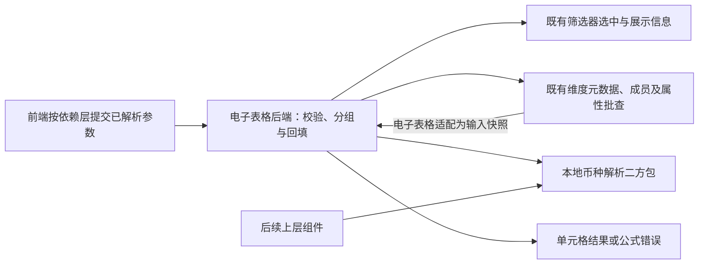
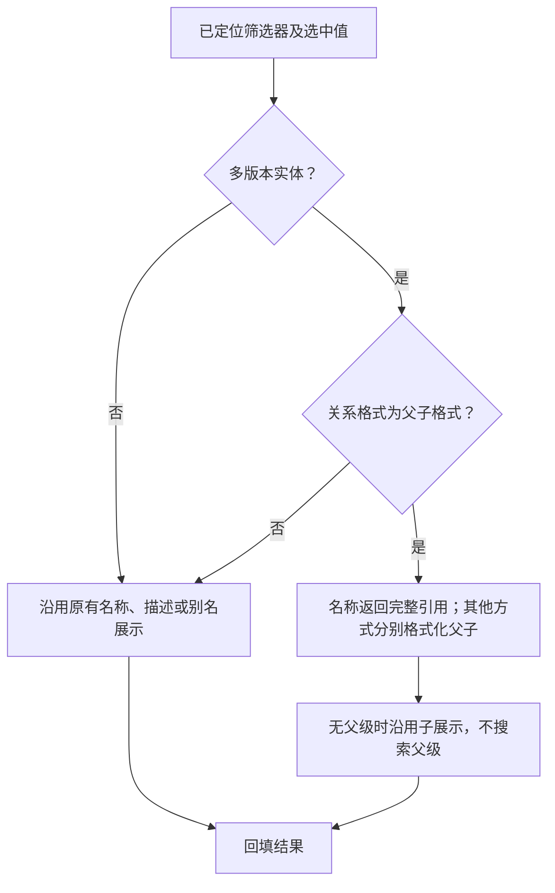
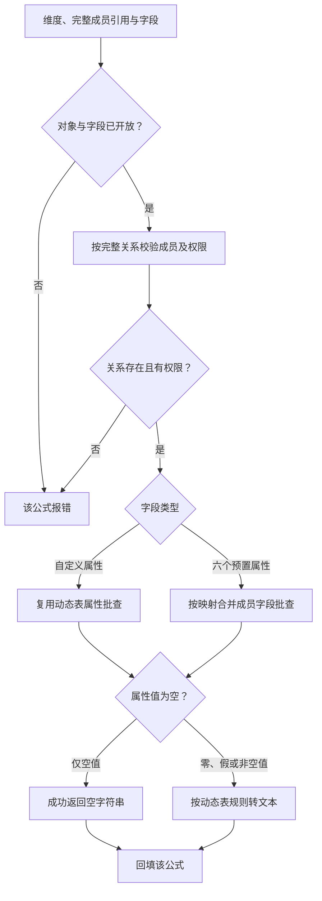
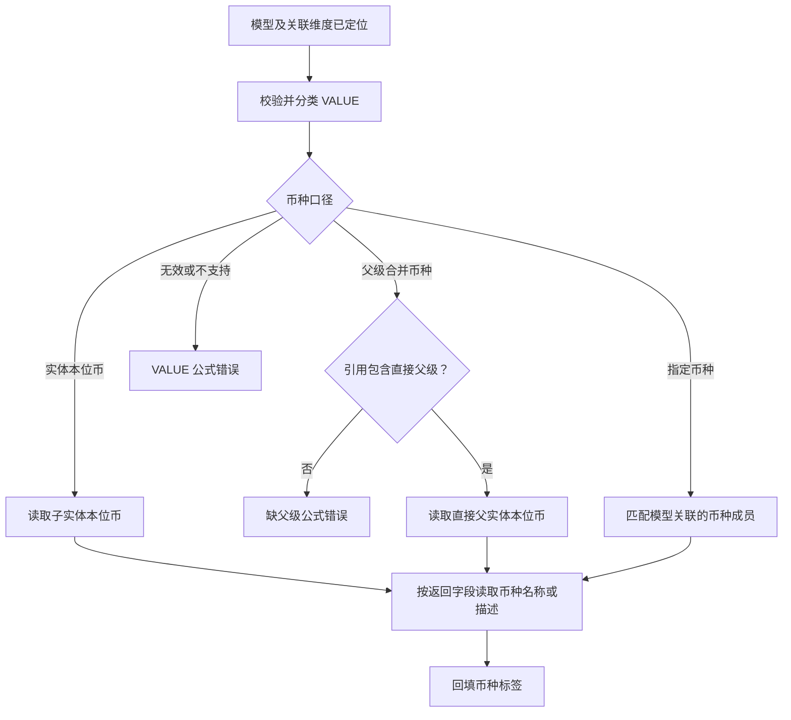
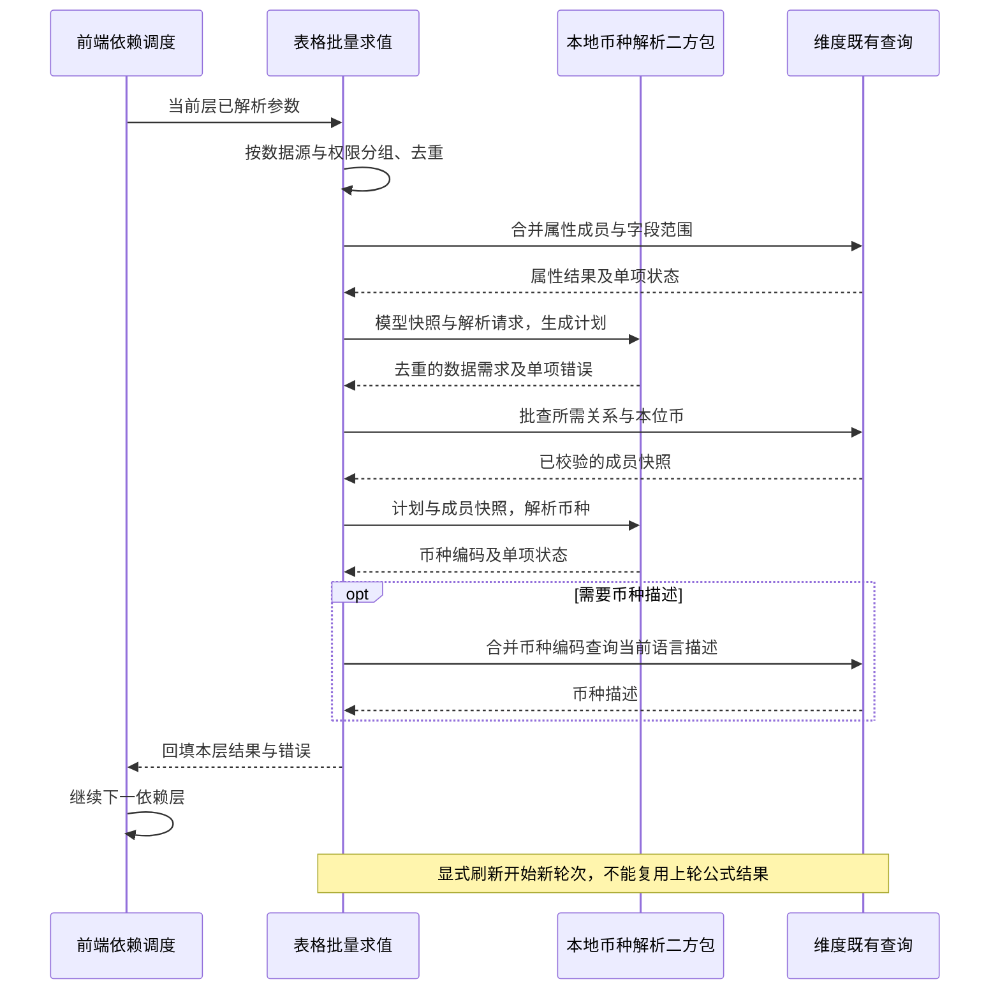

# 筛选器、属性与报表币种公式功能及后端规范

> 状态：评审中
> 最后更新：2026-10-15
> 适用范围：电子表格后端、币种解析二方包及既有元数据查询能力；关联需求 ReqP_00486
> 关联文档：[主题说明](../说明.md)、[二方包规范](币种解析二方包规范.md)、[后端实施计划](../代码执行计划/2026-10-14-筛选器属性与币种公式后端实施计划.md)、[二方包决策](../决策记录/2026-10-14-币种解析采用二方包.md)

> 实施更新：2026-10-14 已按用户授权完成本地代码实现，并按后续确认迁入 deepfos-planning/deep-table 与同仓库 deep-currency-resolution，使用 JDK 21。下文的候选契约／未创建／未实施描述为评审阶段基线；当前工程位置、载荷、开发坐标、验证与待联调／发布事项以[实现记录](../代码执行计划/2026-10-14-筛选器属性与币种公式实现记录.md)为准，不代表已上线。

## 背景与文档状态

让静态表读取筛选器完整实体引用、成员用户定义属性（UD），以及当前 VALUE 金额口径对应的币种标签。本文的公式行为和范围取自用户提供的产品需求及币种背景补充；服务分工、批量共享和权限接入是基于源码核对的后端设计。新公式类型编号、传输字段及二方包发布坐标尚未冻结，不作为已上线协议。

用户只负责电子表格后端，不负责维度或财务模型服务源码。当前仅完成规范与执行计划，需求尚未实施；前端界面和依赖调度不计入用户范围。币种解析采用独立二方包，本期不以改造财务模型／维度服务或新增其业务接口为前置工作。

下图说明电子表格直接调用本地二方包，所需元数据由电子表格适配已有查询能力取得。



二方包只读取调用方传入的数据，不访问网络、数据库或服务上下文。电子表格继续批查模型元数据、实体本位币和币种描述；没有金额查询、汇率换算或合并计算依赖。

## 1. 已确认的范围与边界

1. DFFILTER 保留筛选器已经选中的父子引用，不搜索父级，不判断关系是否激活。
2. DFUD 读取指定成员或指定父子关系成员的属性，复用动态表的属性范围、查询能力及文本转换规则。
3. DFCurrency 返回当前 VALUE 金额口径对应的币种标签；不查询金额，不查询或执行汇率换算，不运行合并计算。
4. DFCurrency 不需要年、期间、场景、版本参数。实体 `local_currency` 是成员属性；这些业务维度用于关系激活过滤，本需求不执行该过滤。
5. 普通 DFUD 属性读取也不引入关系激活上下文。若后续要求读取有独立期间语义的属性，应作为另一个明确需求处理。
6. 当前需求不包含任意自定义 VALUE 的币种推断。按模型现有的标准 VALUE 分类和模型关联币种处理，不另建通用分类体系。
7. 维度和财务模型仅通过既有能力取得元数据与成员属性，不新增报表币种服务接口。二方包以普通 JAR 供上层组件本地调用，电子表格负责其查询适配与接入。
8. 根据用户提供的维度映射截图，DFUD 的预置属性支持范围收敛为 isBase、aggWeight、level、sharedMember、baseCount、localCurrency 六个；复用既有成员字段查询，不要求维度将其新增为自定义 UD，也不扩大到全部内部字段。

需要携带的查询上下文是数据源身份、维度／模型定位、完整成员引用、语言和权限信息。它们用于定位、隔离、展示和结果共享，不等同于年、版本等业务维度。

2026-10-14 前端接入更新：DFUD／DFCurrency 已完成本地解析保存、配置面板、使用态只读回填和分层引用批查；DFUD 支持新增 DIM 数据源，维度不进入财务模型信息查询。合法公式的编辑态显示 #待查询，包括 DFFILTER 的 Parent.Child 第三个参数。前端保留待求值 formula／args 和 rc，解析就绪后才按后端契约提交；循环及查询失败反馈错误并清除旧结果。支持文字、单元格／绝对／跨 sheet 引用、文本拼接与名称模式 DFFILTER 内嵌引用；其他 Excel 表达式先在单元格计算后引用。验证范围和真实业务联调限制以实现记录为准。

## 2. 公式行为规范

### 2.1 DFFILTER

```text
DFFILTER(筛选器编码, 显示方式, [关系格式])
```

| 参数 | 规范 |
| --- | --- |
| 筛选器编码 | 使用筛选器编码，例如 `Entity_wb1`，不是维度名称 |
| 显示方式 | 1 名称、2 描述、3 名称＋描述、4 别名、5 别名＋描述 |
| 关系格式 | `Child` 或 `Parent.Child`；省略时等同 `Child` |

前端将第三个参数解析为 `tag.DF.rf`，后端校验及取值使用相同字段。例如 `{"t":3,"fn":"Entity_wb1","st":1,"rf":"Parent.Child"}`；省略 `rf` 时保持 Child 行为。

三个参数均支持单元格、绝对及跨 Sheet 引用，例如 `=DFFILTER(C30,D30,E30)`。保存保留原始 f，并使用 formula／args／rc 记录未就绪参数；不能把 C30／D30／E30 当作筛选器名称、数字或关系格式校验。使用态由前端读取单元格计算结果、按依赖层提交已解析的 fn／st／rf，后端仍校验真实值。二次查询沿用 query-sheet-baseplate-celldata（含 zip），BaseplateCellFormulaDTO 增加 fn／st／rf，请求增加 filterParamList（filterId／dimMember／dimMemberRef）以使用本次实际选择；筛选器定义与可见范围从已保存工作簿读取。动态筛选器名称依赖同作用域的筛选器，切换筛选值后重新解析，不把保存时的值固定为常量。

例如 HK 的别名 HKG、描述香港，US 的别名 USA、描述美国时：显示方式 2 返回 `[香港].[美国]`，3 返回 `[HK-香港].[US-美国]`，4 返回 `[HKG].[USA]`，5 返回 `[HKG-香港].[USA-美国]`。父成员及完整子关系按维度去重批查；不能把子关系降为裸名查询另一父级的描述，也不在查询失败时强制改为名称模式。

规则：

- 省略关系格式时保持旧公式行为。
- `Parent.Child` 仅对多版本实体维生效。
- 名称模式（显示方式 1）返回筛选器选中值的完整引用，例如 `[HK].[US]`。
- Parent.Child 配合显示方式 2／3／4／5 时，分别格式化直接父成员和选中的完整子关系，返回 `[父展示].[子展示]`；别名缺失时各自回退名称，描述使用当前语言。Child 或省略关系格式时保持原展示规则。
- 其他维度忽略关系格式；选中值没有父级时不补父级。
- 不改变现有多选处理方式。当前链路取第一个选中值，本需求不新增多选拼接能力。
- 相同筛选器的选中信息和展示信息可共享；最终结果还须区分显示方式及关系格式。

独立关系引用协议：旧 `dimMember`／`selectedDimension` 不变，使用态筛选参数新增可选 `dimMemberRef`，底板筛选参数、筛选器响应和保存配置使用 `selectedDimensionRef`，浏览器记忆值及 `rememberedSelections` 使用可选 `memberRefs` 数组。它们记录本次实际选中的完整关系，与旧值数量及顺序一致；后端校验引用中的子成员及旧完整引用一致。切换、清空、联动、保存重开和记忆恢复同步维护引用。老请求未传新字段时不搜索父级。

默认选择的引用只从已查询并通过筛选器范围及权限裁决的候选节点保留；裸成员对应多个关系时不取第一条，需用户明确选择。前端在既有成员信息批查中请求 parent_name，在表单变更前记录选中节点；程序化信息补全不得覆盖已经确认的关系。

维度类型不是前端新增必填项：后端在 rf=Parent.Child 的五种显示方式下复用已加载的维度类型，仅对缺失元数据按服务、维度身份去重，复用已有缓存并批查；不得逐公式查询或将类型固定为多版本实体。查询失败反馈公式错误。


下图说明 Parent.Child 对多版本实体的五种显示方式生效，Child 保留旧展示规则。



### 2.2 DFUD

```text
DFUD(维度, 成员, UD字段编码)
```

| 参数 | 规范 |
| --- | --- |
| 维度 | 已配置数据源的维度元素名称或别名，例如 `Entity` |
| 成员 | 成员编码，例如 `US`，或完整引用 `[HK].[US]` |
| UD 字段编码 | 动态表已支持的自定义 UD 字段，例如 `UD1`；或下列六个预置属性名 |

规则：

- `[HK].[US]` 定位 HK 下的 US，并读取该关系成员的属性。
- 不改为读取 HK 的属性，也不在完整引用未匹配时降级为任意 US。
- 普通编码按现有成员查询语义处理，不自动搜索活跃父级。
- 首版返回属性值，不新增属性描述参数；描述能力待产品单独确认。
- 复用动态表的文本转换：属性值 `null` 转为空字符串；`0`、`false` 必须保留。
- 字段不存在、成员不存在、关系不存在、无权限均反馈公式错误，不能当作空属性值。
- 六个预置属性使用独立的固定字段描述与映射，不以它们是否出现在自定义 `udList` 中判断有效性。自定义 UD 仍按原 UD 元数据校验；两类字段复用相同的成员权限、完整关系、批量与文本回填规则。
- DFCurrency 和 DFUD 的 localCurrency 分支读取同一个已有 `local_currency` 成员字段；DFCurrency 仍按 VALUE 判断读取子实体或直接父实体，不能与 DFUD 的固定成员属性读取混淆。


### 2.2.1 六个预置属性及字段映射

清单来源：用户于 2026-10-14 提供的维度映射截图。查询字段映射已在维度 `MemberProperties.BasePropertyEnum`、`DimensionNormalUtil.dimensionColumnMap` 及实体 `LocalCurrencyProperty` 中核对；当前部署版本的实际响应仍需实施时联调，不把截图当成运行验证。

| 公式使用的预置属性名 | 含义 | 截图中的映射类型 | 既有查询字段 | 适用范围与源码类型 |
| --- | --- | --- | --- | --- |
| `isBase` | 是否末级成员 | 数字 | `is_base` | 基础成员属性；当前源码查询映射可返回 Boolean |
| `aggWeight` | 汇总比重 | 数字 | `aggweight` | 基础成员属性；Decimal |
| `level` | 成员层级 | 数字 | `level` | 基础成员属性；Integer |
| `sharedMember` | 是否共享成员 | 数字 | `sharedmember` | 基础成员属性；当前源码查询映射可返回 Boolean |
| `baseCount` | 末级成员数量 | 数字 | `baseCount` | 基础成员属性；Integer，可为空 |
| `localCurrency` | 本位币 | 文本 | `local_currency` | 实体维属性；String，其他维度无该字段时明确报不适用 |

映射与取值约束：

- 公式文档以截图中的六个名称为规范名称。大小写匹配沿用维度字段约定；现有字段写法 `is_base`、`aggweight`、`sharedmember`、`local_currency` 作为这些属性的兼容输入，不构成新增属性范围。
- `aggWeight` 与源码 `aggweight` 的区别属于字段名适配；`localCurrency` 与 `local_currency` 也不能被识别为两个不同属性。规范名称及兼容输入统一到同一个字段身份后去重。
- 预置属性优先通过已有支持权限的成员表达式批量接口读取，按字段映射生成 `resultString`；自定义 UD 继续复用动态表 UD 批量链路。不强迫预置属性走必须返回自定义 UD 元数据的接口。
- 响应键按已核对的字段映射适配，包括接口返回逻辑名或查询字段名的差异；不得用字符串真假值判断字段是否为空。
- 截图显示“数字”不等于接口 JSON 必然返回 0／1。Boolean false 返回文本 false，数字 0 返回文本 0；只将合法属性的 null 转为空字符串，不额外把布尔值改成 0／1。
- 字段在该维度不适用、接口版本不支持或请求字段未返回时，反馈对应公式错误；不能伪造 0、false 或空币种作为成功值。
- 不通过 DFUD 开放任意成员内部字段，也不新增年、期间、场景、版本上下文。

示例：`DFUD("Entity","US","localCurrency")` 与兼容写法 `DFUD("Entity","US","local_currency")` 都读取 US 本位币；`DFUD("Entity","[HK].[US]","aggWeight")` 读取该完整关系成员的比重，不降级到任意 US。

下图说明属性查询必须先定位完整关系并处理权限，合法空属性与查询失败使用不同结果。



DFUD 混合引用批查匹配补充（2026-10-15）：裸成员优先取返回中与请求身份一致的 expectedName 记录，排除同批其他完整关系的返回；完整父子引用仍精确匹配自身，不回退到裸名或另一父级。同一身份返回的数据有冲突仍反馈不唯一，缺失关系／权限结果仍报错。没有精确 expectedName 的旧裸成员响应保留既有唯一性规则。

### 2.3 DFCurrency

```text
DFCurrency(模型, 实体, VALUE, [返回字段])
```

| 参数 | 规范 |
| --- | --- |
| 模型 | 已配置数据源的财务模型名称或别名，例如 `Consol` |
| 实体 | 成员编码或 `[父编码].[子编码]`；不使用成员描述 |
| VALUE | 模型实际关联 VALUE 维度中的成员编码 |
| 返回字段 | `name` 或 `description`；省略时为 `name` |

产品补充确认：币种标签必须与当前查询金额的口径一致。同一实体在 EC、PC、PT 等不同 VALUE 下，金额使用的币种可能不同；不能仅返回该实体本位币。

| VALUE 分类 | 币种来源 | 示例结果（HK：HKD，US：USD） |
| --- | --- | --- |
| EntityCurrency、EntityCurrencyAdjs、EntityCurrencyTotal | 当前子实体的本位币 | `[HK].[US]` → USD |
| ParentCurrency、ParentCurrencyAdjs、ParentCurrencyTotal | 引用中直接父实体的本位币 | `[HK].[US]` → HKD |
| ParentTotal 等模型既有父级合并节点 | 引用中直接父实体的本位币 | `[HK].[US]` → HKD |
| EURTotal 等明确指定币种节点 | 模型关联的指定币种成员 | EURTotal → EUR |

后端规则：

- 先解析模型元数据及关联的实体维、VALUE 维和币种配置，再按对应模型规则分类。
- 新旧实体／VALUE 结构使用各自已有规则，不把新 VALUE 的节点清单强套到旧模型。
- 新结构现有父级节点清单包括：`ParentTotal`、`Parent`、`ParentAdjs`、`Proportion`、`Elimination`、`Contribution`、`ContributionAdjs`、`ContributionTotal`、`AdjTotal`，以及 ParentCurrency 三个节点。
- 不能仅使用 `isParentCurrency()` 判断父币种；该方法只覆盖 ParentCurrency 三个节点。应结合既有父级节点分类覆盖 PT 等口径。
- 指定币种应结合模型关联的实际币种及 VALUE 节点生成规则识别，例如 EUR → EUR／EURAdjs／EURTotal。不能遇到任意 `Total` 后缀就认定它是币种。
- 需要父币种且没有提供父级时，明确报错；不查找合并范围或活跃父级。
- EC 和指定币种口径不要求用户补父级。
- 币种描述从实际币种成员的当前语言描述取得，不返回 VALUE 节点描述，也不返回实体描述。
- 父子关系不存在、VALUE 不存在、币种配置缺失或无权限均反馈公式错误。


下图说明币种选择由 VALUE 口径决定，父币种口径缺少父级时直接报错。



## 3. 查询能力和职责分配

### 3.1 电子表格后端

- 扩展 DF 公式类型识别、参数校验及保存校验。
- 解析数据源名称／别名，按对象类型区分模型与维度。
- 收集当前批次可求值的公式，去重、分组、调用批量能力。
- 将每个结果或错误回填至对应单元格，并保留原始公式。
- 同时覆盖初始底稿查询、引用单元格后续查询及刷新入口。
- 复用现有筛选器依赖记录和公式错误机制。
- 后端接收已解析的参数值；未就绪的单元格引用沿用现有引用标记和后续查询协议，不将 `A1` 等引用文本直接当作对象或成员编码。
- 不在后端新建 Excel 公式解释器或完整的电子表格依赖引擎。

当前数据源解析 `getCubDataSourceMap` 只收集 CUB。DFUD 应新增维度数据源解析分支，覆盖名称／别名、元素关联、保存重开和无效对象校验；不得按同名筛选器或任意模型中的同名维度猜测数据源。

### 3.2 币种解析二方包

采用纯规则二方包，取代原方案中“在财务模型服务抽取并暴露币种解析入口”的默认安排。公共包 artifactId 固定为 `deep-currency-resolution`，以独立 Java 工程交付；从首版面向其他上层设计公共契约。公共包负责模型结构下的 VALUE 分类、所需成员身份判定和币种编码解析；电子表格负责对象定位、权限、远程批查、描述展示及 DF 错误回填。

二方包分两阶段本地调用：

1. 输入已定位的模型快照、结构化实体引用和 VALUE，生成解析计划及去重的成员数据需求；无效 VALUE 或缺父级按单项返回错误。
2. 电子表格通过已有接口批查需求项，将已校验的关系与本位币快照交给二方包，取得逐项币种编码。需要 description 的项再由电子表格合并币种编码查询描述。

包中不引入 Spring、HTTP、数据库、服务 DTO、RequestContext、全局缓存或金额查询代码。它不包含 DFCurrency 标签、筛选器或工作簿结构，其他上层可以提供同样的数据后复用。具体公开契约、错误与版本要求以[二方包规范](币种解析二方包规范.md)为准。

已核对到电子表格与财务模型各有币种映射实现，且父级节点清单不同：表格侧包含 Consolidation 系列；财务模型侧包含 Contribution 系列和 AdjTotal。不能直接把表格常量复制成标准，也不能直接依赖财务模型应用 JAR。首版按财务模型规则、维度实际节点及产品口径建立测试样例，历史别名与旧结构独立核定。

用户范围是电子表格三类公式和二方包接入。独立二方包的实际仓库位置、groupId、首版版本、发布及长期维护方须由团队明确；不能默认要求用户修改财务模型服务。财务模型开发参与规则及样例校验，既有服务接入公共包属于各维护方后续任务，不计入本期。

### 3.3 既有维度能力与外部协同

默认复用：

- 元数据查询：维度定位、自定义 UD 列表、关联维度和模型所需结构信息；六个预置属性由表格字段描述表独立适配。
- 成员表达式批量查询：完整父子引用、成员字段、本位币、币种描述及已有权限能力。
- UD 批量查询：动态表属性值及展示链路。

权限处理：

- 对象权限、成员权限分别复用已有机制，不因公式查询而绕过权限。
- 当前 UD DTO 没有权限方案参数，ANTLR UD 链路构造普通成员查询 DTO 时也未启用默认权限方案，不能假定 UD 批查已完成成员权限过滤。
- 优先通过已有支持权限的成员批量查询校验成员，再仅对允许的项调用 UD 批量接口。
- 六个预置属性直接复用支持权限的成员批查并合并字段；自定义 UD 如能通过同一成员批查取得完全一致的值，可在验证动态表一致性后合并校验与取值。
- 本期在电子表格端适配已有权限能力。若实测发现必须补维度接口参数，应形成能力缺口交由维度维护方处理，不列为用户修改维度源码的步骤；不能绕过权限或修改全局默认权限。
- 不默认新增维度 URL，不修改维度自定义 UD 元数据来挂入六个预置属性，也不扩大预置属性白名单。

## 4. 前后端协议协同边界

本节是后端接入要求；前端界面及依赖调度不属于电子表格后端实施范围。

1. 新公式必须在类型、参数标签、保存和查询载荷中被识别。
2. 固定值与单元格引用必须可区分，例如 `"US"` 是字面值，`B2` 是引用；不要在解析阶段丢失这种差异。
3. 前端按依赖顺序提交已就绪的参数，后端对同一批次统一求值。超过一层的 DF 依赖不能只读取旧单元格值后查询一次。
4. 初始查询和后续批量查询复用同一后端求值逻辑，防止固定值与引用值走出两套规则。
5. DFFILTER 的关系格式、DFUD 的维度／成员／字段、DFCurrency 的模型／实体／VALUE／返回字段均须完整传输并可保存重开。
6. 新类型编号和 JSON 字段名需在编码前统一，不在两端分别自行定义。保留现有 DFFILTER 的 `fn`、`st`，新增可选关系格式字段；旧标签缺失该字段时按 Child 处理。
7. 保存原始公式，不将已求值的参数永久替换到公式正文中。

## 5. 批量、共享和刷新规范

### 5.1 分组与结果身份

分组键至少覆盖实际服务、应用／空间、元素名称、folderId／path、对象类型、语言和权限上下文。模型组还须区分模型身份及相关结构。

结果键另须覆盖完整成员引用、字段、VALUE、返回字段及 DFFILTER 的显示方式／关系格式。

- `[HK].[US]` 与 `[CN].[US]` 不得因子编码相同而共用关系结果。
- 同名但不同数据源的 Entity 不得混用。
- 不同语言、权限或返回字段不得混用。
- 共享底层元数据与最终公式结果可以使用不同的键；不要为了共享元数据而省掉最终结果的必要身份。

### 5.2 各公式要求

| 公式 | 批量要求 |
| --- | --- |
| DFFILTER | 同轮共享选中信息和展示信息；不增加父级搜索 |
| DFUD | 按维度和上下文合并成员、UD 字段，去重后批查；不能把 100 条独立查询仅包装为一次 HTTP 请求 |
| DFCurrency | 电子表格按模型和上下文共享元数据、实体本位币、币种描述；本地二方包统一解析，不执行逐公式远程查询 |

维度 UD 批量入口内部仍按子请求分别执行。因此调用方必须先合并成员范围和字段范围；批量装包不等于底层查询合并。

首版新增共享结果使用请求／重算轮次级缓存。显式刷新开始新轮次并重新调用底层能力，不新增难以失效的长期公式缓存。若底层已有长期缓存，还须核对其刷新契约，不能只清空表格层结果就宣称取得最新配置。


下图说明同一依赖层统一批查，结果共享只持续到当前重算轮次。



属性查询和币种查询的具体先后不是约束；两者无依赖时可独立执行。图中展示的是一层内的分组与回填边界。

## 6. 错误与回填

| 情况 | 处理 |
| --- | --- |
| 参数数量、格式或枚举值不合法 | 沿用公式参数错误机制 |
| 筛选器不存在或选中值为空 | 沿用筛选器公式错误机制 |
| 维度／模型不存在、别名歧义或对象类型不匹配 | 对应公式报错，不随意选择一个对象 |
| 成员或父子关系不存在 | 成员／关系错误；完整引用不降级为同名子成员 |
| 自定义 UD 不存在、预置属性不在六个范围内或不适用 | 字段错误，不返回空字符串伪装成功 |
| 请求字段未返回或现有接口不支持 | 查询能力错误，不伪造 0／false／空币种 |
| 合法成员属性值为 null | 成功返回空字符串 |
| 需要父币种但无父级 | 明确提示使用 `[父编码].[子编码]` |
| VALUE、币种或本位币配置无效 | 对应公式报错，不默认改为子实体币种 |
| 对象或成员无权限 | 沿用现有权限及公式错误机制 |
| 批次中部分项失败 | 将错误映射到相应单元格，其他合法项继续回填 |

错误码复用现有体系；如确需新增，先统一码值与前端展示映射，不在求值分支临时写入任意数字。

## 7. 验收矩阵

示例数据：HK 本位币 HKD，US 本位币 USD；US 的 UD1 为“海外”；币种 USD 的描述为“美元”。筛选器 Entity_wb1 选中 `[HK].[US]`。

| 场景 | 期望 |
| --- | --- |
| `DFFILTER("Entity_wb1","1")` | US，与旧行为一致 |
| `DFFILTER("Entity_wb1","1","Parent.Child")` | `[HK].[US]` |
| Parent.Child 配合显示方式 2／3／4／5 | `[父描述].[子描述]`／`[父名称-父描述].[子名称-子描述]`／`[父别名].[子别名]`／`[父别名-父描述].[子别名-子描述]` |
| 非多版本实体维或选中值无父级 | 忽略关系参数或保留无父级结果，不补父级 |
| `DFUD("Entity","US","UD1")` | 海外 |
| `DFUD("Entity","[HK].[US]","UD1")` | HK 下 US 的 UD1 |
| 同批查询 `[HK].[US]` 与 `[CN].[US]` | 分别匹配各自关系属性，不串值 |
| UD 值为 null／0／false | 分别返回空字符串／文本 0／文本 false |
| 自定义 UD 不存在，或请求六个以外的未开放内部字段 | 公式错误 |
| 六个预置属性逐项查询 | 对应字段值及文本转换与成员接口一致，不因缺少自定义 udList 条目报错 |
| isBase／sharedMember 返回 false 或数字 0 | 分别返回文本 false／0，不当空值，不强制互转 |
| aggWeight 与 aggweight，localCurrency 与 local_currency | 映射到同一字段；同轮同关系查询可去重 |
| DFUD("Entity","[HK].[US]","aggWeight") | HK 下 US 的比重，完整关系不降级 |
| DFUD("Entity","US","localCurrency") | USD；不随 VALUE 改变 |
| 非实体维读取不适用的 localCurrency | 明确的字段不适用错误 |
| `DFCurrency("Consol","[HK].[US]","EntityCurrencyTotal","name")` | USD |
| `DFCurrency("Consol","[HK].[US]","ParentCurrencyTotal","name")` | HKD |
| `DFCurrency("Consol","[HK].[US]","ParentTotal","name")` | HKD |
| `DFCurrency("Consol","[HK].[US]","USDTotal","description")` | 美元 |
| ParentCurrencyTotal／ParentTotal 配合实体 US，无父级 | 明确的缺父级错误 |
| 固定参数与前端解析后的引用参数 | 结果及错误一致 |
| 不同语言、权限、数据源、关系 | 按各自上下文返回，不混用结果 |
| 筛选器切换、显式刷新、保存重开 | 参数与公式保留，结果按新一轮查询更新 |
| 批次中一个成员无效或无权限 | 该公式报错，其他合法公式可回填 |
| 100 个 DFUD 与重复 DFFILTER／DFCurrency | 按组／批次执行，重复项去重；留存查询次数和耗时 |

## 8. 兼容与未决事项

已确认：旧 DFFILTER 缺少关系格式时保持 Child 行为；不新增维度 URL；不引入年、期间、场景、版本上下文；不执行金额、汇率或合并计算；不推断任意自定义 VALUE。

待编码前冻结：

| 项目 | 当前决定 | 协同方 |
| --- | --- | --- |
| 新类型及载荷 | 复用 DF 标签框架，编号及字段名待统一；不得覆盖既有类型 | 表格前后端 |
| 二方包交付 | artifactId 为 deep-currency-resolution、独立 Java 工程、通用公共契约已确定；仓库位置、groupId、版本及维护方待明确 | 二方包维护方与各消费方 |
| 规则差异 | 包内规则对照财务模型及维度节点，历史别名和旧结构用例需核定 | 财务模型开发与二方包维护方 |
| 属性描述参数 | 首版只返回值，不追加参数；后续由产品确认 | 产品 |
| 预置属性映射 | 已按截图及源码列出六个字段；部署接口响应与适用性在接入时核验，不要求新增 UD 元数据 | 表格后端；能力缺口由维度维护方协同 |
| 性能耗时阈值 | 已明确分组、去重和记录口径；绝对耗时阈值需在测试环境确定 | 后端与测试 |

发布顺序、回退限制和可执行验证步骤见实施计划。兼容性不包含让旧后端识别新增公式；回退前必须停用新增公式调用，并保留含新公式的原始文档及配置备份。
