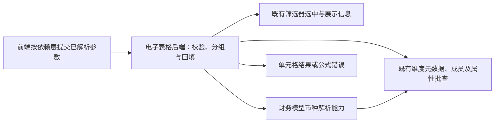
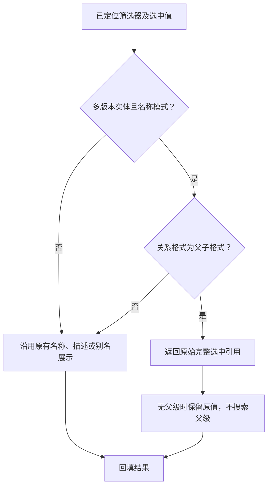
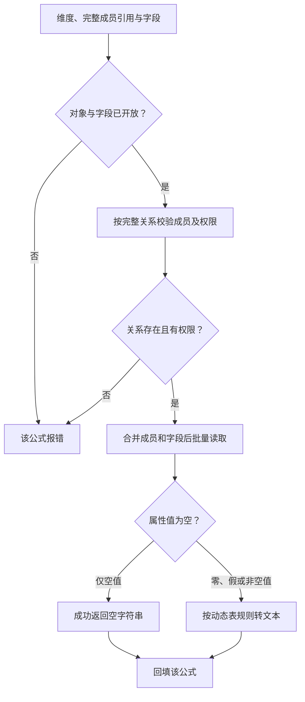
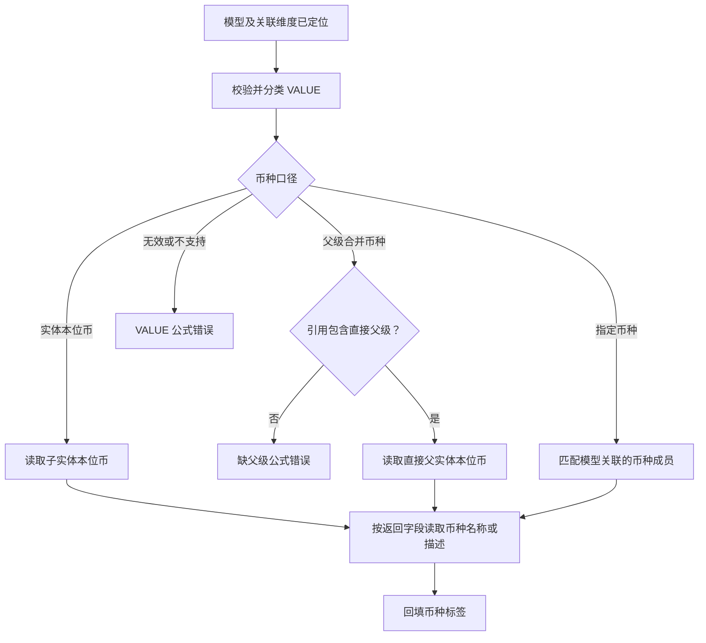
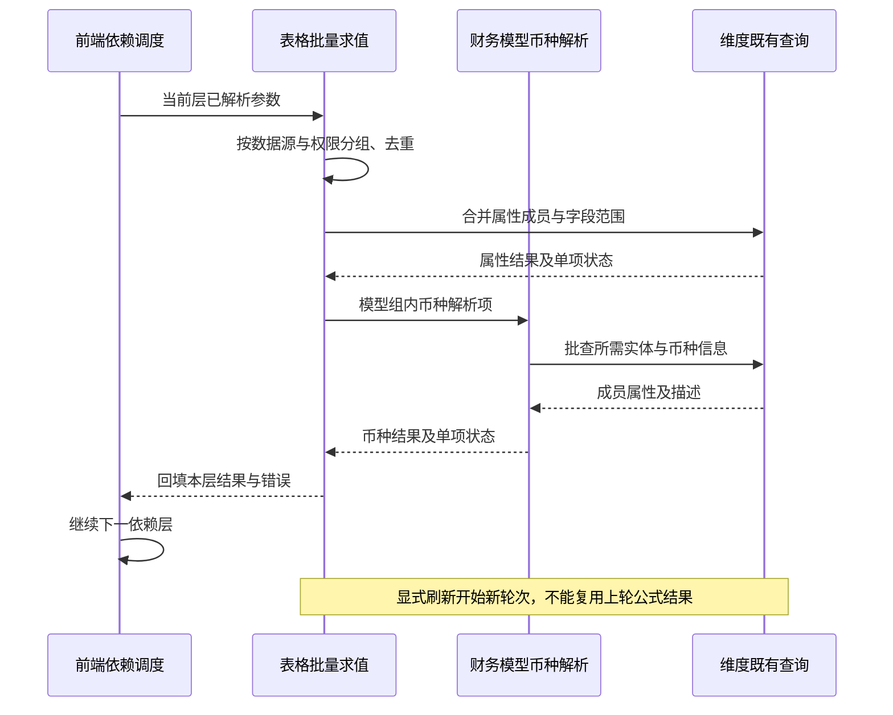

# 筛选器、属性与报表币种公式功能及后端规范

> 状态：评审中
> 最后更新：2026-10-14
> 适用范围：电子表格后端、财务模型服务、维度既有查询能力；关联需求 ReqP_00486
> 关联文档：[主题说明](../说明.md)、[后端实施计划](../代码执行计划/2026-10-14-筛选器属性与币种公式后端实施计划.md)

## 背景与文档状态

让静态表读取筛选器完整实体引用、成员用户定义属性（UD），以及当前 VALUE 金额口径对应的币种标签。本文的公式行为和范围取自用户提供的产品需求及币种背景补充；服务分工、批量共享和权限接入是基于源码核对的后端设计。新公式类型编号、传输字段和财务模型跨服务入口尚未冻结，不作为已上线协议。

当前仅完成规范与执行计划，需求尚未实施。前端界面和依赖调度不计入用户的后端负责范围。

下图说明公式接入与既有能力的边界：维度不新增业务 URL，币种口径由财务模型规则负责。



财务模型解析能力只读取元数据和成员属性；与金额查询、汇率换算、合并计算没有调用依赖。

## 1. 已确认的范围与边界

1. DFFILTER 保留筛选器已经选中的父子引用，不搜索父级，不判断关系是否激活。
2. DFUD 读取指定成员或指定父子关系成员的属性，复用动态表的属性范围、查询能力及文本转换规则。
3. DFCurrency 返回当前 VALUE 金额口径对应的币种标签；不查询金额，不查询或执行汇率换算，不运行合并计算。
4. DFCurrency 不需要年、期间、场景、版本参数。实体 `local_currency` 是成员属性；这些业务维度用于关系激活过滤，本需求不执行该过滤。
5. 普通 DFUD 属性读取也不引入关系激活上下文。若后续要求读取有独立期间语义的属性，应作为另一个明确需求处理。
6. 当前需求不包含任意自定义 VALUE 的币种推断。按模型现有的标准 VALUE 分类和模型关联币种处理，不另建通用分类体系。
7. 维度服务复用已有元数据、成员表达式批量查询和 UD 批量查询接口；新增维度 URL 不作为本需求的前置工作。
8. DFUD 的权限对接与系统 UD 开放范围需要正确处理，但不能由此推导出“必须新增维度接口”或“必须开放全部系统字段”。

需要携带的查询上下文是数据源身份、维度／模型定位、完整成员引用、语言和权限信息。它们用于定位、隔离、展示和结果共享，不等同于年、版本等业务维度。

## 2. 公式行为规范

### 2.1 DFFILTER

```text
DFFILTER(筛选器编码, 显示方式, [关系格式])
```

| 参数 | 规范 |
| --- | --- |
| 筛选器编码 | 使用筛选器编码，例如 `Entity_wb1`，不是维度名称 |
| 显示方式 | 1 名称、2 描述、3 名称＋描述、4 别名、5 别名＋描述 |
| 关系格式 | `Child` 或 `Parent.Child`；省略时等同 `Child` |

规则：

- 省略关系格式时保持旧公式行为。
- `Parent.Child` 仅对多版本实体维生效。
- 仅名称模式（显示方式 1）返回筛选器选中值的完整引用，例如 `[HK].[US]`。
- 描述、名称＋描述、别名、别名＋描述保持原有展示规则，不额外拼接父级。
- 其他维度忽略关系格式；选中值没有父级时不补父级。
- 不改变现有多选处理方式。当前链路取第一个选中值，本需求不新增多选拼接能力。
- 相同筛选器的选中信息和展示信息可共享；最终结果还须区分显示方式及关系格式。


下图说明关系格式只影响指定范围的名称输出，保留旧展示规则。



### 2.2 DFUD

```text
DFUD(维度, 成员, UD字段编码)
```

| 参数 | 规范 |
| --- | --- |
| 维度 | 已配置数据源的维度元素名称或别名，例如 `Entity` |
| 成员 | 成员编码，例如 `US`，或完整引用 `[HK].[US]` |
| UD 字段编码 | 动态表已支持的 UD 字段编码，例如 `UD1` |

规则：

- `[HK].[US]` 定位 HK 下的 US，并读取该关系成员的属性。
- 不改为读取 HK 的属性，也不在完整引用未匹配时降级为任意 US。
- 普通编码按现有成员查询语义处理，不自动搜索活跃父级。
- 首版返回属性值，不新增属性描述参数；描述能力待产品单独确认。
- 复用动态表的文本转换：属性值 `null` 转为空字符串；`0`、`false` 必须保留。
- 字段不存在、成员不存在、关系不存在、无权限均反馈公式错误，不能当作空属性值。
- `isBase`、`local_currency` 等系统属性仅在 UD 元数据及查询接口已开放时允许作为 DFUD 字段。基础成员接口能够返回某字段，不代表它已经进入 DFUD 允许的 UD 范围。
- DFCurrency 直接读取已有成员查询能力中的 `local_currency`，不以 DFUD 的系统 UD 开放情况为前提。


下图说明属性查询必须先定位完整关系并处理权限，合法空属性与查询失败使用不同结果。



### 2.3 DFCurrency

```text
DFCurrency(模型, 实体, VALUE, [返回字段])
```

| 参数 | 规范 |
| --- | --- |
| 模型 | 已配置数据源的财务模型名称或别名，例如 `Consol` |
| 实体 | 成员编码或 `[父编码].[子编码]`；不使用成员描述 |
| VALUE | 模型实际关联 VALUE 维度中的成员编码 |
| 返回字段 | `name` 或 `description`；省略时为 `name` |

产品补充确认：币种标签必须与当前查询金额的口径一致。同一实体在 EC、PC、PT 等不同 VALUE 下，金额使用的币种可能不同；不能仅返回该实体本位币。

| VALUE 分类 | 币种来源 | 示例结果（HK：HKD，US：USD） |
| --- | --- | --- |
| EntityCurrency、EntityCurrencyAdjs、EntityCurrencyTotal | 当前子实体的本位币 | `[HK].[US]` → USD |
| ParentCurrency、ParentCurrencyAdjs、ParentCurrencyTotal | 引用中直接父实体的本位币 | `[HK].[US]` → HKD |
| ParentTotal 等模型既有父级合并节点 | 引用中直接父实体的本位币 | `[HK].[US]` → HKD |
| EURTotal 等明确指定币种节点 | 模型关联的指定币种成员 | EURTotal → EUR |

后端规则：

- 先解析模型元数据及关联的实体维、VALUE 维和币种配置，再按对应模型规则分类。
- 新旧实体／VALUE 结构使用各自已有规则，不把新 VALUE 的节点清单强套到旧模型。
- 新结构现有父级节点清单包括：`ParentTotal`、`Parent`、`ParentAdjs`、`Proportion`、`Elimination`、`Contribution`、`ContributionAdjs`、`ContributionTotal`、`AdjTotal`，以及 ParentCurrency 三个节点。
- 不能仅使用 `isParentCurrency()` 判断父币种；该方法只覆盖 ParentCurrency 三个节点。应结合既有父级节点分类覆盖 PT 等口径。
- 指定币种应结合模型关联的实际币种及 VALUE 节点生成规则识别，例如 EUR → EUR／EURAdjs／EURTotal。不能遇到任意 `Total` 后缀就认定它是币种。
- 需要父币种且没有提供父级时，明确报错；不查找合并范围或活跃父级。
- EC 和指定币种口径不要求用户补父级。
- 币种描述从实际币种成员的当前语言描述取得，不返回 VALUE 节点描述，也不返回实体描述。
- 父子关系不存在、VALUE 不存在、币种配置缺失或无权限均反馈公式错误。


下图说明币种选择由 VALUE 口径决定，父币种口径缺少父级时直接报错。



## 3. 查询能力和职责分配

### 3.1 电子表格后端

- 扩展 DF 公式类型识别、参数校验及保存校验。
- 解析数据源名称／别名，按对象类型区分模型与维度。
- 收集当前批次可求值的公式，去重、分组、调用批量能力。
- 将每个结果或错误回填至对应单元格，并保留原始公式。
- 同时覆盖初始底稿查询、引用单元格后续查询及刷新入口。
- 复用现有筛选器依赖记录和公式错误机制。
- 后端接收已解析的参数值；未就绪的单元格引用沿用现有引用标记和后续查询协议，不将 `A1` 等引用文本直接当作对象或成员编码。
- 不在后端新建 Excel 公式解释器或完整的电子表格依赖引擎。

当前数据源解析 `getCubDataSourceMap` 只收集 CUB。DFUD 应新增维度数据源解析分支，覆盖名称／别名、元素关联、保存重开和无效对象校验；不得按同名筛选器或任意模型中的同名维度猜测数据源。

### 3.2 财务模型能力

推荐在财务模型侧抽取独立的币种解析方法，让 VALUE 语义与既有模型规则保持同源。

内部输入：已定位的模型、实体引用、VALUE、返回字段及请求上下文。

内部输出：每个查询项的币种名称／描述或可回填的错误。

实现步骤：

1. 每组模型加载一次相关元数据，确定关联实体、VALUE、币种配置及新旧结构。
2. 校验并分类 VALUE，确定每项需要读取子实体、直接父实体还是指定币种。
3. 收集所需成员和字段，去重后批量查询；能从显式引用提前收集的父实体，应与子实体一起预收集，减少补查。
4. 解析币种名称，按需要批量读取对应币种描述。
5. 返回各查询项结果；同组单项失败不应让其他合法公式全部失败。

不直接调用金额查询入口来取得币种，不复制金额聚合、汇率换算或结果矩阵转换代码。`checkAndGetCurrency` 可参考其模型关联及本位币查询步骤，但它耦合报表表达式扫描和金额查询映射准备，不能直接作为新公式的完整实现。

跨服务需要暴露该能力时，可在财务模型提供批量入口。这属于财务模型业务能力对接，不是新增维度接口。具体 URL 与 DTO 在编码前核对现有接口后确定。

### 3.3 维度服务

默认复用：

- 元数据查询：维度定位、UD 列表、关联维度和模型所需结构信息。
- 成员表达式批量查询：完整父子引用、成员字段、本位币、币种描述及已有权限能力。
- UD 批量查询：动态表属性值及展示链路。

权限处理：

- 对象权限、成员权限分别复用已有机制，不因公式查询而绕过权限。
- 当前 UD DTO 没有权限方案参数，ANTLR UD 链路构造普通成员查询 DTO 时也未启用默认权限方案，不能假定 UD 批查已完成成员权限过滤。
- 优先通过已有支持权限的成员批量查询校验成员，再仅对允许的项调用 UD 批量接口。
- 如已有成员批查能直接返回同一属性值，且验证其文本、空值与动态表一致，可合并校验和取值，减少查询。
- 若选择给现有 UD 接口补权限参数，应作为兼容扩展，同时核验旧链路和 ANTLR 链路；不要修改全局默认权限行为。
- 不默认新增维度 URL，不把系统 UD 元数据全面开放计入本期。

## 4. 前后端协议协同边界

本节是后端接入要求；前端界面及依赖调度不属于电子表格后端实施范围。

1. 新公式必须在类型、参数标签、保存和查询载荷中被识别。
2. 固定值与单元格引用必须可区分，例如 `"US"` 是字面值，`B2` 是引用；不要在解析阶段丢失这种差异。
3. 前端按依赖顺序提交已就绪的参数，后端对同一批次统一求值。超过一层的 DF 依赖不能只读取旧单元格值后查询一次。
4. 初始查询和后续批量查询复用同一后端求值逻辑，防止固定值与引用值走出两套规则。
5. DFFILTER 的关系格式、DFUD 的维度／成员／字段、DFCurrency 的模型／实体／VALUE／返回字段均须完整传输并可保存重开。
6. 新类型编号和 JSON 字段名需在编码前统一，不在两端分别自行定义。保留现有 DFFILTER 的 `fn`、`st`，新增可选关系格式字段；旧标签缺失该字段时按 Child 处理。
7. 保存原始公式，不将已求值的参数永久替换到公式正文中。

## 5. 批量、共享和刷新规范

### 5.1 分组与结果身份

分组键至少覆盖实际服务、应用／空间、元素名称、folderId／path、对象类型、语言和权限上下文。模型组还须区分模型身份及相关结构。

结果键另须覆盖完整成员引用、字段、VALUE、返回字段及 DFFILTER 的显示方式／关系格式。

- `[HK].[US]` 与 `[CN].[US]` 不得因子编码相同而共用关系结果。
- 同名但不同数据源的 Entity 不得混用。
- 不同语言、权限或返回字段不得混用。
- 共享底层元数据与最终公式结果可以使用不同的键；不要为了共享元数据而省掉最终结果的必要身份。

### 5.2 各公式要求

| 公式 | 批量要求 |
| --- | --- |
| DFFILTER | 同轮共享选中信息和展示信息；不增加父级搜索 |
| DFUD | 按维度和上下文合并成员、UD 字段，去重后批查；不能把 100 条独立查询仅包装为一次 HTTP 请求 |
| DFCurrency | 按模型和上下文共享分类、实体本位币、币种描述；按需取字段，不触发金额查询 |

维度 UD 批量入口内部仍按子请求分别执行。因此调用方必须先合并成员范围和字段范围；批量装包不等于底层查询合并。

首版新增共享结果使用请求／重算轮次级缓存。显式刷新开始新轮次并重新调用底层能力，不新增难以失效的长期公式缓存。若底层已有长期缓存，还须核对其刷新契约，不能只清空表格层结果就宣称取得最新配置。


下图说明同一依赖层统一批查，结果共享只持续到当前重算轮次。



属性查询和币种查询的具体先后不是约束；两者无依赖时可独立执行。图中展示的是一层内的分组与回填边界。

## 6. 错误与回填

| 情况 | 处理 |
| --- | --- |
| 参数数量、格式或枚举值不合法 | 沿用公式参数错误机制 |
| 筛选器不存在或选中值为空 | 沿用筛选器公式错误机制 |
| 维度／模型不存在、别名歧义或对象类型不匹配 | 对应公式报错，不随意选择一个对象 |
| 成员或父子关系不存在 | 成员／关系错误；完整引用不降级为同名子成员 |
| UD 字段未开放或不存在 | 字段错误，不返回空字符串伪装成功 |
| 合法成员属性值为 null | 成功返回空字符串 |
| 需要父币种但无父级 | 明确提示使用 `[父编码].[子编码]` |
| VALUE、币种或本位币配置无效 | 对应公式报错，不默认改为子实体币种 |
| 对象或成员无权限 | 沿用现有权限及公式错误机制 |
| 批次中部分项失败 | 将错误映射到相应单元格，其他合法项继续回填 |

错误码复用现有体系；如确需新增，先统一码值与前端展示映射，不在求值分支临时写入任意数字。

## 7. 验收矩阵

示例数据：HK 本位币 HKD，US 本位币 USD；US 的 UD1 为“海外”；币种 USD 的描述为“美元”。筛选器 Entity_wb1 选中 `[HK].[US]`。

| 场景 | 期望 |
| --- | --- |
| `DFFILTER("Entity_wb1","1")` | US，与旧行为一致 |
| `DFFILTER("Entity_wb1","1","Parent.Child")` | `[HK].[US]` |
| Parent.Child 配合显示方式 2／3／4／5 | 不额外拼接父级，符合原展示规则 |
| 非多版本实体维或选中值无父级 | 忽略关系参数或保留无父级结果，不补父级 |
| `DFUD("Entity","US","UD1")` | 海外 |
| `DFUD("Entity","[HK].[US]","UD1")` | HK 下 US 的 UD1 |
| 同批查询 `[HK].[US]` 与 `[CN].[US]` | 分别匹配各自关系属性，不串值 |
| UD 值为 null／0／false | 分别返回空字符串／文本 0／文本 false |
| UD 字段不存在或系统字段未开放 | 公式错误 |
| `DFCurrency("Consol","[HK].[US]","EntityCurrencyTotal","name")` | USD |
| `DFCurrency("Consol","[HK].[US]","ParentCurrencyTotal","name")` | HKD |
| `DFCurrency("Consol","[HK].[US]","ParentTotal","name")` | HKD |
| `DFCurrency("Consol","[HK].[US]","USDTotal","description")` | 美元 |
| ParentCurrencyTotal／ParentTotal 配合实体 US，无父级 | 明确的缺父级错误 |
| 固定参数与前端解析后的引用参数 | 结果及错误一致 |
| 不同语言、权限、数据源、关系 | 按各自上下文返回，不混用结果 |
| 筛选器切换、显式刷新、保存重开 | 参数与公式保留，结果按新一轮查询更新 |
| 批次中一个成员无效或无权限 | 该公式报错，其他合法公式可回填 |
| 100 个 DFUD 与重复 DFFILTER／DFCurrency | 按组／批次执行，重复项去重；留存查询次数和耗时 |

## 8. 兼容与未决事项

已确认：旧 DFFILTER 缺少关系格式时保持 Child 行为；不新增维度 URL；不引入年、期间、场景、版本上下文；不执行金额、汇率或合并计算；不推断任意自定义 VALUE。

待编码前冻结：

| 项目 | 当前决定 | 协同方 |
| --- | --- | --- |
| 新类型及载荷 | 复用 DF 标签框架，编号及字段名待统一；不得覆盖既有类型 | 表格前后端 |
| 财务模型调用边界 | 抽出独立币种解析能力；是否暴露批量入口依既有跨服务接口核定 | 表格及财务模型后端 |
| 属性描述参数 | 首版只返回值，不追加参数；后续由产品确认 | 产品 |
| 系统属性开放 | 只支持元数据已开放的字段；不默认全面开放 | 维度与表格后端 |
| 性能耗时阈值 | 已明确分组、去重和记录口径；绝对耗时阈值需在测试环境确定 | 后端与测试 |

发布顺序、回退限制和可执行验证步骤见实施计划。兼容性不包含让旧后端识别新增公式；回退前必须停用新增公式调用，并保留含新公式的原始文档及配置备份。
