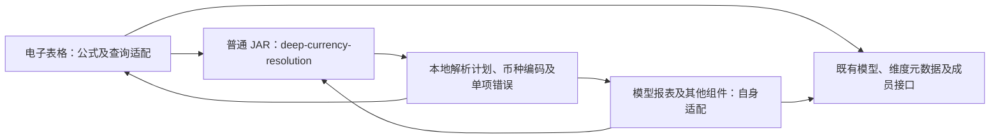
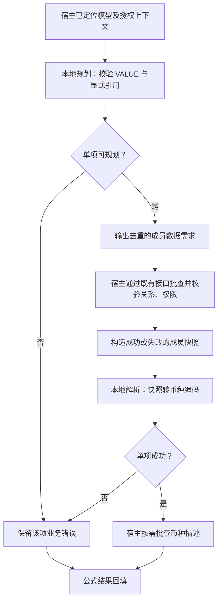
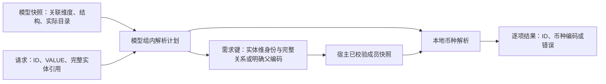
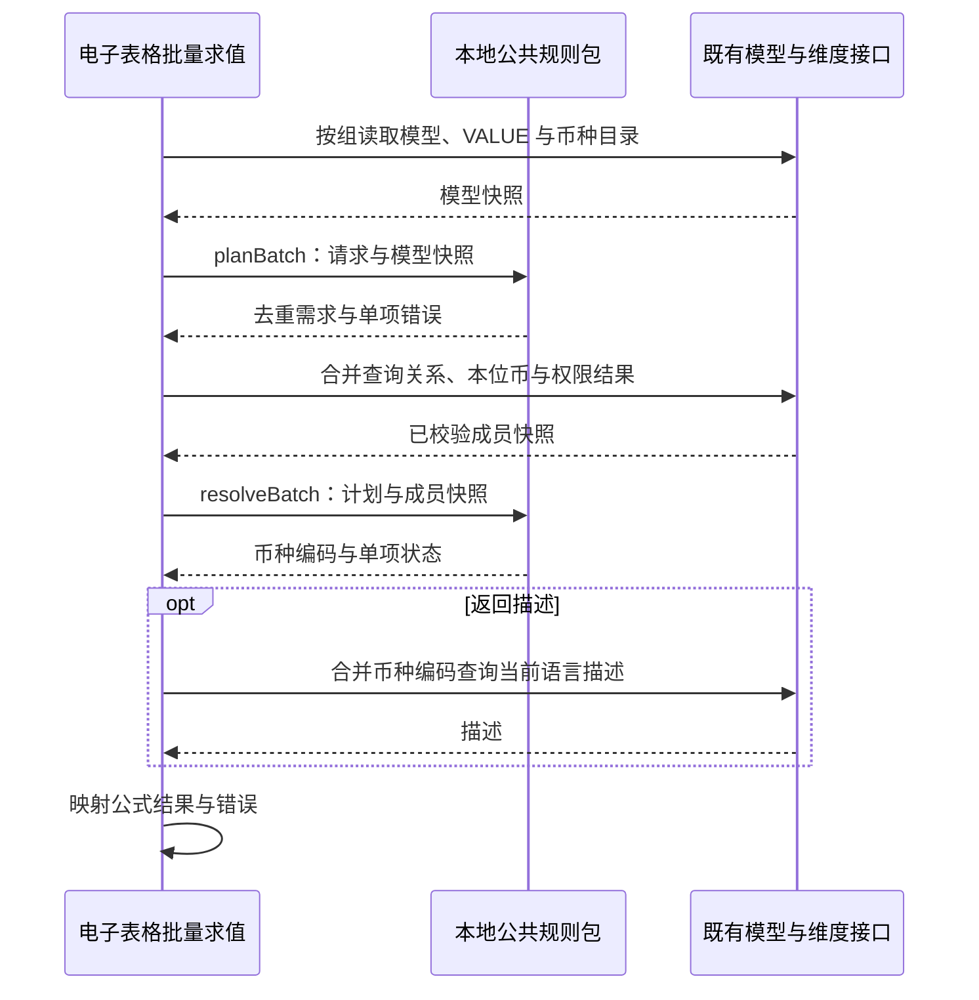

# 币种解析二方包规范

> 状态：评审中
> 最后更新：2026-10-14
> 适用范围：deep-currency-resolution 独立 Java 工程及跨组件公共契约；电子表格是首个消费方
> 关联文档：[主题说明](../说明.md)、[功能与后端规范](功能与后端规范.md)、[实施计划](../代码执行计划/2026-10-14-筛选器属性与币种公式后端实施计划.md)、[采用二方包的决策](../决策记录/2026-10-14-币种解析采用二方包.md)

> 实施更新：2026-10-14 已按用户授权完成本地代码实现，并按后续确认迁入 deepfos-planning/deep-table 与同仓库 deep-currency-resolution，使用 JDK 21。下文的候选契约／未创建／未实施描述为评审阶段基线；当前工程位置、载荷、开发坐标、验证与待联调／发布事项以[实现记录](../代码执行计划/2026-10-14-筛选器属性与币种公式实现记录.md)为准，不代表已上线。

## 一、目标与调研结论

把 VALUE 对应币种的业务判定做成独立二方包（内部共享的普通 Java 库）。artifactId 已确定为 `deep-currency-resolution`，采用独立 Java／Maven 工程、普通 JAR，让电子表格、模型报表及其他上层组件按同一契约引入调用，不要求新增财务模型或维度业务接口。

通用性是首版设计要求：电子表格只是首个消费方，公开 API、数据对象、错误与查询需求均以模型、实体、VALUE 和币种领域表达，不以单元格、工作簿或某个服务的 DTO 表达。通用范围仍是既有财务模型的币种口径解析，不扩张为汇率或任意规则平台。

源码核对支持这一方案：

- 财务模型 `CurrencyMappingAdapter/CurrencyMapping/CurrencyMappingV2` 的模板和分组属于本地规则，不依赖金额查询；其中集合与大小写匹配可用 JDK 实现，不必带入 Hutool 或 Guava。
- 模型关联、实体 `local_currency`、VALUE 成员和实际币种目录是数据输入；电子表格已有模型与维度查询客户端。
- `checkAndGetCurrency`、`NewValueUtil` 和聚合类耦合服务 DTO、查询编排或金额口径映射，不能整类直接搬入二方包。
- 电子表格与财务模型已经各有币种规则副本，但并不完全一致：表格新映射包含 Consolidation 系列；财务模型包含 Contribution 系列和 AdjTotal，且大小写匹配方式不同。共享包应统一新公式所用规则，不能复制任意一份副本就宣称兼容。
- 已核对两个服务均采用 Java 21，并使用 Spring Boot 应用打包。二方包应是独立普通 JAR，而非引入 financial-model-server 应用制品。

已确认独立规则包可行，且 artifactId 与独立 Java 工程形式已确定。实际仓库位置、groupId、首版版本、发布与长期维护归属尚待团队指定；当前没有已创建或已发布的工程。

## 二、责任和改动范围

| 角色 | 本次责任 | 不自动纳入的工作 |
| --- | --- | --- |
| 电子表格后端开发 | 公式接入、对象定位、权限、现有接口批查、输入快照适配、引入固定版本、描述及错误回填 | 修改维度／财务模型服务源码，替其他上层迁移 |
| 二方包交付及维护方 | 规则、轻量契约、批量规划与解析、测试样例、普通 JAR、版本发布及规则维护 | 维护每个宿主的请求上下文、接口客户端及缓存 |
| 财务模型开发 | 校验 VALUE 语义、新旧结构、历史节点及对照样例 | 为本期默认新增报表币种接口或先迁移所有调用方 |
| 维度维护方 | 确认已有查询与权限能力；必要时处理独立能力缺口 | 把报表币种语义放入维度服务 |
| 后续上层组件 | 引入同一版本并实现自身数据适配 | 成为电子表格首版验收的前置条件 |

用户明确只负责电子表格后端。若团队希望用户同时实现二方包首版，需要明确该独立交付物的工程与发布责任；这不等于授权改造财务模型服务。当前已冻结 artifactId、独立工程形式及通用契约边界，不编造实际仓库位置或维护人。

下图说明共享的是业务规则，查询适配和服务身份仍属于各宿主。



包中不调用图中的远程接口。财务模型现有类仅作规则参考；未来是否引入公共包由该组件维护方另行安排。

## 三、包内能力与依赖约束

包内包含：

1. 按已明确的模型结构分类 VALUE：实体本位币、父级币种、指定币种。
2. 根据显式父子引用规划所需成员及字段，缺父级时给出业务错误。
3. 使用已校验的关系／成员快照解析币种编码，输出模型实际币种目录中的规范名称。
4. 同组批量规划及解析，按请求身份保序返回单项成功／失败。

包内不包含：

- Spring 注解或容器、HTTP、RPC、DAO、数据源连接、服务发现、重试或线程池。
- `RequestContext`、`CommonContext`、用户令牌、权限方案、静态服务定位或全局结果缓存。
- `CubeInfoDto`、`MdxMemberDTO`、`ResponseResult`、`ValidationException` 等具体服务类型。
- DFCurrency 标签、工作簿、筛选器、DFUD 展示或电子表格错误码。
- 金额查询、汇率查询／换算、合并计算或活跃父级搜索。

生产依赖目标为 JDK 本身。首版无需 Spring Starter、额外 HTTP 适配包或自动装配。发布普通 Maven JAR，不执行 Spring Boot repackage；不从服务应用的父 POM 引入运行时装配。内部统一的构建父 POM／依赖管理可按公司规范使用，但不能因此带入上述生产依赖。

DTO 使用普通 Java 对象及 JDK 集合，避免绑定 Java 21 特有语法。已核对消费方为 Java 21；最终最低字节码版本由公共包维护方结合其他实际消费方，在首版发布前明确。

### 3.1 跨组件公共契约要求

- 公开请求、快照、计划和结果采用公共包自行定义的轻量领域对象。不得要求消费方构造 `DFCurrency` 标签、单元格行列、sheetId、筛选器或电子表格错误码。
- 模型／维度定位以调用方提供的稳定身份键表达；公共包不规定必须使用某个服务的 folderId／path、URL、令牌或存储结构。宿主负责把自身对象定位结果适配为公共身份。
- 显式实体引用、模型结构、VALUE 规则和币种目录是公共业务语义。规则匹配不能依赖消费方名称或电子表格专有标志；相同输入在不同消费方应得到相同币种结果。
- 单条与批量使用同一规则实现；对多个模型由调用方按模型及授权上下文分组调用，不绑定电子表格的重算轮次。
- 公开错误类别与错误明细稳定，宿主自行映射提示文案、异常及本组件错误码。不得把“单元格错误”作为公共包的结果类型。
- 解析器无可变全局状态；输入快照及计划不得被解析过程修改。同一个解析器可由不同组件或请求并发调用，不能依赖 ThreadLocal 中的应用身份。
- 固定规则按模型结构和公共包版本维护；不要为了通用性预建插件注册中心、远程配置、Spring Starter 或多个适配模块。首版采用一个独立纯 Java 库，数据适配在各宿主实现。

## 四、两阶段调用与查询顺序

采用“先规划数据需求，再用快照解析”的两阶段纯函数。下列方法及类型是候选契约，不是已发布类。

| 候选调用 | 输入 | 输出 |
| --- | --- | --- |
| `planBatch` | 同一模型快照、结构化实体引用及 VALUE 请求列表 | 解析计划、去重的数据需求、规划阶段单项错误 |
| `resolveBatch` | 原计划及对应的已校验成员／关系本位币快照 | 请求 ID、币种编码、币种来源或单项业务错误 |

需要单项调用时可以提供便利方法，但必须复用同一套批量规则，不能另写一套分支。首版不提供由包内部执行远程查询的回调或客户端；否则批量、权限和上下文责任又会混入公共包。

下图说明两阶段调用的失败路径与数据需求；查询完成后不会重新搜索父级。



规划必须包含实体／完整关系的存在及权限校验需求，即使是指定币种节点也不能跳过对实体参数的校验。PC／PT 需要读取显式父实体本位币；EC 不为了本位币额外读取父币种。描述字段只由需要 description 的请求触发。

## 五、输入、输出与关系身份

下表规定公开契约必须表达的语义；artifactId 为 deep-currency-resolution，最终类名、构造方式、groupId 与版本在发布前冻结。

| 对象 | 字段或信息 | 类型与约束 |
| --- | --- | --- |
| 模型快照 | `modelKey`、`modelStructure` | 字符串／结构枚举；必填，结构从真实元数据确定，不能只看 VALUE 编码猜测 |
| 模型快照 | 关联实体、VALUE、币种身份 | 公共轻量身份对象；宿主提供稳定且唯一的身份键，不只传可能歧义的别名；不强制服务专有 folderId／path 结构 |
| 模型快照 | 实际 VALUE 与币种目录 | JDK 集合；宿主从已有接口取得，区分已取得空目录与查询失败 |
| 请求 | `requestId` | 字符串，批内唯一；重复 ID 明确拒绝，不覆盖已有结果 |
| 请求 | `entityReference`、`valueCode` | 结构化实体引用及字符串；必填 |
| 实体引用 | 子编码、可选父编码、完整关系身份 | 保留规范名称和完整引用；父编码只来自输入，不提供父级搜索能力 |
| 成员快照 | 查询身份、关系／成员定位结果、`localCurrency` | 本位币可为空；缺失和空本位币与有效数据区分 |
| 成员快照 | 单项失败状态 | 宿主已取得的不存在、无权限或查询失败信息；公共包不主动鉴权 |
| 结果 | `requestId`、成功状态、`currencyCode`、来源分类 | 按输入顺序返回；编码从真实币种目录规范化 |
| 结果 | 业务错误类别与可读原因 | 不含具体服务错误码；宿主映射到本组件的错误机制 |

模型快照不包含年、期间、场景、版本、金额或汇率。宿主按应用／空间、数据源、语言和权限分组后调用；这些隔离边界不由包中的静态缓存实现。

下图说明完整实体关系是数据身份，不能被子编码替代。



不得只用 `US` 作为 `[HK].[US]` 与 `[CN].[US]` 的快照键。普通成员和完整关系成员也必须能够区分。表达式语法、转义及接口返回适配在宿主处理，公共包不复制完整 ANTLR 解析器或现有宽松的子编码匹配兜底。

## 六、VALUE 规则与当前实现差异

产品确认的新结构规则沿用功能规范：EC 三节点取子本位币；PC 三节点及 Parent、ParentAdjs、ParentTotal、Proportion、Elimination、Contribution 系列、AdjTotal 等父级节点取直接父币种；指定币种从实际币种目录及该结构的 VALUE 生成规则匹配。

大小写查找与返回原文分开：按已有维度成员语义进行匹配，输出实际目录中的规范名称。不能返回人为转小写的币种编码；不能依据任意 Total 后缀产生未存在的币种。

| 已核对差异 | 处理要求 |
| --- | --- |
| 电子表格新常量使用 Consolidation 系列，财务模型使用 Contribution 系列及 AdjTotal | 财务模型开发校验真实模型及历史别名；不把两个清单无条件并集后宣称全部有效 |
| 表格常量为普通 Map／Set，财务模型常量使用大小写无关集合 | 公共包统一匹配约定并用原目录名称返回，测试大小写场景 |
| 旧结构使用 LocalCurrency、LocalCurrTotal、LocalCurrAdjs 以及 ParentTotal／ParentAdjs 等模板 | 按独立模型结构核定；同名 ParentTotal 不能跨结构机械套新结构含义 |
| 原方法返回金额查询所需的 VALUE 映射或在无模板节点时不返回币种对象 | 公共包输出实际币种编码，单独覆盖指定币种节点，不直接复用原返回对象 |

首版交付前用产品例子、财务模型实现及实际维度生成节点建立固定测试样例。历史别名、旧结构或节点语义尚未核定时，应明确返回不支持该结构／节点，不能静默使用新规则或子本位币。

不要求本期修改财务模型的全部既有调用点来实现“单一源码”。本期新公式统一使用包的规则；现有服务副本保留，未来迁移由各维护方单独执行并验证。规则差异测试是首版要求，跨团队全面迁移不是。

## 七、描述、权限与错误

DFUD 的六个预置属性白名单与查询字段转换属于电子表格适配，不纳入币种规则包。宿主读取 localCurrency 时将既有查询字段 local_currency 转入成员快照的 localCurrency；包只使用该快照值，不关心预置属性或 UD 查询接口。

公共包返回币种编码。`name` 直接使用该规范名称；`description` 由宿主对解析出的币种编码按当前语言批查实际币种成员描述，不使用 VALUE 或实体描述。描述缺失按已有成员展示约定处理，不由包猜测语言或返回字段。

权限在宿主查询时执行。包不能仅凭输入代码制造有效结果：必须消费关系／成员快照的失败状态；缺少必要成功快照时返回数据未就绪或业务错误，不把空 Map 当作全部合法。

候选业务错误类别包括：无效请求、无效 VALUE、不支持模型结构、缺少父级、成员／关系不存在、无权限、空本位币、币种不在目录、数据未就绪。最终枚举以公共契约为准，不在包中引入电子表格 ErrorCodeEnum 或平台异常类型。

- 业务失败按请求项返回，正常项继续解析。
- 批量结构错误（例如重复请求 ID）明确拒绝，不静默覆盖。
- 全组元数据失败由宿主映射到该组公式，不影响其他模型组。
- 远程失败、超时、重试由宿主已有机制处理；包没有重试副作用。
- 相同包版本、请求及输入快照必须产生相同结果。

## 八、批量性能与刷新

包内外部 I/O 次数必须为零。包内批量 API本身不能证明远程查询已经合并；真正的分组、请求合并、上下文隔离和日志均在宿主完成。

下图说明电子表格的查询顺序，包始终是本地参与方。



同一轮重复公式共享底层快照和解析结果。显式刷新读取新快照；新币种或描述配置变化通常只需新数据输入，语义性 VALUE 规则变化则需要公共包版本更新。日志记录包版本、模型结构、去重前后项数、远程批次与内部查询次数，不增加包内全局缓存。

## 九、独立工程、打包与发布

### 9.1 已确定的工程形态

| 项目 | 规范 |
| --- | --- |
| artifactId | `deep-currency-resolution`，已由用户指定 |
| 工程类型 | 独立 Java／Maven 工程，不作为电子表格或财务模型服务的子模块 |
| 制品 | 普通 `jar`，不采用 Spring Boot 应用打包 |
| 构建能力 | 工程自身可单独编译、测试、打包及发布，不要求先构建任何业务服务 |
| 生产依赖 | JDK；不带入电子表格、财务模型、维度应用或平台运行时 |
| 发布位置 | 内部 Maven 仓库；groupId、version、仓库地址及维护归属待确定 |

以下为拟定独立工程结构，不表示已创建目录或代码。首版一个 Maven 工程即可，不为了“通用”拆分多个空模块。

```text
deep-currency-resolution/
├── pom.xml
├── README.md
├── src/main/java/       # 公共契约、解析计划及币种规则
└── src/test/java/       # 规则样例、错误、并发及普通 Java 消费验证
```

`pom.xml` 的 artifactId 固定为 deep-currency-resolution，packaging 为 jar。可使用公司独立的构建父 POM／依赖管理，但不得把业务服务 POM 作为 parent、通过 relativePath 绑定服务工程或继承其 Boot repackage 装配。README 说明单条／批量用法、输入快照适配、错误及版本兼容。

### 9.2 版本与消费兼容

- groupId、首版正式版本、实际源码仓库、最低 Java 版本、发布账号及维护方由团队明确；artifactId 和独立工程选择不再列为待确认。
- 导出轻量 DTO 与本地单条／批量 API，包名避免与服务现有 `com.proinnova.dimension.*` 类同名冲突。
- 发布不可变正式版本，每个消费组件固定依赖版本；生产不依赖可变 SNAPSHOT，不覆盖同一版本制品修正规则。
- 公开方法、DTO、错误类别和既有结果保持兼容。会改变结果或调用契约的规则调整须在版本说明与对照样例中明确，不让已接入组件在未升级时被动改变行为。
- 各组件独立升级和回退，随自身制品记录公共包版本；不要求多个服务同步发版，也不新增服务接口、数据库迁移或维度全局开关。
- 财务模型或其他组件未来采用同一包时，由其维护方单独验证迁移；电子表格首版不以其他组件实际接入为前置条件，但公共契约从首版即须通用。

## 十、包交付与接入验收

- [ ] 在无 Spring、无平台上下文、无财务模型应用依赖的最小普通 Java 工程中调用两阶段 API 成功。
- [ ] 生产依赖检查满足普通 JAR 与 JDK 依赖边界，没有 HTTP、数据库、服务发现或 Boot repackage。
- [ ] EC／PC／ParentTotal／指定币种、缺父级和错误值有固定业务样例；规则差异及目标旧结构由财务模型开发校验。
- [ ] 完整关系与同名子成员不串值，结果保序，重复 ID 及缺少快照明确反馈。
- [ ] 包内零 I/O；100 个币种公式在宿主按组批查，重复成员及币种描述去重。
- [ ] 宿主验证权限、语言、数据源隔离、描述展示、单项错误及刷新。
- [ ] 独立 Java 工程能自身构建，artifactId 为 deep-currency-resolution，制品为普通 JAR；不作为任一业务服务的子模块。
- [ ] 至少用“电子表格适配样例”和“不含电子表格概念的普通 Java 消费样例”验证同一公开契约；相同领域输入输出一致，不要求真实其他组件先迁移。
- [ ] 单条与批量结果一致，输入不被修改，并发调用没有共享可变状态；公共 API 不包含单元格／工作簿字段或服务 DTO。
- [ ] groupId、最低 Java 版本、正式包版本、首版交付及长期维护方明确。
- [ ] 电子表格只引入并适配包；没有将其他团队源码改造或后续组件迁移计入用户任务。

本轮只更新规范和计划，没有创建、构建或发布公共包，也没有修改电子表格、财务模型或维度业务代码。
