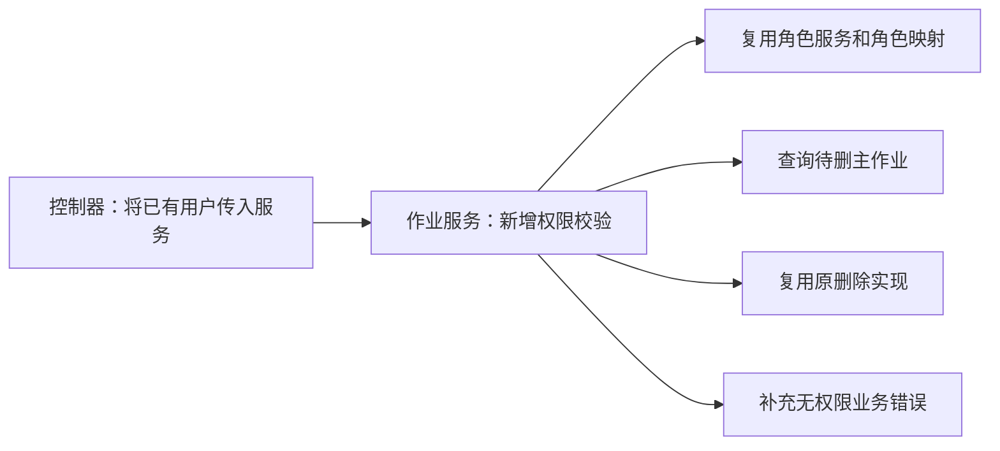
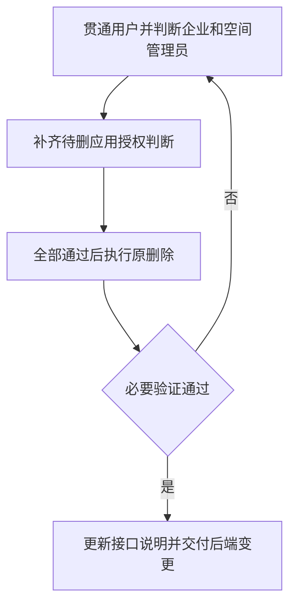

# 作业批量删除权限后端实施计划

> 状态：已确认（本地实施与专项验证完成，已提交推送、未部署）
> 最后更新：2026-11-04
> 适用范围：DeepFos `system-server`，`POST /job/batch-remove`
> 关联文档：[功能入口](../说明.md)、[权限规则与后端方案](../规划/权限规则与后端方案.md)

## 一、目标与依据

在原删除逻辑前增加管理员优先级判断：企业管理员直接放行；否则核对当前空间管理员；仍不是则查询待删记录，核对全部所属应用的管理员身份，一个不满足就整批拒绝。普通用户不能删除本人记录。

实现依据和源码位置见[后端方案](../规划/权限规则与后端方案.md)。仓库为 `/Users/yang/deepfinance_project/deepfos-platform`，首次调研提交为 `2de498c21696e7bc2a5e53bbbc4b3539b5a83aa8`。实施前按实际工作区确认符号及基线即可，不要求叠加当前分支中的其他需求。

只改本接口必要的后端权限判断及错误说明，不涉及前端、查询权限、相邻删除入口、删除顺序和计数契约。依赖现有角色服务、用户组解析、角色 Mapper 与 ES 仓库，无新外部依赖或数据迁移。

## 二、改动全景

下图显示需要修改与直接复用的代码范围。

下图显示三个实施步骤及验证顺序。

## 三、实施步骤

以下路径相对 `system-server/`。

### 1. 在删除入口增加管理员优先级判断

- 修改位置：`src/main/java/com/proinnova/system/job/rest/JobController.java` 的 `deleteJobBatch`，`job/service/JobService.java` 和 `job/service/impl/JobServiceImpl.java` 的 `jobRemoveBatch`。
- 具体改动：将控制器已有的 `user` 传入服务；在原删除逻辑之前用现有 `getUserPermissionInfo` 查询当前 `space` 权限。企业管理员直接进入原删除。非企业管理员只允许处理当前空间记录；空间管理员无需应用角色判断。
- 依赖关系：现有角色解析和请求上下文，不新增客户端参数。
- 验证方式：企业管理员不执行逐应用校验；空间管理员可删当前空间任意应用记录，不能因同企业共享索引删到其他空间。

### 2. 查询待删记录并检查所有所属应用

- 修改位置：`job/service/impl/JobServiceImpl.java` 内的私有校验方法；复用 `UserRoleMapper.getRolesByUserGroup` 及 ES 仓库查询能力。
- 具体改动：非企业管理员查询待删主作业并核对 `space`；不是空间管理员时提取不同的 `app`，与当前空间中用户及用户组获得 `AR001` 的应用集合比较，有一个应用不满足即整批拒绝。空应用／`0` 应用不能通过应用管理员分支。查询必须完整，不受请求头 `app` 过滤，不直接复用包含开发者 `AR004` 的 `getAppsByUserGroup`。
- 依赖关系：步骤 1；沿用现有用户组语义。
- 验证方式：单应用、多应用全部授权、多应用含一个未授权、默认查询页外有未授权应用、无 app 头、开发者及普通用户本人记录等场景符合预期。拒绝时两类记录均未删除。

### 3. 接回原删除逻辑并完成必要验证

- 修改位置：`job/service/impl/JobServiceImpl.java` 的原删除调用；`common/enums/E1131Enums.java` 和控制器接口错误说明按需补充。
- 具体改动：仅在前述检查通过后执行删除，主作业和明细使用同一已校验记录范围。补充无删除权限错误，沿用现有日志；保持原删除顺序、返回类型及计数契约。权限依赖失败时抛异常，不绕过校验。
- 依赖关系：步骤 2。
- 验证方式：针对权限判断增加必要的 JUnit／Mockito 测试或等效隔离验证；验证允许删除与拒绝零删除副作用，再编译受影响模块。现有测试依赖已具备，不引入 H2 或新增测试基础设施。2026-11-04 已执行下述专项验证，结果见[验证记录](../验证记录/2026-11-04-后端实施与验证记录.md)。

## 四、验收用例

| 用户与记录 | 预期 |
| --- | --- |
| 企业管理员，本企业多个空间记录 | 允许，不逐应用判断 |
| 当前空间管理员，本空间他人和空间级记录 | 允许 |
| 当前空间管理员，同企业其他空间记录 | 拒绝 |
| 应用管理员，待删应用全部由其管理 | 允许 |
| 应用管理员，一批里有一个未管理应用 | 整批拒绝，主作业和明细都不删除 |
| 应用管理员，含空应用或 `0` 应用 | 拒绝 |
| 通过用户组获得空间／应用管理员身份 | 与直接赋权一致 |
| 普通用户、仅开发者、仅审计员，删除本人记录 | 拒绝 |
| 请求无 app 头，或 app 头与待删应用不同 | 仍按记录所属应用判断 |
| 未授权记录在默认查询第一页之外 | 完整检查后整批拒绝 |
| 角色或记录查询抛异常 | 返回失败，不继续删除 |

## 五、发布与完成标准

后续仅发布必要后端改动，无数据库或索引迁移；确保处理该接口的实例均升级。回滚版本会恢复原接口权限行为，需在交付说明注明。原有删除失败及重试机制保持原样，不在本需求另行改造。

- [x] 企业、当前空间、全部待删应用的三级判断顺序正确。
- [x] 非企业管理员的待删记录属于当前空间。
- [x] 普通用户本人记录和仅开发者身份均不能删除。
- [x] 任一应用无权限时整批没有删除副作用，用户组身份正常生效。
- [x] 必要测试和编译通过，接口错误说明同步。
- [x] 未夹带前端、相邻接口、查询规则或存储行为变更。
