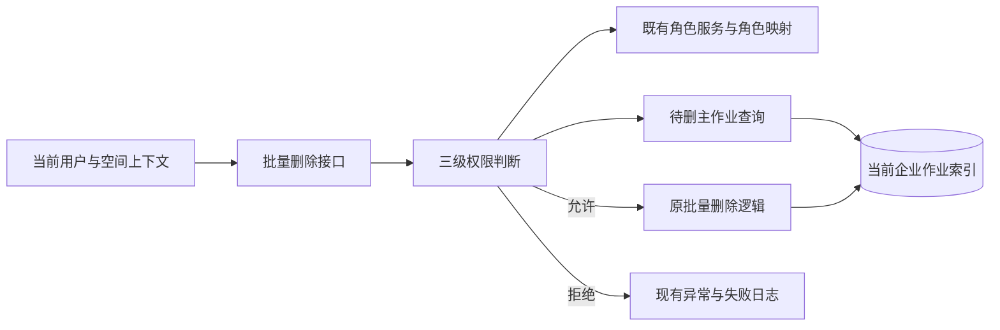
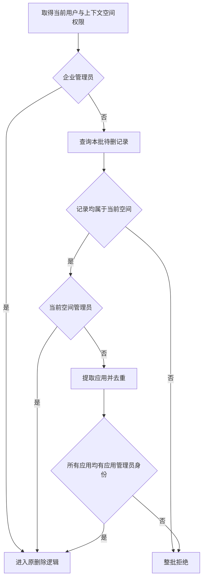

# 作业批量删除权限规则与后端方案

> 状态：已确认（按三级判断方式完成后端本地实现）
> 最后更新：2026-11-06
> 适用范围：DeepFos `system-server` 的 `POST /job/batch-remove` 与已完成作业 `POST /job-current-list`
> 关联文档：[功能入口](../说明.md)、[后端实施计划](../代码执行计划/2026-11-02-作业批量删除权限后端实施计划.md)

## 一、已确认规则

按照管理员身份优先级依次判断，命中后不再继续检查低一级身份：

| 顺序 | 判断 | 处理 |
| --- | --- | --- |
| 1 | 是否当前企业的企业管理员 | 直接放行，沿用该企业索引 |
| 2 | 是否上下文 `space` 的空间管理员 | 允许删除本空间记录，不要求应用管理员身份 |
| 3 | 是否为待删记录所有所属应用的管理员 | 全部满足才放行，有一个应用不满足就整批拒绝 |
| 4 | 以上均不满足 | 拒绝，即使作业由本人提交 |

接口没有必填 `app` 参数，因此应用来自待删主作业数据，不依赖客户端补传应用。非企业管理员只处理当前空间记录；无应用或应用为 `0` 的空间级记录不能凭应用管理员身份删除。

## 二、已核实的实现依据

代码仓库为 `/Users/yang/deepfinance_project/deepfos-platform`。首次调研基线为分支 `codex/enterprise-log-auditor`、提交 `2de498c21696e7bc2a5e53bbbc4b3539b5a83aa8`；行号为当时位置，实施时按符号定位。

以下路径相对 `system-server/`：

| 位置 | 现状与复用方式 |
| --- | --- |
| `src/main/java/com/proinnova/system/job/rest/JobController.java:300`，`deleteJobBatch` | 已有 ID 数组、`space`、`user`，未使用用户做删除授权；可在此入口增加校验或调用服务内的小型校验方法 |
| `src/main/java/com/proinnova/system/job/service/impl/JobServiceImpl.java:378`，`jobRemoveBatch` | 当前直接按 ID 删除主作业和明细；授权通过后继续复用原删除逻辑 |
| `src/main/java/com/proinnova/system/role/service/impl/UserRoleServiceImpl.java:930`，`getUserPermissionInfo` | 可取得当前企业管理员、当前空间管理员和用户组信息，沿用已有解析方式 |
| `src/main/java/com/proinnova/system/role/service/impl/UserRoleServiceImpl.java:1023` 起 | `appAdmin` 依赖 `RequestContext.getApp()`，不能直接代表待删批次所有应用的管理员身份 |
| `src/main/resources/mapper/mysql/UserRoleMapper.xml:164`，`getRolesByUserGroup` | 返回当前空间内用户及用户组的角色与应用，可筛选 `AR001` 得到管理应用集合；无需新建 SQL |
| 同上，467 起，`getAppsByUserGroup` | 同时包含 `AR001` 和开发者 `AR004`，不能原样用于本次删除授权 |
| `src/main/java/com/proinnova/system/job/service/impl/ESJobServiceImpl.java:385`，`buildIndexName` | 索引按企业共享，`space` 只定位企业索引，不自动隔离该空间 |
| 同上，345 起，`jobCurrentListByIds` | 使用上下文空间和应用、无显式完整分页保证，不能原样查询整批用于授权；需要确保查询不受头部 app 干扰且取全 |

作业列表的 `assignPrecondition` 与操作日志的 `getUserPermissionByUser` 可参考角色判断方式，但查询中的开发者、本人记录分支不用于删除授权。

## 三、最小后端方案

下图说明本次只在原删除链路前增加一处授权判断，复用现有角色与数据查询。

具体只需以下处理：

1. 用现有角色服务取得当前用户在上下文 `space` 下的权限，企业管理员直接进入原删除逻辑，不再逐空间、逐应用解析。
2. 非企业管理员查出本批待删主作业，检查其 `space` 与上下文一致。当前空间管理员通过后即可删除，不再判断每个应用的角色。
3. 不是空间管理员时，从这些记录取不同的 `app`，与用户在当前空间拥有 `AR001` 的应用集合核对。用户组赋权沿用现有角色查询；任一应用不在集合内就抛无删除权限异常。
4. 所有检查通过后才进入删除；主作业和明细均只处理已经校验的记录范围，不能查一部分就开始删除。

这里保留的空间核对只是防止企业共享索引内串空间删除，不引入跨空间授权合并。应用管理员分支要查全待删记录，避免默认只取第一页而漏掉无权限应用。企业管理员无需增加该查询。

下图展示唯一的核心判断流程。

## 四、修改边界与接口行为

- 保持请求体字符串数组和现有 `space`、`user` 入参，不增加必填 `app`。
- 权限校验集中在一个小方法内，由批量删除入口调用。可放在 `JobServiceImpl.jobRemoveBatch` 开头，将已有 `user` 传入服务；不建立公共权限框架。
- 无权限使用项目现有业务异常机制，补充合适的“无作业删除权限”错误定义；继续使用现有成功／失败日志。
- 保持主作业、明细原删除顺序与返回类型，不附带修改删除计数、重试、缺失 ID 或历史数据清理政策，不增加新的批次上限。
- 权限查询异常沿用失败处理，不能继续删除。未查到主记录的 ID 不能作为应用管理员授权依据，也不能因此直接清理未经授权确认的明细。
- 作业列表复用既有查询范围，并按第七节追加删除权限结果。

## 五、验证与交付

- 企业管理员可删除本企业其他空间记录，不增加逐应用判断。
- 当前空间管理员可删除本空间任意应用及其他用户提交的记录；同企业其他空间记录拒绝。
- 应用管理员可删除其管理应用的记录；一批涉及多个应用时，必须全部有管理权限，任一个不满足整批拒绝。
- 普通用户、仅开发者、仅日志审计员等无上述管理身份时，删除本人记录也拒绝。
- 用户组取得的管理员身份正常生效；请求头无 `app` 或带有不同 `app` 时，仍按记录所属应用判断。
- 待删记录超过默认查询页大小时仍完整检查；拒绝时主作业和明细均未发生删除。

2026-11-04 后端本地实现及 20 个专项用例已完成，详见[实施与验证记录](../验证记录/2026-11-04-后端实施与验证记录.md)。发布只涉及后端服务，无数据迁移；回滚会恢复原权限行为。真实 ES／账户中心联调及部署尚未执行。

## 六、调整记录

2026-11-02 根据用户反馈，采用企业管理员、当前空间管理员、待删应用管理员的三级判断；“一个应用无权限就整批拒绝”已明确。原规划中的跨空间权限范围并集、逐空间角色解析、删除顺序改造、计数契约变更及一组额外待确认项均不再纳入本次实现。

相邻接口调研发现仅保留为备忘：`/job/remove-history` 使用含本人范围的查询条件，`/job-delete` 另有关系数据库删除路径。本次按指定接口完成，不以这两个入口的处理作为前置条件。

## 七、已完成作业列表可删除标识

2026-11-06 用户追加要求，在 `/job-current-list` 的已完成作业中提供逐条可删除标识，供前端直接读取。

| 字段 | 类型 | 返回条件 | 含义 |
| --- | --- | --- | --- |
| `canDelete` | 布尔值 | 请求 `complete=true` 且列表存在记录 | 当前用户是否具备删除该条作业的权限 |

列表项示例为 `{"id":"作业甲","app":"应用甲","canDelete":true}`。已完成记录的权限判断结果必须明确为 `true` 或 `false`。未完成列表和共享响应对象的其他用途以可空字段配合忽略空值序列化处理该属性。

在 `JobServiceImpl` 中共用 `getJobAdminApps` 与 `canDeleteJob`，供批量删除和列表调用。列表前置条件返回已经取得的权限信息，管理员应用集合每个请求查询一次。列表直接使用当前页已有记录的空间、应用逐条计算标识。

验收包括企业管理员跨空间标识、空间管理员范围、应用管理员混合应用标识、普通用户本人记录为 `false`，以及未完成列表的字段序列化。新增 5 个专项用例与原 20 个删除回归用例全部通过。
