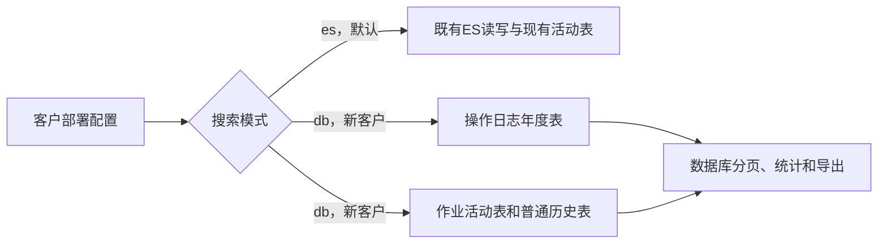
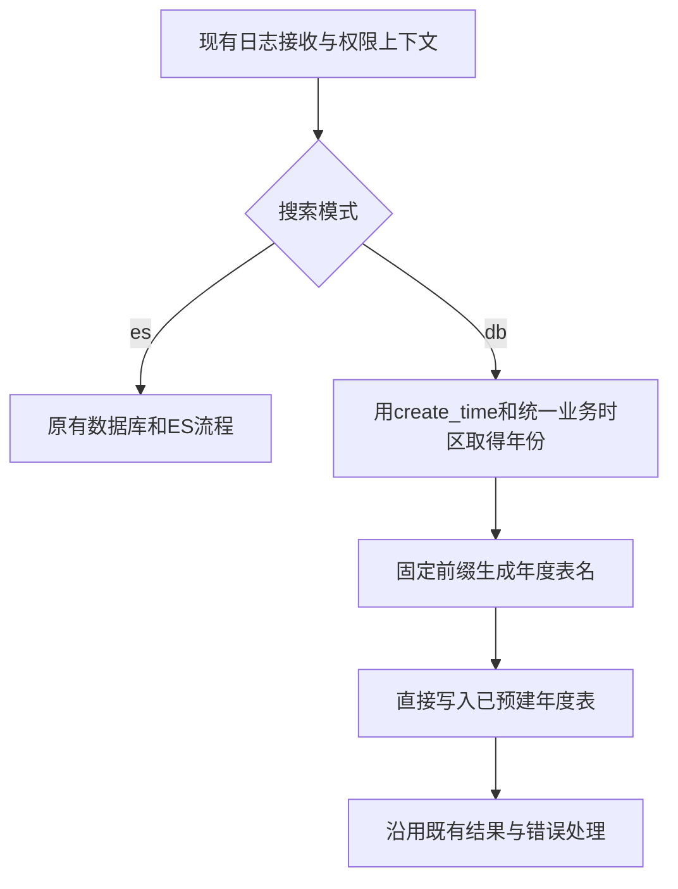
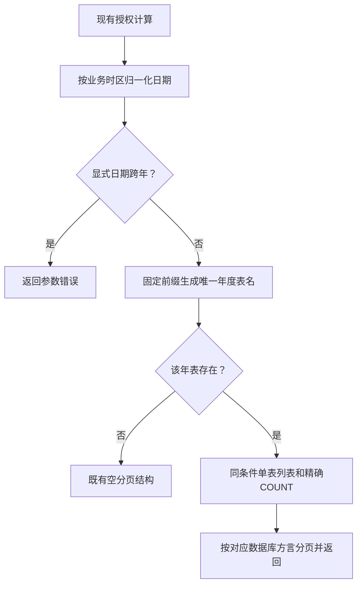
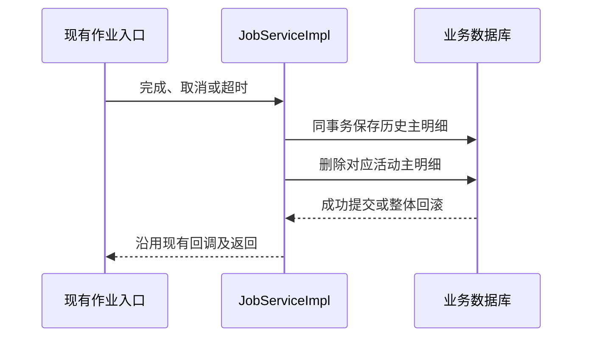

# 年度表数据库技术方案

> 状态：评审中
> 最后更新：2026-11-05
> 适用范围：deepfos-platform 存量ES客户与新部署数据库客户；操作日志、作业管理及启动配置
> 关联文档：[主题说明](../说明.md)、[实施计划](../代码执行计划/2026-11-05-年度表数据库模式实施计划.md)、[ES替代核对表](../代码执行计划/2026-11-05-后端ES替代核对表.md)、[决策记录](../决策记录/2026-11-05-保留ES与采用年度表.md)、[来源地址规范](../../操作日志与作业来源地址/说明.md)、[作业删除权限规范](../../作业批量删除权限/说明.md)

> 2026-11-05 实施补充：用户明确取消索引存在性检索、既有表索引补齐和扫描空表再补索引；只在创建新表时直接建索引，活动作业表不动。表存在性使用业务数据源的 JDBC 元数据，不手写系统目录 SQL。本补充覆盖下文对应旧要求。实际代码与逐项验证状态见[后端实现与验证记录](../验证记录/2026-11-05-后端实现与验证记录.md)。

> 本轮实施澄清：年表仅指 sp_log_info 操作日志，字段沿用原表，只改表名和索引。异常日志 sys_log_info 不分年，复用原 LogMapper，不单独新增 Mapper／查询服务或堆栈列；完整堆栈与列表复用原 tract_infos 字段存储。操作日志收敛为建表／索引与查询两类 Mapper 职责，删除多余的 Query／Page／Write 文件拆分。

> 本轮代码收敛补充：数据库查询使用 DbLogQuery 实体，年度修复复用 SpLogInfo，不使用 Map 作为业务入参。操作日志年表 DDL、索引、写入及查询均集中在 common XML，只有自增／时间类型／表内索引与分页语法的少量原生差异分支；已删除 19 份重复方言 XML。common 与方言目录同时加载，重复 namespace／语句 ID 不会覆盖而会报错，不能依赖加载顺序。此说明覆盖下文早期按方言分文件的实施位置描述。

> 用户追加确认作业历史也按年存储，此要求覆盖下文“作业历史本期不分年”的早期决定。完成作业写 job_history_YYYY／job_content_history_YYYY，主体按 endTime 的业务年份路由，明细跟随同年。完整保留 ES 的 24／13 个业务属性与内部 tenant_scope 隔离列，查询、统计、ID 定位、导出及删除覆盖实际已有年表，并兼容此前普通历史表。当前策略代码已提交为 159b6bdd，年度作业历史作为后续改动。实际验证边界见后端实现与验证记录。

## 一、已定方向与最小范围

同一套产品保留两条**按客户部署互斥**的路线，以 `EXPORT_SEARCH_MODE=es|db`选择，默认es。接近200个存量客户继续用原ES路线，不强制迁移、不改大表索引。新销售的OP环境可选db，不安装或连接ES。

数据库模式直接使用操作日志年度物理表，不设最近一个月热表，不引入Lucene、NAS索引、待办、选主、同步、归档搬迁或分库分表中间件。年度分表本期只用于操作日志；为减少改动，作业继续用活动表，加两张普通历史表，不再给作业增加跨年路由。

用户补充确认：**db新环境不创建、不写入、不读取全量操作日志表sp_log_info，也不把它当作DDL模板。** 年表独立定义完整字段与索引。存量es环境的既有全量表／双写保持兼容，本次不删除其表或数据。

| 对象 | es模式 | db模式 |
| --- | --- | --- |
| 操作日志 | 原数据库／ES写入及ES查询 | 只写sp_log_info_YYYY；数据库查询 |
| 未完成作业 | 现有job_current、job_content | 同样使用现有活动主明细表 |
| 完成作业 | 原ES归档与查询 | 同库事务归档job_history、job_content_history并查库 |
| 异常日志sys_log_info | 原行为保留 | 沿用现有数据库存储／查询，停止额外ES写入 |
| ES依赖与配置 | 保留并默认启用 | 相关客户端、仓库、初始化及健康探测不启用 |

以下是当前目标结构图，展示两类客户的独立数据路线。

本轮交付文档，不编写业务代码、不执行DDL或数据迁移。后续实施只修改后端Java、SQL／Mapper、配置与测试，不修改前端页面、日期控件、请求／响应协议或新增必传年份；单年范围由后端校验，不能以等待前端调整作为功能完成条件。上述路线由用户确认；具体类名、索引组合和建表入口属于本方案建议，实施前以准确交付分支验证。

## 二、依据与性能边界

2026-11-05首次核查基线为 `codex/enterprise-log-auditor / e5ed1ccf`，本轮补充核查为 `jdk21 / 8c860742`；仓库为 `/Users/yang/deepfinance_project/deepfos-platform`。通过CodeGraph追踪作业创建／归档／查询、超时监听、日志查询与初始化；接口、未覆盖SQL和配置另核查当前文件。

已确认：作业创建即完成可直接写ES；transferEs、removeJobToES写ES后删活动行；未完成查询已用数据库；操作日志ES查询具有企业／空间／应用／用户权限和多字段关键词；当前全局关键词分支跳过时间筛选。DB新路线必须覆盖这些功能，不能只替换列表。

用户提供alpha约五年操作日志1000万行、每年约200万，其他客户通常更少。2026-10-26只读检查时alpha为MySQL5.7.44，sp_log_info只有id主键，约4.8GiB数据；统计行数为估算，自增ID不能当精确行数。

同日对真实主键范围 `9718295 < id <= 9888295`计得170000行，禁用SQL结果缓存的重复粗测如下：

| 查询 | 观测耗时 |
| --- | --- |
| zhcn_content LIKE '%ss%'＋COUNT | 约0.12秒；此前首轮约0.40秒 |
| 用户名／邮箱／操作类型／空间名／应用名／中文内容六字段OR LIKE＋COUNT | 约0.23秒 |
| 同样六字段过滤，按create_time、id倒序取前20条 | 约0.24秒 |
| 后两项SQL分别执行的时间之和 | 约0.47秒 |

这是已有大表中限定17万行的只读SQL粗测，含相邻SQL打点切换成本，未创建真实热表、未清空InnoDB缓存、未测并发或完整接口，不是客户环境p95承诺。普通索引不能直接定位LIKE '%词%'，其作用是先按权限和时间缩小范围；年度表不意味着每次扫全年200万行。

先不引入热表。实际验收重点是年度表配索引后的近月关键词、精确COUNT、单年分页和导出；若目标环境实测不达业务目标，再单独评估，不能预先叠加冷热搬迁。

## 三、年度表结构与预建

### 3.1 表与字段

操作日志只使用 `sp_log_info_2026`、`sp_log_info_2027`等独立物理表，不采用MySQL原生分区，避免改主键规则和引入数据库特定分区限制。

年度DDL使用当前完整SpLogInfo业务字段：id、tenant_code、enterprise_name、space／space_name、app／app_name、module_type／module_version、operate_name、ope_status、三语言内容、log_file_id、create_user、avatar、user_name、email、create_time、ip和mac_address。字段类型及响应映射沿用当前模型，不为替换后端另建一套日志DTO。

每年可继续使用现有整型自增id，内部单条定位采用“年份＋id”，跨年不能只把id视为全局唯一；不新增雪花ID服务。按create_time分年后，相同时间的记录只会在同一年，create_time＋id足以给列表确定顺序。实施时核查现有调用是否另有全局日志ID依赖，发现真实依赖再处理，不预先造ID框架。

### 3.2 索引

年度空表创建时同时建立以下初始组合，按真实执行计划微调，不给所有字段逐个建索引：

| 索引字段 | 主要查询 |
| --- | --- |
| PRIMARY KEY(id) | 年内定位及稳定排序辅助 |
| tenant_code, create_time, id | 企业日志及时间排序 |
| space, create_time, id | 空间日志入口；不能仅有tenant开头而让纯space查询用不上 |
| tenant_code, create_user, create_time, id | 用户个人日志 |

应用、状态和模块等先在上述范围内过滤；只在目标请求实测需要时增加相应组合。索引名称、字段长度和分页语法按项目现有数据库方言处理，以alpha的MySQL5.7作为已知验证基线，不使用MySQL8专有窗口函数。

### 3.3 创建时机：启动预建＋每日低频预建

采用同一个ensureYearTables方法，在db模块初始化时调用一次，之后每天凌晨调用一次；每次只准备**本年和下一年两张日志表**，包括规定的初始索引。这样既覆盖首次部署，也覆盖多年不重启和年界切换。

| 方式 | 本方案判断 |
| --- | --- |
| 每条日志落库前查表／执行CREATE IF NOT EXISTS | 不采用；即使已存在仍增加高频数据库交互 |
| 只在启动时预建 | 不单独采用；无法覆盖多年持续运行 |
| 仅每年某日执行一次任务 | 不采用；一次错过就可能影响下一年 |
| 启动＋每日检查本年／下一年 | 推荐；很少量元数据检查，不进入写入请求路径 |

正常写入只计算年份并INSERT，不查表、不建表、不加索引、不做“表不存在则建表重试”的异常降级。任务失败进入现有日志／初始化错误处理；下一次日任务仍会按计划执行，不额外实现重试框架。年表被人工删除属于运维异常，不在每条日志上补救。

各实例均可低频执行，不新增选主。MySQL、PostgreSQL等支持的原生幂等语句优先使用；其他引擎在对应Mapper做表／索引元数据检查。存在性检查与CREATE之间仍可能竞争，只对该引擎**明确的同名对象已存在**结果，在事务结束后复查对象已完整创建，再视为并发成功；其他异常不吞。PostgreSQL类引擎发生DDL异常后先回滚再复查，不能在已失败事务中继续查询。此为多实例必要边界，不做通用异常兼容框架。

各引擎表和规定索引全部创建成功才算预建完成；不假定CREATE TABLE IF NOT EXISTS会补齐已有表缺少的索引。元数据核对只在初始化／低频任务中做，新建未完成空表的索引按方言幂等完成；只在发现缺索引时轻量检查表是否有数据，不扫描完整业务表；已有数据表的索引变更走明确升级流程，不让日任务自动ALTER历史大表。

### 3.4 多数据库适配范围

代码已有mysql、postgresql、dm、kingbase8、oceanbase、opengauss六套方言目录，本次db模式均需提供对应实现与验证；mysql-opengauss是已有系统Mapper兼容路由，不作为第七种数据库。不能只交MySQL后把其余引擎称作“以后适配”。

沿用application.properties的配置：system按 `mapper/${datasource.mapper-type}`加载，space按 `mapper/${datasource.type}`加载，另有common目录。Mapper绑定当前业务dataSource的SqlSessionFactory，不能根据账号库类型或驱动名猜年度业务库方言。混合部署同时核查datasource.type／datasource.mapper-type实际值和兼容模式，不改成新的路由框架。

| 引擎／已有目录 | 年表／ID与元数据重点 | 查询／索引重点 |
| --- | --- | --- |
| MySQL／mysql | AUTO_INCREMENT；information_schema；数据库catalog范围；空表CREATE含KEY | 日期参数绑定、既有不区分大小写排序规则；LIMIT语法按既有方式 |
| PostgreSQL／postgresql | 沿用serial／序列或目标版本支持的identity；schema范围；序列与JDBC生成键 | 原生timestamp，不照抄datetime；既有ILIKE语义；表外CREATE INDEX及COMMENT |
| 达梦／dm | 目标版本的identity、用户／schema和目录视图；不假定支持MySQL式IF NOT EXISTS | 日期和注释语法；索引创建；采用当前引擎已验证分页，不硬写MySQL LIMIT |
| 金仓／kingbase8 | 依据目标兼容模式的自增／序列、标识符大小写和schema | 中文／英文匹配、timestamp及索引语法，不能仅因类似PG就免测 |
| OceanBase／oceanbase | 项目现有MySQL兼容模式；自增及元数据幂等 | MySQL兼容日期／索引／分页；Oracle兼容模式不作未经验证的承诺 |
| openGauss／opengauss | 沿用当前序列／兼容模式；schema及生成键返回 | 目标模式的日期、匹配和分页，独立验证，不复制MySQL结论 |

表名／索引名长度、保留字引用、schema与大小写归一、自增键回填、DDL事务行为都用既有对应方言处理。旧SpaceInitMapper中的datetime等兼容写法只能作为线索，不能当作原生引擎验证通过。年度DDL定义完整表，不CREATE LIKE sp_log_info，也不新增模板表。

### 3.5 旧初始化隔离

现有 `space.init.service.impl.InitServiceImpl#execute`读取SPACE-INIT脚本，经loadSql分句、去注释后执行，并按SQL正文记录已执行内容。新db部署必须绕开全量sp_log_info的CREATE、ALTER、COMMENT及其专属旧数据修复；其余初始化照旧。

最小实现：在六套SPACE-INIT脚本的全量日志专属语句前增加受控标记 `-- @es-only-log-table 仅ES模式使用全量操作日志表`；原loadSql在去注释前识别标记，db模式跳过该语句，es模式照旧剥注释。保留原执行SQL正文及记录匹配语义，不改已发布SQL为新正文、不复制整套初始化文件、不新增SQL解析依赖。核查initSpLogInfo Mapper，任何调用也须仅ES模式。DB新部署不运行面向旧全量表的历史升级修复。

## 四、日志写入与查询

下图说明db日志只有一次数据库写入，没有双写或同步任务。

写入沿用当前addLog的数据装配、用户／应用名称和来源地址，不换调用协议。按日志create_time归属年份，不能写入按服务器当前年、查询又按create_time年。建表、写入、查询统一使用现有平台业务时区，不各自取机器默认时区。

### 4.1 DB模式只允许单年查询

用户已明确不做跨年搜索。本期不增加独立年份必填字段，沿用现有日期参数，归一化后只定位一张年度表：

- 起止都明确提供：必须属于同一个业务年份，开始不得晚于结束；跨年直接返回现有参数校验错误，不自动拆查询或静默截断。
- 都未提供：结束取当前时间，开始取“当前时间前30天”和“当年元旦”中较晚者。一月初默认条件也不跨年，例如1月5日默认从1月1日开始。
- 仅提供结束：按结束所属年份查询，开始取结束前30天与该年元旦中较晚者。
- 仅提供开始：按开始所属年份查询，结束补当前时间但用该年下一元旦的排他上界约束；返回范围不越过所选年，不用猜各数据库最后一微秒。
- 归一化只对db生效。显式结束时间仍沿用现有包含语义；年度上界内部采用 `create_time < nextYearStart`，这是所选年截止边界，不是搜索第二张表。
- 列表、独立COUNT和导出使用同一个年份／日期规则；只由后端拒绝跨年，本轮不要求前端日期控件调整。ES原查询实现不在本轮重写。
- 关键词优先／分类筛选沿用现有接口约定，但**授权和时间始终在外层生效**。

年度表名仅由固定前缀和服务端年份生成，不接受客户端字符串。只需检查该年是否存在；新客户确实没有该历史年则返回空分页，不遍历全部年度表、不做元数据缓存框架。正常写入不做此检查。真实SQL失败不能假装该年没有数据。

字段值使用MyBatis参数绑定，语言内容列和排序方向用既有常量映射；保留这些必要边界，不叠加通用SQL校验器。

### 4.2 单表分页与精确统计

下图展示单年限制如何同时简化列表和COUNT。

删除跨年UNION ALL、各分支LIMIT、跨年COUNT求和及Java合并。直接年度单表按 `create_time ASC/DESC, id ASC/DESC`排序，保留现有页码、页大小、精确total和导出上限。

本轮代码核查发现system／space手动创建SqlSessionFactory的配置中未像account那样显式挂PageInterceptor，因此不能只调用PageHelper.startPage就认定已分页。为不改全局工厂影响存量客户，DB新查询Mapper提供简单的单表分页壳：公共字段／权限／时间条件复用，分页语法留在对应方言XML；不通用硬编码LIMIT。若最终交付分支已确认有可用分页插件，可直接复用，但本计划不通过重配所有工厂来完成日志需求。

MySQL／OceanBase MySQL模式可用LIMIT；PG类引擎用其已验证LIMIT/OFFSET；达梦沿用目标版本可用的ROWNUM或OFFSET/FETCH写法。精确COUNT另用同一过滤片段，不对已分页结果计数。日期和关键词参数绑定，不能把时间列转字符串后比较。

导出复用当前查询和Excel格式，日志／作业的来源ip列保留。没有跨年功能也不改变授权规则。

### 4.3 权限与历史修复

复用当前getLogList中的用户身份、企业／空间／应用范围计算。普通用户、企业管理员、空间／应用管理员以及当前分支的企业审计员规则，以已有业务规范为准；年度SQL不能简化为只按tenant过滤。列表、COUNT、导出使用相同范围。

旧日志升级修复在db新部署不执行。确有现成管理入口需要修复年度日志时，沿用现有条件逐年更新实际存在年表，不调用原全量表或ES updateByQuery；不建设通用补偿队列和历史修复平台。

## 五、作业与异常日志的最小适配

作业本期不按年分：活动表job_current／job_content保持现状，新建job_history／job_content_history，字段包括现有ip、三语言名称、时间、日志、附件、回调与统计数。两张新表额外保存服务端生成的非空tenant_scope CHAR(64)，复刻企业索引隔离：将tenant:<按原ES规则归一的企业编码>或无企业的global用已有工具取SHA-256十六进制摘要。避免空字符串跨库语义及长企业码叠加500字符明细key导致索引过长，不新增映射表／ID服务。主体主键为(tenant_scope,id)，明细为(tenant_scope,job_id,key)，保留既有ID／key长度；历史索引补企业范围＋space＋end_time及明细范围／job_id／start_time。所有历史读写、查重、统计和删除绑定同一范围，不放宽原ES边界，也不合并不同企业的同名自定义作业。

下图说明db完成归档保持原生命周期，只改变最终存储。

ES模式沿用原归档；DB模式创建即完成直接写历史，正常终态同事务保存最终主体／全部明细后删活动数据。复用已有moving／终态判断、事务和回调流程，不另建状态机、分布式事务或“最终一致”补偿。数据库失败要回滚，不能先删活动记录再写历史。

已完成列表、明细、按ID详情、查重、统计、导出、单条／批量／按历史条件删除都要走对应后端；未完成列表继续原活动SQL。来源IP只保存创建时值，不被取消／超时操作人覆盖。批量删除复用已确认的企业→当前空间→待删应用管理员顺序与整批拒绝规则，不因换数据库放宽授权。

sys_log_info保留普通数据库表／查询，db不再写ES，也不另做年度分表或全文检索。必须先装配再保存message、tractInfos及原ES独有的tractInfoList等完整字段；现有数据库插入在完整栈生成之前且缺少列表字段映射，DB新初始化要提供足够容量的TEXT／CLOB和查询还原，不能只关闭ES写入。仅调整新DB定义，不自动ALTER存量ES大表，不静默截断，不扩展新日志平台。

## 六、代码改动约束与中文注释

1. 复用当前Controller、请求／响应DTO、权限服务、日志装配和导出逻辑；不为新后端复制一套接口或全量重命名ES类／方法。
2. 新增最少的模式配置、年度表助手／Mapper、DB日志查询实现及作业历史Mapper。现有方法在真正读写后端的位置分流，不在每一层增加工厂／策略注册表／仓储框架。
3. ES Bean、仓库和自动配置按模式条件启用。保留spring.profiles.active，因为现有初始化直接判断其是否等于lease，不能通过追加模式profile破坏它。必要ES依赖统一按需注入，仅ES分支取实例；不逐处判空，不用空实现或No-op伪装ES。
4. 保留必要的模式枚举、时间先后、服务端表名、现有分页与授权校验。复用既有异常机制；不catch所有异常返回空列表、不自动回退ES／全量表、不盲目重试、不新增用户未提出的批次／跨度限制。
5. 新增类／公开方法有中文职责、参数及返回注释；关键业务分支、单年校验／分页SQL、DDL字段和索引均补中文注释。说明原因和边界，不为每行赋值写重复注释。旧无关代码／注释不顺手整理。

至少说明：默认ES保护存量客户；db不创建全量表；逐条写入不查表；启动／每日只预建本年和次年；一月默认日期不跨年；跨年请求拒绝；表名服务端产生；分页按方言且COUNT不包含LIMIT；多实例仅处理明确的重复对象竞争；作业归档同事务；来源IP与权限沿用。

## 七、发布与验收

首批新客户db初始化只创建年度日志表与作业历史表，不装ES，不迁移存量客户，不导出或对账space_log，不运行ES回迁脚本。旧客户默认es升级，不触发年表DDL或大表加索引。未来客户主动切换路线时另立迁移任务，不能把环境变量当作存储自动转换开关。

验收必须覆盖：不配置模式时ES行为保持；新db环境无ES客户端／请求且不存在sp_log_info；启动预建／每日续建通过，逐条写入无元数据查询；跨年请求拒绝、单年／空年份的列表、精确COUNT、排序和导出正确；关键词不绕过时间或权限；作业创建即完成、取消、超时、删除和回滚完整；来源IP及当前授权规则不回退；所有新增关键注释齐全。

性能以目标交付机实测，保留17万行粗测为参考，不能直接当SLA。建议先用近月六字段查询“列表＋COUNT”p95不超过1秒作为首轮验收目标，明确这是待产品／交付确认的建议值；同时测单年全年、无命中词、并发和最大允许导出，不承诺所有跨度都同样快。

适配交付清单覆盖上述六种现有关系数据库，分别记录空库建表／索引、生成键、重复初始化、单年LIKE／分页／COUNT及归档事务的真实引擎验证。mysql-opengauss按实际启用映射验证。具体版本／兼容模式、统一业务时区和目标性能阈值需确认；测试尚未执行的引擎列为待验证，不以MySQL粗测替代，也不缩减为只支持MySQL。

## 八、后端功能替代完成条件

以[ES替代核对表](../代码执行计划/2026-11-05-后端ES替代核对表.md)逐行验收，不以“只改列表”或“无ES可启动”认定完成。已静态核查作业查重／创建／归档／取消／超时／详情／统计／导出／删除，日志写入／全部权限查询及COUNT／导出／名称、用户和操作类型修复，异常完整落库，以及客户端／初始化／配置依赖。

所有业务能力在db模式有年度表、历史表或已有异常表的有效SQL落点；纯ES技术接口按模式隔离，不制造假平替。默认ES路线回归，DB路线禁止运行时触达ES，六个数据库分别记录验证状态。前端不在本轮修改范围。
