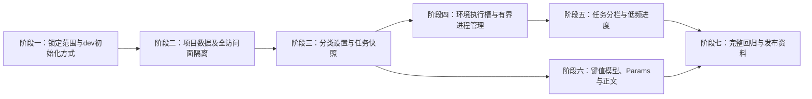
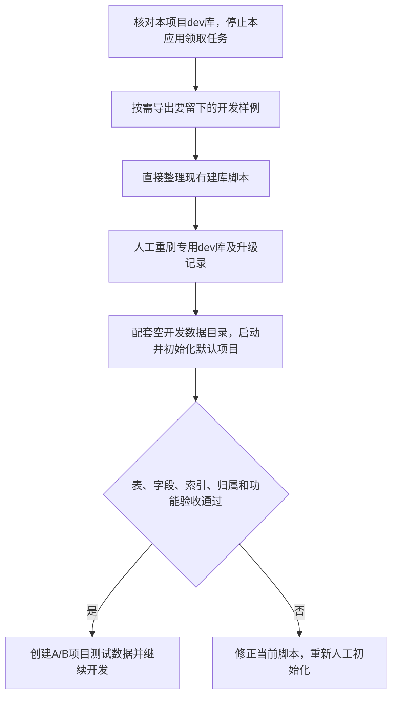

# 项目隔离与工作台增强计划

> 状态：草稿
> 最后更新：2026-10-20
> 适用范围：deep-jmeter 分类设置、项目隔离、运行任务分栏与进度、HTTP编辑器增量
> 关联文档：[本轮规范](../规划/项目隔离与工作台增强规范.md)、[项目入口](../说明.md)、[已有分层与数据库规范](../规划/后端分层与任务存储规范.md)、[身份扩展边界](../规划/账号权限与审计扩展规范.md)、[此前验证](2026-10-19-首版开发验证记录.md)

## 一、交付目标与实施边界

本轮先完成计划供讨论，**不修改产品代码，不执行SQL、重刷、服务重启或环境配置变更**。用户后续明确开始本轮实施后，再按阶段开发和做中文本地提交；不推送或发布。

**dev阶段策略已按用户声明简化**：尚未对客户发布，可以直接改现有建库脚本并人工重刷本项目dev库。本轮不做V4/V5/V6等增量升级、旧数据回填、旧API别名、旧请求模型转换器和在线降级；前后端及测试直接使用新结构。见[已确认决策](../决策记录/2026-10-20-开发阶段直接修改建库脚本与人工重刷.md)。本次仍只改文档，数据库尚未重刷。

目标对应用户的四项需求：

1. 分类设置可编辑，具有作用域、管理能力、约束、配置来源和生效时机。
2. 多项目隔离，A/B项目的场景、任务、报告、附件、缓存和下载均不混用。
3. 运行任务页面分“运行中／已完成”；进度采集与页面刷新有明确低频预算。
4. 参数默认键值表格、可切JSON，增加Params与URL联动、正文模式和JSON格式化。

用户追加说明已纳入：**执行槽是环境级资源配置，不是任务内线程数。** 环境共用执行器不意味着压测只有一个并发用户。当前固定单槽需要改造为可配置的有界槽数，默认值1仅为建议；任务内线程、平台同时运行任务数和环境总预算分别定义。

不扩大到账号登录、角色管理、公司身份接入、项目成员、多租户、分布式执行、消息中间件、秒级实时图表、任意脚本或文件型multipart。用户是否要求本轮加入multipart、Web修改环境待重启配置等，见本轮规范末节，实施前确认这些范围即可，不重开已确认的技术栈讨论。

## 二、当前代码事实与差距

核实日期：2026-10-20；产品仓库`/Users/yang/Documents/project/deep-jmeter`，当前基线`16f8a59`，工作区干净，无CodeGraph索引；docs此前提交`a633de1`。以下都是已读的真实入口；“拟新增”文件不当作现有实现。

| 范围         | 当前入口                                                                                                                                   | 事实与所需变化                                                                                                |
| ------------ | ------------------------------------------------------------------------------------------------------------------------------------------ | ------------------------------------------------------------------------------------------------------------- |
| 设置         | `frontend/src/pages/SettingsPage.tsx`；`app/service/impl/SystemServiceImpl.java`、`config/PlatformSettings.java`、`model/vo/SystemVO.java` | 只有`GET /system`状态，无可保存配置目录／版本；参数在启动时注入record，不能只改页面输入框                     |
| 项目         | `frontend/src/App.tsx`；各业务Controller／Service／Mapper及8张业务表                                                                       | 现有场景、任务、资产、报告均无project_id；列表和UUID详情是全局路径，缓存、静态资源和导出同样必须改            |
| 幂等与快照   | `service/impl/RunServiceImpl.java`；`mapper/TaskPayloadMapper.xml`                                                                         | 当前按操作类型+幂等键全局唯一；配置密文在任务明细，需补项目和有效设置快照，并保持重复请求语义                 |
| 调度         | `service/impl/ExecutionServiceImpl.java`                                                                                                   | 单线程executor、单activeId/active和busy，压力执行和报告共用；多个槽必须改成每任务上下文，不能仅更改一个配置数 |
| 生命周期     | `mapper/TaskMapper.xml`、`TaskReportMapper.xml`；`RunsPage.tsx`                                                                            | 当前混合列表每3秒刷新；执行与报告状态分开，但没有首次流程完成状态与进度摘要                                   |
| 进度源       | `core/engine/JMeterEngine.java`                                                                                                            | 输出独立console.log和CSV JTL，未显式配置／解析进度summariser；需先验证可靠增量信号                            |
| 请求模型     | `core/plan/HttpScenario.java`、`HttpPlanBuilder.java`；`ScenarioEditorPage.tsx`、`frontend/src/types/index.ts`                             | 变量／Headers用Map和JSON文本，正文raw字符串；不能无损表示禁用行、说明或重复Query／表单键                      |
| 初始化与存储 | `config/SchemaUpgradeRunner.java`；`db/core/V1..V3`；`support/SecretVault.java`、`service/impl/AssetServiceImpl.java`                      | 当前运行时仍检查SQL摘要，资产加密、本地UUID路径；dev允许直接改建库脚本，配套人工重刷库及升级记录              |
| 已有回归     | `backend/app/src/test/.../PlatformIntegrationTest.java`；`frontend/tests/batch.spec.ts`、`workflow.spec.ts`                                | 此前22个后端测试和2条浏览器流程通过；本轮尚未实施，不把此前通过当作新增功能验收                               |

后端代码路径中的`app/`指`backend/app/src/main/java/io/deepjmeter/app/`，Mapper XML指`backend/app/src/main/resources/mapper/`。核心路径是`backend/core/src/main/java/io/deepjmeter/core/`。

风格参考核实了TabTin中`TabCodeSidebarStack.tsx`的紧凑选中／悬停标签样式（通过该仓库已有CodeGraph），不照搬Electron依赖。用户附件仅用作键值表与请求分栏结构参考，不存入真实业务参数。

## 三、实施依赖与总体路径

此图说明交付阶段及其依赖；项目隔离必须先于其他功能对外开放。

不因图上分支独立就要求并行开发。每个可验证阶段做中文本地提交；未完成隔离验收时不开放创建第二项目。MySQL仍为持久事实来源，Redis只作可回源缓存，本地文件与单应用实例边界继续保留。

## 四、分阶段实施步骤

### 1. 锁定设置边界、请求模型与dev初始化方式

- 修改位置：实施时的本轮规范／计划；拟新增后端`support/ProjectContext.java`、设置与HTTP配置定义，暂不直接开放接口。
- 具体改动：确认无账号维护写入方式、环境槽配置来源、首轮Body类型；固定命名、单位、范围、默认值和统一请求模型，系统／项目设置与普通偏好分开。不再讨论本轮旧API兼容期或旧模型迁移。
- 依赖：用户授权实施且关键待确认项有结论。重新检查分支、现有SQL执行顺序、已有改动及真实JMeter版本；不另排增量迁移版本。
- 验证：形成当前接口／初始化清单和测试矩阵；明确人工重刷只针对本项目专用dev库及其升级记录，不能影响同实例其他库。需要留下的样例先单独导出，不把旧数据全量保留列为前提。
- 完成标准：新增设计有确定字段／错误行为，未决项没有被写成已确认；具备空库初始化、人工重刷和重新创建测试数据的明确步骤。

### 2. 项目持久化和所有资源访问隔离

- 修改位置：拟新增`ProjectController`、`ProjectService`、`service/impl/ProjectServiceImpl`、`ProjectMapper`及XML、项目DTO/PO/VO；修改现有资产、场景、运行、结果导入、报告Controller与各自Service/Impl/Mapper；前端`App.tsx`、API客户端、列表／详情／批量弹窗。
- 具体改动：新库创建默认项目及8张带非空`project_id`的业务表；项目列表、创建、重命名、归档。使用明确项目路径与不可变服务上下文，逐项封堵跨项目资源ID、版本、附件、缓存、幂等、批量和文件读取。任务事务一次保存一致归属；后台恢复从任务记录恢复项目。
- SQL方式：直接修改现有建库脚本，添加项目表、归属字段、约束和中文COMMENT；人工重刷后从空库一次初始化。不新增V4增量回填脚本，现有V1/V2/V3顺序执行时也不能重复定义列或索引。
- 索引：项目场景列表、任务生命周期列表、项目场景历史、已发布报告列表与项目幂等唯一键；保留共享队列需要的全局索引。点查不滥加重复索引。已有幂等键保留操作前缀，调整为项目联合唯一，不额外重复拼接到超长字符串。
- 前端：项目路由、项目选择器；切换时取消旧请求并校验响应key，重置游标／勾选，提示未保存内容。新标签分别打开A/B项目不互相改变全局当前项目。
- 依赖：步骤1。直接替换旧无项目API，前后端和测试同步更新，不保留默认项目兼容别名；归档项目只读规则同时落地。
- 验证：A/B项目均创建场景／CSV／结果，逐个测试列表、UUID详情、错误关联、停止／重试、日志、原生页面及每个静态文件、单项／批量导出、Redis命中和故障回源；批量混入异项目项应在开始输出前拒绝。同键跨项目不返回旧任务，同项目重复请求不重复施压。
- 完成标准：空库初始化通过；打开第二项目之前，全部核心访问面隔离测试通过，新建资源的归属、摘要与下载正确。

### 3. 分类设置和生效快照

- 修改位置：拟新增`SettingsController`、`SettingsService`、`service/impl/SettingsServiceImpl`、`SettingsMapper`及XML、对应DTO/PO/VO；拟新增`SettingCatalog`、`EffectiveSettingsResolver`和通用能力策略；修改`SettingsPage.tsx`、`SystemServiceImpl`、`RunServiceImpl`、`ScenarioServiceImpl`、`EngineSupport`及报告生成入口。
- 具体改动：系统策略／项目默认用`setting_sets`保存类别、版本与白名单值，乐观锁冲突409；返回配置来源、可编辑性、单位、能力与生效方式。偏好先浏览器保存；部署资源和状态分区，不能把健康状态做成可写字段。
- 权限边界：服务端能力契约只接通用主体和动作，默认无账号策略按已确认部署模式决定维护写入，身份扩展可替换。拒绝请求体伪造角色或scope，不创建用户／角色表。未来普通用户不能改系统或环境策略。
- 配置快照：入队前先处理已存在幂等请求；首次入队固定有效设置和版本到任务明细，不受后续默认变化影响。引擎校验／启动、报告生成及历史展示读对应快照；领取前复核环境硬上限。新场景默认值与现有版本分开处理。
- SQL方式：直接把设置表和任务快照字段纳入现有建库脚本，不新增V5，不回填旧任务或增加LEGACY兼容分支；使用新任务验证配置快照。
- 依赖：步骤2项目归属已生效。
- 验证：系统／项目／浏览器作用域、输入边界、越权、并发修改、重启持久化、缓存失效。排队后改设置、修改前重发同幂等键、历史报告重试都不悄悄更改原任务参数；无账号核心仍独立启动。
- 完成标准：设置显示值与真正执行值一致，“只改展示、不改引擎”的实现不得通过。

### 4. 环境级执行槽与独立任务上下文

- 修改位置：`config/PlatformSettings.java`、`application.yml`、`application-dev.yml`、`application-lease.yml`、`.env.example`、`ExecutionServiceImpl`、`ExecutionService`、`SystemVO`和环境设置展示；必要的领取Mapper XML。部署配置使用占位符，不写真实地址／凭据。
- 具体改动：引入环境`ENGINE_SLOT_COUNT`，建议默认1、允许经容量验证的N；压力和报告引擎共用总进程槽。将单active字段改为按任务维护的有界运行上下文，每项固定projectId、任务/报告批次、进程、控制端口、停止与进度信息。
- 资源与生命周期：先原子占槽再条件领取，领取失败或工作完成必须释放；一个任务同阶段只领一次，压力与报告不重叠领取。心跳、停止、超时、恢复、shutdown逐任务处理；DataDirectoryGuard仍保护单应用实例。槽数变化建议维护重启，不能杀死其他任务或暗减用户线程数。
- 调度边界：共享排队，不向普通项目页面暴露其他项目任务细节。现有报告优先领取可能导致持续重试挤占压力任务，实施时验证并确定有界公平策略；不在本轮额外建设复杂项目配额系统。
- 依赖：步骤2、3，环境入口与生效方式已确认。若用户只批准单槽过渡交付，多槽必须明确列为后续未完成项，不得仅配置项存在就宣称支持N。
- 验证：环境N=1和N=2，两个项目各运行多个线程；记录最大活跃JMeter进程数、总堆预算与槽释放。验证同时完成、停止A不误停B、报告重试、领取失败、服务退出／重启、PID与UDP端口隔离；不得向非本机测试目标发压。
- 完成标准：实测支持声明的槽数与预算，多槽不是新增第二个后端实例或多份共享DATA_ROOT进程。

### 5. 任务分栏、首次流程状态与低频进度

- 修改位置：`RunsPage.tsx`、`RunDetailPage.tsx`、`useData.ts`及样式；`RunController`、`RunService`和Impl、`TaskMapper.xml`、`TaskReportMapper.xml`、`ExecutionServiceImpl`；拟新增`TaskProgressService`、Impl、Mapper/XML及DTO/PO/VO，核心拟新增`engine/ProgressCollector`／summariser解析器。
- 具体改动：新增首次流程`workflow_status`及完成时间，按规范的全状态矩阵划分ACTIVE/FINISHED；历史报告重试留在已完成。项目游标分页、Tab计数、本页进度批量读取，不为每行请求大详情。
- SQL方式：直接在建库脚本定义生命周期字段与进度摘要表，不新增V6，不推导旧任务生命周期；用新任务覆盖初次报告和重试状态。
- 进度信号：先在锁定JMeter上验证5秒summariser累计输出、线程与事务样本口径，再实现每任务增量采集、最多10秒持久化和终态立即更新。读日志有64KiB单次预算、完整行与截断处理；未知分母、采集故障及报告生成显示阶段，不伪造数值。
- 轮询：前台运行列表／详情默认5秒、仅一个在途请求；隐藏暂停、恢复立即读、错误退避；完成页无重试则不轮询。新执行槽增加时采集随实际活跃任务数增长，浏览器访问不新增采集器。此进度不是秒级实时趋势图，也不重算报告统计。
- 依赖：步骤2至4；多槽的运行上下文是进度归属来源。
- 验证：排队、启动、循环、时长、CSV提前结束、停止、失败、中断、无数据、结果导入、首次报告与历史重试。两个浏览器／两个项目、弱网和后台页面，统计请求数、DB写频率、采集字节与CPU开销，验证无N+1和全量JTL扫描。
- 完成标准：两栏集合完整且互斥，数值可解释、未知可降级，采集器故障不影响原执行；进度预算实测而非只写定时常量。

### 6. 键值模型、请求分栏与正文格式化

- 修改位置：`ScenarioEditorPage.tsx`、`frontend/src/types/index.ts`、API校验；拟新增`KeyValueEditor.tsx`、`RequestBodyEditor.tsx`、`RequestTabs.tsx`和Query规范化工具；`core/plan/HttpScenario.java`、`HttpPlanBuilder.java`、`model/dto/WebScenarioDTO.java`、`ScenarioServiceImpl`及HTTP模型转换支持。
- 具体改动：变量、公共／请求Headers、Params、表单共享行模型，保留id、启用、说明与顺序。默认表格，JSON切换使用无损转换；变量唯一，Headers按大小写规则校验，重复Query／表单允许。无效JSON不丢草稿，禁止静默覆盖重复键。
- Query：把基础URL与有序查询模型作为唯一语义来源，完整URL投影回显；支持直接粘贴URL后生成行。明示一次编码、空值、无等号、`+`、`%`、Unicode、变量和fragment处理，前后端共同测试，不能在JMX中把Query放两次。
- Body：按确认范围实现NONE／JSON／RAW／URLENCODED，方法和Params独立。JSON格式化保持数字与字符串字面量、变量和非法输入原文，不用会丢大整数的通用parse/stringify。Content-Type冲突给出明确提示，不默默覆盖用户Header。
- 模型切换：前后端一次改为新的键值行、Query与正文结构，不增加旧Map／body字符串转换或schemaVersion=2兼容分支；人工重刷后重新创建开发场景。导入JMX仍保持原始脚本方式，不用表单重写；新任务的版本快照继续固定。
- 依赖：步骤2、3；本阶段可先于进度界面完成，但最终联调需等待调度阶段稳定。如采用格式化库，选公开依赖并锁版本、核实许可证，不新增服务。
- 验证：表格⇄JSON无损、增删／禁用、重复与大小写、切换请求／正文类型、无效中间输入、未保存保护及689px窄屏。用本机HTTP回显接收真实Query顺序、重复键、空值、中文、JSON与表单；对照导出JMX和平台执行，不只检查textarea内容，不承担旧开发场景转换。
- 完成标准：用户无需手写JSON即可完成常用配置；实际服务收到的内容与所见一致，格式化／模式切换不损坏数据。

### 7. 完整验收、使用说明和阶段提交

- 修改位置：产品README、前后端README、接口说明、公开环境模板、项目AGENTS（如有新增必要约束）及docs验证记录；保留此前计划的历史完成记录。
- 具体改动：说明项目切换、默认项目、设置生效、槽与线程区别、低频进度、正文范围及dev重刷方法。记录真实测试结果、空库初始化和容量范围，不把本计划的建议值描述成实测值。
- 依赖：前述阶段及待确认事项已解决。
- 验证：JDK21／MySQL5.7／Redis可回源／JMeter5.6.3环境，后端相关单元与集成测试、前端类型与构建、Spotless和Prettier；真实浏览器本地HTTP闭环、批量导入／导出、原生及离线报告、lease子路径、切项目与重启恢复。新数据一致性和索引必须用真实MySQL验证，不能只凭H2测试通过。
- 完成标准：每个阶段有中文本地提交和验证证据；工作区保留用户改动，私有配置与运行数据不入Git；不推送、不发布。

## 五、dev人工重刷与重新初始化

此图说明人工重刷后的空库验收；应用启动不会自行删除数据库。

- 当前只改文档，不实际停止／取消任务或操作数据库。实施时按开发流程人工重刷，不能把删除数据库接入应用启动，也不能为了清队列自动发起压测。
- 允许直接改V1/V2/V3等现有脚本；重刷包含本项目升级记录。现有升级器的摘要检查仍存在，不通过篡改checksum或强标SUCCESS掩盖旧结构。
- 不要求保留旧开发数据。需要的样例单独导出；新库使用配套空数据目录，原目录／密钥／私有配置不自动删除。缓存仅清理本应用前缀，不清空共享Redis实例。
- 回到某个dev提交时可以使用该提交的配套建库脚本再次重刷，不要求保留新模型写入的数据或提供数据库在线降级。
- 新结构运行后的任务快照、幂等、项目隔离和中断恢复仍须正确，不能因允许重刷就取消这些业务保证。环境槽变更按确认方式维护生效，不暗减线程或自动重压。
- 首次对外发布或有不可重建数据需要保留前，再冻结基线并设计正式升级／兼容／备份恢复，不把这部分工作提前放进当前dev交付。

## 六、测试矩阵与主要风险

| 范围       | 必测例                                                                      | 失败时的交付要求                                         |
| ---------- | --------------------------------------------------------------------------- | -------------------------------------------------------- |
| 设置       | 越权scope、非法键／范围、版本冲突、重启、入队后改默认、幂等重发             | 不保存部分字段、不改变已入队快照，错误可定位             |
| 项目       | A/B所有核心入口、交叉附件／版本／批量、命中缓存、无项目请求、并发浏览器切换 | 不能只隐藏列表；任何文件／缓存泄露均阻止开放多项目       |
| 任务槽     | N=1／2、压力与报告同时竞争、独立停止、异常退出、资源不足                    | 限定进程数并准确释放槽；不能继续保留全局单active引用     |
| 分栏／进度 | 复杂JMX、EOF、错误样本、报告慢、重试、无数据、后台及弱网                    | 未知进度降级，终态不冒充成功，采集负载有测量记录         |
| 请求编辑   | 编码、重复键、禁用行、JSON大整数／非法模板、正文切换、新模型闭环            | 不静默变更语义；真实服务回显不一致则不能发布             |
| dev初始化  | 空库完整建表、脚本顺序、中文备注、默认项目、升级记录、重新创建数据          | 当前脚本可从空库重复验证，不要求旧数据迁移或旧客户端兼容 |

最高风险是遗漏跨项目的UUID／文件访问、设置显示与实际引擎参数不一致、单active运行时直接改为多线程，以及URL重复编码／JSON有损转换。上述问题应在各自阶段关闭，不留给界面验收后再修。

## 七、完成定义与待评审事项

- [ ] 用户确认本轮实施范围及本轮规范末节的关键取舍；在此之前只修改docs。
- [ ] 每阶段按指定位置、依赖和验证执行，MVC、Service/Impl、DTO/PO/VO、Mapper XML与中文SQL备注均符合现有约定。
- [ ] 全访问面项目隔离、设置能力与快照、多槽独立生命周期、低频进度和请求语义均有测试证据。
- [ ] 当前脚本可在空dev库完整初始化，默认项目、索引和中文备注正确；前后端与测试统一使用新接口／模型，人工重刷说明可执行。
- [ ] 中文说明、环境模板、规范与真实验证记录一致；每阶段本地提交，不推送／发布。

建议讨论顺序：先确认“环境资源参数仅由部署维护还是需要Web管理员维护待重启值”，再确认无账号维护写入口和multipart是否首轮需要。项目隔离、设置分类、任务内线程与环境执行槽的区别不再作为模糊假设留给实现者。
