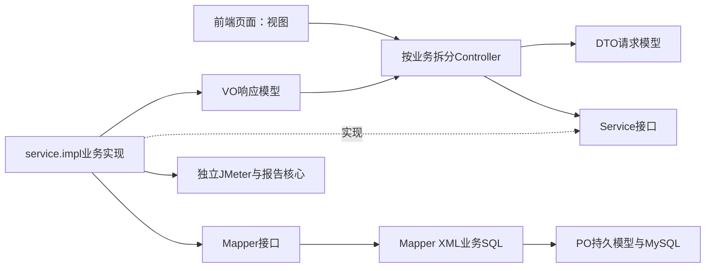
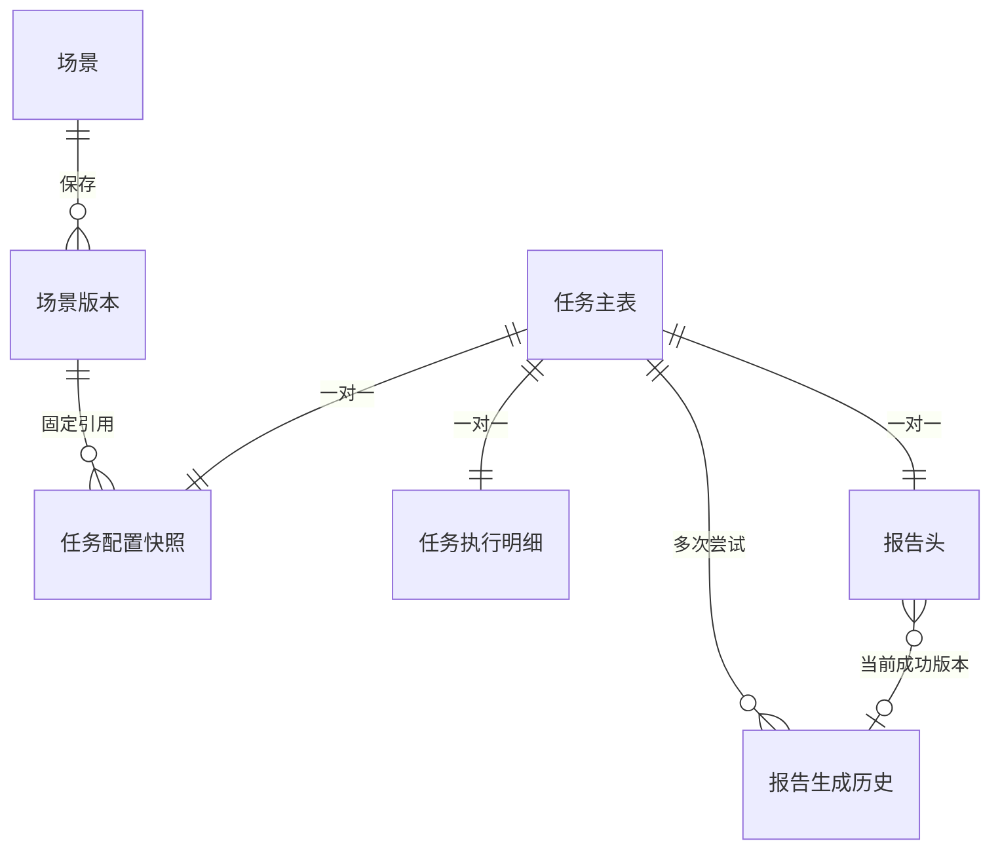
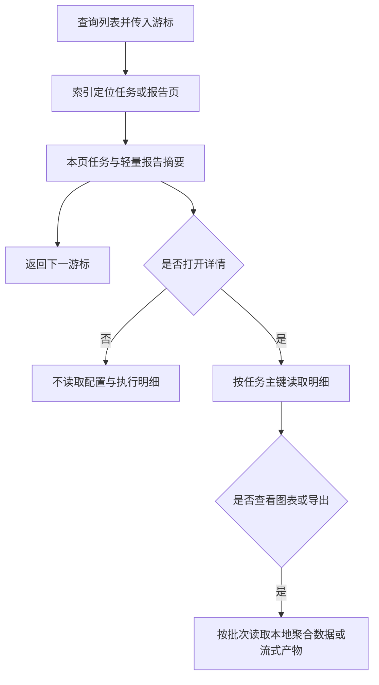
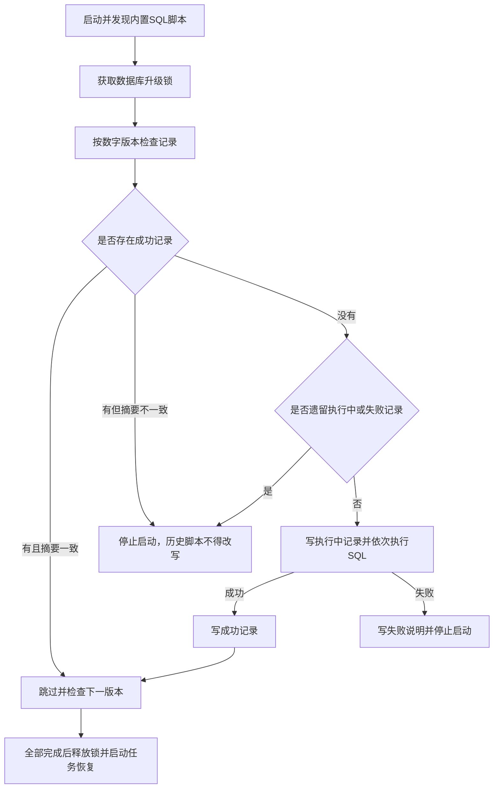

# 后端分层与任务存储规范

> 状态：实施中
> 最后更新：2026-10-19
> 适用范围：首版后端MVC、MyBatis XML、任务拆表、环境配置、简单SQL升级与导出依赖
> 关联文档：[技术规范](技术与数据规范.md)、[开发执行计划](../代码执行计划/2026-10-19-首版开发执行计划.md)、[验证记录](../代码执行计划/2026-10-19-首版开发验证记录.md)

## 一、用户已确认约束

2026-10-19 开发过程中补充确认：严格分层组织目录，按业务拆多个Controller和Service；Service接口与实现分离；DTO、PO、VO分别维护；用MyBatis且SQL写入XML；建表语句与每个字段有中文备注；本地与线上分别使用dev和lease配置；任务主表与明细分开，按实际查询设计索引；数据库升级采用自建简单记录表，不再引入Flyway或Liquibase；导出优先采用成熟公开依赖。

这些约束优先于此前技术草案中的持久化工具建议。当前实现仍以开源为基准，账号模块不作为运行依赖。

## 二、MVC与持久化边界

此图说明请求、业务、持久化和视图的依赖方向。

实际代码位于 `backend/app/src/main/java/io/deepjmeter/app/`：

| 目录 | 职责与禁止内容 |
| --- | --- |
| `controller/` | 按资产、场景、运行、结果导入、报告、系统分别组织；接收DTO并返回VO，不访问Mapper或编排任务 |
| `service/` | 各业务服务接口；Controller只依赖接口 |
| `service/impl/` | 参数校验、业务流程、事务、状态编排，调用Mapper与独立核心；不内嵌SQL |
| `mapper/` | MyBatis接口，只声明方法和参数，不使用SQL注解 |
| `model/dto/` | 请求与应用内命令，不直接复用数据库对象 |
| `model/po/` | 表持久模型，按表区分；不直接作为HTTP响应 |
| `model/vo/` | 接口响应与下载描述，不暴露参数密文和服务器文件路径 |
| `config/`、`support/`、`exception/` | 配置、通用工具及异常处理；不承载混杂的场景/运行业务 |

SQL位于 `backend/app/src/main/resources/mapper/*.xml`，使用绑定参数。唯一允许的动态SQL入口为升级Mapper读取应用内置脚本，不接收用户上传、请求参数或外部任意文件；业务查询禁止字符串拼接。JMeter核心位于 `backend/core/` 的engine、plan、report、contract包，不依赖MVC、账号、数据库或公司SDK。

## 三、任务数据拆分

此图说明任务主表与配置、执行、报告的关系。

| 表 | 职责 | 主要查询与索引 |
| --- | --- | --- |
| `tasks` | 名称、类型、执行状态、停止标记、操作者、时间 | 递增`seq`主键用于游标分页；唯一`task_id`用于详情；`(execution_status,seq)`用于领取/状态列表；`(scenario_id,seq)`用于场景历史；`(created_at,seq)`用于时间范围管理 |
| `task_payloads` | 场景版本、结果资产、参数密文、请求摘要与幂等键 | `task_id`主键按需读取；`idempotency_key`唯一索引用于幂等判定 |
| `task_executions` | 进程、心跳、产物路径、执行错误 | `task_id`主键，详情/心跳/恢复定点访问 |
| `task_reports` | 当前报告状态、成功/尝试批次与轻量统计 | `task_id`主键；`(status,task_seq)`用于报告队列和已就绪报告列表 |
| `report_generations` | 每次生成的版本、适配器、粒度、路径、状态与错误 | 批次主键；`(task_id,started_at,id)`用于重试历史 |

场景、场景版本与资产继续独立保存。原始样本、图表JSON、HTML与日志在本地文件保存，不向数据库逐条写入压测样本。

新任务的主表和一对一子表在同一事务中建立；执行与报告状态分别更新，跨表终态更新使用事务。报告重试新建批次，只有成功后才切换当前指针。账号与角色表不参与查询或强制外键。

### 1. 列表与索引规则

- 任务列表使用`before`任务序号和最多100条的游标分页；按递增序号逆序读取，不使用不断增加的OFFSET跳过任务历史。
- 列表读取主表，再一次批量读取本页报告头；不读取参数密文、执行明细和报告生成历史，不产生逐行N+1查询。
- 报告中心先按`status=READY`与`task_seq`索引定位，再关联任务主表；生成中与失败状态可从运行详情查看。
- Mapper显式列出读取字段；只有实际过滤/排序或唯一性需要的字段才建索引，不为每列添加索引。
- 用真实MySQL的EXPLAIN核对领取、任务分页、场景历史、报告分页和幂等查询。执行计划检查不等于海量数据容量证明，后续规模和响应阈值另行约定；首版不提前做分库分表。

此图说明从列表到详情时如何避免读取大字段。

## 四、简单SQL升级记录

由 `config/SchemaUpgradeRunner` 扫描打包内的 `db/core/V数字__说明.sql`，按数字版本执行；通过MyBatis的升级Mapper与XML访问升级记录、获取MySQL连接级命名锁并执行内置语句。不创建远程SQL执行接口。

`deep_jmeter_schema_history`保存版本、文件名、SHA-256摘要、状态、开始/结束时间及失败说明；表和字段均有中文COMMENT。

此图说明成功跳过、摘要冲突和失败阻断逻辑。

仅SUCCESS可跳过。已应用脚本不可改写，变更必须新增版本。普通SQL支持注释与字符串内分号，不支持存储过程DELIMITER。MySQL的DDL不能靠事务完整回滚，失败或中断后须核实实际结构并人工修复；升级器不能把部分执行伪装成成功，也不自动回退或盲目重复执行。连接在同一启动事务边界中保留，命名锁到释放期间不返回连接池；失败记录先持久化再中止启动。

当前测试中H2只用于隔离的单实例集成测试，锁映射为本地无竞争占位；实际部署使用MySQL命名锁，不能将H2测试解释为多实例锁验收。

## 五、环境与导出依赖

- `application.yml`：通用配置与MyBatis Mapper位置。
- `application-dev.yml`：默认本地环境，可选读取Git忽略的`.local/application-local.properties`；不写真实凭据。
- `application-lease.yml`：按用户命名用于线上，数据库、引擎、数据目录和密钥由环境变量注入，不加载dev本地文件。
- CSV读写使用[Apache Commons CSV](https://commons.apache.org/proper/commons-csv/) 1.14.1；保留正确转义、UTF-8与文本列公式防护，统计不重新计算。
- HTML报告ZIP使用[Apache Commons Compress](https://commons.apache.org/proper/commons-compress/examples.html) 1.28.0，按流写出并处理ZIP64；原始JTL直接流式下载，保留原始字节。
- [MyBatis Mapper XML](https://mybatis.org/mybatis-3/sqlmap-xml.html)用于所有业务SQL。Spring/JDBC驱动只作为MyBatis底层依赖，应用不使用JdbcTemplate或DriverManager手工操作数据。
- Excel与PDF不属于当前导出范围，后续需要时再选择对应公开依赖，不为预留能力增加未使用框架。

## 六、验收

- [ ] Controller按业务拆分，仅依赖Service接口，DTO/PO/VO用途清晰。
- [ ] Java业务文件无SQL、JdbcTemplate或SQL注解，Mapper接口与XML语句一致。
- [ ] 所有业务表及字段有中文备注，任务主表无密文或日志等大字段。
- [ ] 普通历史列表不读取配置快照和执行明细，游标翻页无重复，索引计划已核对。
- [ ] 首次执行升级脚本成功，再次启动跳过；摘要被改写、SQL失败或记录中断时阻止误启动。
- [ ] dev和lease分别可通过外部配置启动，真实凭据、运行文件与密钥不入库。
- [ ] 真实引擎闭环与CSV/ZIP导出通过，不安装账号及Redis不可用时仍能读取持久结果。
