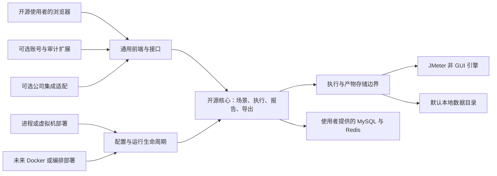
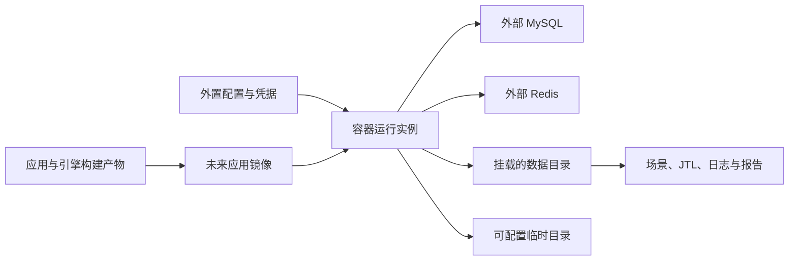
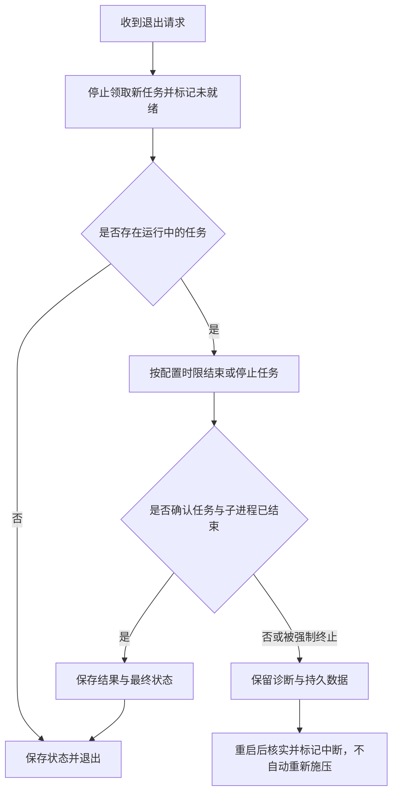

# 开源基准与部署扩展规范

> 状态：草稿
> 最后更新：2026-10-19
> 适用范围：deep-jmeter 的开源设计基准、公司扩展与未来容器化部署
> 关联文档：[说明](../说明.md)、[技术与数据规范](技术与数据规范.md)、[账号权限与审计扩展规范](账号权限与审计扩展规范.md)、[首版实施规划](首版实施规划.md)、[已确认设计原则](../决策记录/2026-10-19-以开源为基准并预留容器部署.md)

## 一、已确认原则与当前阶段

**一切以开源为基准设计。** 2026-10-19 用户明确要求：规划和规范应以开源为统一基准，未来 Docker 等部署方式要预留扩展能力。

开源核心是需求、架构、数据、接口、前端、配置、构建和验收的默认版本；公司集成通过可选扩展接入。不能先依赖公司平台完成业务，再将解除依赖留到开源发布时处理。已确认的 JDK 21、MySQL、Redis、本地文件、无消息中间件及账号模块可移除要求继续有效。

已确认的是设计方向和扩展要求。2026-10-19用户已授权核心开发，四阶段本地验证见执行记录；具体开源许可证、镜像基础系统、Compose、镜像仓库、多架构及容器化交付时间仍待讨论，不将部署边界的实现写成已经交付Docker镜像。

## 二、开源产品全景

此图说明默认开源核心、可选公司扩展和可替换的部署环境。

账号与审计均维持独立可选模块；Docker 是部署方式，不能成为压测业务中的必需服务。当前内网数据库与缓存只是一组开发配置，不是产品环境假设。

## 三、开源基准的具体要求

| 范围 | 必须满足的要求 |
| --- | --- |
| 业务与数据 | 核心使用通用资源标识和自有数据模型，不依赖公司租户、菜单、用户表、业务库或财务系统术语 |
| 账号与审计 | 无账号核心可独立构建和运行；公司身份只通过适配器接入；审计不强制依赖账号模块 |
| 前端 | 通用导航和压测/报告页面不依赖公司登录 Store、权限编码、品牌资源或专属接口 |
| 外部服务 | 使用者能自行提供 MySQL、Redis 和 JMeter 环境；不强制使用公司代理、Rancher、Kubernetes、私有域名或镜像仓库 |
| 配置 | 地址、端口、凭据、路径、URL 和运行参数通过外部配置注入；公开模板采用占位符，不使用公司地址或个人机器路径作为默认值 |
| 构建与依赖 | 源码构建不要求公司账号、私有包或内部许可证服务；版本可锁定，可使用公开可获取且允许相应使用和分发的依赖 |
| 图表与报告 | 原生统计口径和报告格式不因部署在公司环境而改变；运行时前端与离线 HTML 所需资源不依赖公司 CDN |
| 文档与示例 | 开源使用者仅依赖公开说明、通用配置和脱敏样例即可运行；内部环境附录不随开源资料或镜像发布 |

开源许可证尚未选择；未来公开发布前再明确许可证及依赖声明。MeterSphere 与 TabTin 当前作为功能流程和风格参考；引用或复制实际源码、资源时须另行核实对应版本的许可及保留要求，不能将参考项目直接变为核心的私有依赖。

## 四、为 Docker 等部署方式预留的边界

### 1. 配置与网络

- 同一业务代码通过外部配置适配本机、虚拟机和容器，不增加“公司版地址”分支。配置来源可为环境变量或外置配置文件，名称、优先级及敏感值注入方式在实施前锁定。
- 配置范围至少包含数据库与 Redis 连接、应用监听地址/端口、公开访问 URL、API 路径、可信代理、数据/临时目录、JMeter 位置与执行资源预算。
- 前端默认使用同源相对 API 地址；若以后支持独立前端入口，则按部署配置选择。页面、附件和报告链接不能写死宿主地址或容器内部地址。
- 容器内通过可配置服务地址连接数据库与 Redis，不能假设 `localhost` 指向宿主机器，也不能把某个 Docker 宿主访问别名当成跨环境常量。
- 未来编排可选“连接既有数据库/缓存”或“另外启动配套服务”，不要求重建用户已经提供的实例；当前给定开发实例保持原部署方式。

### 2. 文件与产物存储

- 镜像和程序目录只保存应用、静态资源及固定版本引擎；JMX、附件、JTL、日志和报告写入可配置数据目录。
- 容器化时数据目录可挂载持久卷，临时目录可单独配置。文件权限、磁盘配额和目录可写性在启动与运行前检查，不依赖以 root 运行。
- 持久化记录保存资产标识与受控相对路径，不记录只能在某台宿主机解析的绝对路径。挂载位置变化后历史数据仍能定位。
- 原生进程和容器部署使用同一产物读取/写入边界；首版只实现本地存储，未来是否接对象存储另行决定，不提前增加服务。

此图说明应用、持久数据与基础服务如何在容器中保持分离。

容器被重建不应删除持久产物；本地与容器运行不能对同一数据目录同时无约束写入。数据目录和 MySQL 恢复仍须保持一致。

### 3. 执行器与生命周期

- 核心通过执行边界管理 JMeter；先实现本地独立子进程，以后可增加容器或独立节点适配。不能让报告服务直接调用 Docker 命令、读取 Docker Socket 或依赖宿主 PID。
- 未来平台整体放入 Docker 时，可先在应用运行环境内启动固定引擎子进程；“平台容器化”和“每个压测任务独立容器”是两项能力，后者不属于当前首版要求。
- 引擎路径、工作目录、JVM 内存、超时、停止策略和并发槽位均可配置；进程启动与报告生成不调用桌面 JMeter GUI。
- 应用提供启动、存活、就绪及退出的清晰状态。就绪状态说明能否领取任务；依赖故障不能被误报为进程已经退出。
- 收到退出请求时停止领取新任务，在配置时限内处理当前任务与子进程、保存状态并释放资源；超时或强制终止后以中断恢复规则处理，不能伪造完成或自动重压。
- 应用运行日志可输出到标准输出/错误输出，JMeter 原始执行日志与报告作为受控产物留存；日志位置和轮转不依赖个人开发目录。

此图说明退出时如何避免继续领取任务或错误重跑压测。

### 4. 后续部署扩展的范围

此图说明部署能力的依赖顺序，而不是当前承诺的交付日期。

上述扩展应复用相同业务与报告逻辑。镜像拆分、多架构、编排平台和分布式容量没有在本轮获得实现授权，也不是首版核心功能的附加前置。

## 五、验收要求与未决事项

授权实现后的开源核心验收必须覆盖：

- [ ] 在无公司网络、账号、SDK、私有依赖和专属认证服务的环境，只配置使用者自己的 MySQL、Redis、本地存储与引擎，即可完成压测至 HTML/CSV 导出的闭环。
- [ ] 公开模板、默认值和构建产物不包含内部连接信息、真实凭据或开发机绝对路径；公司配置仅在独立部署资料中维护。
- [ ] 未安装账号及审计扩展也能构建与运行，启用公司适配不需要修改核心统计和执行代码。
- [ ] 更改数据挂载根目录后，历史资产、JTL 和报告仍可定位；当前进程部署下即可验证配置与路径契约。
- [ ] 已定义并验证退出、任务停止与重启核实行为，未来容器包装无需重写任务状态机。

容器化阶段再增加：镜像可从通用构建环境生成，外置配置连接既有数据库与缓存，持久卷在容器替换后保留结果，退出信号与子进程停止正确，挂载权限失败有明确原因，Web 和离线 HTML 报告正常。当前不把这些尚未实现的能力记为已通过。

未决事项：开源许可证、正式配置名称与默认值、容器化交付时间、镜像组织、支持的 CPU 架构、Compose 示例及 Kubernetes 是否纳入后续版本。未决项不改变“开源为基准、公司可选、容器可扩展”的已确认原则。
