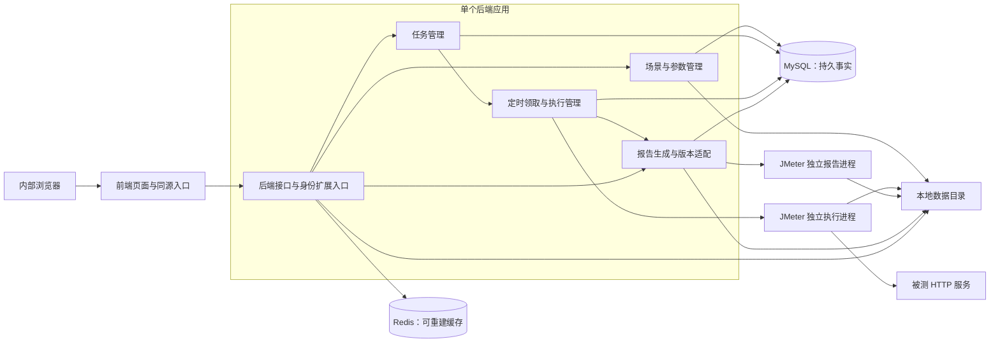
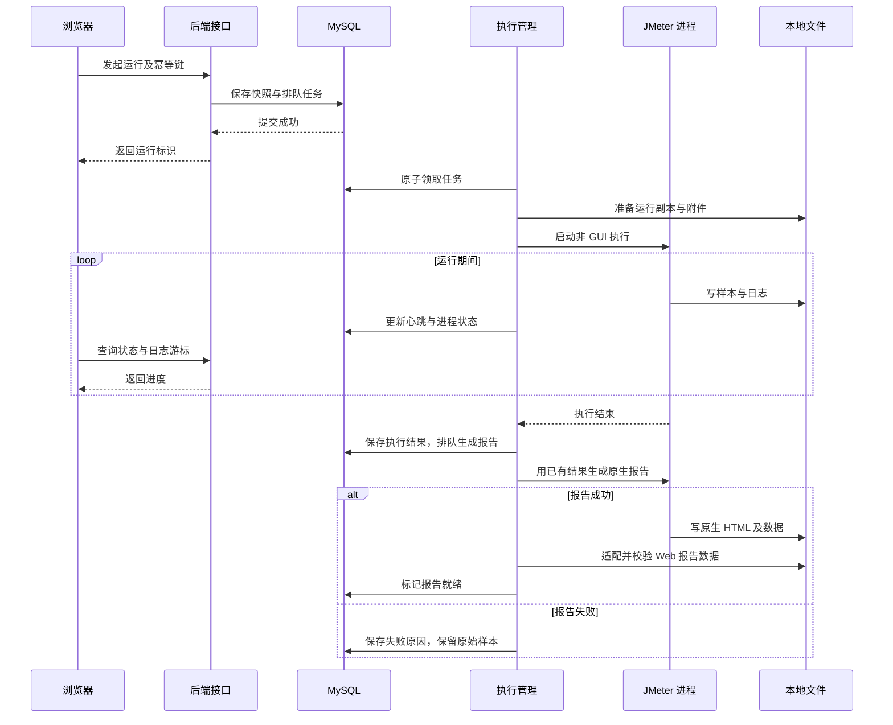
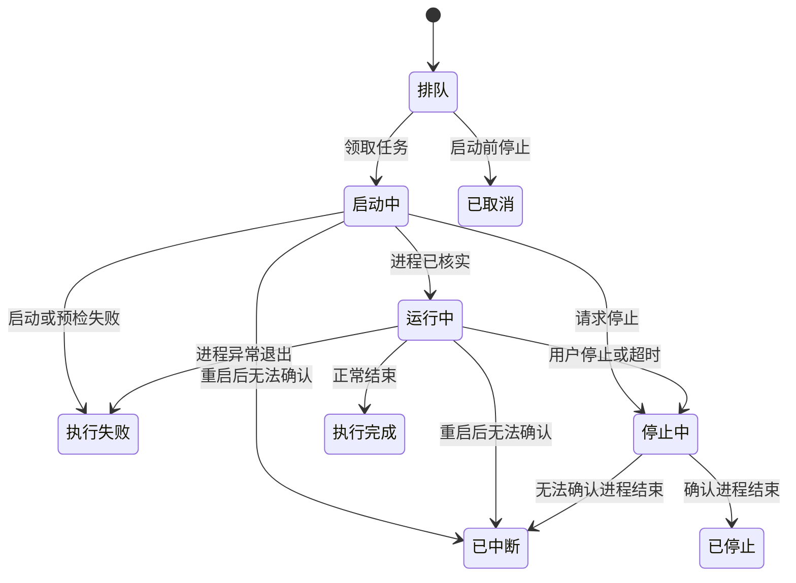
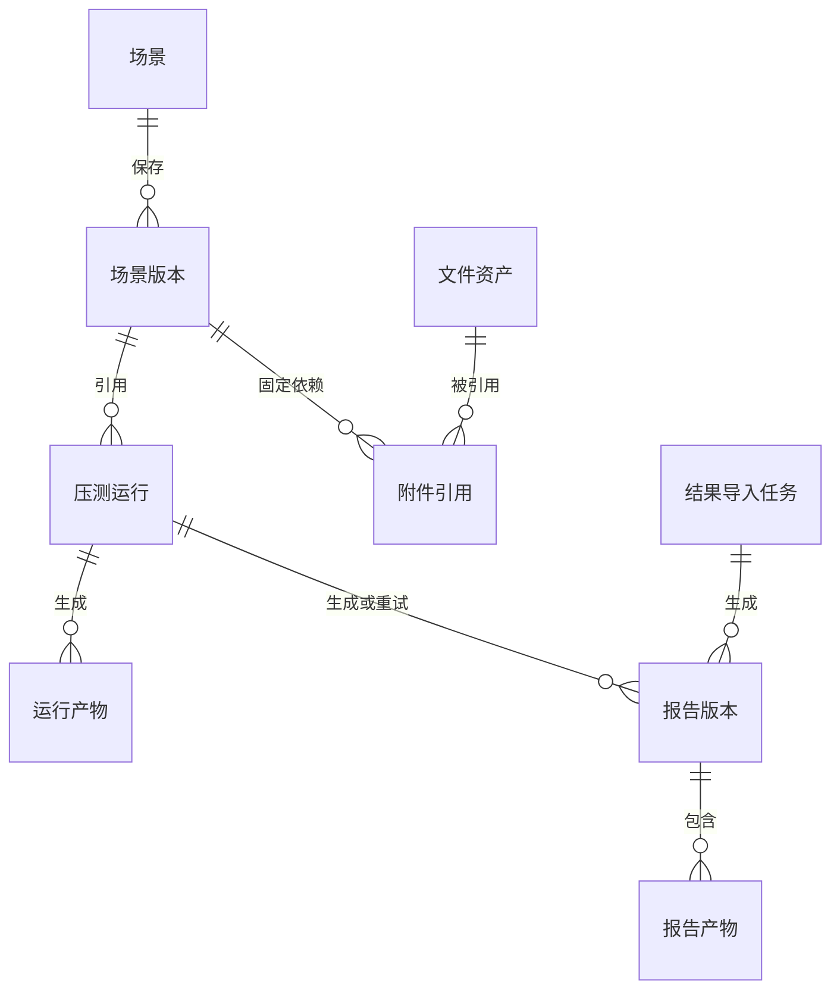

# 技术与数据规范

> 状态：草稿
> 最后更新：2026-10-16
> 适用范围：内部压测平台首版架构、执行、报告、数据与接口
> 关联文档：[说明](../说明.md)、[首版功能规范](首版功能规范.md)、[界面与交互规范](界面与交互规范.md)、[账号权限与审计扩展规范](账号权限与审计扩展规范.md)、[首版实施规划](首版实施规划.md)

## 一、约束与技术建议

已确认约束：JDK 21、MySQL、Redis、本地文件存储；暂不引入消息中间件；前后端分别位于 `deep-jmeter/frontend/`、`deep-jmeter/backend/`；当前不写代码。

2026-10-16 补充确认：当前开发复用给定 MySQL 与 Redis 实例；平台身份认证暂缓。后续开源版自建账号权限，公司集成版接入公司体系，压测核心需预留统一身份与审计边界。

用户进一步确认：账号权限模块必须能从构建和部署中移除；无账号模式完整支持场景、执行、报告及导出。核心不依赖账号表、登录会话或认证框架；最小通用契约只包含可缺省的操作者快照、资源动作和事件。具体依赖边界、前端/数据隔离及移除验收见[账号权限与审计扩展规范](账号权限与审计扩展规范.md)。

下表为建议选型。具体依赖版本必须在获得开工许可后锁定并验证，本文不将候选版本写成已验证事实。

| 层次 | 建议 | 理由或约束 |
| --- | --- | --- |
| 前端 | TypeScript、React、Vite | 独立单页应用，便于组织表单与复用 TabTin 类似的视觉方式 |
| 组件与图表 | Tailwind CSS、Radix 基础组件、Apache ECharts | 统一视觉变量、基础可访问性与趋势交互 |
| 后端 | Java 21、Spring Boot、Maven | 控制服务、任务执行与报告处理模块保持单体结构 |
| 持久化 | MySQL | 场景、任务、报告及未来审计元数据；复用给定实例，具体版本待确认 |
| 数据库结构版本管理 | Flyway，建议项 | 按版本执行和记录建表、改表脚本；应用依赖，无需额外部署服务；尚未确认为强制选型 |
| 缓存 | Redis | 列表摘要等可重建数据，故障时应能回源 MySQL；不承担持久任务队列 |
| 文件 | 专用本地数据目录 | JMX、附件、JTL、日志、报告；与代码和容器可写层分开 |
| 执行引擎 | Apache JMeter 独立 JVM 进程，候选 5.6.3 | 官方下载页查阅时版本；在 JDK 21 下验证后锁定 |
| 部署 | 同源 Web，单后端实例、单执行节点 | 容器化可作为交付方式；不引入 Kafka、RabbitMQ、MinIO 等额外服务 |

首版不建议将 JMeter 嵌入 Spring Boot 的 JVM。独立进程可以单独限制堆、停止任务，并减少引擎异常对 Web 服务的影响。负载上限需要由运行机器实测决定，不能仅凭 JDK 或框架选型承诺压测能力。

### 1. 数据库结构版本管理的用途

Flyway 管理数据库结构随应用版本的变化。例如首个版本创建场景和运行表，下个版本增加报告字段，再后续增加审计表；每次变更形成有序的 SQL 迁移文件，Flyway 记录已执行版本与校验值，后续部署只执行尚未应用的变更。

它不替代 MySQL、不负责业务数据缓存，也不是独立消息服务。[官方说明](https://documentation.red-gate.com/flyway/flyway-concepts/migrations/versioned-migrations)指出版本迁移按序应用，并通过历史表记录版本与校验值。

是否使用 Flyway 仍待技术选型确认。若采用，仅管理本项目独立数据库；若不用，也应有明确的 SQL 版本清单与升级规程。已经执行的历史迁移不得随意改写；数据库回退另行设计，不能认为 Flyway 会自动撤销所有表结构变更。

### 2. 当前开发环境的连接约定

以下为用户提供的内部开发环境信息，尚未连接验证。只记录部署和网络入口；密码、令牌和其他凭据不写入文档或未来开源配置。本轮不连库、不建库、不操作现有数据。

| 项目 | MySQL | Redis |
| --- | --- | --- |
| 部署方式 | 虚拟机，单机 | Kubernetes StatefulSet，单机 |
| 实例位置 | 源地址 `192.168.9.113:3306` | 命名空间 `dev`，StatefulSet `deepfos-redis` |
| 开发连接入口 | 代理 `192.168.9.108:10306` | 容器外 `192.168.6.7:30729` |
| 内部端口 | `3306` | `6379` |
| 运维访问方式 | MySQL 客户端经代理连接，交互输入密码 | 可经 Rancher 进入容器运行 redis-cli，或通过容器外入口连接并认证 |
| 账号和凭据 | 用户已提供管理员凭据，本文件不保存；后续项目账号另行配置 | 用户已提供认证密码，本文件不保存 |
| 待核实项 | 数据库版本、项目库名、专用账号与授权、字符集、时区、连接加密 | Redis 版本、可用逻辑库、ACL 能力、连接加密、容量与淘汰策略 |

建议项目库名 `deep_jmeter`，目前只作为提案，尚未创建。给定管理员账号不作为默认应用运行账号；正式配置使用项目专用账号。迁移权限与运行期读写权限按采用的部署流程确定。

Redis 按复用实例设计：所有项目键使用 `deep-jmeter:<环境>:` 前缀；逻辑库编号待确认，不能假设某个编号独占。项目清理只处理自己的键，不执行全实例清理，也不擅自改变实例级淘汰或持久化配置。开发环境连通性、数据库版本和逻辑库不因本次提供地址而视为已经验证。

MySQL 和 Redis 已有独立部署，不要求为本项目重新部署它们。应用、JMeter 执行器与本地文件目录部署在哪里仍待确认。未来开源版提供可替换连接参数，公司内部地址不进入默认值或公开示例。

## 二、系统全景

此图说明各组件职责与数据归属。

首版同一机器上的进程隔离不等于完整安全沙箱，也不消除负载与报告处理对控制服务的资源竞争。执行器预留独立接口边界，后续需要时再拆到专用机器；本轮不提前建设分布式体系。

## 三、执行与调度

### 1. 持久任务，无消息中间件

- 创建任务时，在一个 MySQL 事务中保存不可变运行快照和 `QUEUED` 状态；任务 ID 在提交后返回。
- 后端调度器周期扫描 MySQL，原子领取任务并写入执行租约；默认执行槽位为 1。前端通过短轮询查询状态。
- 领取、启动、进程身份登记应有明确边界：先持久化运行标识，启动时携带唯一标识，再登记 PID 与进程启动时间；重启时对启动窗口内任务进行核对，不能直接重复启动。
- 任务具有租约、心跳和最大执行时间；MySQL 保存权威状态，Redis 清空或不可用不会丢任务。
- Redis 不保存唯一的运行状态，不用 Redis Stream/List 代替任务持久化。
- 不在 HTTP 请求线程中阻塞等待压测或报告完成；启动请求重复提交使用幂等键避免重复执行。
- 压测不得因为后端重启而自动重新执行；已领取任务须先核实进程身份与产物，无法确认则标记中断。
- 报告单独排队处理，可重试；初期与压测执行错峰，避免报告抢占执行资源。具体调度周期与资源预算待实测确认。

### 2. 运行模式与参数

使用 JMeter 非 GUI 模式。执行与报告分开：先执行生成 CSV 格式 JTL，再根据这份结果生成 Dashboard。这样报告失败可独立重试，不需要重新施压。

示意调用语义为 `jmeter -n -t <运行副本> -l <结果文件> -j <引擎日志>` 与 `jmeter -g <结果文件> -o <独立空目录>`。实际开发通过固定可执行文件和参数数组启动，不拼接用户 shell 命令。

- 每次运行单独工作目录，解决相对附件路径；禁止引用宿主任意路径或修改全局 JMeter 安装。
- 覆盖标准线程组必须记录目标、原值、新值；循环模式和持续时长模式分别校验，不能仅透传几个属性就宣称所有导入 JMX 已生效。
- 只开放明确允许的运行属性；采样保存格式、输出目录、插件目录和 JVM 启动参数由平台控制。
- 默认不保存请求/响应正文；必要字段以 Dashboard 生成要求为准，并写入运行元数据。
- 停止先请求优雅结束，超时才强制结束且只作用于该任务进程；队列中停止则直接取消，不启动进程。
- 请求成功/失败来自 JMeter 样本和断言。JMeter 进程退出码为零不能表示所有请求成功；请求错误率大于零也不表示平台执行失败。

此图说明异步执行、产物生成和浏览器查询顺序。

### 3. 状态边界

执行和报告使用两个状态字段，避免“压测已结束但报告失败”只能显示一个笼统失败。

此图表示执行状态的合法转换；中文状态后的英文为拟议 API 枚举。

执行枚举拟定为 `QUEUED / STARTING / RUNNING / STOPPING / COMPLETED / STOPPED / CANCELLED / FAILED / INTERRUPTED`。强杀后须确认进程退出才能写 `STOPPED`；无法确认时保留诊断状态。

报告枚举拟定为 `NOT_READY / QUEUED / GENERATING / READY / FAILED / NO_DATA`。运行进入终态后，存在有效样本才能排队生成；停止和失败任务也可生成“部分结果”报告。零样本为 `NO_DATA`；失败后可重新排队；重试采用新的生成目录，校验通过后原子切换可见版本。

## 四、报告与统计一致性

1. 原始结果、引擎版本、JDK 版本、报告属性、时间戳格式、时区、图表粒度、过滤规则和适配器版本一起保存。
2. 原生 Dashboard 为基准。优先适配其统计与图表数据输出以供 ECharts 使用；原生输出内部格式不是平台长期 API，必须在技术验证中确认可稳定读取、固化样本和版本适配。
3. 如果原生输出不适合直接读取，先记录缺口再讨论替代方式，不静默改成另一种百分位算法，也不通过运行不受控脚本解析报表。
4. 前端只渲染已经聚合的数据，不下载全量 JTL 后在浏览器计算统计。
5. 百分位、成功样本过滤、事务控制器排除规则等按原生对应视图保留。原生 Dashboard 与 GUI 聚合报告的百分位算法可能不同，验收对象固定为同一配置的 Dashboard。
6. 时间轴存储为 epoch 毫秒，界面显示时区；报告与 Web 的时区、时间桶对齐。首版建议固定 60 秒图表粒度，之后是否开放配置另行讨论；不能将改变展示粒度冒充重新计算完成。
7. 缺字段、XML JTL、不支持的时间戳或损坏记录必须明确报错；不偷偷丢弃坏行后声称完整报告。部分结果需记录样本缺失与来源。
8. 验证样本包含成功、失败、重复标签、事务控制器、时间桶边界、中文及转义字符、停止后的有效前缀。原生与 Web 的整数计数一致，统计数值使用同源值，页面仅允许格式化舍入差异。

## 五、数据与文件设计

此图说明场景、不可变快照、运行和文件的关系；均为拟建实体。

### 1. 拟议核心实体

| 实体 | 主要字段与约束 |
| --- | --- |
| 场景 | `id`、名称、来源 `IMPORTED_JMX / WEB`、当前版本、归档标记、创建人、时间；名称必填 |
| 场景版本 | `id`、`scenarioId`、版本号、配置模式版本、配置 JSON/JMX 资产引用、附件映射、内容摘要；保存后不可变 |
| 文件资产 | `id`、类型、原文件名、内部相对路径、字节数、SHA-256、创建人、时间；路径仅服务器生成 |
| 压测运行 | `id`、场景版本、参数快照、执行/报告状态、运行环境、开始/结束时间、停止原因、租约、进程身份、幂等键；不复制明文密钥到普通快照 |
| 报告版本 | `id`、来源运行或结果导入（二选一）、生成状态、引擎/适配器版本、口径配置、样本数、是否部分结果、失败原因 |
| 运行与报告产物 | 所属实体、种类、文件引用、大小、摘要、创建时间、清理状态；用户不能直接传磁盘路径下载 |
| 结果导入任务 | 原始结果资产、格式、列映射、时间格式、时区、校验结果；不伪造场景或执行成功记录 |

主键拟用 UUID，时间持久化统一 UTC；展示时使用明确时区。实体写入包含乐观锁版本，防止并发编辑覆盖。数据库不保存逐条压测样本，样本保留在本地 JTL，聚合结果存版本化 JSON，MySQL 保存索引及摘要。

### 2. 本地文件规则

配置独立 `DATA_ROOT`，按资产标识与运行标识组织。路径为拟议布局，例如 `assets/<assetId>/`、`runs/<runId>/`、`reports/<reportId>/<generationId>/`；不能将用户上传文件名作为目录路径。

- 本地开发与部署分别配置数据根目录，部署使用持久卷；不得依赖容器临时层。
- 临时上传、校验、最终资产分阶段发布；MySQL 与文件无法做同一事务，采用暂存、原子重命名、状态登记和孤儿清理处理一致性。
- 运行中的文件、被场景版本引用的附件禁止误清理；用户删除场景先归档，不立即删除历史依赖。
- 容量检查覆盖上传、启动和报告生成；磁盘不足时阻止新写入并给出原因。配额和保留天数待用户确认。
- 备份包含 MySQL 与文件清单/摘要，必要密钥单独备份；Redis 可重建。恢复验证必须同时校验元数据与文件引用。

## 六、接口约定草案

前缀拟用 `/api/v1`。以下用于讨论接口职责，获得开工许可后生成 OpenAPI 契约并锁定字段。

| 方法与路径 | 输入重点 | 输出与行为 |
| --- | --- | --- |
| `POST /assets` | 文件、用途 | 资产标识、摘要、校验结果；大小超限拒绝 |
| `POST /scenarios/import` | JMX 资产标识、附件映射 | 场景、版本、可执行/可编辑能力与问题清单 |
| `POST /scenarios` | 名称、Web 配置、配置模式版本 | 场景及初始版本 |
| `PUT /scenarios/{id}` | 配置、期望实体版本 | 新场景版本；并发冲突返回 409 |
| `GET /scenarios` | 分页、名称、来源 | 场景列表及当前版本 |
| `GET /scenarios/{id}` | 场景标识 | 当前配置、版本和附件 |
| `GET /scenarios/{id}/jmx` | 可选场景版本 | 原始或生成的 JMX，遵守敏感值处理规则 |
| `POST /runs` | `scenarioVersionId`、参数、`Idempotency-Key` | 202 与运行标识；仅排队，不等待执行完成 |
| `GET /runs` | 场景、状态、分页 | 历史运行摘要 |
| `GET /runs/{id}` | 运行标识 | 状态、时间、停止原因、报告标识、可用操作 |
| `POST /runs/{id}/stop` | 原因 | 幂等停止；终态返回当前状态 |
| `GET /runs/{id}/logs` | 游标、最大返回条数 | 有限日志片段与下一游标，禁止全量无界读取 |
| `POST /result-imports` | 结果资产、时间格式、时区 | 202 与导入任务标识，或明确格式错误 |
| `GET /result-imports/{id}` | 导入任务标识 | 校验与报告生成状态 |
| `GET /reports/{id}` | 报告标识 | 状态、口径、来源、图表与导出能力 |
| `GET /reports/{id}/summary` | 标签筛选 | 同源汇总及错误数据 |
| `GET /reports/{id}/series` | 固定图表类型、标签筛选 | 版本化序列、单位、时间桶、样本过滤说明 |
| `POST /reports/{id}/regenerate` | 幂等键 | 202，基于同一原始结果生成新的报告版本 |
| `GET /reports/{id}/exports/{type}` | `html / summary-csv / raw-jtl`、允许的筛选 | 受控下载；未就绪返回明确状态 |

所有资源 ID 必填且格式校验；操作者标识在无账号模式可为空，不要求提交用户 ID。标签按原值匹配，不将用户输入作为可执行正则。列表默认 20、最大 100 条为建议值。接入身份体系后，创建类幂等键按规范化操作者与操作类型隔离；显式无账号模式使用稳定的服务端部署上下文与操作类型隔离，不依赖用户表或登录会话，也不伪造实名用户。同键同参数返回原任务，同键不同参数返回 409。

错误响应拟包含 `code`、`message`、`traceId`、`details`；不泄露密钥或服务器绝对路径。错误码至少区分 `INVALID_CONFIG`、`UNSUPPORTED_COMPONENT`、`MISSING_ASSET`、`INVALID_RESULT_FORMAT`、`DISK_QUOTA_EXCEEDED`、`REPORT_NOT_READY`、`REPORT_GENERATION_FAILED`、`VERSION_CONFLICT`。格式/参数错误 400、无权限 403、不可见或不存在 404、状态冲突 409、超限 413、依赖不可用 503。后端不能向客户端返回“成功”并隐瞒失败。

## 七、访问、敏感数据与运行边界

- 平台账号、登录和权限当前暂缓。未来本地账号与公司权限均为可选扩展，必须提供不包含账号权限模块及其认证依赖的核心构建；无账号使用方式不要求另装任何账号服务。具体方案见[账号权限与审计扩展规范](账号权限与审计扩展规范.md)。
- 业务服务预留统一操作者和资源动作入口，接入权限后由后端统一校验。当前不得把前端传入的用户名、任意请求头或默认管理员当作已认证身份；未接入阶段真实记录为未认证或系统操作，不能宣称完整实名审计。
- 首版规划预留可缺省的创建/修改主体、运行发起人、停止发起人和通用操作事件；核心表不建立对账号/角色表的强制外键，读取场景/报告不依赖用户表内连接。审计通过独立可选接收器落库，核心不直接依赖审计表；未安装时有空接收器。核心、账号、审计的迁移按模块隔离，移除扩展不能导致核心迁移校验失败。
- 无账号模式是使用者可显式选择的完整运行方式，不限于开发；其不提供平台内身份验证和用户权限隔离，部署访问边界由使用者选择。已经启用账号权限的部署遇到认证故障时不得自动转为无账号放行。
- JMX 可包含可执行代码与外部资源引用。首版建议组件允许清单、禁用任意脚本/进程组件及用户上传 JAR；管理员维护经验证的固定引擎环境。
- 执行使用低权限账户/容器，任务目录隔离，资源上限明确，不挂载宿主凭据与无关目录。是否采用容器执行属于实施前决策。
- 允许访问哪些内网目标由部署配置确定；不能禁止全部私网地址导致内部接口不可测，也不能把云元数据和宿主管理接口默认作为可测目标。
- XML 解析禁用外部实体；上传附件防路径穿越、符号链接逃逸及压缩炸弹。首版可先分别上传附件，避免引入通用 ZIP 脚本导入。
- 密钥保存采用独立加密字段或凭据引用，主密钥不进入仓库；运行时物化文件限制权限。原始 JMX 可能含密钥，应作为敏感资产受控保存。
- 常规日志、列表、快照展示与报告导出遮蔽认证信息。下载原始 JMX/JTL 不承诺自动彻底脱敏，界面明确内容类型并按权限提供；CSV 字符串列防公式注入，原始下载不改写原文件。
- 原生报告含脚本资源：由平台生成，不直接发布用户上传的任意 HTML；采用隔离源或受限沙箱预览，避免报告脚本获得平台会话能力。具体预览方式在原生报告兼容验证中确定。

## 八、实施前需要补齐的指标

MySQL/Redis 网络入口与既有部署方式已确认，但版本、项目库/账号、Redis 逻辑库尚待核实。应用及执行器部署机 CPU/内存、目标并发与请求速率、单次时长、JTL 规模、报告耗时、保留天数、磁盘配额和备份位置目前均未确认。不提供虚构的性能承诺。

首版默认单任务执行仅是并发调度策略，不是“能承受任意线程数”的承诺。需要用约定规模验证：控制接口可响应、JTL 不丢失、报告生成内存受控、磁盘满与进程退出可恢复。性能验收阈值须在对应里程碑开工前约定。
