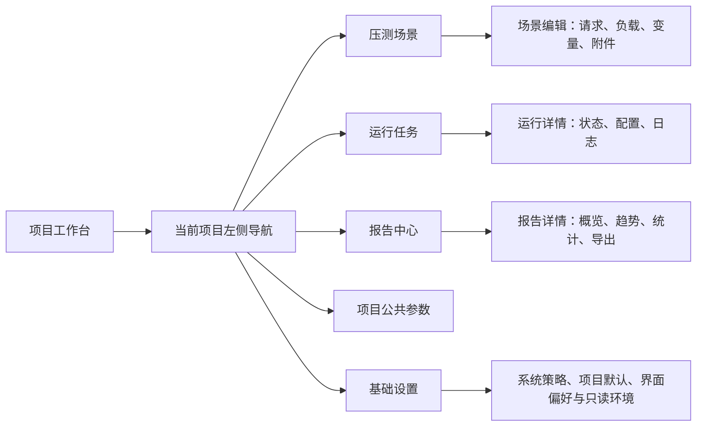
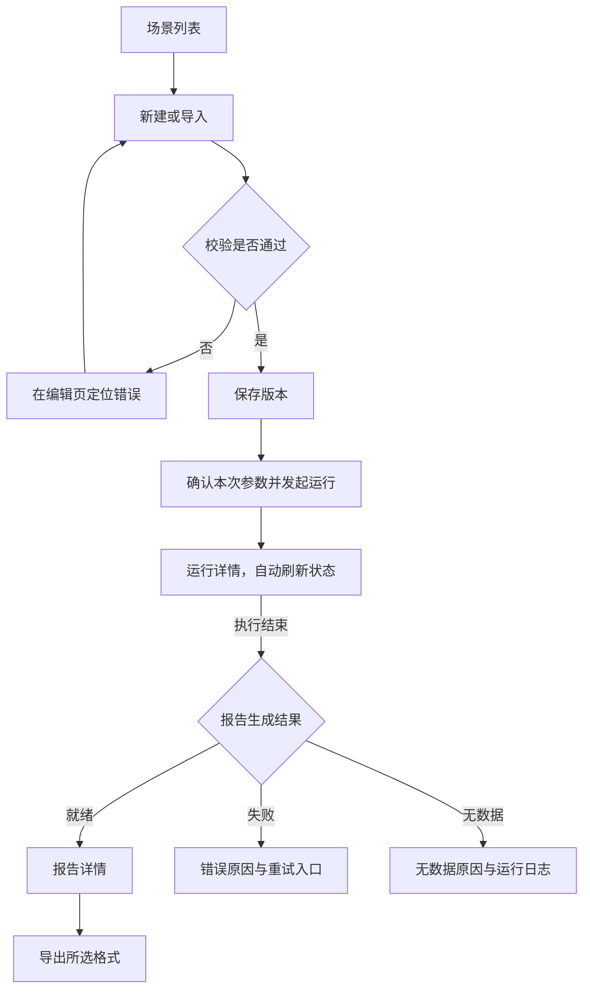
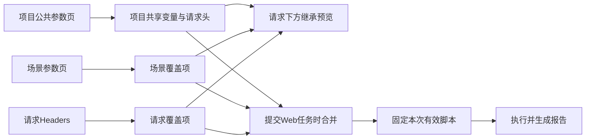
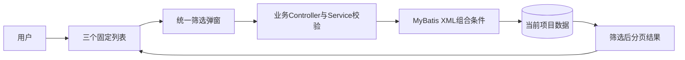
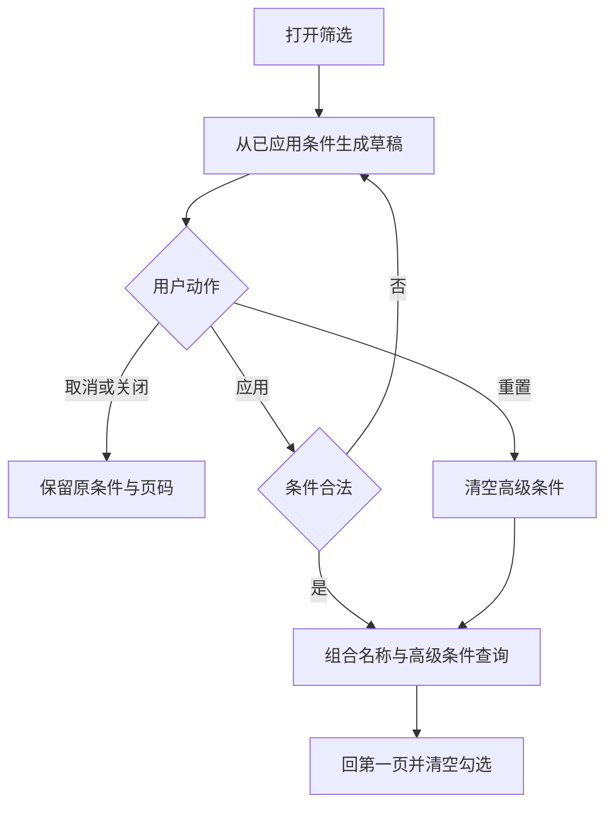

# 界面与交互规范

> 状态：草稿
> 最后更新：2026-10-21
> 适用范围：以开源为基准的压测平台当前工作台与账号协作迭代桌面浏览器界面
> 关联文档：[说明](../说明.md)、[首版功能规范](首版功能规范.md)、[技术与数据规范](技术与数据规范.md)

## 一、参考依据与设计方向

2026-10-21用户明确：后续账号迭代必须以当前压测平台已实现的 UI 为主，参考 TabTin Mac 客户端的样式细节。当前样式与本规范早期建议值不一致时，以实际工作台为准；账号页面不得另起视觉体系。具体复用来源、分页面约束和截图验收要求见[账号规范的界面章节](../账号权限/规划/账号与团队项目规范.md)，已同步到登录、权限、人员、游客四份执行计划。

界面以通用开源版本为基准，公司品牌、登录入口、组织字段与专属菜单通过可选扩展提供。TabTin 只作为风格参考，不成为界面运行、构建或资源加载的依赖；API 与报告链接适配外部部署地址，符合[开源与部署扩展规范](开源基准与部署扩展规范.md)。

已确认：界面风格参考本机 TabTin 的 Mac 客户端。以下为只读源码提炼后的建议，尚未完成实际客户端截图对照，也未获得用户对具体页面稿的确认。

2026-10-19实现更新：已按源码提炼的风格实现React工作台，并检查真实浏览器截图、原生报告及下载流程；尚未启动TabTin做逐像素对照，也不将工程验收等同于用户确认视觉稿。

查阅来源均位于 `/Users/yang/Documents/larchiveai/TabTin/`：

| 来源                                                                             | 已核实信息                                                                 |
| -------------------------------------------------------------------------------- | -------------------------------------------------------------------------- |
| `apps/tabtin-electron/src/renderer/src/styles/globals.css`，基础主题区域         | 暖中性画布、浅灰侧栏、白色主工作区、克制蓝色主色、语义化颜色、明暗主题变量 |
| `apps/tabtin-electron/src/renderer/src/components/layout/sidebarUi.ts`           | 紧凑侧栏、细分组、弱悬停背景、统一图标与对齐、选中态强调                   |
| `apps/tabtin-electron/src/renderer/src/components/layout/SidebarMenuItem.tsx:65` | 统一导航行与选中状态、可访问性属性和元信息槽                               |

借鉴视觉关系和操作节奏，独立实现本项目界面。无需把 Electron、聊天、工作空间或 TabTin 后端架构移植过来。

## 二、界面全景

此图说明少量导航入口与主要工作区的对应关系。

默认进入项目工作台，选择项目后进入该项目的场景、任务和报告；结果导入入口放在报告中心。当前不增设独立业务大屏。

可选平台登录、注册和改密页已完成本地验证，见[账号登录验证记录](../账号权限/验证记录/2026-10-21-账号登录验证记录.md)；人员、角色和审计界面仍待后续计划，通过可选模块注册入口。压测与报告页面不直接依赖登录 Store、用户 API 或权限框架；无账号构建不包含这些扩展仍可打开全部核心功能，不跳转登录或请求缺失的用户接口。不能将公司专属导航写入通用页面。操作者仅作为可缺省的展示信息，未接入身份时显示“未认证”或“系统”，不展示虚构管理员。

## 三、视觉规范建议

| 维度       | 设计建议                                                                                        |
| ---------- | ----------------------------------------------------------------------------------------------- |
| 页面骨架   | 左侧窄导航，顶部简洁工具栏，主工作区白底；侧栏约 224–248px，可收起                              |
| 配色       | 暖中性画布、近中性浅灰侧栏、白色内容；蓝色用于主要动作和选中反馈                                |
| 可参考变量 | 画布 `hsl(40 20% 97%)`，正文 `hsl(30 10% 15%)`，主色 `hsl(215 65% 52%)`，侧栏 `hsl(0 0% 97.6%)` |
| 层次       | 依赖留白、背景差与少量分隔线；浮层使用轻阴影，正文区域避免大量阴影卡片                          |
| 字体       | 系统字体栈，中文正常阅读字号建议 14px，标题 18–22px，辅助文字 12px                              |
| 数字       | 指标与表格采用等宽数字，统一单位、小数位和空值表达                                              |
| 控件       | 表单和按钮使用紧凑的约 8px 圆角，焦点环可见；不机械套用客户端缩放比例                           |
| 图表       | 分类系列可用多色，图例与系列颜色一致；红色保留给错误含义，不能只依靠颜色表达状态                |
| 主题       | 首版先验收浅色主题，保留主题变量；深色模式是否纳入首版待确认                                    |
| 布局       | 优先桌面浏览器；建议以 1440×900 和 1280×800 验证，窄屏允许折叠侧栏、表格横滚                    |

这些数值属于建议起点，并非已经确认的设计稿。图表面积和表格密度应服务性能数据阅读，不能为了仿 Mac 界面牺牲信息可见性。

## 四、页面要求

### 1. 场景列表与编辑

- 列表显示名称、来源、最近运行状态、更新时间；工具栏提供新建与导入。
- 2026-10-20增量：场景行的空白、来源、版本、时间均可点击进入Web编辑或导入脚本详情；聚焦行后Enter/空格同样生效。复选框与运行、复制、归档按钮必须保持各自行为。
- 场景工具栏增加“批量导出”，逐项与全选本页使用有名称的复选框，表头支持半选。已选数量和最多50项限制始终可见，可跨页累计或清空；搜索条件改变后清空，不隐式导出所有查询结果。
- JMX入口允许一次多选最多20份、每份20MB。每份脚本独立展示名称、线程组、兼容问题和CSV附件；就绪项可先导入，未就绪项保留。逐项显示成功/失败，已成功项锁定，重试只提交尚未成功的就绪项。
- Web 场景编辑：左侧请求列表，中间请求表单；负载、变量、CSV 附件分区配置。
- 导入 JMX：展示脚本摘要、线程组、附件映射与兼容检查；不展示一个看似可编辑但会丢节点的表单。
- 保存与开始运行是两个动作；开始运行应清楚显示使用的已保存版本和本次覆盖参数。
- 校验错误定位到字段或组件；参数未生效、依赖缺失必须在启动前可见。
- 请求配置、认证值遮蔽和日志区域采用一致的复制、展开与脱敏规则。
- 文件选择使用统一的图标按钮，隐藏浏览器原生文件控件；JMX、JTL 与 CSV 附件共用 `frontend/src/components/FilePicker.tsx`。按钮支持键盘触发、禁用态和焦点反馈，同一文件可重新选择；导入区显示选中文件名、上传结果与重新选择入口，附件缺失时继续阻止导入。
- 导入区使用浅色虚线边框、文件图标和格式/大小提示；长文件名换行，约690px宽的浏览器窗口内弹窗无横向溢出。视觉效果仍以用户审阅为准。

### 2. 运行详情

- 顶部显示执行状态、报告状态、场景版本、操作者、开始时间、已运行时间和终止原因。
- 运行中显示日志与配置快照，提供停止操作；页面关闭后任务继续由后端管理。
- 排队中支持取消；停止中按钮显示处理中，不能把请求已接收显示成进程已停止。
- 完成后给出报告入口。报告失败时显示原因与重新生成操作；无样本时显示无数据而不是一组零值。
- 当前建议不显示伪实时图。是否增加运行中趋势，须另行确认其时延与暂定统计口径。

### 3. 报告详情

建议布局：顶部来源与运行信息 → 样本数/错误率/平均耗时/P95 等摘要 → 趋势图 → 请求统计 → 错误明细。

- 工具栏放原生报告、导出 HTML、导出汇总 CSV 和下载原始结果；未就绪项说明原因。
- 图表显示时间轴时区、单位、粒度、标签筛选和成功样本过滤等说明。
- 表格支持标签筛选、数值排序；导出汇总 CSV 继承筛选条件，总计行注明对应范围。
- 停止或异常产生的报告显示“部分结果”，不与正常完整运行混淆。
- 列表的加载、无数据、无权限、错误、已清理均有明确状态；不使用随机或演示数值填充生产界面。
- 报告中心增加勾选与“批量导出”，每次最多50项；弹窗选择HTML、汇总CSV或原始JTL，并说明统一ZIP、每报告独立文件及HTML内层ZIP结构。批量CSV为全量标签，按钮忙碌、错误和下载状态可见，不与详情页筛选混淆。

## 五、核心交互流程

此图说明从配置到报告的页面跳转和失败反馈位置。

“确认本次参数”指产品内运行前展示，不是要求编码 Agent 反复向用户申请权限。用户本轮关于开发开工的限制仍单独有效。

## 六、界面验收建议

- [ ] 场景、运行、报告三个页面共享导航、工具栏、字体、间距和状态样式。
- [ ] 键盘可完成主要配置、运行与导出操作；焦点清楚，图标按钮有可读名称。
- [ ] 参考分辨率下关键操作不被遮挡，长标签、长 URL 与中文错误不破坏布局。
- [ ] 图表可读且单位完整，同一标签在相关图中的颜色稳定；不以动画掩盖加载失败。
- [ ] 用户能区分排队、运行、停止中、执行终态、报告生成和报告失败。
- [ ] 用实际 TabTin 客户端视觉参考与用户评审确认相似风格，不能仅凭源码变量宣称验收通过。

## 请求编辑布局与项目公共参数补充（2026-10-20）

用户通过五处浏览器批注与Apifox编辑态附件补充要求，并确认公共变量及请求头按项目共享。本轮只借鉴布局和颜色，不复制截图业务参数，也不加入Mock、负责人或文档编排等未请求功能。

- 编辑页按请求配置、负载配置、场景参数、数据附件分栏；保存与运行入口保持独立。请求名称、方法＋URL和参数页签依次排列，减轻纵向表单堆叠。
- 方法选择采用彩色菜单：GET绿色、POST橙色、PUT／HEAD／OPTIONS蓝色、DELETE红色、PATCH粉色；仅展示实际支持的方法。支持方向键、Enter、Escape、外部点击关闭。
- Body类型改为横向胶囊选项，选中项有明确底色和文字对比；none、JSON、raw、URL编码表单沿用既有范围，不放置不可用的multipart／XML等占位项。
- JSON正文提供带行号的等宽编辑区、格式化工具栏和字符状态；保留数字原文，JSON与raw切换保留正文草稿。
- 键值表／JSON使用蓝色文字、浅蓝选中底色、描边及字重区分，ARIA选中值和视觉一致，切换时不残留上一项颜色。
- 左侧公共参数入口放在基础设置上方；项目参数分公共变量／公共请求头两页，支持保存、取消、非法JSON保草稿及版本冲突提示。场景原有参数保留为该场景覆盖项，不自动提升到项目而影响其他场景。
- 请求Headers下面默认展示场景与项目公共头，标注继承／已覆盖／未启用；同名Header不区分大小写。继承区只读，编辑项目公共值应进入公共参数页。
- 页面及编辑区需通过689px窄屏和桌面检查；参数表可独立横向滚动，整页不能因长URL或参数值溢出。

此图说明公共参数的编辑入口、继承关系及运行时冻结边界。

项目修改只影响之后提交的Web任务。已排队脚本和历史报告保留快照；导入JMX继续保留原参数。真实验证见[请求编辑布局与项目公共参数验证记录](../代码执行计划/2026-10-20-请求编辑布局与项目公共参数验证记录.md)。

## 固定视口框架与内部滚动补充（2026-10-20）

用户进一步明确所有页面使用固定外框，项目分类、场景编辑分类等页签以下才允许内容滚动；场景名称移到页签上方。同时确认场景、运行任务和报告中心列表每页10条，并要求顶部层级可跳转且更紧凑。

此图区分固定区与唯一的业务内容滚动区；名称行、分类页签及分页按页面实际功能出现。

- 网页根节点不产生整页滚动；各页面明确设置可聚焦的内容区域，长表格、表单、图表和日志在业务区内滚动，横向溢出同样由局部区域承接。
- 三个业务列表标题、操作区、表头和底部分页保持可见。每页固定10条，旧浏览器pageSize偏好不再改变这些列表；界面偏好只保留时区和默认参数编辑模式。API已有size参数保持原约束，当前仅统一Web界面。
- 翻页、搜索和任务状态切换使内容回到顶部；同页低频刷新保留滚动位置，跨页勾选最多50项的行为不变。
- 项目工作台的标题、分类、搜索与新建入口固定，卡片／列表在下方滚动；项目卡片不按业务列表的10条规则额外分页。
- 编辑页将场景名称放在分类页签上方，名称、保存／运行、分类和底部保存区固定；请求、负载、局部参数、附件在页签下面滚动。
- 公共参数、基础设置、导入脚本、任务详情和报告详情同样固定外框。设置分类与公共参数分类保持在内容区之外，不随表单滚走。
- 顶部层级栏40px，采用11px紧凑文字。项目工作台入口返回项目列表，项目名称返回当前项目首页，模块名称返回对应列表，详情／新建为当前页标记；窄屏不得被侧栏的隐藏文字规则误隐藏。
- 点击层级跳转仍执行未保存保护。键盘焦点可进入内容区；方法选择浮层在视口中定位，自动决定展开方向，滚动／调整窗口时关闭，避免被新滚动边界裁切。

本轮以689×757验证固定位置和内部滚动，同时回归既有桌面流程；详细证据见[固定页面框架与内容滚动验证记录](../代码执行计划/2026-10-20-固定页面框架与内容滚动验证记录.md)。

## 任务报告搜索与报告分析页签补充（2026-10-20）

用户追加要求：运行任务和报告中心提供与场景列表一致的搜索；报告四个核心指标缩小、提高辨识度并固定；趋势分析、请求统计、错误分布分成页签。

- 两个列表的固定工具栏使用名称搜索框，回车提交，最多160字符，支持清空。搜索在服务端分页前执行，仍同时受项目、任务状态和报告可用性约束，不只过滤当前10行。
- 新关键词重置游标、回到顶部并清空报告批量选择；切换运行中／已完成保留关键词。空结果明确提示无匹配项，提供查看全部入口。任务页签计数继续表示项目总体，不为每个关键词频繁重算。
- 报告标题、样本总数／错误率／平均响应／P95四项核心指标、分析分类和底部主要操作固定，只有分析面板滚动。689px宽下仍四列展示；指标使用浅色分类背景、清晰数字及错误强调，移除原两行高卡片的大量留白。
- 分析分类复用编辑页的页签交互：趋势分析、请求统计、错误分布。趋势页保留响应／吞吐／资源分组；统计页保留标签筛选和汇总CSV；错误页展示完整运行的原生错误分布。
- 切换页签回到内容顶部，不重新读取同一报告数据。仅渲染当前面板，离开趋势页释放图表实例，再进入时按实际尺寸重建，避免隐藏画布宽高为零；统计标签状态保留，顶部指标始终全量。
- HTML、原生报告、原始JTL、重新生成保持可访问；导出不随分析页签重新计算统计或改变历史任务。

实际结果见[任务报告搜索与分析页签验证记录](../代码执行计划/2026-10-20-任务报告搜索与分析页签验证记录.md)，本轮未改变JMeter统计口径。

## 列表密度、组合筛选与确认弹窗补充（2026-10-20）

用户要求压测场景、运行任务、报告中心统一列表尺寸，搜索旁增加时间、版本等筛选，并替换截图中的浏览器原生确认框。本节为本轮实现约束，视觉风格仍由用户审阅。

- 三个列表共用40px表头、72px数据行、12px正文和相同名称／图标／元信息密度。任务列表进度保留阶段、百分比和进度条，补充估算信息悬停可查看；不因进度说明额外撑高行。固定外框、局部滚动及每页10条继续有效。
- 搜索旁使用“筛选”按钮，启用条件显示数量；时间范围计一类、场景版本和来源各计一类。弹窗草稿通过“应用筛选”生效，取消／关闭保留已应用条件；“重置筛选”立即清空高级条件，名称搜索保留。
- 场景按更新时间、当前场景版本、Web／JMX来源过滤。任务与报告按提交时间、运行时场景版本、场景执行／导入结果过滤。场景后来保存为v2，不改变既有v1任务的匹配结果；外部结果没有场景版本，指定版本时不匹配。
- 时间使用浏览器本地时区填写，提交UTC ISO时刻，起止均包含该时刻，可只填一端。开始晚于结束、非正整数版本、非法时间／来源均拒绝，服务端返回400，不能退化为无限制查询。
- 三个GET列表新增可选`from`、`to`（ISO日期时间）、`version`（正整数）、`source`（枚举）。条件与名称、项目、任务状态、报告可用性和分页共同生效，在LIMIT之前查询。变更条件回第一页、滚动顶部并清空批量勾选；任务分类整体计数不随筛选重算。
- 归档项目／场景、放弃公共参数修改、离开未保存页面改用统一应用内确认框，参考TabTin的标题说明分层、紧凑圆角和分离动作。归档说明明确数据保留范围，默认焦点在取消，Escape等同取消；同一时刻只显示一个确认框。页面跳转等待确认，取消保留地址和草稿。
- 刷新／关闭标签页仍保留浏览器的`beforeunload`未保存保护，这类浏览器提示无法替换为应用内组件。

此图展示公共筛选组件与服务端查询的边界。

此图展示草稿、应用和取消的不同结果。

本轮不变更数据库结构，不重刷现有数据；版本筛选通过任务快照的版本标识关联不可变版本，只比较关联字段，不加载参数密文、日志或报告明细。

本轮只读参考的TabTin组件为`packages/smartsheet-ui/src/components/confirm-dialog.tsx`及`apps/admindash/src/components/ui/confirm-dialog.tsx`，通过CodeGraph取得当前源码；没有启动TabTin客户端做逐像素视觉对照，也未引入其业务或运行时依赖。

三个列表的名称搜索、筛选按钮以及后续上下文栏采用相同高度；上下文栏为36px，场景／报告显示选择提示，运行任务显示状态分类。900px以下统一将主要操作放在标题下方，避免各页不同换行方式导致列表框起点不同；相同窗口和正常数据状态下，列表框位置与高度相同。

| 查询参数  | 场景列表              | 任务与报告列表               | 约束                  |
| --------- | --------------------- | ---------------------------- | --------------------- |
| `from`    | 更新时间下界          | 任务提交时间下界             | 可省略，包含边界时刻  |
| `to`      | 更新时间上界          | 任务提交时间上界             | 可省略，包含边界时刻  |
| `version` | 当前版本号            | 不可变运行快照关联的版本号   | 可省略，1到2147483647 |
| `source`  | `WEB`、`IMPORTED_JMX` | `EXECUTION`、`RESULT_IMPORT` | 可省略，其他值返回400 |
