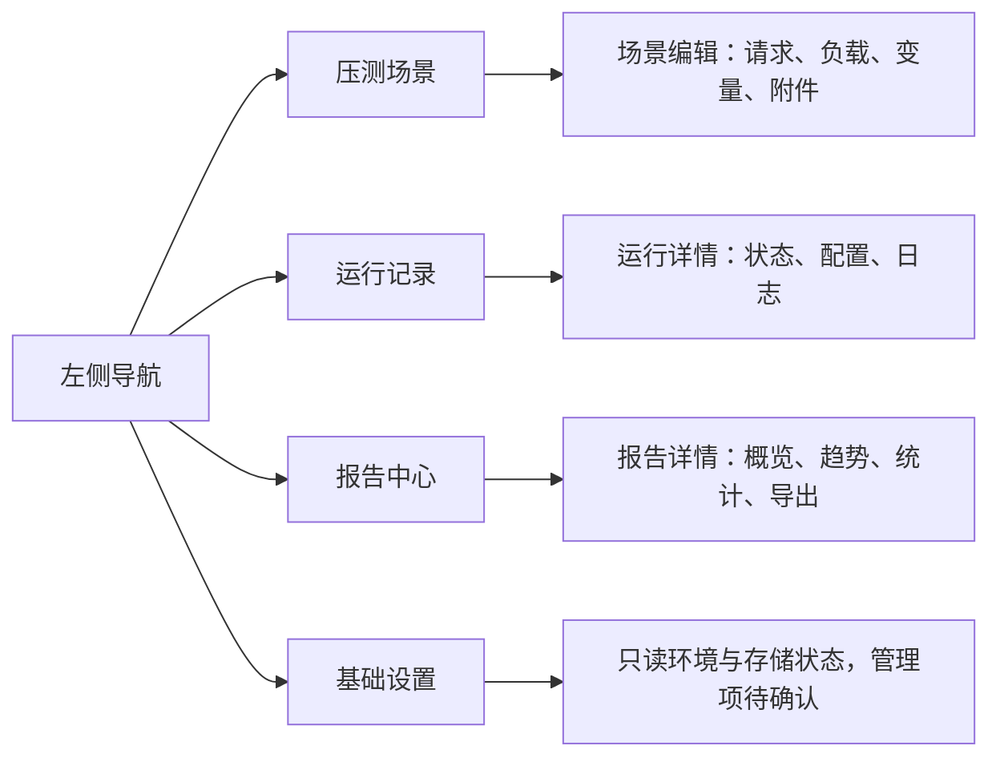
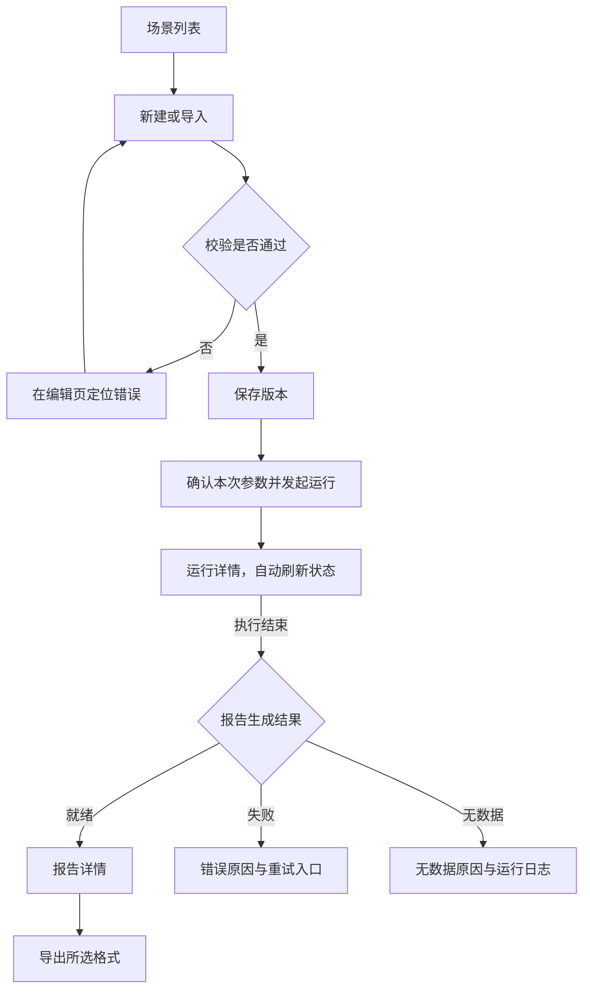

# 界面与交互规范

> 状态：草稿
> 最后更新：2026-10-16
> 适用范围：内部压测平台首版桌面浏览器界面
> 关联文档：[说明](../说明.md)、[首版功能规范](首版功能规范.md)、[技术与数据规范](技术与数据规范.md)

## 一、参考依据与设计方向

已确认：界面风格参考本机 TabTin 的 Mac 客户端。以下为只读源码提炼后的建议，尚未完成实际客户端截图对照，也未获得用户对具体页面稿的确认。

查阅来源均位于 `/Users/yang/Documents/larchiveai/TabTin/`：

| 来源 | 已核实信息 |
| --- | --- |
| `apps/tabtin-electron/src/renderer/src/styles/globals.css`，基础主题区域 | 暖中性画布、浅灰侧栏、白色主工作区、克制蓝色主色、语义化颜色、明暗主题变量 |
| `apps/tabtin-electron/src/renderer/src/components/layout/sidebarUi.ts` | 紧凑侧栏、细分组、弱悬停背景、统一图标与对齐、选中态强调 |
| `apps/tabtin-electron/src/renderer/src/components/layout/SidebarMenuItem.tsx:65` | 统一导航行与选中状态、可访问性属性和元信息槽 |

借鉴视觉关系和操作节奏，独立实现本项目界面。无需把 Electron、聊天、工作空间或 TabTin 后端架构移植过来。

## 二、界面全景

此图说明少量导航入口与主要工作区的对应关系。

首版无需独立大屏式首页。默认进入压测场景或最近运行列表；结果导入入口放在报告中心，不单独扩成一个管理系统。

平台登录页、账号管理、角色权限和审计查询暂不实现；未来通过可选模块注册入口，不显示不可用的空菜单。压测与报告页面不直接依赖登录 Store、用户 API 或权限框架；无账号构建不包含这些扩展仍可打开全部核心功能，不跳转登录或请求缺失的用户接口。不能将公司专属导航写入通用页面。操作者仅作为可缺省的展示信息，未接入身份时显示“未认证”或“系统”，不展示虚构管理员。

## 三、视觉规范建议

| 维度 | 设计建议 |
| --- | --- |
| 页面骨架 | 左侧窄导航，顶部简洁工具栏，主工作区白底；侧栏约 224–248px，可收起 |
| 配色 | 暖中性画布、近中性浅灰侧栏、白色内容；蓝色用于主要动作和选中反馈 |
| 可参考变量 | 画布 `hsl(40 20% 97%)`，正文 `hsl(30 10% 15%)`，主色 `hsl(215 65% 52%)`，侧栏 `hsl(0 0% 97.6%)` |
| 层次 | 依赖留白、背景差与少量分隔线；浮层使用轻阴影，正文区域避免大量阴影卡片 |
| 字体 | 系统字体栈，中文正常阅读字号建议 14px，标题 18–22px，辅助文字 12px |
| 数字 | 指标与表格采用等宽数字，统一单位、小数位和空值表达 |
| 控件 | 表单和按钮使用紧凑的约 8px 圆角，焦点环可见；不机械套用客户端缩放比例 |
| 图表 | 分类系列可用多色，图例与系列颜色一致；红色保留给错误含义，不能只依靠颜色表达状态 |
| 主题 | 首版先验收浅色主题，保留主题变量；深色模式是否纳入首版待确认 |
| 布局 | 优先桌面浏览器；建议以 1440×900 和 1280×800 验证，窄屏允许折叠侧栏、表格横滚 |

这些数值属于建议起点，并非已经确认的设计稿。图表面积和表格密度应服务性能数据阅读，不能为了仿 Mac 界面牺牲信息可见性。

## 四、页面要求

### 1. 场景列表与编辑

- 列表显示名称、来源、最近运行状态、更新时间；工具栏提供新建与导入。
- Web 场景编辑：左侧请求列表，中间请求表单；负载、变量、CSV 附件分区配置。
- 导入 JMX：展示脚本摘要、线程组、附件映射与兼容检查；不展示一个看似可编辑但会丢节点的表单。
- 保存与开始运行是两个动作；开始运行应清楚显示使用的已保存版本和本次覆盖参数。
- 校验错误定位到字段或组件；参数未生效、依赖缺失必须在启动前可见。
- 请求配置、认证值遮蔽和日志区域采用一致的复制、展开与脱敏规则。

### 2. 运行详情

- 顶部显示执行状态、报告状态、场景版本、操作者、开始时间、已运行时间和终止原因。
- 运行中显示日志与配置快照，提供停止操作；页面关闭后任务继续由后端管理。
- 排队中支持取消；停止中按钮显示处理中，不能把请求已接收显示成进程已停止。
- 完成后给出报告入口。报告失败时显示原因与重新生成操作；无样本时显示无数据而不是一组零值。
- 当前建议不显示伪实时图。是否增加运行中趋势，须另行确认其时延与暂定统计口径。

### 3. 报告详情

建议布局：顶部来源与运行信息 → 样本数/错误率/平均耗时/P95 等摘要 → 趋势图 → 请求统计 → 错误明细。

- 工具栏放原生报告、导出 HTML、导出汇总 CSV 和下载原始结果；未就绪项说明原因。
- 图表显示时间轴时区、单位、粒度、标签筛选和成功样本过滤等说明。
- 表格支持标签筛选、数值排序；导出汇总 CSV 继承筛选条件，总计行注明对应范围。
- 停止或异常产生的报告显示“部分结果”，不与正常完整运行混淆。
- 列表的加载、无数据、无权限、错误、已清理均有明确状态；不使用随机或演示数值填充生产界面。

## 五、核心交互流程

此图说明从配置到报告的页面跳转和失败反馈位置。

“确认本次参数”指产品内运行前展示，不是要求编码 Agent 反复向用户申请权限。用户本轮关于开发开工的限制仍单独有效。

## 六、界面验收建议

- [ ] 场景、运行、报告三个页面共享导航、工具栏、字体、间距和状态样式。
- [ ] 键盘可完成主要配置、运行与导出操作；焦点清楚，图标按钮有可读名称。
- [ ] 参考分辨率下关键操作不被遮挡，长标签、长 URL 与中文错误不破坏布局。
- [ ] 图表可读且单位完整，同一标签在相关图中的颜色稳定；不以动画掩盖加载失败。
- [ ] 用户能区分排队、运行、停止中、执行终态、报告生成和报告失败。
- [ ] 用实际 TabTin 客户端视觉参考与用户评审确认相似风格，不能仅凭源码变量宣称验收通过。
