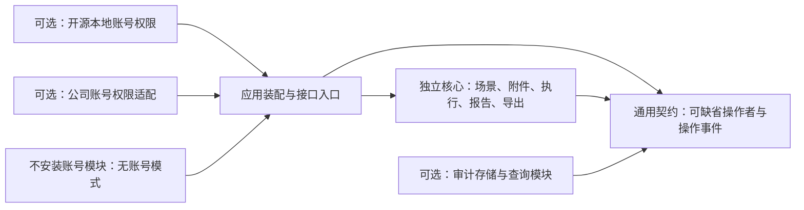
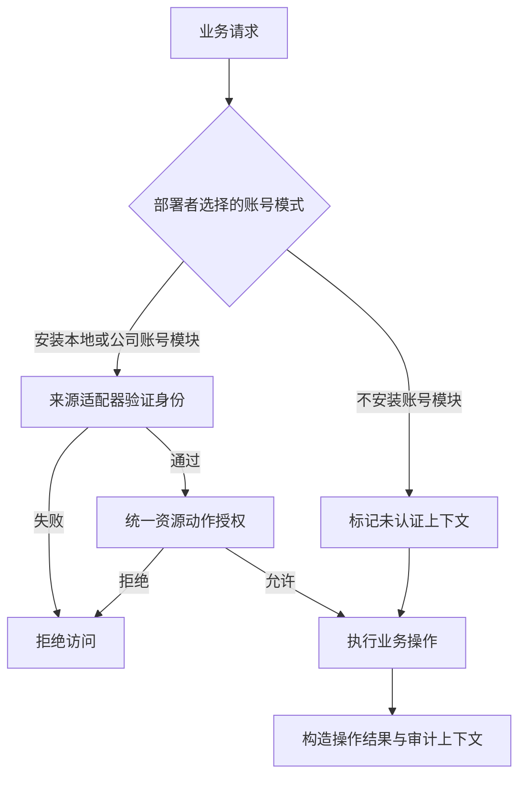
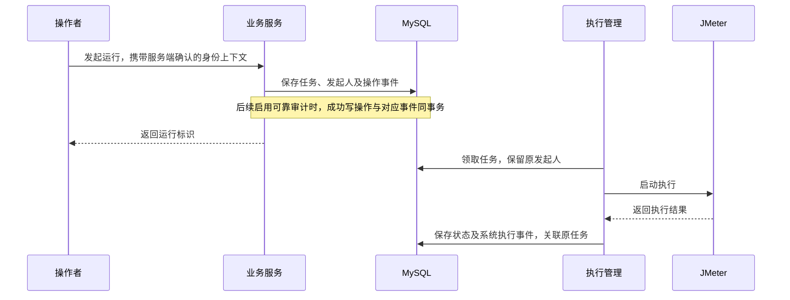
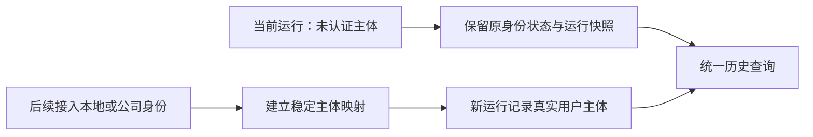

# 账号权限与审计扩展规范

> 状态：草稿
> 最后更新：2026-10-21
> 适用范围：压测核心独立运行、可移除账号权限模块及后续平台审计扩展
> 关联文档：[说明](../说明.md)、[首版功能规范](首版功能规范.md)、[技术与数据规范](技术与数据规范.md)、[首版实施规划](首版实施规划.md)

2026-10-21起，本地账号、团队项目角色、邀请、游客和请求上下文的具体方案以[账号权限目录](../账号权限/说明.md)为准，本地账号登录已实现并完成本地验证，其余计划尚未执行。本文继续维护模块可移除、无账号核心和独立审计边界；下文公司接入及完整审计属于后续预留。

## 一、已确认边界

- 全项目以开源为基准；通用核心与无账号模式是默认设计基线，本地账号和公司接入均为可选扩展。原生及未来 Docker 部署遵循同一模块边界，见[开源基准与部署扩展规范](开源基准与部署扩展规范.md)。
- 用户计划两版：开源核心可选独立账号权限扩展，公司集成版可复用公司现有权限体系；两者均不改变无账号核心基线。
- 用户进一步确认：账号权限必须与 JMeter 执行、报告、导出明确分离，未来可以删除账号权限模块；开源使用者可以完全不用账号体系。核心独立运行是硬约束，不能只做到一个配置开关关闭登录。
- 用户已授权并完成本地账号登录基础，其余团队权限、人员及游客按独立计划接续；公司接入仍待定。角色采用固定枚举，不设计角色配置表。
- 当前规划必须考虑未来账号与审计数据，避免压测场景、运行、报告等对象以后难以关联操作者。
- 审计完整功能的实施阶段、字段细节、留存策略和查询权限尚未确认。本文提出可演进边界，不代表用户已确认全部细节。
- 被测 HTTP 接口的认证仍属于压测配置；与“登录压测平台”分开。

## 二、两版共用核心

此图说明三种身份装配方式和独立审计模块；账号模块不是核心或审计的必需依赖。

以同一开源核心通过可选模块接入不同身份来源，避免复制两套压测和统计逻辑。必须提供不包含账号权限实现及其依赖的核心构建；是否另提供包含全部可选模块的统一产物、公司适配包如何分发、具体开源许可证和公司专属资料的公开范围均待后续决定，不再将核心以开源为基准设计作为未决事项。图中箭头表示调用或契约依赖，不表示核心必须等待审计模块完成采集。

公司网络地址、SDK、权限编码和凭据只属于公司部署配置/适配层，不成为开源版运行依赖。当前给定的 MySQL/Redis 是内部开发环境，不是开源使用者必须连接的服务。

### 1. 模块职责与依赖方向

下表为逻辑边界，具体 Maven 模块与前端目录在开工后的代码执行计划中确定。不能以尚未确定目录名为由取消可移除性。

| 模块         | 职责                                                 | 允许依赖                         | 必须满足的独立性                                            |
| ------------ | ---------------------------------------------------- | -------------------------------- | ----------------------------------------------------------- |
| 压测核心     | 场景、JMX、附件、任务、JMeter 执行、统计、报告与导出 | 技术基础设施及最小通用契约       | 编译、启动、运行任务和读取历史均不需要账号模块或账号表      |
| 最小通用契约 | 可选操作者快照、资源动作标识、操作事件与接收接口     | 基础类型                         | 不包含用户实体、角色实体、登录会话、公司 SDK 或认证框架类型 |
| 账号权限扩展 | 登录、账号、角色、身份映射与授权                     | 通用契约；必要的稳定资源查询接口 | 可从构建与部署中排除；核心不能反向引用它                    |
| 审计扩展     | 接收操作事件、存储、查询与导出审计                   | 通用契约及自身存储               | 不要求安装账号模块；无账号时仍可记录未认证主体和操作事实    |
| 应用装配     | 注册实际安装的适配器、接口拦截与前端入口             | 选定的核心和扩展模块             | 未安装扩展时有显式缺省行为，不因缺少组件或配置启动失败      |

核心不直接读取登录会话或认证框架上下文，不引用安全框架的用户类型、公司权限注解，也不从用户服务查询操作者。账号适配层验证并规范化身份，向核心传可缺省的普通数据。权限判断在应用接口/服务边界执行；不能要求每个报告统计函数先查询账号。

不要求为这些模块部署独立服务，也不引入消息中间件；模块分离首先是代码、依赖、数据和装配边界。

### 2. 无账号模式是完整支持的使用方式

无账号模式适用于使用者主动选择不安装账号模块的部署，不限于早期开发。该模式不提供平台内的用户身份验证和用户间权限隔离，使用者可按自己的环境安排访问边界；平台不强制安装内置账号。

- 导入/新建场景、启动/停止、查看结果、重新生成报告和导出均可独立完成，无登录重定向或用户接口依赖。
- 操作者记录 `UNAUTHENTICATED` 或 `SYSTEM`，显示“未认证”或“系统”，不会虚构管理员；主体标识允许为空。
- 已启用审计时照常记录可观察的操作事实，但不能声称具备实名追溯；未安装审计时核心使用明确的空事件接收器，不访问审计表。
- 已安装账号模块却遇到认证服务故障时，返回对应错误，不能自动降级成无账号放行；是否无账号是部署者显式选择的装配模式。
- 无账号核心保持完整可用；2026-10-21本地账号登录通过本地验证，团队权限、人员及游客仍待执行，完整审计继续暂缓。

### 3. 数据、前端与构建边界

- 核心表的主体标识仅为可空的逻辑引用或快照，不对账号/角色表建立强制外键，也不将登录用户字段作为创建任务的必填条件。
- 场景列表、运行记录、报告读取不能依赖用户表的内连接；账号模块移除、用户删除或公司用户不可查询时，历史数据仍可访问并展示已有快照。
- 核心、账号、审计的数据库迁移按各自模块装配；核心初始化不创建账号/角色表。已经安装过的扩展若被移除，保留历史表，不自动删表、清空历史或级联删除核心记录。若采用 Flyway，迁移历史与位置隔离方案须同时验证，不能因移除扩展脚本导致核心校验失败。
- 前端压测与报告页面不强制引用登录 Store、用户 API、角色常量或公司 SDK；菜单、登录路由及权限界面由可选模块注册，无账号构建不能留下缺失导入或全局登录守卫。
- 核心发行包可排除账号模块的源码/产物和依赖，且不需要账号初始化、会话 Redis 配置或公司认证地址。仅把登录按钮隐藏或关闭认证开关不算完成模块分离。
- 后续移除模块不要求重写核心业务、清理历史 JMX/JTL，或修改报告计算与导出格式；构建装配清单按该模式选择模块即可。

## 三、身份和授权预留

### 1. 统一操作者

压测核心只消费规范化身份上下文，不直接查询某家公司的用户表。建议包含：

| 字段                  | 含义与约束                                                                         |
| --------------------- | ---------------------------------------------------------------------------------- |
| `actorType`           | `USER / SYSTEM / UNAUTHENTICATED`，区分真实用户、后台任务和未接入身份              |
| `principalId`         | 规范化的稳定主体标识；来自可选身份适配层，核心不要求对应本地账号表；未认证时可为空 |
| `identityProvider`    | 本地账号或公司接入来源；未认证时不声称来自公司                                     |
| `externalSubject`     | 外部来源稳定用户标识，仅在真实接入后由服务端适配器提供                             |
| `realm`               | 身份来源内的组织/租户边界，如来源无此概念则为空；不因此建设多租户                  |
| `displayNameSnapshot` | 操作当时的显示名称快照，可为空，不能作为权限判断依据                               |

同一外部用户由“来源 + 来源域 + 外部主体标识”映射，不能只凭用户名或显示名合并。映射由身份扩展负责；核心只保存可选的规范化标识和快照，避免公司用户主键与开源用户主键类型不同造成耦合，也不要求存在一份本地用户映射表才能处理业务。

场景与附件预留创建、修改主体；运行预留发起、停止主体。主体字段可为空，但身份类型和来源必须准确。用户改名或离职后保留操作当时快照，不级联删除运行与审计历史。

### 2. 统一资源动作

建议业务服务按资源和动作检查权限，例如场景读写、发起/停止运行、读取报告、下载原始结果、查询审计。开源版未来可映射本地角色与权限，公司版映射公司授权结果。

本地账号方案按[团队项目规范](../账号权限/规划/账号与团队项目规范.md)区分团队及项目固定角色，不做SaaS租户；具体权限包在该文档维护。不能将前端按钮隐藏当作后端鉴权，原始结果下载与查看汇总报告分别授权。公司身份如何映射仍待后续确认。

此图说明显式无账号模式与已安装账号模式的请求路径，以及认证失败不会变成匿名放行。

无账号模式下不允许任意传入用户名就成为已认证操作者。是否使用账号模块由部署选择；账号模块缺失或移除不能阻断核心功能。

## 四、平台审计数据预留

### 1. 审计范围

先规划平台内的操作审计：场景新建/修改/归档、JMX 与附件导入、运行发起/停止、结果导入、报告重新生成、报告及原始数据导出。未来账号与权限变更也应进入同一事件模型。

审计描述“谁在何时对什么做了什么，结果如何”。压测性能指标、JMeter 引擎日志、请求样本和应用异常日志分别保存，不能用它们代替操作审计。

如用户后续还需要被测系统的业务审计数据，需要另定数据来源、关联 ID、权限和采集时序，不属于 JMeter 自动生成能力。

### 2. 建议事件字段

| 字段                                          | 含义                                                           |
| --------------------------------------------- | -------------------------------------------------------------- |
| `eventId / eventVersion`                      | 唯一事件标识与结构版本，后续扩展兼容                           |
| `occurredAt / recordedAt`                     | 操作发生时间、持久化时间，统一 UTC                             |
| `actor`                                       | 前述规范化主体与必要快照，不能伪造实名                         |
| `action`                                      | 稳定动作编码，不直接使用易变化的页面文案                       |
| `resourceType / resourceId / resourceVersion` | 对象类型、标识、版本；关联具体场景或报告快照                   |
| `outcome / errorCode`                         | 成功、失败或拒绝及原因，不保存无界异常堆栈                     |
| `requestId / traceId / operationId`           | 关联请求、调用链与异步任务                                     |
| `source`                                      | 用户请求、系统调度或恢复处理；后续记录必要的来源信息           |
| `changeSummary`                               | 经脱敏的关键变更或前后差异；不直接复制完整脚本、令牌和请求正文 |

新建对象应在得到对象 ID 后建立关联；异步运行的发起人与后台执行进程是不同主体，不能用后台 SYSTEM 覆盖用户发起人。

### 3. 采集和存储扩展

此图说明同步操作与异步执行事件的关联方式。

建议未来由可选审计模块将事件直接存入 MySQL，不引入消息中间件。启用审计时，业务成功事件与对应写入尽量同一数据库事务，具体由通用事件接收接口和应用装配完成，核心不直接写审计表。拒绝/失败事件、下载事件和状态终结事件按各自生命周期定义采集，不能承诺一次事务覆盖所有外部副作用。未安装审计时空接收器不阻塞业务；已经启用审计后的写入失败仍按约定策略处理，不能静默切为空接收器。

导出事件区分已申请、服务端开始/完成传输等可观测状态；服务端无法证明文件已被用户打开。审计记录以追加为主，普通业务接口不能随意改写；留存、删除、专门查询与导出权限后续设计。启用完整审计后，其写入失败应阻断还是允许降级需按事件类型确认，不能悄悄丢事件。

此图说明当前无账号历史如何在未来接入账号后保留真实性。

未来不能将接入前的未认证操作批量归给第一个管理员或某个公司用户。只有可靠证据和专门迁移规则才能补充历史身份，且保留补充来源。

## 五、后续验收与未决项

- [ ] 给定不包含账号模块源码/产物及认证依赖的核心构建，未创建账号/角色表、未配置会话或公司认证时，后端可启动，前端可构建并打开压测功能。
- [ ] 无账号模式可完成“导入或新建 → 执行 → 查看报告 → HTML/CSV 导出”；报告生成进程和后台任务无需登录上下文。
- [ ] 已生成的场景与报告在移除账号模块后仍可读取、再次执行或导出；不会因查询用户表失败而报错，也不会自动删除历史。
- [ ] 核心数据库迁移不包含账号建表或强制外键；移除可选模块不导致迁移历史校验失败。
- [ ] 无账号模式的前端无登录跳转、缺失用户请求、缺失导入和权限框架初始化错误。
- [ ] 审计模块可在无账号模式启用；不安装审计时核心不访问审计表；已启用账号或审计发生故障不会自动改成宽松模式。
- [ ] 替换身份来源不改变 JMeter 执行和报告统计逻辑，核心不依赖公司用户表或 SDK。
- [ ] 同名的两个来源用户不会被误合并；改名不破坏历史事件关联。
- [ ] 发起、停止、导出、报告重试等可按运行/资源标识追溯，敏感值不进入审计明文。
- [ ] 未认证、系统与真实用户三种主体在界面和数据中可区分。
- [ ] 权限接入后，后端覆盖读取、操作和下载，不能只控制菜单。

本地账号登录方式、固定角色与分项执行顺序已提出独立草案，待评审后授权开发。其余待定事项：公司身份/权限协议、实际开发时间、审计采集范围、留存与容量、查询导出与写入失败策略。上述待定不阻止继续讨论压测核心。

核心独立运行、账号模块可物理移除、无账号使用方式和数据/前端解耦已由用户确认，不再作为可选取舍；具体实现和装配工具仍为草稿。
