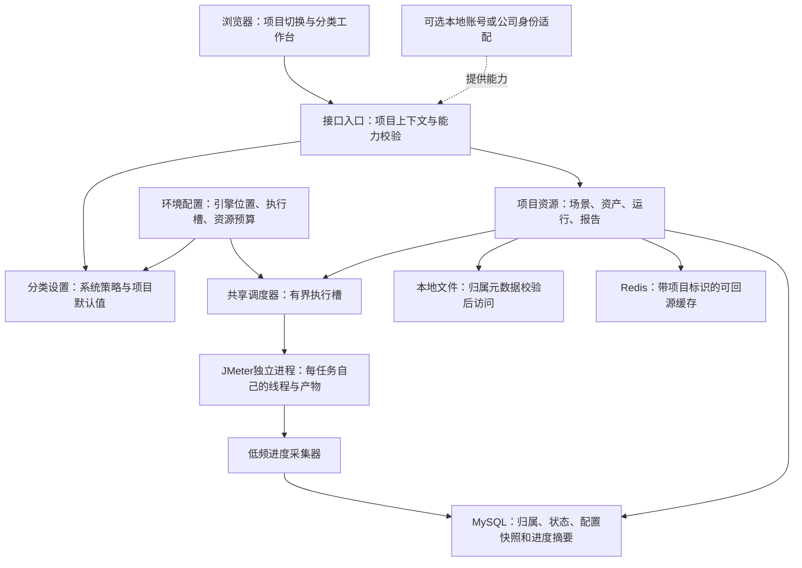
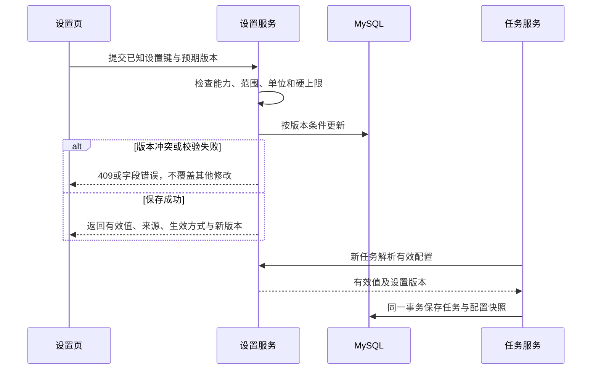
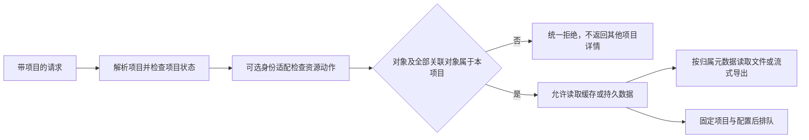
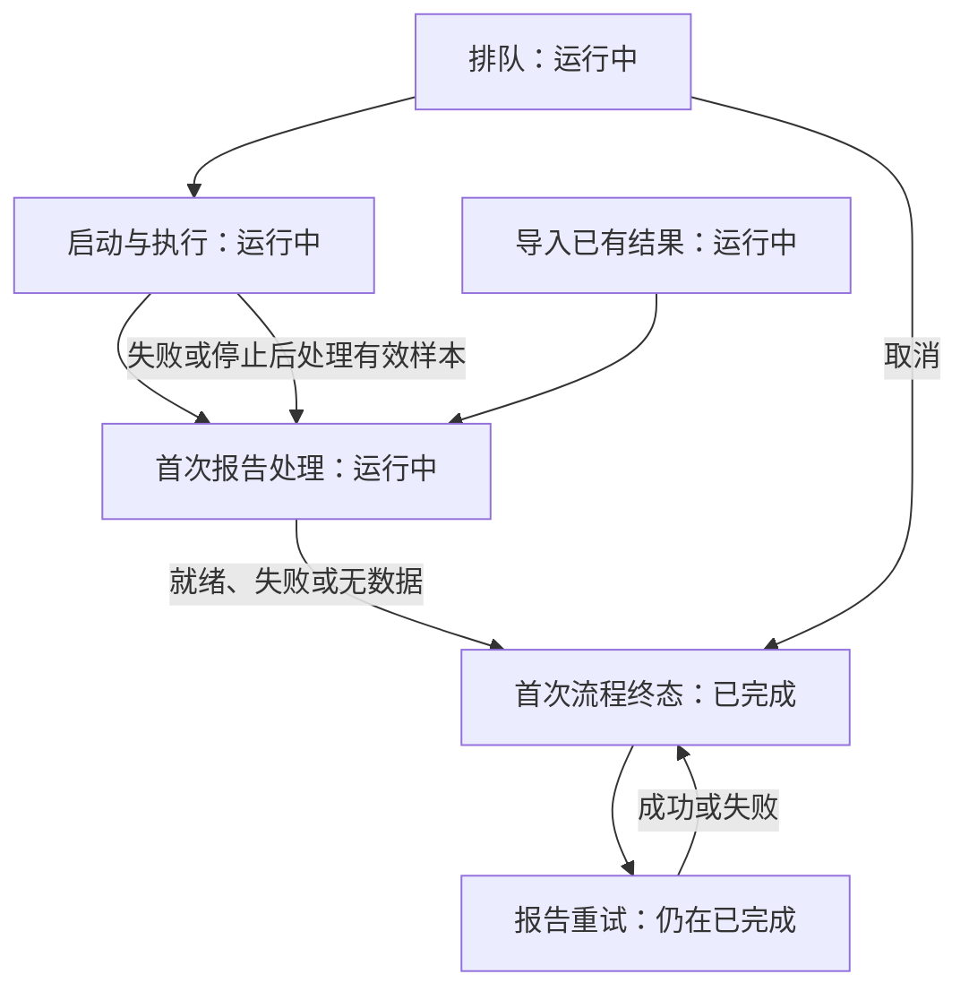
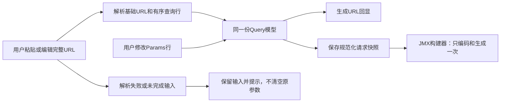

# 项目隔离与工作台增强规范

> 状态：草稿
> 最后更新：2026-10-20
> 适用范围：分类设置、项目数据隔离、任务分栏与低频进度、HTTP请求编辑器
> 关联文档：[入口](../说明.md)、[实施计划](../代码执行计划/2026-10-20-项目隔离与工作台增强计划.md)、[后端分层](后端分层与任务存储规范.md)、[身份扩展](账号权限与审计扩展规范.md)、[界面规范](界面与交互规范.md)

## 一、需求、建议与开发边界

本轮先完成规划，2026-10-20用户随后明确授权“执行此计划”。当前按本规范实施和分阶段验证，未完成项不描述为已有能力；具体进度见工作台增强开发验证记录。

用户随后确认当前尚未向客户发布，dev阶段可以直接修改现有建库脚本并人工重刷本项目数据库。因此本轮不要求旧数据迁移、逐版本升级、旧API和旧客户端兼容；默认以新库和配套开发数据验证。该部分已确认，见[开发阶段数据库决策](../决策记录/2026-10-20-开发阶段直接修改建库脚本与人工重刷.md)；其他设计仍为草稿。实际重刷按本轮执行授权实施，仅限本项目专用dev库。

用户已提出的要求：

1. 基础设置中适合修改的参数可编辑；设置分类组织，可扩展类别，未来管理员比普通用户拥有更多设置能力。
2. 引入项目。A项目的场景、任务和报告不出现在B项目，多个项目的数据互不混杂。
3. 运行页面用“运行中／已完成”小标签切换；运行任务显示进度，以低频采集和更新避免占用过多资源。
4. 除请求体外，变量、请求头等默认用键值表格编辑，允许切换JSON。请求体增加格式化；请求编辑器提供Params、Body等分栏，Query参数与URL联动。
5. 用户进一步澄清：执行槽数量应属于环境级资源配置。不能把“一个执行槽”理解为一个并发用户，也不能把此前选择理解为今后硬编码只能同时运行一个任务。

本轮已获执行授权。未逐项另选的实施细节采用末节所列取舍，不冒称用户逐项指定；下文是设计约束，具体完成结果见开发验证记录。一切以开源核心设计，维持JDK 21、MySQL、Redis缓存、本地文件、MyBatis XML和账号模块可移除原则，不新增消息中间件。

两张用户附件仅用作结构参考：第一张提炼为“启用、参数名、值、说明、增删行”；第二张提炼为“URL与Params、Body、Headers、Auth等分栏”。不复制其业务URL、Cookie、参数值或其他真实数据，也不把参考截图中的全部功能认定为本轮需求。

## 二、全景与资源层级

此图说明环境、项目、任务及可选账号之间的边界。

必须区分以下三个量，页面文案和配置项也不能混用。

| 概念                             | 归属           | 示例与含义                                                                           |
| -------------------------------- | -------------- | ------------------------------------------------------------------------------------ |
| 最大并行引擎任务数，即执行槽上限 | 环境／部署     | 建议配置名`ENGINE_SLOT_COUNT`，默认1是保守起点，可配置为经验证的正整数；所有项目共用 |
| 单任务并发线程数                 | 场景／本次运行 | 例如一个任务配置200个JMeter线程；只有一个执行槽时仍可产生这些并发线程                |
| 全环境资源预算                   | 环境／部署     | 同时运行的引擎堆、线程、CPU、磁盘和网络预算；不是普通用户的偏好设置                  |

第一阶段仍是**单后端实例**。多个槽是同一实例管理多个独立引擎进程，不等于多后端副本或分布式压测。报告生成也会启动JMeter进程，建议与压测共用同一引擎槽预算，避免配置N个压测槽后额外无界启动报告进程。界面应说明槽的当前用途。

项目先隔离数据与默认设置，共享环境资源。共享排队不代表项目独享CPU、网络或执行器；排队提示不能暴露其他项目的任务名称、配置和日志。项目不得自行扩大环境执行槽或资源硬上限。

## 三、分类设置与生效规则

### 1. 分类、作用域与权限分别建模

设置类别回答“设置什么”，作用域回答“对谁生效”，能力回答“谁能修改”；三者不能用一个`isAdmin`前端变量替代。

| 建议类别       | 作用域                   | 首轮内容                                                 | 修改与生效方式                                                   |
| -------------- | ------------------------ | -------------------------------------------------------- | ---------------------------------------------------------------- |
| 执行与报告策略 | 系统                     | 单任务允许线程上限、执行时限、报告聚合粒度               | 维护能力可编辑；在环境硬边界内，对新提交任务生效                 |
| 项目默认值     | 项目                     | 新场景默认线程、启动时间、循环／时长、超时、报告默认粒度 | 项目设置写能力可编辑；不改已有场景、版本或任务                   |
| 界面偏好       | 当前浏览器；未来可接用户 | 显示时区、参数编辑模式；三个业务列表固定每页10条         | 普通使用者可改自己的偏好，不改变原始UTC数据或其他浏览器          |
| 部署与执行资源 | 环境                     | 执行槽、引擎堆、线程总预算、引擎路径、数据根目录         | 建议从外置配置读取，页面展示来源和维护说明；变更需维护窗口／重启 |
| 环境状态       | 只读                     | 引擎版本／就绪状态、缓存状态、存储类型、账号装配模式     | 状态不能伪装成可保存参数；不展示连接凭据                         |

“最大线程”和“执行时限”同时有环境硬边界与可调业务策略时，必须分开命名，例如“环境单任务线程硬上限”与“允许的单任务线程上限”。不允许通过保存Web设置突破部署预算。现有`MAX_THREADS`、`MAX_RUN_SECONDS`的兼容映射在实施时明确，不悄悄改变原环境配置的保护作用。

设置定义由服务端白名单注册，至少提供：`key`、`category`、`scope`、类型、单位、默认值、约束、`editable`、需要的能力、`applyMode`、当前来源和版本。类别可扩展，未知设置键和越权作用域必须拒绝，不能把此入口做成任意Spring配置或任意文件写入接口。

建议当前参数规则：

- 线程、时限和超时为正整数，项目默认值及运行值不超过系统策略／环境硬边界；涉及当前构建器内的固定上限时同步统一校验。
- 报告粒度使用毫秒存储、秒显示；下限沿用当前`EngineConfig`的2000ms，候选上限为1小时，最终范围以JMeter 5.6.3验证为准。
- 默认运行方式只接受循环或时长；停用字段保留草稿，提交只使用所选方式的有效值。
- 引擎版本、缓存健康和账号模式是事实；数据库／Redis凭据、加密主密钥、监听和存储路径继续由部署管理。
- 设置页有保存、取消、恢复本作用域默认值、字段错误和未保存提示。恢复默认不删除其他项目设置。

### 2. 管理员能力与无账号模式

为未来预留`settings.system.write`、`settings.project.write`、`preferences.write`、`projects.manage`等通用能力，不在核心中写死公司角色、查询用户表或引入登录依赖。未来管理员可拥有系统设置，普通用户仅访问授权项目及自己的偏好；设置目录和写接口均由服务端过滤／校验，隐藏按钮不算鉴权。

当前无账号模式无法区分真实管理员与普通用户。建议提供部署者显式启用的“维护写入模式”，由服务端策略适配器决定系统／项目管理能力，操作者仍记为`UNAUTHENTICATED`，不虚构管理员。默认不允许匿名修改系统资源策略，普通核心功能继续可用；本轮dev默认显式启用、lease默认关闭，外置开关控制，由可替换能力服务判断。若已安装身份扩展却故障，禁止自动切换到无账号放行。

无账号个人偏好先在浏览器保存，键按部署实例和必要的项目命名；不冒称跨用户隔离。未来用户偏好由身份扩展提供稳定主体关联，不要求核心先建账号／角色表。

### 3. 设置保存与任务快照

有效值按“本次允许的运行覆盖 → 场景配置 → 项目默认 → 系统默认 → 内置默认”解析；只允许声明支持继承的键参与该链。各层都受系统策略和环境硬边界约束，用户偏好不进入执行参数。

创建新场景时应用默认值；已保存场景不因默认值变化自动变化。新任务入队时固定有效执行／报告策略与设置版本，保存到任务配置明细，避免等待期间悄悄换参数。领取时仍校验当前环境硬上限；不再可执行时明确失败，不擅自缩减压力或重压。新报告尝试记录实际粒度和版本，重试默认沿用原任务快照；历史报告不重算。

此图说明保存冲突和任务快照的形成时点。

## 四、项目数据隔离

### 1. 项目及界面行为

- 建议提供项目创建、选择、重命名和归档；首轮不做物理删除、项目成员管理、组织或租户系统。
- 新库初始化创建“默认项目”；当前开发数据可以在人工重刷后重新导入或创建，不做旧数据自动回填。新项目初始为空。
- 项目入口采用独立工作台，参考用户追加的Apifox布局：卡片／列表视图、搜索、新建、最近访问、归档。创建后留在列表，点击项目再进入场景、任务、报告；内部显示当前项目及返回项目列表入口，不使用原页面上方下拉选择栏。系统／环境设置不随项目切换伪装为另一套值。
- URL建议采用`#/projects/{projectId}/scenarios`等显式路径，支持新标签分别打开A、B项目。项目切换清空勾选、分页游标和临时筛选，取消旧请求；迟到响应不能渲染到新项目。
- 有未保存场景／设置或未完成导入时，切换项目前提示保存、放弃或取消；不能把A项目导入成功后的回调写入B项目。已开始的运行继续绑定原项目。
- 归档项目建议拒绝新建、修改、上传和发起运行，历史只读；有排队／执行／首次报告处理中的任务时拒绝归档。归档不删除历史、密钥或文件。

### 2. 隔离检查必须覆盖完整访问面

服务端项目上下文是必填约束，不能只靠前端筛选，也不能相信客户端提交的对象归属。无账号模式仍检查“资源属于请求项目”；未来身份模块另外检查“主体可访问该项目”。知道A项目ID并不自动获得项目访问权限；无账号模式本身也不提供实名访问控制。

所有下列入口都要检查归属：场景列表／详情／版本／复制／归档／JMX下载，资产上传／元数据／检查／读取，CSV关联，运行创建／详情／停止／日志，结果导入，报告列表／数据／重新生成／原生页面及其每个静态资源，单项和批量导出、幂等返回、缓存命中与后台恢复。

- B项目提交A的资源ID，或一次批量混入A/B资源，返回404或统一不可访问响应；打包前整批检查，不能流式输出一半才发现跨项目项。
- A场景版本、JMX和CSV必须同属A；复制仅在项目内，跨项目复制／移动暂缓。附件不做跨项目明文共享，未来去重也不能绕过归属检查。
- 缓存键包含部署前缀、项目、对象和版本；读取缓存前检查项目归属，不能因命中缓存绕过授权。浏览器缓存、偏好、批量勾选和幂等键也须有明确作用域。
- 幂等唯一性改为`项目 + 操作类型 + 客户端幂等键`；请求摘要覆盖项目和规范化客户端命令。同项目同键同参先返回原任务及其配置快照，不因默认设置刚好改变而重新执行或冲突；同键异参409，不跨项目返回旧任务。有效配置另存版本与摘要用于追溯，不与客户端幂等摘要混为一谈。
- 路径只从已校验的资产／任务／报告元数据生成，保持防穿越和符号链接检查；新库配套空的开发数据目录，项目归属由元数据强制控制，不承担旧文件目录迁移。
- 调度器可跨项目领取，但必须携带数据库记录中的项目上下文，不能使用“浏览器当前项目”或进程全局可变项目。恢复、停止和清理只操作对应任务目录与进程。

此图说明从请求到文件／缓存的隔离链。

### 3. 数据与索引建议

以下为计划字段，尚未建表或执行SQL；具体长度与索引名在实施前按当时源码核定。直接调整现有初始化脚本，新库中一次创建所需字段与约束，不拆分增量回填。所有表、字段、新增列和重要状态必须写中文COMMENT。

| 对象                                                                                                                                     | 建议变更                                                                                            | 查询与约束                                                                              |
| ---------------------------------------------------------------------------------------------------------------------------------------- | --------------------------------------------------------------------------------------------------- | --------------------------------------------------------------------------------------- |
| `projects`新表                                                                                                                           | UUID、稳定项目键、名称、ACTIVE/ARCHIVED、revision、UTC创建／修改时间                                | 项目键唯一；默认项目由新库初始化创建，不依赖账号表                                      |
| 8张业务表：`assets`、`scenarios`、`scenario_versions`、`tasks`、`task_payloads`、`task_executions`、`task_reports`、`report_generations` | 增加非空`project_id`，根对象与子表一致写入                                                          | 定点读取同时带项目与主键；跨对象关联验证项目一致，事务内创建各子表                      |
| `scenarios`                                                                                                                              | 新列表索引`(project_id,archived,updated_at,id)`                                                     | 当前名称搜索仍有包含匹配，不能声称任意LIKE都命中名称索引                                |
| `tasks`                                                                                                                                  | `workflow_status`、`workflow_finished_at`；索引`(project_id,workflow_status,seq)`及项目场景历史索引 | 项目列表按seq游标；原全局执行队列索引保留供环境调度                                     |
| `task_reports`                                                                                                                           | 项目报告列表索引`(project_id,available,task_seq)`                                                   | 列表只读轻量报告头；保留独立报告队列索引                                                |
| `task_payloads`                                                                                                                          | 配置快照增加有效设置及版本；按项目重建幂等唯一索引                                                  | 新库直接建立项目级唯一约束，不做旧键迁移                                                |
| `setting_sets`新表                                                                                                                       | `scope_type`、`scope_id`、`category_key`、`revision`、白名单`values_json`、UTC修改时间、可空操作者  | 主键按作用域／类别；首轮仅SYSTEM和PROJECT，系统scope_id用固定非空值，避免NULL唯一性问题 |
| `task_progress`新表                                                                                                                      | 项目、任务、阶段、估计方式、可空百分比／预计样本数、观测样本数、采集时间                            | 一任务一行；本页ID批量取，不把高频字段和大日志塞回任务主表                              |

UUID仍全局唯一。点查可使用已有主键再核对project_id，不机械给每个子表重复添加同形联合索引；列表／筛选按真实SQL设计。实际MySQL 5.7需用EXPLAIN核对项目列表、状态分栏、批量汇总和共享队列，不需要的原列表索引可直接在初始化脚本中调整。

首轮沿用无强制账号外键的业务事务风格；项目归属冗余列须有创建与引用一致性验证，不能留下“子表写A、主表写B”的合法路径。

### 4. 接口方向

建议统一在`/api/v1/projects/{projectId}/`下组织scenarios、assets、runs、reports与项目settings；项目目录入口是`/api/v1/projects`，系统settings与`/system`保留系统作用域。业务Controller依旧按领域拆分，Service显式接收不可变项目上下文，Mapper XML显式绑定项目条件。

当前dev阶段直接替换旧无项目接口，前后端和测试同步调整，不保留默认项目兼容别名。项目接口缺少上下文时明确拒绝，不能根据Cookie、localStorage或某个全局可变“当前项目”猜测；原生报告静态资源和批量入口同样显式校验项目。

## 五、任务分栏与低频进度

### 1. “运行中／已完成”的语义

页面建议改名“运行任务”，用TabTin式紧凑分段标签，轻背景、明显选中态、克制蓝色。采用`tablist/tab/tabpanel`及键盘切换，不因采用Tabs就让两个隐藏面板都轮询。

| 情形                                                   | 分栏       | 显示规则                                                       |
| ------------------------------------------------------ | ---------- | -------------------------------------------------------------- |
| 排队、启动、执行、停止中                               | 运行中     | 明确阶段；排队不是执行百分比0的假启动                          |
| 执行已结束，首次报告排队／生成中                       | 运行中     | 显示“执行已结束，正在生成报告”，保留执行终态                   |
| 已有结果导入，首次报告尚未结束                         | 运行中     | 显示“结果处理”，不显示正在施压                                 |
| 首次流程结束，包含成功、失败、停止、取消、中断、无数据 | 已完成     | “已完成”是处理流程终态，不等于业务成功                         |
| 历史任务重新生成报告                                   | 保留已完成 | 显示重新生成徽标；旧成功报告仍能访问，不让历史任务在标签间跳动 |

建议持久化`workflow_status=ACTIVE/FINISHED`和`workflow_finished_at`，只表示首次处理流程；`execution_status`和`report.status`继续分别表达执行与最近报告尝试。首次流程结束在同一业务事务内更新；报告重试不重置流程完成时间。`tasks.finished_at`保持执行终态时间，不改含义。

此图说明首次流程和报告重试的区别。

### 2. 百分比来源与降级

进度条不替代原生统计，更不能用请求耗时猜测成功率。前端不得定时自行增长到某个百分比。

- 按时长的标准Web任务：按实际引擎启动信号及计划时长估计，明确“预估进度”；启动耗时、爬坡和收尾会影响实际结束，进程退出前最多99%。
- 按循环的标准Web任务：仅在启用请求数、线程、循环及运行覆盖均可确定，且不存在CSV提前停止、条件分支等破坏分母的情况时，用观测完成样本／预计样本估计。成功与失败样本均代表已处理，不能只数成功样本。
- 导入JMX的复杂线程组、动态循环、未知总量：`percent=null`，显示阶段型进度条、已运行时间和真实观测样本数；不能声称精确百分比或用系统最大时限代替计划时长。
- 报告生成无可靠原生百分比时显示不定长阶段“生成报告”，不伪造90%、95%。100%仅用于正常结束的相应阶段；停止、失败和中断保留实际进度或无数值状态，另示终态原因。
- 数据未到、日志格式不兼容或采集失败时，显示更新时间和“等待进度更新”，保留最后可靠快照；进度采集异常不得影响压测或报告读取。

建议验证JMeter 5.6.3的原生summariser输出，显式设置5秒汇总间隔，按日志增量读取累计样本；只采信已识别的累计行，不把增量行与累计行重复相加。线程组、事务控制器和提前结束对样本口径的影响须先实测；验证失败的脚本使用阶段降级。不得每次API请求全量扫描JTL或统计换行数，CSV字段可包含换行。

### 3. 更新与资源预算

以下为可验证的建议预算，不是已有性能测试结论：

- 服务端每个实际运行任务最多每5秒采集一次；以任务为单位共享结果，不随浏览器访问人数创建采集器。只增量读末尾内容，单次预算64KiB，长行／大日志有上限并降级。
- 进度摘要最多每10秒持久化一次；阶段与终态立即记录。列表一次批量读取本页进度，不每行请求详情、不从Redis当作唯一事实来源。
- 前台“运行中”与打开的任务详情默认5秒一次；同一路由只保留一个调度轮询源。“已完成”默认不轮询，存在报告重试时低频刷新相关摘要。
- 标签隐藏或失焦时先暂停列表轮询；恢复时立即读取一次。网络错误按10／20／30秒退避，最多一个在途请求，切换项目或标签取消旧请求。
- 状态和计数查询按项目聚合，建议计数最多10秒更新一次。缓存包含项目与版本，故障可回源；多任务环境下采集总量随执行槽数有界增长，不按全部历史任务增长。
- API返回`phase`、`mode`、`percent|null`、观测／预计样本、`updatedAt`、`stale`等必要摘要；不把整份日志或图表送入轮询。辅助采集不改写原始JTL，重启按既有中断恢复规则处理，不自动继续施压。

### 4. 多槽必须同步改造运行时

`ENGINE_SLOT_COUNT`不能仅加一个配置输入框。现有`ExecutionServiceImpl`只有单个`activeId`、`active`、`busy`和单线程执行器，必须改成按任务保存项目、进程、控制端口和阶段的有界运行上下文；领取、占槽、释放、停止、心跳和退出清理分别对任务生效。

多个槽同时运行时，一个任务不能被领取两次，停止A不能停止B；报告不能无界突破引擎总槽数。环境预算不满足时排队或拒绝启动并说明原因，不自动降低用户设定线程数。降低槽上限建议维护重启生效，不中途杀死正在运行的任务。首轮默认1、验证至少2槽后才允许部署者使用多槽；不据此承诺机器容量。

## 六、键值表格、请求分栏和正文

### 1. 默认表格，JSON为可选视图

统一`KeyValueEditor`用于用户变量、公共Headers、请求Headers、Query Params及文本表单。基础列为启用、Key、Value、说明和删除，支持增加行、中文／变量引用、长值编辑及逐字段报错；不强迫普通用户填写JSON。

底层建议采用有序行数组`{id,key,value,enabled,description}`，不能继续用单个Map承载所有场景：Query和表单允许重复键，Header名称大小写不敏感，变量名必须唯一；未勾选行保留草稿但不参与生成JMX。HTTP参数值默认字符串，截图中的“类型”不扩成任意嵌套类型系统；JSON正文保留真实JSON类型。

- JSON模式也须无损：变量可用字符串对象快捷视图；需要重复键、禁用行或说明时使用行数组JSON。从对象JSON导入时生成行ID并校验，不用普通`JSON.parse`静默吞掉重复键。
- 两种模式共享同一份规范化模型；JSON无效时保留文本和光标，阻止保存／切回，显示错误。不能切换一次就丢掉禁用项、顺序、重复键和说明。
- 用户变量重复键报错；Header同一作用域大小写重复且启用时首轮建议报错，公共／请求同名则请求级覆盖。多个同名Query和URL编码顺序必须保留。
- 当前dev阶段统一改为新的行数组与正文结构，前后端同时更新，不增加旧Map／body字符串迁移或`schemaVersion=2`兼容分支；旧开发场景可在重刷后重新创建。新模型中的场景版本和运行快照仍不可被后续编辑改写。

### 2. 请求编辑器分栏

建议请求区域采用`Params / Body / Headers / Auth / 校验与提取 / 设置`。公共变量、公共Headers、负载与CSV仍在场景级区域。Params适用于GET及其他HTTP方法，是URL查询参数；它不是请求体的一种类型。分栏显示有效项数量，选中态沿用项目现有浅色风格，689px窄屏允许标签横滚。

Body首轮建议提供：

| 正文模式    | 交互与生成规则                                                                   |
| ----------- | -------------------------------------------------------------------------------- |
| 无正文      | 不生成正文参数；GET默认此模式，Params独立工作                                    |
| JSON        | 提供JSON格式化和校验，Content-Type默认application/json，实际发送时不悄悄重排正文 |
| 原始文本    | 保留原始文本和用户Content-Type；格式化按钮只在已声明JSON时可用                   |
| URL编码表单 | 键值行，保留重复键和启用状态，采用对应Content-Type并按一次编码规则生成JMX        |

文件型multipart／二进制上传建议另期；若用户本轮就需要，须补充文件资产归属、大小、文件字段、生命周期和JMeter映射，不能只显示一个实际不可执行的Tab。截图中的Cookies、前置／后置脚本也不自动引入任意脚本执行。

切换正文类型保留当前会话草稿，不静默把表单转成JSON；保存／运行只使用选中类型。GET默认不发Body，Params与正文分别存储，不把raw正文自动改成Query。旧开发数据不要求兼容；新模型是否允许显式GET正文按请求规则统一校验，不另设旧行为兼容模式。

格式化为用户主动操作：仅在JSON语法可识别时排版，失败不改原文。`${token}`等字符串内变量保留原样；未加引号的模板表达式按文本处理并说明无法作标准JSON格式化。采用保留数字字面量的JSON语法树／格式化器，避免大整数、精度和重复键被一次parse/stringify改变。其他正文不随意执行格式转换。

### 3. URL与Params双向同步

此图说明单一数据源，避免重复拼接查询串。

- 在提交有效URL编辑后解析Query；中间输入状态不破坏现有草稿。Params增删／启停及时回显URL，保持光标和撤销行为，不用两个互相写入的effect制造循环。
- 选择一个明确规范化模型：基础URL不带Query，Query行独立；完整URL只是编辑／回显投影。服务端校验不能再把同一查询串同时留在path和参数列表里。
- 保留重复键、顺序、空字符串、`flag`与`flag=`的差异；必要时记录`hasEquals`及原始编码信息。无语义修改的URL应保持原编码，不将`%26`误解成分隔符，不将已有`%2F`再编码成`%252F`。
- `+`与空格的解释及编辑后规范化规则必须明示并测试；`${变量}`不能被编码坏，参数中的`&`、`=`、中文和Unicode要按Query组件规则编码。URI fragment只作编辑态保留／提示，不发送到HTTP服务。
- 前后端不能各用一套不相容编码规则；由统一测试用例约定语义。生成JMX按原生HTTPArgument及raw Body模式正确映射，不用字符串拼接实现表单或multipart。
- 字段内Bearer、Cookie、认证值继续使用现有加密和受控导出边界；编辑器不通过自动日志或错误信息泄露真实参数。

## 七、建议验收标准

- [x] 系统设置、项目默认、浏览器偏好和环境资源分类清晰；保存后可看到来源、生效范围及版本，非法值和版本冲突不覆盖原配置。
- [x] 系统维护能力和项目设置能力分别由后端校验；无账号核心可运行且不伪造管理员；账号扩展移除不导致历史不可访问。
- [x] A/B项目同时各有场景、资产、运行和报告，切换不混数据；猜测ID、交叉附件、批量导出、日志、缓存及原生静态资源均不能绕过归属。
- [x] 空dev库按当前脚本完整初始化，默认项目及各表／索引／中文备注正确；新项目接口、资产、原生报告静态资源和批量接口的归属检查完整。
- [x] 分栏集合覆盖全部任务且不重复；首次报告处理中位于运行中，失败也能进入已完成，历史报告重试不来回跳栏。
- [x] 可估计任务显示有依据的进度，复杂任务显示阶段；采集失败和服务重启不造成假100%或自动重压。
- [x] 多个浏览器打开同一任务不增加采集器；页面／项目切换取消旧轮询，后台停轮询，无每任务每秒全量读取JTL或列表N+1。
- [x] 同环境2槽真实验证不同项目任务同时执行，每任务可有多线程；取消／停止A不影响B，报告不突破引擎槽预算。
- [x] 键值表格与JSON切换无损，禁用行、重复Query、说明、大整数和变量不丢失；新建任务的配置快照不被后续场景编辑回写。
- [x] Params与URL双向编辑及真实JMeter请求结果一致；JSON、raw和URL编码表单在本机HTTP回显验证，正文格式化不改变值。
- [x] 原有批量导入／导出、单报告筛选、UTC存储、lease子路径和重启恢复均通过回归。

## 八、本轮采用的实施取舍

以下是执行时采用的建议值和范围，不表示用户逐项指定，也不扩大到远期模块。

| 项目            | 本轮实现与保留边界                                                                                                 |
| --------------- | ------------------------------------------------------------------------------------------------------------------ |
| 环境执行槽      | 外置配置、维护重启，默认1；真实验证2槽。Web显示有效值，不编辑待重启配置                                            |
| 无账号设置写入  | 服务端CapabilityService统一判断；dev默认启用维护写入，lease默认关闭。不创建用户／角色表                            |
| 正文范围        | none、JSON、raw、URL编码表单；文件multipart／二进制另期                                                            |
| 项目入口        | 按用户追加的Apifox截图改为独立项目卡片工作台；创建后点击卡片进入项目内页面                                         |
| 项目归档和偏好  | 归档只读；偏好按当前部署地址在浏览器存储，项目成员／跨设备偏好／配额另期                                           |
| 性能预算        | 引擎5秒输出、共享采集5秒最多64KiB／任务、普通摘要10秒写库、阶段立即写；前台5秒读取、失焦／隐藏暂停，生产容量未标定 |
| Query和正文语义 | 有序重复参数、无等号、禁用、说明及原始编码；fragment明确拒绝。JSON格式化使用MIT的jsonc-parser，保留大整数原文      |
| 内部构造工具    | Java测试可用Map／字符串便捷构造器创建新模型；对外JSON只接受行数组和结构化Body，不提供旧客户端转换器                |

## 九、参考依据

- 用户本轮四项需求及两张交互截图；仅提炼结构，不保存附件中的业务数据。
- 当前代码基线：`deep-jmeter`提交`16f8a59`。`SettingsPage.tsx`与`SystemServiceImpl.status`只读；`ExecutionServiceImpl`单执行器／单active上下文；`HttpScenario`为Map和raw字符串；`HttpPlanBuilder`处理已有URL与raw正文，该基线尚无本文的项目、结构化Query、分类设置和进度模型；本轮实现结果另见验证记录。
- TabTin只读源码参考：`apps/tabtin-electron/src/renderer/src/components/tabcode/components/TabCodeSidebarStack.tsx`的`sidebarTabClass`（17行起），采用紧凑标签、浅色选中背景和弱悬停。该仓库有CodeGraph索引，已通过CodeGraph读取相关当前源码；未启动客户端做逐像素比较，不引入其依赖或复制业务数据。
- 本计划不把MeterSphere、Apifox截图或TabTin的全部能力视为已验证／已支持能力；真正HTTP行为以本项目锁定的JMeter 5.6.3及本机回显测试为准。

本轮实施结果及验证边界见[工作台增强开发验证记录](../代码执行计划/2026-10-20-工作台增强开发验证记录.md)。上文代码基线是规划编写时的历史事实，当前实现以该记录与产品仓库为准。

## 十、项目共享HTTP参数增量（2026-10-20）

用户已确认公共变量与请求头按项目共享，并将管理入口独立放在基础设置上方。该增量扩展此前仅在场景内配置公共参数的范围；原场景变量和头保留为局部覆盖项，不自动提升到项目。

项目参数复用既有加密配置与乐观版本，作用于Web场景；新任务冻结提交时合并后的脚本和公共参数版本。场景及请求的启用同名配置优先，禁用局部行不关闭继承值。已排队任务、历史报告和原始版本快照不回写，导入JMX保持原脚本作用域。本次无数据库结构变更和重刷。

编辑布局与交互以[界面规范补充](界面与交互规范.md#请求编辑布局与项目公共参数补充2026-10-20)为准；接口字段和快照的当前实现见产品仓库接口说明，真实验证见[请求编辑布局与项目公共参数验证记录](../代码执行计划/2026-10-20-请求编辑布局与项目公共参数验证记录.md)。

2026-10-20按用户后续批注统一固定视口与内容区滚动，场景／任务／报告列表每页10条，停止使用可变页大小偏好。该项替代前期默认每页条数建议，其他设置作用域、任务快照与低频刷新不变，见[固定框架验证](../代码执行计划/2026-10-20-固定页面框架与内容滚动验证记录.md)。
