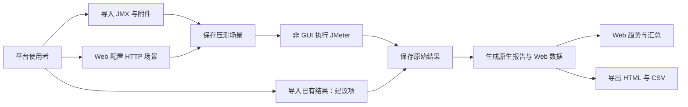
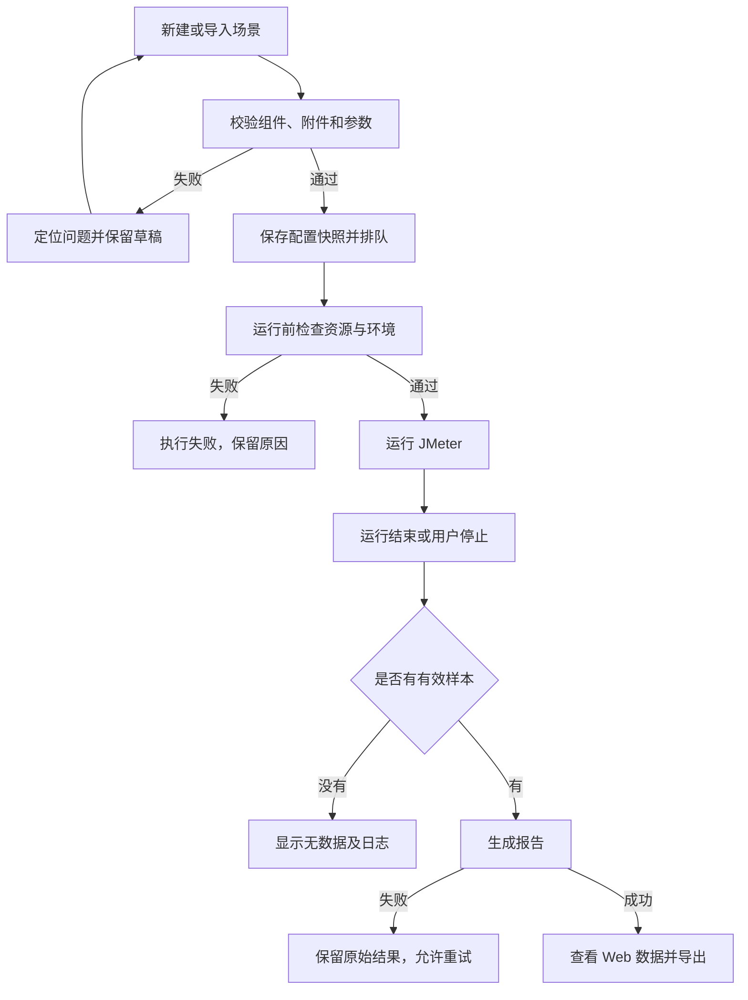
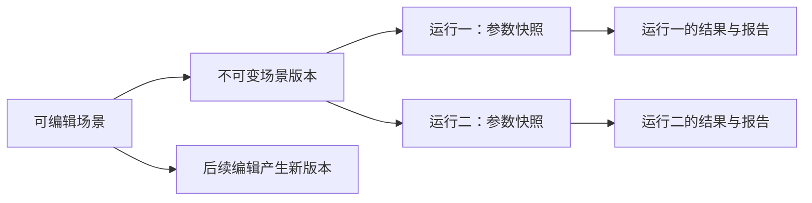
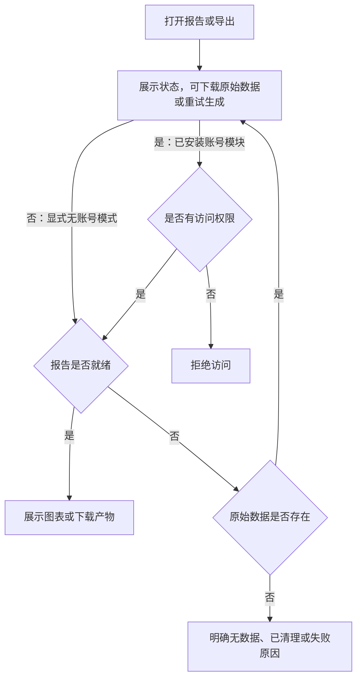

# 首版功能规范

> 状态：草稿
> 最后更新：2026-10-19
> 适用范围：以开源为基准的 Web 压测平台首版
> 关联文档：[说明](../说明.md)、[技术与数据规范](技术与数据规范.md)、[界面与交互规范](界面与交互规范.md)、[首版实施规划](首版实施规划.md)

## 一、目标与确认状态

**全部功能以开源核心为基准设计。** 开源使用者能够配置自己的数据库、缓存和存储并运行完整闭环，公司账号、网络和业务系统属于可选集成；Docker 等部署扩展见[开源基准与部署扩展规范](开源基准与部署扩展规范.md)。内部场景先使用该开源核心，不另建一套默认依赖公司的业务模型。

已确认：首版以 HTTP/HTTPS API 为主，支持 JMeter 脚本导入与 Web 配置，交付 Web 趋势图、汇总数据、HTML 报告和 CSV 导出。后续扩展审计数据。

补充确认：平台登录和权限实现暂缓；后续可选开源版自建账号权限或公司集成版复用公司体系。账号模块必须与压测/报告核心分离，支持被删除或不安装；无账号模式仍能完整压测、查看报告和导出。当前规划预留身份、权限和审计数据，详见[账号权限与审计扩展规范](账号权限与审计扩展规范.md)。本文“请求认证”指被测 HTTP API 的 Basic/Bearer 等参数，与平台登录是不同功能，不因平台账号模块移除而受影响。

本文具体组件清单、单节点限制、结果导入和报告时效均为建议，仍需与用户讨论确认。

首版完成后，使用者能够完成“准备场景 → 发起执行 → 查看结果 → 导出”的闭环。平台不需要先建设完整的测试管理体系。

## 二、产品全景

此图说明首版用户入口、平台能力和结果产物。

## 三、建议的首版功能范围

| 能力 | 首版建议要求 | 边界 |
| --- | --- | --- |
| 场景管理 | 新建、保存、复制、列表、详情、归档 | 首版单一空间，不预设公司组织层级 |
| JMX 导入 | 上传 JMX、CSV 等附件，识别依赖与兼容问题 | 不承诺任意插件和任意脚本都可执行 |
| Web 新建配置 | 基础 HTTP 请求、负载、变量、断言、CSV 参数化 | 不做完整 JMeter 组件树编辑器 |
| 执行管理 | 启动、排队、状态查询、日志、停止、再次执行 | 单执行节点，默认并行执行数为 1 |
| 历史记录 | 每次运行独立记录、配置快照与结果 | 修改场景不会改写已有运行 |
| 报告 | 常用 Web 图表、统计表、错误分布、原生报告入口 | 完成后生成完整报告，实时趋势待确认 |
| 导出 | HTML 报告 ZIP、汇总 CSV、原始结果 CSV/JTL | PDF、XLSX、图表图片不是当前默认范围 |
| 既有结果导入 | 导入 CSV 编码的 JTL/CSV，生成报告 | 建议项；首版不支持 XML JTL 转换 |

### 1. 导入与配置能力分层

必须区分“可导入保存”“可执行”“可在 Web 编辑”，三者分别给出结果，不能用“导入成功”暗示全部兼容。

| 类型 | 建议行为 |
| --- | --- |
| 原生基础 HTTP JMX | 保存原文，校验后执行；展示结构摘要 |
| 标准线程组 | 在运行副本中按指定线程组覆盖线程数、启动时间、循环或持续时长 |
| 显式参数化脚本 | 支持通过 `__P` 等属性入口传参；界面列出参数值与生效位置 |
| 多线程组 | 逐组配置，不将一个全局并发数静默覆盖所有线程组 |
| 自定义线程组或插件 | 提示缺少组件或不支持编辑；只有固定运行环境验证通过才允许执行 |
| Groovy、JSR223、外部进程类组件 | 首版建议默认阻止在线执行，待明确受信脚本与隔离策略后开放 |
| CSV、数据文件、证书等依赖 | 展示依赖清单与映射；缺少依赖时阻止启动 |
| JDBC 等非 HTTP 组件 | 不纳入首版 Web 新建配置；导入执行兼容范围另行确认 |

原始 JMX 始终可下载。任何运行参数覆盖只作用于独立运行副本，不能破坏原文件。复杂脚本可继续在桌面 JMeter 编辑后重新导入；不要求任意 JMX 与表单无损双向转换。

### 2. Web 配置器建议范围

- 一个基础标准线程组，多个按顺序执行的 HTTP 请求；支持请求启停与排序。
- 方法、协议、主机、端口、路径、查询参数、请求头、JSON 或文本请求体。
- 认证先支持 Bearer Token 与 Basic Auth；支持 Cookie 管理、重定向配置。
- 连接超时、响应超时；并发线程数、启动时间；循环次数或持续时长二选一。
- 用户变量与环境变量，支持引用；敏感值界面遮蔽、保存与导出规则见技术规范。
- CSV 数据集：列名、分隔符、编码、首行处理、文件结束行为、线程共享方式应明确。
- 基础断言：响应码、响应文本包含；基础 JSON 提取与变量引用，用于“登录 → 携带 Token 请求”等常见链路。
- 生成的 JMX 可下载，并能在锁定版本的桌面 JMeter 打开执行。

录制、任意脚本编辑、复杂分支控制器、自定义插件在线安装、复杂登录协议暂缓。

## 四、图表、数据和导出

### 1. 结果口径

以同一份结果文件、锁定的 JMeter 版本及报告属性所生成的原生 HTML Dashboard 为对照基准。Web 采用相同数据源与过滤规则，不自行定义另一套同名指标。

“趋势”在首版指一次运行内部随时间变化的数据。跨多次运行的性能趋势、基线对比和容量分析暂缓。

### 2. Web 页面重点图表

| 图表 | 主要用途 | 口径要求 |
| --- | --- | --- |
| 平均响应时间趋势 | 观察耗时是否随压测变大 | 单位毫秒；样本范围与原生对应图一致 |
| 响应时间分位数趋势 | 观察长尾耗时 | P90/P95/P99；原生对应时序图只统计成功样本，必须标明 |
| 每秒请求数 | 观察请求完成速率 | 对应 Hits per Second，不包含事务控制器样本 |
| 每秒事务数 | 观察按标签的事务速率 | 对应原生 TPS，区分成功/失败，不与请求速率混用 |
| 活跃线程数趋势 | 观察实际并发变化 | 标明观测值，不当成计划配置值 |
| 收发数据吞吐趋势 | 观察传输量 | 与原生字节吞吐图一致，单位在界面明确 |

支持按请求标签选择系列、图例开关、时间缩放和悬停查看。其他原生图表通过完整 HTML 报告查看；首版不要求全部重绘。

汇总表建议包含：样本数、失败数、错误率、平均/最小/最大响应时间、中位数、P90/P95/P99、吞吐量、接收与发送速率。错误表包含错误类型/响应码、数量与占比。能否直接取得中位数等字段须在报告适配验证中逐项确认；缺项不得用猜测值补齐。

总计行遵循原生统计，不能把标签行简单相加后计算百分位。事务控制器、HTTP 子请求等会影响计数，界面应显示当前报告的过滤口径。

### 3. 导出要求

- HTML：下载包含本地资源的完整 ZIP；解压后能离线查看，不依赖平台会话或公网 CDN。
- 汇总 CSV：UTF-8，列名带清晰单位，导出与页面相同筛选条件的数据，并携带运行和口径信息。
- 原始结果：保留并下载 CSV 格式 JTL；仅声明平台实际采集到的字段，不把汇总 CSV 当作原始结果。
- 敏感运行参数不随常规报告导出；原始数据下载遵守访问控制，参见技术规范。
- 导出失败可重试；报告生成失败不删除原始数据，可在同一原始结果上重新生成。

## 五、核心使用流程

此图说明从场景到报告的正常路径和阻断条件。

此图说明历史结果为什么不受场景后续编辑影响。

此图说明报告和导出的结果状态与可选权限入口；不安装账号模块时仍支持完整读取与导出。

## 六、明确暂缓

分布式压测、平台账号登录与权限实现、多租户与复杂组织权限、完整测试用例管理、接口 Mock、UI 自动化、录制、定时压测、消息中间件、监控平台集成、服务器 CPU/内存/数据库指标采集、审计查询分析中心、跨次运行对比、PDF/XLSX 报告。账号、资源动作和审计事件的规划预留不属于暂缓内容，必须在设计中保留。

JMeter 请求数据不等于被测服务的机器监控或业务审计数据。后续扩展时单独定义采集来源与权限，不将这些数据宣称为原生 JMeter 自动提供。

## 七、业务验收建议

- [ ] 给定基础 HTTP JMX 和附件，导入后能显示兼容结果，并在校验通过后执行。
- [ ] 给定 Web 创建的登录与业务请求，变量提取及引用生效，生成 JMX 能在锁定版本的桌面 JMeter 使用。
- [ ] 给定多线程组脚本，参数覆盖只影响用户选择的组，原文件摘要保持不变。
- [ ] 同一结果文件生成原生报告与 Web 报告，六类图表和汇总项按约定口径匹配。
- [ ] 完成、停止、启动失败、无样本、报告失败各有独立可理解的状态；错误率大于零不直接等同于执行器失败。
- [ ] HTML ZIP 解压后可以离线查看；CSV 与页面数值及筛选条件一致。
- [ ] 修改场景并再次执行后，历史报告仍对应原有快照。
- [ ] 不安装或移除账号权限模块后，导入、新建、运行、停止、报告及导出完整可用，已有历史不会因账号表缺失而不可读取。
- [ ] 在不接入公司网络、账号或私有依赖的通用环境，仅配置使用者自己的基础服务，就能完成同样闭环；公开示例中无公司连接信息。
- [ ] 如确认结果导入功能，CSV JTL 可以直接生成报告；XML 或缺列文件给出明确错误。

## 八、下一轮需要讨论

1. Web 配置器清单是否足够，尤其登录 Token 提取、CSV 参数化是否首版必需？
2. 完整图表在压测结束后生成是否可接受；是否要求运行中的实时趋势？
3. 是否纳入已有结果导入；导出的 CSV 是只要汇总还是也要原始样本？
4. 第一批实际 JMX 用到了哪些插件、脚本和附件？需用脱敏样本界定兼容范围。

## 九、参考项目对照

2026-10-16 补查 MeterSphere `v2.10` 部分源码，固定提交 `72678e9e7d7e2ef756401910c365f6c7b209221b`。源码通过只读远程访问查阅，未克隆、修改或运行该项目。以下区分已核实的参考与我们自己的首版建议。

| 参考项 | 已读来源与事实 | 本项目采用或调整 |
| --- | --- | --- |
| JMX 加载和线程组展示 | [基础配置页面](https://github.com/metersphere/metersphere/blob/72678e9e7d7e2ef756401910c365f6c7b209221b/performance-test/frontend/src/business/test/components/PerformanceBasicConfig.vue#L9)，有 JMX 加载入口与线程组列表 | 保留导入入口；首版先支持标准线程组，不默认继承其自定义线程组范围 |
| 压力配置 | [压力配置页面](https://github.com/metersphere/metersphere/blob/72678e9e7d7e2ef756401910c365f6c7b209221b/performance-test/frontend/src/business/test/components/PerformancePressureConfig.vue#L43)，按线程组配置并发与持续/迭代模式 | 导入模式按组选定覆盖；Web 新建先覆盖基础模式 |
| 场景保存及脚本导出 | [性能测试控制器](https://github.com/metersphere/metersphere/blob/72678e9e7d7e2ef756401910c365f6c7b209221b/performance-test/backend/src/main/java/io/metersphere/controller/PerformanceTestController.java#L88)，存在保存、编辑、读取与导出 JMX 入口 | 独立设计场景版本和运行快照；不直接复制它的接口路径或数据结构 |
| 报告组织 | [报告页面](https://github.com/metersphere/metersphere/blob/72678e9e7d7e2ef756401910c365f6c7b209221b/performance-test/frontend/src/business/report/PerformanceReportView.vue#L102)，包含请求统计、错误样本、报告导出入口 | 采用概览、趋势、统计、错误的阅读顺序，具体视觉参考 TabTin |
| 请求统计列 | [请求统计组件](https://github.com/metersphere/metersphere/blob/72678e9e7d7e2ef756401910c365f6c7b209221b/performance-test/frontend/src/business/report/components/RequestStatistics.vue#L83)，含 P90/P95/P99、事务速率及收发量 | 统计项参考成熟报告，数值与算法基准以 JMeter 原生 Dashboard 为准 |
| 导出形式差异 | [请求统计导出](https://github.com/metersphere/metersphere/blob/72678e9e7d7e2ef756401910c365f6c7b209221b/performance-test/frontend/src/business/report/components/RequestStatistics.vue#L3)为 Excel，[报告页](https://github.com/metersphere/metersphere/blob/72678e9e7d7e2ef756401910c365f6c7b209221b/performance-test/frontend/src/business/report/PerformanceReportView.vue#L157)使用 PDF 导出工具 | 用户要求 HTML 与 CSV，因此本项目的导出方案另行设计，不宣称完全复刻其导出 |
| 权限与操作审计 | [保存/编辑入口](https://github.com/metersphere/metersphere/blob/72678e9e7d7e2ef756401910c365f6c7b209221b/performance-test/backend/src/main/java/io/metersphere/controller/PerformanceTestController.java#L89)使用权限及审计注解 | 参考统一入口的职责分离，规划自有身份与审计边界；当前不实现账号权限，不复制其注解体系 |
| 基础设施 | [V2.10 说明](https://github.com/metersphere/metersphere/blob/72678e9e7d7e2ef756401910c365f6c7b209221b/README.md)列出 Kafka、MinIO、分布式等相关技术与能力 | 按用户约束使用 MySQL、Redis、本地文件，无消息中间件；单节点执行和报告适配均为本项目建议 |

尚未核实：完整运行环境、引擎内部调度、实时指标管线与算法实现、全部插件兼容、全部异常恢复行为。当前六类图表、已有结果导入、首版容量和缓存策略不应被描述为已从 MeterSphere 完整验证后搬迁。
