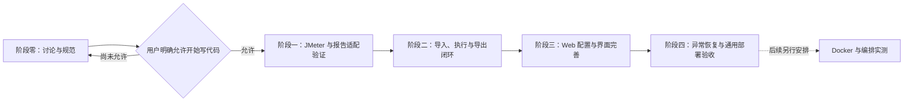
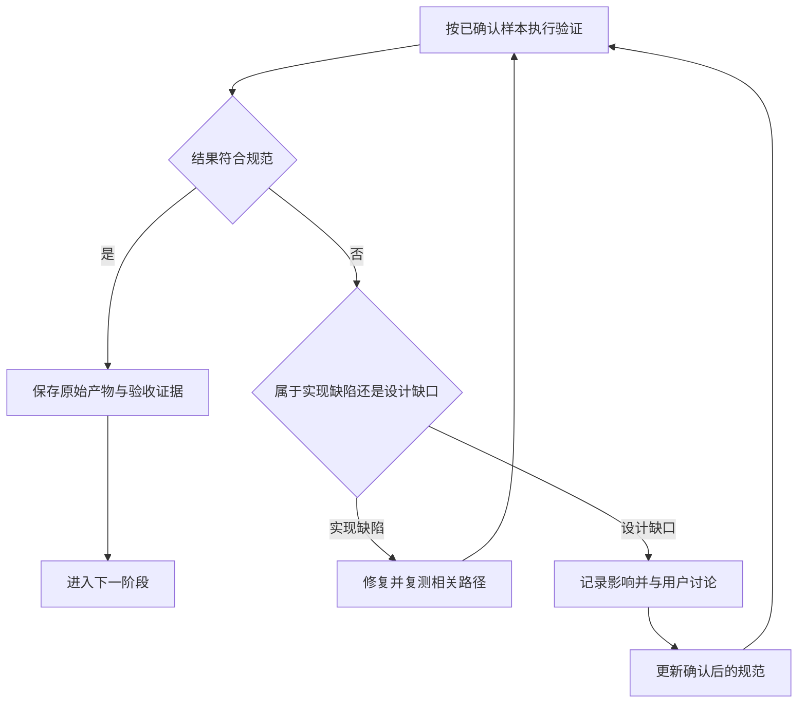

# 首版实施规划

> 状态：草稿
> 最后更新：2026-10-19
> 适用范围：以开源为基准的压测平台首版需求收敛、技术验证与分阶段交付
> 关联文档：[说明](../说明.md)、[首版功能规范](首版功能规范.md)、[技术与数据规范](技术与数据规范.md)、[界面与交互规范](界面与交互规范.md)、[账号权限与审计扩展规范](账号权限与审计扩展规范.md)

## 一、当前阶段与计划性质

**全阶段以开源核心为设计、交付与验收基准。** 公司接入为可选适配，当前数据库实例只作为开发配置。Docker 等未来部署的边界需要从设计与核心实现开始预留，具体容器交付时间待定，详见[开源基准与部署扩展规范](开源基准与部署扩展规范.md)。本轮继续只修改文档。

2026-10-16 首轮检查 `/Users/yang/Documents/project/deep-jmeter/` 为空目录；本轮检查已存在 `.git/` 和 `README.md`，尚无前后端工程、数据库迁移和测试。本轮未初始化产品仓库或创建产品代码。本文工程路径均为拟建位置，不代表已有实现。

**2026-10-19 用户已明确授权开始开发。** 阶段零的禁止开发限制解除，按[首版开发执行计划](../代码执行计划/2026-10-19-首版开发执行计划.md)执行；每完成可验证阶段本地提交，提交记录和 README 默认中文。

本文是讨论用的阶段规划，不是已批准的代码执行计划。待需求收敛且用户授权开工后，再建立 `代码执行计划/`，根据当时工程现状写明具体文件、符号、接口和验证命令。

## 二、交付全景与依赖

此图说明各阶段产出以及显式开工门槛。

## 三、阶段零：只做文档与讨论

本阶段不初始化工程、不执行压测、不创建产品数据。

1. 整理已确认要求，明确 JMX 导入、Web 配置和已有结果导入的差别。
2. 与用户确认首版图表、导出、配置组件范围和是否需要实时趋势。
3. 确认已有 JMX 的插件/脚本/附件情况，记录兼容清单；只检查脱敏资料。
4. 将给定 MySQL/Redis 环境作为开发依赖，讨论项目库、缓存隔离、单节点容量、应用/执行器部署位置和本地存储；本阶段不连库、不建库。
5. 确认界面信息架构与风格，必要时补充静态页面线框说明；明确核心、可选账号、可选审计的依赖及无账号发行方式。
6. 将讨论结果同步至规范，保留未决项；用户允许开始写代码后才进入下一阶段。

开源基准、无公司依赖和未来 Docker 部署边界是本阶段必须写清的约束；本阶段不创建 Dockerfile、Compose、镜像或容器实例。内部连接信息集中维护在单独附录，不进入通用示例。

## 四、授权后的分阶段交付建议

### 1. 引擎与报告适配验证

- 拟议位置：后端工程内的引擎与报告模块及脱敏验证样本；具体目录在代码执行计划中确定。
- 验证内容：JDK 21 下锁定版本的 JMeter 启动、基础 HTTP 执行、停止、JTL 与 HTML 生成、图表与统计数据读取。
- 重点：Web 六类图表、统计列是否可以从原生输出稳定取得；事务控制器和成功样本过滤能否保持一致；HTML ZIP 能否离线打开。
- 输出：兼容矩阵、报告适配方式、实际性能测量、依赖锁定和必要的规范修订。
- 通过条件：已约定样本能生成原生报告并映射到 Web 数据模型。若失败，先与用户讨论调整，不自行更换验收口径。

### 2. 导入、执行、报告和导出闭环

- 拟议位置：`backend/` 的场景、资产、运行、报告模块；`frontend/` 的列表、导入、运行详情与报告详情。
- 具体内容：MySQL 数据模型与迁移、本地资产目录、Redis 可回源缓存、MySQL 任务领取、独立 JMeter 进程、报告处理和受控下载。
- 第一条闭环：导入基础 JMX 与附件 → 校验 → 排队执行 → 状态与日志 → 原生报告 → Web 图表 → HTML/CSV 导出。
- 依赖：阶段一通过；支持组件与部署资源已明确。平台认证接入不作为当前核心功能前置，只按已确认的扩展边界预留身份与审计信息。
- 通过条件：真实运行产生真实报告，历史配置可追溯，导出离线可用；不使用假数据替代引擎结果。
- 模块要求：先保证不安装账号/角色表和认证依赖即可完成闭环；核心只接收可缺省操作者与通用事件，账号/审计扩展的缺失不能阻断启动和报告处理。
- 开源与部署边界：所有基础服务地址、数据目录、引擎路径和资源预算从外部配置注入；产物保存受控相对路径；应用有就绪与限时退出行为，后续 Docker 包装沿用相同核心。
- 若确认已有结果导入，在此阶段增加结果导入到同一报告流程，避免重复实现统计。

### 3. Web 配置与界面完善

- 拟议位置：`frontend/` 场景编辑与公共组件；`backend/` 配置校验与 JMX 生成模块。
- 具体内容：基础线程组、HTTP 请求列表、认证、变量、CSV、基础断言与 JSON 提取；按确认清单控制范围。
- 与导入模式分开保存来源，不能将未支持的导入节点经过表单保存后丢弃。
- 依赖：阶段二的执行与报告闭环稳定。
- 通过条件：Web 创建的场景能够下载 JMX 并在锁定版本的桌面端执行；视觉与交互通过用户评审。

### 4. 异常恢复与部署验收

- 拟议位置：前后端错误处理、任务恢复、本地存储清理和部署配置；脚本和具体位置在执行计划中确定。
- 具体内容：重复启动、排队取消、运行中停止、报告重试、后端重启、Redis 故障、MySQL 故障、磁盘不足、缺附件、损坏结果与无样本。
- 依赖：前述功能范围完成，负载规模与性能阈值已约定。
- 通过条件：运行状态与进程/产物一致，控制服务在目标压测负载下可用，备份恢复和持久化部署经验证。
- 交付：部署与使用说明、支持组件清单、限制清单、验收记录和后续迭代项。必须验收不包含账号模块的核心构建；是否使用内置或公司账号由部署者显式选择，不将安装账号作为核心发行前置。
- 开源验证：使用不含公司网络、SDK、私有依赖和账号表的环境，仅配置独立基础服务完成全流程；当前进程部署先验证配置、可搬移的数据目录和退出契约。公司环境运行成功不能代替通用验证。

### 5. 后续容器化部署扩展

- 实施时间：待用户后续确认，不纳入本轮文档任务或自动增加到首版交付承诺。
- 拟议范围：产品目录内的镜像与部署资料，具体路径在对应执行计划中确定；支持外置配置、外部 MySQL/Redis、持久卷、端口与退出信号。
- 前置：核心的配置、路径、执行和生命周期边界已落实；镜像组织与支持架构已讨论确认。
- 通过条件：容器替换后历史产物仍在，信号可正确结束子进程，Web/原生报告与导出行为不变；容器部署不依赖公司平台或强制挂载 Docker Socket。
- Compose、Kubernetes 与独立任务容器按后续需求分别规划，不在此提前部署。

## 五、验证流程与重点

此图说明发现差异时如何处理，避免未经讨论改变范围。

| 层次 | 应验证什么 |
| --- | --- |
| 单元与契约 | 配置校验、线程组覆盖、状态转换、幂等规则、报告适配；不为简单样式编写镜像实现的测试 |
| 集成 | MySQL 领取与恢复、Redis 故障回源、本地文件一致性、真实 JMeter 调用与报告生成 |
| 端到端 | JMX 导入到导出、Web 新建到导出、历史不受编辑影响、停止与部分结果 |
| 兼容对照 | 同一原始结果下 Web 与原生 Dashboard 对照；生成 JMX 在桌面端打开执行 |
| 模块可移除性 | 核心构建排除账号产物与依赖，数据库无账号表，前端无用户接口；全流程及历史读取正常。已有扩展移除后核心迁移校验仍通过 |
| 开源与可部署性 | 无公司依赖的通用构建和闭环，外置配置、数据目录搬移、就绪/退出行为；容器阶段再验证镜像、挂载与信号，不提前声称已支持 |
| 非功能 | 约定负载规模下的资源占用与响应、敏感数据、磁盘配额、备份恢复；权限接入后再增加完整鉴权验收 |
| 视觉 | 与实际 TabTin 参考对照、中文与长文本、表格/图表可读性、焦点和错误反馈 |

具体负载样本、报告耗时和响应时间阈值目前未确认，需在相关阶段开始前确定，不能使用未约定指标宣布验收完成。

## 六、发布、迁移与回退建议

- 首版部署包固定前后端、JMeter 与报告适配版本；本地数据目录独立持久化。
- 数据库使用有版本的迁移。发布前备份 MySQL 与文件清单，停止领取新任务并等待或明确停止已有任务。
- 首版优先使用向后兼容的新增结构；不可逆迁移前单独评估回退方式。
- 回退时同时检查应用、数据库结构、报告适配器与文件格式兼容；不能只换旧镜像就宣称完成回退。
- 保留原始 JMX、JTL 和运行元数据，报告可重新生成；恢复后核对文件摘要、归属和运行状态。
- 升级时不自动重跑历史压测，避免产生重复压力。
- 未来镜像升级复用相同数据与迁移规则，镜像/应用与数据分离；内部环境附录和真实配置不进入开源源码、示例或镜像发布清单。

## 七、讨论清单

| 事项 | 当前建议或状态 | 影响 |
| --- | --- | --- |
| HTTP 与报告形式 | 用户已确认 | 功能基线 |
| JDK、MySQL、Redis、本地存储、无消息中间件 | 用户已确认 | 架构约束 |
| 统一开源基准 | 2026-10-19 用户已确认，适用于全部规划与规范 | 公司适配可选，默认构建与验收不依赖公司环境 |
| Docker 等部署扩展 | 已确认必须预留边界；镜像、编排和交付时间待定 | 外部配置、持久数据、执行器及生命周期先纳入设计 |
| 现有 MySQL/Redis 实例 | 用户已提供，连接约定见技术规范；未验证连通性 | 无需重建基础设施，需隔离本项目数据 |
| React/TypeScript 与后端框架 | 建议选型，待整体确认 | 工程与人员适配 |
| 运行时趋势 | 先状态与日志，结束后完整报告 | 实时采集与统计工作量 |
| Web 配置组件 | 见功能规范，待确认 | 配置器大小与场景覆盖 |
| 已有结果导入 | 建议纳入，待确认 | 无需平台执行即可使用报告 |
| 执行规模 | 单执行节点、一次一个任务为建议 | 调度、机器资源与后续拆分 |
| 身份与权限 | 用户确认当前暂缓；未来可选本地账号或公司体系适配 | 当前只规划统一操作者、权限入口和审计扩展，无账号核心独立可用 |
| 账号模块可移除性 | 用户已确认硬约束，开源使用者可不安装账号模块 | 编译、装配、前端、数据迁移和运行验收均须覆盖 |
| 脚本与插件 | 固定受控环境，具体清单待核实 | 导入兼容与运行隔离 |
| 文件期限与容量 | 待确认 | 本地磁盘与恢复成本 |
| 审计数据 | 已确认未来需要；先预留平台操作审计，被测系统业务审计是否纳入仍待确认 | 后续采集范围、留存和查询设计 |
| 开始写代码 | 2026-10-19 已授权 | 按阶段验证和本地中文提交，不自动推送或公开发布 |

## 八、首版完成标准建议

- [ ] 需求边界已讨论确认，且已经单独获得开工许可。
- [ ] 约定 HTTP 场景能通过 JMX 导入和 Web 配置两条路径运行。
- [ ] 六类重点图表、汇总和错误数据通过原生对照验收。
- [ ] HTML 与 CSV 导出满足离线、口径和访问要求。
- [ ] 历史配置可复现，停止、失败、部分结果与报告重试行为可解释。
- [ ] MySQL、Redis 和本地存储部署符合约束，无消息中间件。
- [ ] 两版共用核心的身份与审计扩展边界符合规范，未认证历史不被伪造成实名记录；当前不要求实现账号权限。
- [ ] 核心发行不含账号模块、账号表或认证依赖也能完成压测到导出的闭环；移除账号后历史可用，审计可独立选择安装。
- [ ] 开源基准的通用构建与闭环通过，公开配置无公司连接信息；配置、存储与生命周期满足后续 Docker 包装要求，容器实测阶段单独记录。
- [ ] 约定容量、异常恢复、备份恢复和界面验收通过。
- [ ] 未做能力与后续审计等扩展项有明确记录，相关规范和使用说明同步。
