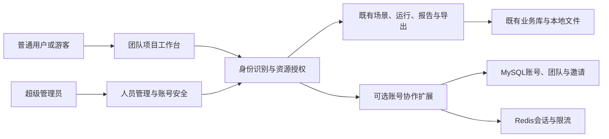
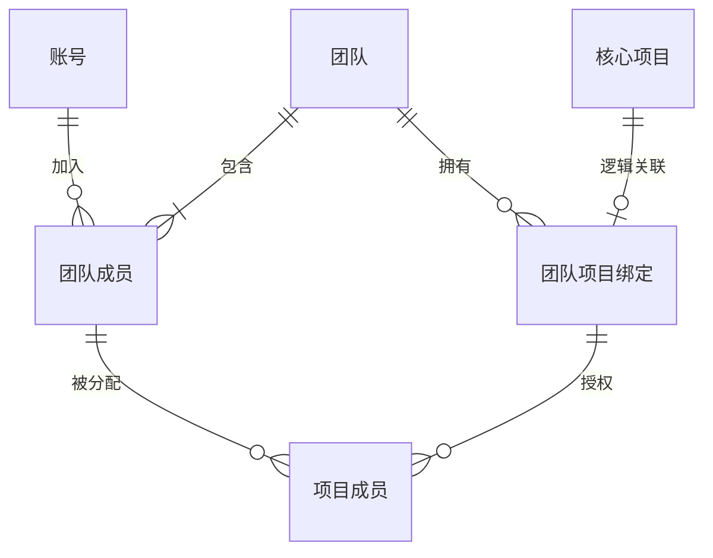
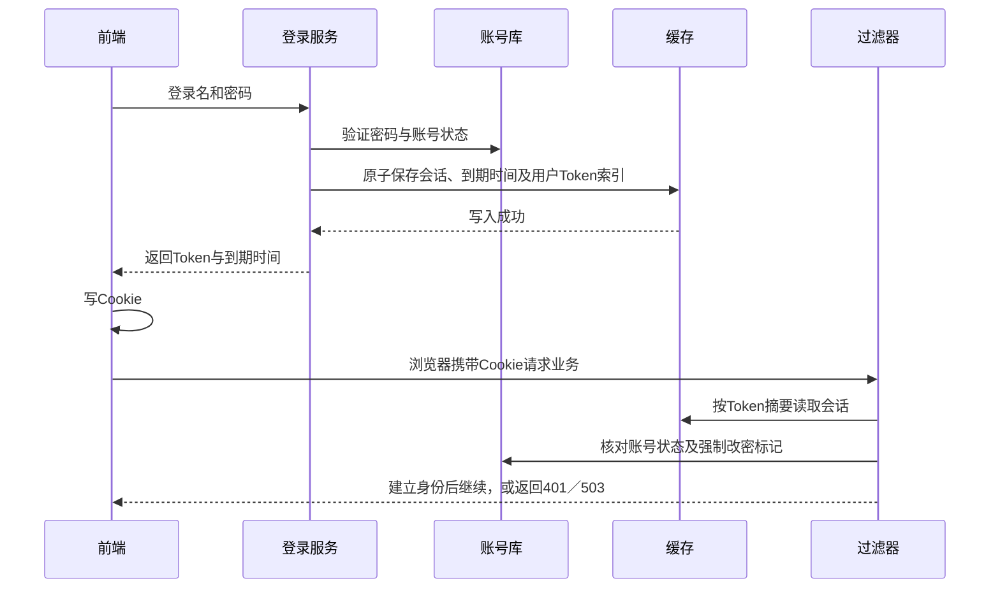
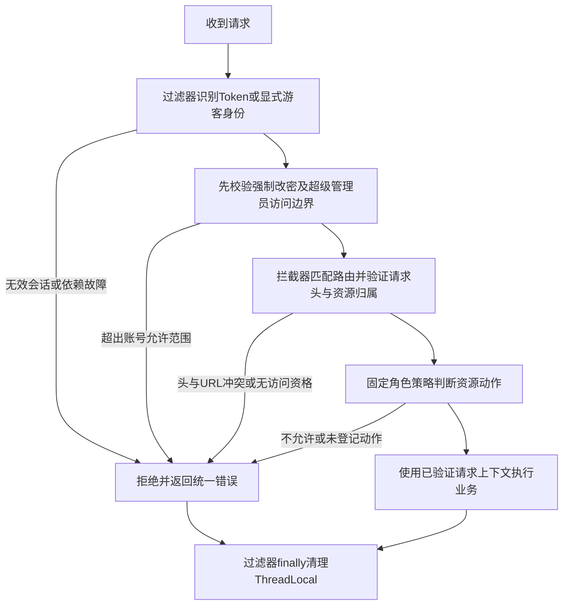

# 账号与团队项目规范

> 状态：草稿，账号登录已实现，其余待执行
> 最后更新：2026-10-23
> 适用范围：本轮账号权限迭代；登录实现见执行进度，其余建议待实施
> 关联文档：[迭代说明与执行计划](../说明.md)、[既有扩展边界](../../规划/账号权限与审计扩展规范.md)

## 一、整体边界与页面

此图说明账号扩展与既有压测能力的关系。

- 首屏左侧直接列出已加入团队及“新建团队”；右侧直接展示默认或当前团队内有权访问的项目卡片，提供新建项目，不设置团队卡片总览或“团队概览”中间页。团队页项目分类与邀请入口合并为一行页签；当前为“全部项目、最近访问、已归档、邀请管理”，成员及团队设置按后续计划接续，角色说明只读展示。
- 超级管理员登录后进入“人员管理”，侧栏仅保留人员管理、账号安全等业务入口；个人中心和退出登录统一放在右上角头像菜单；角色分配页只展示必要的团队／项目名称及成员角色，不提供项目进入链接、场景／任务／报告入口。
- 点击项目进入既有场景／任务／报告工作区，顶部显示“团队 / 项目 / 模块”，侧栏可返回团队。切团队或项目前保留既有未保存确认，取消旧请求、轮询和跨页勾选。
- 最近团队／项目仅作浏览器导航偏好，按部署与用户隔离；不作为授权依据。不向无项目权限的普通成员泄露其他项目名称、数量和成员。
- 合适处优先使用策略模式：身份识别与固定角色授权各有独立策略，账号模式、游客模式、显式无账号模式明确装配，禁止凭组件缺失或 Redis 故障自动选择宽松策略。角色权限使用固定映射即可，不建设通用权限规则引擎。

### 界面风格与复用约束

用户已明确：**当前 deep-jmeter 已实现的 UI 是首要依据**，再参考[平台界面规范](../../规划/界面与交互规范.md)与 TabTin Mac 客户端的细节。原规范中的早期建议数值与现有实现不一致时，以当前工作台为准；Apifox 截图只确定团队／项目的信息组织，不引入其品牌配色。

| 范围       | 本轮执行要求                                                                                                                                                                                                     |
| ---------- | ---------------------------------------------------------------------------------------------------------------------------------------------------------------------------------------------------------------- |
| 配色与字体 | 复用 `frontend/src/styles/global.css` 的系统字体、暖灰画布、白色工作区和蓝色主动作；当前画布 `#f6f6f4`、主色 `--blue: #477bd0`、正文 `#292b2e`。沿用原字号层级、圆角和语义色，不新增账号专用主题                 |
| 页面骨架   | 保持现有固定外框、40px 顶部层级、侧栏和内部内容滚动；团队列表在既有侧栏中扩展，项目卡片保持原布局；场景／任务／报告及新增成员／邀请表格沿用紧凑密度、对齐和每页 10 条的规则                                      |
| 组件       | 页签复用 `components/TabBar.tsx`，层级复用 `Breadcrumbs.tsx`，危险操作及放弃修改复用 `ConfirmDialog.tsx`；表单、按钮、表格、菜单与状态提示沿用现有 CSS。缺少控件时提炼共享组件，不在各账号页重复画同类控件       |
| 登录与注册 | 按用户提供的 TabTin 完整登录页截图采用左侧产品展示、右侧账号表单；浅色画布、克制蓝色和原品牌。登录／注册使用分段切换、图标输入框、密码显隐及字段旁校验；两种页面均不滚动，控件完整落在视口内；改密保留工作台布局 |
| 团队与人员 | 团队页延续现有项目卡片；成员／待定邀请采用同密度工具栏、页签、表格和分页，成员详情用统一白底浮层与项目角色表；邀请接受页沿用登录表单的宽度与操作布局                                                             |
| 游客与异常 | 复用既有项目、编辑器和报告页，只增加克制的演示提示及受限反馈；加载、空态、无权、过期与保存失败使用统一状态区，不额外搭建一套演示界面                                                                             |

超级管理员的账号表、导入预检、角色分配和安全设置同样使用现有工具栏、表格、确认弹窗与 `SettingsForm`，每页 10 条；首次改密复用既有账号表单，不新建一套管理后台视觉。

TabTin 参考根目录为 `/Users/yang/Documents/larchiveai/TabTin/`，本次只读核实于提交 `7148295cc6` 的当前工作区：

| 已核实来源                                                                                                         | 仅参考的细节                                         |
| ------------------------------------------------------------------------------------------------------------------ | ---------------------------------------------------- |
| `apps/tabtin-electron/src/renderer/src/styles/globals.css` 的基础主题变量                                          | 暖中性层次、浅灰侧栏、白色主区、克制蓝色及浮层轻阴影 |
| `apps/tabtin-electron/src/renderer/src/components/layout/sidebarUi.ts` 的 `SIDEBAR_ROW` 等常量                     | 紧凑导航、统一图标槽与文字对齐、长名称截断和弱悬停   |
| `apps/tabtin-electron/src/renderer/src/components/tabcode/components/TabCodeSidebarStack.tsx` 的 `sidebarTabClass` | 浅色选中背景、清晰文字层级、低强调页签与内部滚动     |

不移植 TabTin 的 Electron／Tailwind 体系、客户端缩放和整套视觉资源。本次核实为源码参考，未启动 TabTin 做视觉比对。后续实现前先留存当前压测平台的浏览器截图及组件复用清单，再按四份计划实现；完成时逐页与现有页面对照，覆盖桌面与窄屏、键盘焦点、长名称及各异常状态，并保存截图证据。任何新增样式须说明现有组件不能覆盖的具体原因，禁止执行时自行重设计主视觉。

本人资料及密码管理统一放在“个人中心”，通过右上角头像菜单进入；个人中心与退出登录不再占用侧栏。项目页JMeter连接／版本状态放在顶部栏，不在侧栏底部额外占行；首次强制改密仍在统一工作台内优先展示。网站页签采用用户提供的无字Logo，其余页面品牌采用带字Logo；SVG资源沿用原图案，不重新设计；去掉白色底层，并以SVG透明处理去除内嵌图的白底，保持原图案的位置和轮廓。

2026-10-23 登录页补充：此前只读参考的 TabTin `AuthDialog.tsx` 与 `LoginForm.tsx`（HEAD `7148295cc6`）仅覆盖认证表单细节，居中卡片方案已被用户否定。本次以用户补充的完整 TabTin 登录页截图确定整体布局，并按后续指令将产品展示放左侧、输入与提交放右侧。展示区的标题、指标、折线图和底栏分别占位，减少重复文案，明确标注“示例数据 · 产品预览”；不冒充当前项目的实时数据。

登录与注册固定视口、禁止页面和表单滚动，通过缩小品牌、控件间距及较矮窗口下的两列表单适配实际高度，不能仅隐藏滚动条后裁切操作。窄屏或极矮窗口隐藏装饰展示区，保留完整账号表单；登录Logo尺寸独立于工作台侧栏断点。不引入 TabTin 的手机号验证码、记住密码或找回密码流程。验证结果及尺寸见[登录页验证记录](../验证记录/2026-10-23-登录页界面验证记录.md)。

## 二、团队、项目与角色

此图说明账号多团队、项目单团队和项目成员的关系；这些均属于可选扩展的协作关系。

账号分为内置超级管理员和普通账号，团队／项目角色只分配给普通账号。团队角色为所有者、管理员、普通成员；项目角色为管理员、编辑者、执行者、只读成员。一个团队恰有一个所有者，项目可有多个管理员；同一人在不同团队、项目可以有不同角色。

| 团队角色 | 权限包                                                                                     |
| -------- | ------------------------------------------------------------------------------------------ |
| 所有者   | 团队全部管理、设置团队管理员、转移所有权，继承团队全部项目的管理员权限                     |
| 管理员   | 修改团队名称、创建项目、邀请／移除普通成员、分配普通成员的项目角色，继承全部项目管理员权限 |
| 普通成员 | 查看自己的团队基本信息；项目能力由逐项目分配的角色决定                                     |

团队内只有所有者可任免团队管理员，超级管理员可通过全局人员管理入口调整任何团队角色及所有权；团队管理员不能修改所有者或其他团队管理员。普通成员默认没有任何项目权限。“禁止访问”表示移除该项目角色，不另外设计拒绝角色；团队所有者／管理员的继承权限不能被项目级配置覆盖。

| 项目动作权限包                                       | 项目管理员 | 编辑者     | 执行者     | 只读成员 | 游客       |
| ---------------------------------------------------- | ---------- | ---------- | ---------- | -------- | ---------- |
| 浏览场景、运行和报告，搜索、筛选与切图               | 是         | 是         | 是         | 是       | 仅演示项目 |
| 修改／保存／复制／归档场景，上传脚本与附件，导入结果 | 是         | 是         | 否         | 否       | 否         |
| 启动已有场景                                         | 是         | 是         | 是         | 否       | 否         |
| 停止、取消任务                                       | 项目内全部 | 项目内全部 | 仅本人发起 | 否       | 否         |
| 重新生成报告                                         | 是         | 是         | 否         | 否       | 否         |
| 导出 HTML 报告与汇总 CSV，含批量导出                 | 是         | 是         | 是         | 是       | 否         |
| 下载 JMX、附件、原始 JTL 及执行日志                  | 是         | 是         | 否         | 否       | 否         |
| 修改公共参数                                         | 是         | 是         | 否         | 否       | 否         |
| 修改项目名称／设置、归档项目、管理项目成员           | 是         | 否         | 否         | 否       | 否         |

执行者仅选择已有的已保存场景版本并按现有配置运行，不能覆盖 URL、脚本、变量、并发、时长等运行参数，也不能从未保存草稿启动。后台可使用受保护的真实参数执行，返回给执行者的认证值仍脱敏；停止权限按持久化的发起用户标识判断，不能采信请求传来的发起人。

项目管理员只能为本团队已有普通成员分配本项目的四种固定角色，不能据此拉人入团队或修改团队角色。执行者／只读成员的场景、公共参数、运行快照中认证值须脱敏，其他详情接口不能绕过。项目归档后写操作统一拒绝，角色不能覆盖归档限制。

超级管理员不继承任何项目权限，不能加入团队、取得项目角色、创建团队／项目或进入任何项目业务；即使存在错误的成员关系也先拒绝其业务访问。账号安全设置属于人员管理职责，执行资源和全局压测策略仍由部署维护，具体展示见下文配置矩阵。本轮不做团队解散、跨团队迁移项目、SaaS 套餐或人数付费配额。

### 超级管理员与全局账号维护

- 仅内置账号 `admin` 使用 `SUPER_ADMIN` 类型，普通账号为 `USER`；注册、快捷创建、用户导入及角色分配均不能创建第二个超级管理员或把普通账号提升为超级管理员。本人可改密，不能删除、停用或降级内置管理员。
- 启用账号模块后，首次启动在账号建表完成、开始接收请求前插入 `admin`，初始密码为 `admin`，只存 Argon2id 摘要并设置 `must_change_password=true`。这是默认初始密码的唯一例外，正常设置的新密码仍须满足密码规则；无账号构建不插入该账号。
- 初始化采用唯一登录名与持久初始化记录保证幂等；重启不覆盖已改密码或账号状态。若成功初始化后管理员记录丢失，报错交由维护恢复，不重新生成默认密码账号；遇到普通账号占用保留名 `admin` 也不能擅自提权。
- 默认密码验证通过只发受限会话，除本人信息、改密、退出及公共启动信息外全部拒绝，返回 `403 PASSWORD_CHANGE_REQUIRED`；前端固定进入改密页，不能靠改路由跳过。改密成功清除标记、删除本人全部 Redis Token 并要求重新登录，之后才开放人员管理。
- 可搜索／快捷创建普通账号、修改昵称与启停状态、重置他人密码、解除他人临时登录锁定，以及导入导出普通用户。创建或重置的初始密码须符合规则，目标账号强制下次登录改密；重置／停用立即使旧会话失效，启用不恢复旧 Token。停用保留成员关系、所有权及历史任务，不自动重分配资源。
- 可给任意普通账号分配任意团队／项目角色；仅查询分配需要的团队、项目和成员元数据，不读取业务内容。分配项目角色时自动补齐缺少的团队普通成员关系；分配所有者必须执行唯一所有权转移事务，不能出现两个所有者或无人持有。操作记录目标、范围、变更摘要和结果，不记录密码。

## 三、账号登录与缓存会话

建议首轮采用“登录名 + 密码”，支持自助注册、退出和修改本人密码；注册是否开放由外置配置控制，建议默认开放。注册成功后原子创建该账号独立的默认团队与“示例项目”，登录后直接进入默认团队的项目列表；已有普通账号首次读取团队时幂等补齐，不认领原有未绑定项目。超级管理员不创建默认工作区，仍进入人员管理。暂不做邮箱短信验证、第三方登录、SSO、找回密码邮件；普通用户遗忘密码由超级管理员重置，管理员本人遗忘密码由部署维护流程恢复。

- 登录名规范化为小写，限 3～32 位字母、数字及下划线并唯一，`admin` 为保留名；昵称 1～40 字；新密码建议 12～64 个字符，使用 Argon2id 加随机盐保存，不记录明文。普通密码错误统一提示，不区分用户不存在与密码错误；失败次数、统计窗口及锁定分钟数按下一节参数执行，成功登录次数不触发锁定。
- 验证成功生成至少 32 字节安全随机的不透明 Token；Redis 键为 `${部署前缀}deep_jmeter_token:${Token的SHA-256摘要}`，每个 Token 独立保存，不能共用一个会被覆盖的固定键；值保存 `userId、issuedAt、expiresAt`。建议固定有效期 7 天，不滑动续期、不另发刷新令牌，允许多设备登录；账号和会话均使用 UTC 时间。
- Redis 同时维护 `${部署前缀}deep_jmeter_token:user:${userId}` 的 Token 摘要集合，令牌写入与索引登记原子完成，索引有效期覆盖该用户最晚到期会话。退出只删除当前 Token 并移除索引项；改密、管理员重置、停用直接删除该用户索引内的全部 Token 及索引，后续请求查不到 Token 即失效，不全库扫描或清空共享 Redis。
- MySQL 仅保存账号类型、状态和强制改密标记等账号数据；认证时核对最新状态及改密标记，团队、项目与角色按当前关系授权。登录最终校验及签发，与同一账号的改密／重置／停用通过账号行锁串行处理，避免旧密码并发登录在清理后遗留新 Token；Redis 清理失败时回滚本次账号修改并返回失败，不能宣称已撤销全部会话。Redis 已删 Token 无须回滚，数据库提交失败时重新登录即可。
- 公共启动信息只返回模式、注册／游客开关及演示标识，不返回安全策略具体值。登录响应为 `{ token, expiresAt, passwordChangeRequired }` 且 `Cache-Control: no-store`；前端写名为 `deep_jmeter_token` 的 Cookie，浏览器同源自动携带，过滤器统一读取。Cookie 不设置 Domain；Path 跟随应用根路径，例如 `/jmeter/`；SameSite=Lax，HTTPS 设置 Secure，到期时间不超过服务端会话，不另存 localStorage，不把 Token 放 URL。
- 按前端写 Cookie 的要求，该 Cookie 无法设置 HttpOnly。需落实脚本注入防护和内容安全策略；原生 HTML 报告在不开放同源能力的沙箱中展示，上传内容不能在应用同源直接执行。后续若改用 HttpOnly，需要服务端 Set-Cookie，属于另一种实现选择。
- 所有浏览器写请求，包括登录、邀请接受、上传和批量导出，校验可信同源 Origin 及统一自定义请求头 `X-DJ-Request: 1`，防止跨站请求伪造；不以 SameSite 单独代替防护。原生报告和下载的 GET 请求仍校验会话与资源权限，不依赖自定义请求头完成认证。

此图说明 Token 的生成、保存与后续请求路径。

Redis 写入失败不返回“登录成功”；会话丢失要求重新登录，缓存故障返回 503。已有 Token 无效时返回 401，不能静默转游客；用户可主动退出并进入演示。报告缓存仍可独立回源。

### 登录锁定与配置分级

复用已有 `SettingsServiceImpl`、`setting_sets`、`SettingsPage.tsx` 和 `SettingsForm` 的分类、字段校验、来源展示及乐观版本；新增账号扩展注册的“账号安全”类别，已使用 `ACCOUNT / global / security` 存储范围。核心不硬编码账号类别，移除扩展后不加载该类别。设置读取也须授权，只返回允许展示的类别及字段，不能把完整配置发给前端后再隐藏。

| 安全参数               | 建议默认值 | 范围与行为                                                         |
| ---------------------- | ---------- | ------------------------------------------------------------------ |
| `maxLoginFailures`     | 10 次      | 整数 1～100；窗口内连续失败达到此值即临时锁定                      |
| `failureWindowMinutes` | 15 分钟    | 整数 1～1440；从首次失败起计，未锁定时成功登录清零                 |
| `lockMinutes`          | 15 分钟    | 整数 1～1440；到期自动解锁并清零，也可由超级管理员解除普通用户锁定 |

失败计数与锁定使用带部署前缀的 Redis 键原子处理；锁定期间即使密码正确也拒绝，不延长锁定期限。已锁定账号返回 `423 ACCOUNT_LOCKED`，统一错误体补充 `retryAfterSeconds` 并设置 `Retry-After` 响应头；来源频率限制另行返回 429，不因账号解锁而绕过。超级管理员也适用失败锁定，不提供网页登录后门。策略修改对下一次登录判定生效，已形成的锁定保留原到期时刻；Redis 故障仍为 503。临时锁定不改 MySQL 的 ACTIVE／DISABLED 状态，账号停用不能因锁定到期而解除。

| 设置类别                           | 超级管理员 | 团队所有者／管理员     | 项目管理员   | 编辑者   | 执行者／只读成员 | 游客           |
| ---------------------------------- | ---------- | ---------------------- | ------------ | -------- | ---------------- | -------------- |
| 账号安全：失败次数、窗口、锁定时长 | 读写       | 隐藏                   | 隐藏         | 隐藏     | 隐藏             | 隐藏           |
| 系统执行与报告策略                 | 隐藏       | 有权项目内只读         | 只读         | 只读     | 只读             | 隐藏           |
| 项目默认值                         | 隐藏       | 继承项目管理员，读写   | 读写         | 只读     | 只读             | 仅示例值只读   |
| 项目公共参数                       | 隐藏       | 读写                   | 读写         | 读写     | 只读且敏感值脱敏 | 仅脱敏示例只读 |
| 运行环境                           | 隐藏       | 有权项目内必要摘要只读 | 必要摘要只读 | 隐藏     | 隐藏             | 隐藏           |
| 个人界面偏好                       | 本人可改   | 本人可改               | 本人可改     | 本人可改 | 本人可改         | 仅本浏览器偏好 |

以上团队权限不扩大到其他团队。普通团队成员无项目角色时仅有个人入口；项目外不展示项目设置。账号模式下任何账号均无全局执行策略的 Web 写权限，该策略仍由部署维护；无账号模式沿用显式维护开关。运行环境摘要不含地址、连接信息、密钥或文件路径；业务运行需要的有效约束由后端内部读取，不要求用户能修改或浏览全部系统配置。

## 四、请求头、上下文与统一鉴权

约定团队和项目编码为稳定标识 `teamId / projectId`，不使用名称。团队请求携带 `X-Team-Id`；项目请求同时携带 `X-Team-Id、X-Project-Id`。登录、本人资料、团队列表、新建团队、全局人员管理和账号安全配置等无选定范围的请求不携带范围头。超级管理员在专用角色分配接口中显式提交目标范围，该请求不建立进入项目业务的上下文。原生 HTML 子资源和浏览器直接下载无法统一加头，允许从 URL 的项目标识反查团队后执行同样的校验，不要求把 Token 加到链接。

此图说明认证、范围校验与角色授权各自负责什么。

- 请求头只是访问范围声明。后端验证标识格式、头与 URL 一致、项目确属团队、当前用户仍是团队成员及具有项目角色；不能因为前端传了编码就放行。不存在的范围不能自动绑定或创建。
- 使用不可变 `RequestContext` 保存 `actorType、userId、accountType、passwordChangeRequired、teamId、projectId`；身份与账号类型只能来自服务端验证的会话及账号记录，不能采信前端用户标识，也不在上下文存原始 Token。过滤器初始化身份，拦截器在路由匹配后补齐已验证范围。通过 `RequestContextHolder` 的 `ThreadLocal` 供应用入口／授权方法读取，无上下文时拒绝需要身份的操作。
- 请求开始清除遗留值，过滤器用 `try/finally` 保证成功、异常和提前返回均执行 `remove()`，不能使用 `InheritableThreadLocal`。过滤器阶段的异常也返回既有统一错误结构和追踪标识。
- `ThreadLocal` 只服务当前请求线程；异步下载 `StreamingResponseBody`、线程池和后台压测显式传递已授权资源及操作者快照，不能从线程池继承当前用户。任务提交后固定发起人，后台执行不依赖会话仍有效；内部任务读取使用明确任务范围，不复用需要登录上下文的请求方法，也不把 SYSTEM 当作全局网页管理员。后续人工停止等操作重新鉴权。
- 应用服务可便捷读取上下文，Mapper 仍显式接收已验证的项目等条件。JMeter 执行、报告计算等独立核心不读取登录上下文；前端、请求头和 ThreadLocal 都不能成为后台任务的数据归属来源。
- 通用访问契约已从 `app` 提取到 `backend/access/`，只包含资源范围、能力接口、请求上下文及最小项目目录契约，不包含账号／角色实体或缓存实现；账号策略与默认策略分别实现，避免 `app → account → app` 循环依赖。请求处理采用职责链思路，沿用框架的过滤器／拦截器机制，不另造处理链框架。
- 路由对应动作默认拒绝，不能按 GET 全放行或只隐藏按钮；服务层在创建文件、写库、启动进程前再次执行动作校验。列表在分页前过滤可见项目，数量和缓存响应遵循相同范围，缓存命中前也先鉴权。

错误约定：未登录访问私有功能或会话失效为 `401 AUTH_REQUIRED / SESSION_EXPIRED`；资源不可见为 `404 NOT_FOUND`；可读但无操作权为 `403 FORBIDDEN`；待改密为 `403 PASSWORD_CHANGE_REQUIRED`；超管访问项目业务为 `403 ADMIN_SCOPE_ONLY`；游客写入为 `403 DEMO_READ_ONLY`；临时锁定为 `423 ACCOUNT_LOCKED`；范围头与 URL 冲突为 `400 SCOPE_MISMATCH`；版本或成员状态冲突为 `409 CONFLICT`；认证缓存故障为 `503 AUTH_UNAVAILABLE`。前端保留草稿并显示原因，不自动重试保存／运行。

## 五、人员与链接邀请

### 全局账号与导入导出

超级管理员使用独立 `/api/v1/admin/users` 及其改密、状态、解锁、导入导出与角色分配子接口；角色选择器从专用元数据接口读取团队／项目名称，不调用业务项目详情。普通团队管理员仅能维护本团队成员，不能创建全局账号、重置他人密码、启停账号或导入导出全局用户。

- 首轮使用 UTF-8 CSV，复用已有 Apache Commons CSV；模板字段为 `login_name、display_name、status、initial_password`。新增账号的初始密码必填且符合规则；更新已有账号时只能改昵称／启停状态，密码列必须为空，改密走单独操作；不通过 CSV 修改登录名或账号类型。
- 先预检再确认提交，展示逐行错误及新增／更新数，建议单次最多 1000 行、2MiB；提交重新核对文件摘要、当前权限和版本。重复登录名、保留名 `admin`、非法状态或任一行校验失败均整批拒绝；成功事务提交并以操作幂等键防止重复创建。
- 普通导出仅含登录名、昵称、状态等账号基本信息，不含密码／摘要、Token、邀请密钥或业务数据；CSV 文本按现有规则防公式注入。初始密码只用于导入或创建当次处理，不记录日志、不落明文临时文件；导入不调整团队／项目角色，新增账号强制首次改密。

### 团队成员与邀请

- 新建团队者成为所有者。成员页展示昵称、团队角色与可管理范围内的项目角色；普通成员只看自己的成员信息。成员详情可批量配置多个项目角色，保存由后端逐项验证并原子提交，不能部分越权成功。
- 所有者／管理员可创建邀请链接，固定邀请为团队普通成员，可附带指定项目和角色；建议默认 7 天、1 人，可配置最多 50 人。任何附带角色不得超出签发者当前可管理范围；管理员邀请不能直接产生团队管理员。
- 链接建议采用 `#/join/{随机码}`，随机码至少 32 字节，MySQL 只存摘要；预览和接受通过 POST 正文传码，避免码出现在服务器查询日志。公开预览仅返回团队名、将分配的项目与角色及有效性，不返回成员表或内部连接信息，并做来源限流。
- 未登录先登录／注册，再回到本站邀请页；不自动加入。用户确认接受后，事务内锁定邀请，检查到期、撤销、剩余人数、签发者当前权限和项目归属，再同时写团队成员、项目成员与接受记录。失败整体回滚。
- 同一账号重复接受返回已加入，不重复计数或覆盖已有角色；接受记录唯一约束保证重试和并发幂等。先识别已有接受记录及当前成员关系，使最后一个名额成功后的重试仍可返回已加入；已是团队成员但未通过此邀请加入时，也不改变原角色，由管理员另行分配项目权限。
- 所有者／管理员可撤销可管理的邀请。邀请次数耗尽后不允许新用户加入；签发者失去授权时链接也失效。接受者主动退出或被移除后，旧接受记录不能恢复成员资格，需重新签发邀请。
- 移除／退出团队同时撤销该团队全部项目角色，不删除场景、运行和报告；已提交任务继续由系统执行。所有者须先转移所有权才能退出；转移目标必须是当前团队成员，事务锁定团队后完成，新旧所有者变化不能出现零个或多个所有者，原所有者转为管理员。

## 六、游客与无账号部署

| 模式                     | 行为                                                                           |
| ------------------------ | ------------------------------------------------------------------------------ |
| 显式无账号部署           | 不安装账号扩展，保留完整压测、报告与导出；维护能力沿用部署配置，不虚构登录用户 |
| 账号部署中的普通登录用户 | 按团队、项目和固定角色使用真实项目                                             |
| 账号部署中的超级管理员   | 仅全局人员管理、角色分配、账号安全与本人入口，不能进入项目业务                 |
| 账号部署中的游客         | 无需注册或生成用户会话，只能进入部署者开启的固定演示空间                       |

建议游客固定看到 1 个“演示团队”和 1 个“演示项目”，系统预置多个场景、已完成运行和可用报告；游客自行创建团队／项目的数量均为 0。演示内容使用脱敏本机样例和预生成产物，既有默认项目及真实开发数据不能直接作为演示数据。

游客可打开场景编辑器、修改当前页面草稿、进入新建／运行配置弹窗，体验参数编辑、搜索和报告图表；保存、另存、复制、删除／归档、运行、停止、上传、导入、重新生成、全部下载及人员管理都拒绝。提示“演示模式不支持此操作，请登录并在自己的项目中使用”，拒绝后保留当前页草稿，不写服务器或浏览器持久业务数据，刷新后恢复样例。

“保存”按钮保留可点击，前端解释限制，直接请求后端同样返回 `DEMO_READ_ONLY`，且不能先上传附件或生成文件再拒绝。普通只读成员仍使用常规只读界面，不自动获得游客的草稿体验。

演示项目整体只读，登录角色也不能直接写入演示项目；样例由部署维护流程装载或更新，不开放 Web 维护入口。游客不实际发送压测流量，不伪造运行成功；读接口按来源限流，建议每分钟 120 次、超出返回 429。无权读取示例外资源时不得通过改 ID、批量接口、原生静态资源或缓存命中绕过。是否向登录用户额外展示演示入口不影响其真实团队权限。

## 七、最小持久模型与待确认值

账号表、团队、团队成员与普通成员邀请基础已实现；团队项目归属与默认工作区正在接入，完整项目角色／人员维护仍待执行；标识统一为 UUID 字符串，时间为 UTC，变更采用事务及必要版本控制。登录实现的DDL以 `backend/account/src/main/resources/db/account/` 为准。

| 模型／表                         | 关键字段和约束                                                                                                                                                                   |
| -------------------------------- | -------------------------------------------------------------------------------------------------------------------------------------------------------------------------------- |
| `account_users`                  | `id、login_name、display_name、password_hash、account_type、status、must_change_password、revision`；规范化登录名唯一，类型为 USER／SUPER_ADMIN；revision 仅用于账号资料并发修改 |
| `account_teams`                  | `id、name、owner_user_id、revision`；所有者标识唯一决定所有权，必须对应有效团队成员                                                                                              |
| `account_team_members`           | `team_id、user_id、role、joined_at`；团队与用户联合唯一；存管理员／普通成员基础角色，所有者由团队表推导                                                                          |
| `account_team_projects`          | `team_id、project_id`；项目标识唯一，核心项目无账号表外键；演示空间另由外置标识指定                                                                                              |
| `account_project_members`        | `project_id、user_id、role`；联合唯一；写入前确认有效团队成员关系                                                                                                                |
| `account_invitations`            | `id、team_id、token_hash、issuer_id、project_grants、expires_at、max_uses、used_count、status`；摘要唯一，项目授权为签发快照，接受时重新校验                                     |
| `account_invitation_acceptances` | `invitation_id、user_id、accepted_at`；邀请与用户联合唯一，用于计数和重试幂等                                                                                                    |

复用既有 `setting_sets` 保存账号安全参数，不复制一套参数中心；新增类别与权限通过通用契约注册。复用 `TaskPO` 已有的 `actorType / actorId` 记录任务发起人，由服务端固定，用于执行者停止权限，不对账号表建立外键；既有无法确定发起人的任务不能算作当前用户发起。

登录模块另外已实现 `account_bootstrap` 一次性管理员标记和 `account_schema_history` 独立升级记录；核心升级器仅通过 `SchemaExtension` 装配已启用模块，账号源码与依赖可从构建中排除。

本轮不要求旧数据迁移；开发启用账号模式时明确绑定测试项目，未绑定的真实项目对账号用户和游客均不可见，不自动归给第一个注册用户。显式移除扩展后核心不查上述表，历史产物保留。

建议值集中于本规范：登录名密码登录、开放注册、7 天会话、安全参数默认 10 次／15 分钟窗口／锁定 15 分钟、邀请默认 7 天／1 人、CSV 大小及游客限制；评审可调整这些值。内置 admin／admin 且首次强制改密、执行者不编辑、超级管理员不进项目、`deep_jmeter_token` 为本次明确要求。Cookie 由前端写入，脚本防护和原生报告隔离必须一起验证；SSO、完整审计与正式生产容量不作为本次前置。
